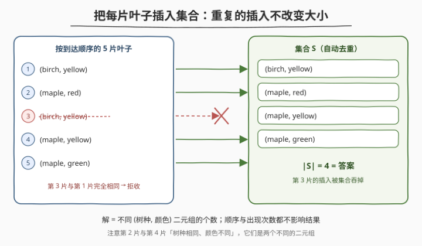
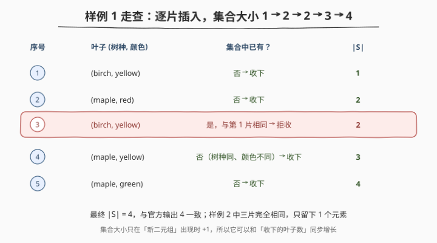

# Codeforces 44A Indian Summer 题解

## 1. 题目概述

- **题目链接**：https://codeforces.com/problemset/problem/44/A
- **比赛来源**：School Team Contest 2 (Winter Computer School 2010/11) · Problem A（UTC 2010-11-06）
- **难度**：900
- **标签**：实现、集合去重
- **评测类型**：普通
- **限制**：时间 2 s / 内存 256 MB

**题意**：Alyona 在森林里捡落叶做花束。她一共遇到 $n$ 片叶子，每片叶子由「树种」和「颜色」两个小写字母串刻画。她只做一件事：如果这片叶子的树种与颜色组合，和她已经收下的某片叶子完全相同，她就不捡；否则捡起来。求她最后收下的叶子数。

形式化地：把每片叶子看成二元组 $(\text{species},\text{color})$，求这 $n$ 个二元组中有多少个**不同**的值。

**约束**：

- $1 \le n \le 100$：规模极小，$O(n^2)$ 的两两比较（约 $10^4$ 次字符串比较）都能过；但这题本来就有 $O(n \log n)$ 的干净写法，没有理由写平方级。
- 树种与颜色都是长度不超过 $10$ 的小写字母串，且非空。因此「二元组」可以用一个空格拼成单个字符串，也可以直接用 `pair<string,string>` / 元组做键，**不会出现歧义**（名字内部没有空格或分隔符）。
- 只有一组数据，不存在 $t$ 组多测，也不需要读到 EOF。
- 答案的范围是 $[1, n]$，最小的可能值是 1（$n \ge 1$ 时至少收下第一片），最大是 $n$（全不相同）。

## 2. 示例与观察

官方样例（输入 / 输出原样，共 2 组）：

```text
输入：
5
birch yellow
maple red
birch yellow
maple yellow
maple green
输出：
4
```

```text
输入：
3
oak yellow
oak yellow
oak yellow
输出：
1
```

**样例 1 逐步演算**：

| 序号 | 叶子 | 是否已出现过 | 收下后集合大小 |
| --- | --- | --- | --- |
| 1 | (birch, yellow) | 否 | 1 |
| 2 | (maple, red) | 否 | 2 |
| 3 | (birch, yellow) | 是（与第 1 片相同） | 2 |
| 4 | (maple, yellow) | 否（树种虽同、颜色不同，仍算新叶子） | 3 |
| 5 | (maple, green) | 否 | 4 |

第 3 片被拒收，第 4 片虽然也是 maple，但颜色是 yellow 而不是 red，所以照收。最终 4 片，与输出一致。

**样例 2 逐步演算**：三片全是 $(\text{oak},\text{yellow})$，第 2、3 片与第 1 片完全相同被拒收，只剩 1 片。

**观察**：「收下哪些叶子、按什么顺序收」与最终数量无关——只要某个二元组在输入里出现过，它就会被第一片这样的叶子收下，且此后不再增加。因此答案就是**不同二元组的个数**，顺序、次数都不影响。

自造样例（标注「自造」，用于覆盖极值与边界）：

| 输入 | 输出 | 说明 |
| --- | --- | --- |
| `1`<br>`a b` | 1 | $n=1$ 的最小规模 |
| `2`<br>`a b`<br>`a b` | 1 | 两片完全一样 |
| `2`<br>`a b`<br>`b a` | 2 | 两个字段互换**不是**同一片叶子 |
| `3`<br>`zzzzzzzzzz a`<br>`a zzzzzzzzzz`<br>`zzzzzzzzzz a` | 2 | 名字取到长度上界 10 |
| `3`<br>`x x`<br>`x x`<br>`y y` | 2 | 树种与颜色可以是同一个字符串 |

## 3. 解题思路

### 3.1 朴素做法与瓶颈

最直白的模拟是：维护一个「已收下的叶子」列表，每来一片新叶子就把它与列表中所有叶子逐一比较，全部不同才加入。比较次数是 $0+1+\dots+(n-1) = n(n-1)/2 \le 4950$，每次比较两个不超过 $10$ 字符的串，在 $n \le 100$ 时毫无压力。

也就是说，这题的瓶颈**不是时间**，而是写法是否精确表达了「去重」这一语义。手动维护列表时，很容易写出「只和上一片比」「只比较颜色」之类的错误；而用集合（哈希表 / 平衡树）表达去重，语义与题面一一对应，几乎不可能写错。

### 3.2 核心观察：答案是不同二元组的个数



把「已收下的叶子」组织成一个集合 $S$，元素是二元组 $(\text{species},\text{color})$。对每片叶子执行 `S.insert(pair)`：

- 若 $S$ 中已有该二元组，插入不产生新元素，集合大小不变——正好对应「她不捡这片叶子」；
- 若没有，插入成功，集合大小加一——对应「她捡起这片叶子」。

$n$ 片叶子都处理完后，$|S|$ 就是答案。这里**不需要**判断「插入是否成功」再手动加一，标准库的集合本身就会自动去重。

### 3.3 算法流程

1. 读入 $n$；
2. 循环 $n$ 次，每次读入两个字符串 `species`、`color`，把 `(species, color)` 插入集合 `seen`；
3. 输出 `seen.size()`。

用 `std::set<pair<string,string>>` 是 $O(n\log n)$ 次比较；用 `std::unordered_set` 或 Python 的 `set` 期望 $O(n)$。$n\le100$ 时两者都在微秒级，选哪个只影响可读性。

### 3.4 样例走查（样例 1）



第 1 片 (birch, yellow) 插入成功，集合 $=\{(b,y)\}$；第 2 片 (maple, red) 插入成功，$=\{(b,y),(m,r)\}$；第 3 片 (birch, yellow) 已存在，集合不变；第 4 片 (maple, yellow) 是新二元组，$=\{(b,y),(m,r),(m,y)\}$；第 5 片 (maple, green) 也是新的，$=\{(b,y),(m,r),(m,y),(m,g)\}$。最终 $|S|=4$，与官方输出一致。

注意第 2 片与第 4 片「树种相同、颜色不同」，是**两个**不同的二元组；这正是本题唯一需要小心的语义点。

## 4. 正确性证明

**引理 1**：若第 $i$ 片叶子的二元组 $x_i$ 在此前（第 $1..i-1$ 片）已经出现过，则它不改变最终计数。

证明：设 $j<i$ 是满足 $x_j=x_i$ 的最早下标。由题意，Alyona 遇到第 $i$ 片叶子时，她已有的叶子中至少含有第 $j$ 片（叶子不会被丢弃），其树种与颜色与第 $i$ 片完全相同，故她拒收第 $i$ 片。集合的插入操作对已存在的键是幂等的，因此计数不变。∎

**引理 2**：若 $x_i$ 在此前从未出现，则它一定会被收下，并使计数增加 1。

证明：第 $i$ 片与所有已收下的叶子二元组都不同，按题面规则她必须收下这片叶子（题面只规定「完全相同才不捡」，没有其他拒收条件）。此时集合中不存在键 $x_i$，插入成功，大小加一。∎

**定理**：程序输出的 $|S|$ 等于 Alyona 最终收下的叶子数。

证明：由引理 1、引理 2，逐片处理后集合中的元素恰好是「被收下的叶子的二元组」，且每个不同二元组恰好被收下一次。因此收下的叶子数 $=|S|$，即程序的输出。∎

## 5. 复杂度分析

- 时间：读入 $O(n)$；每次插入在 `std::set` 上是 $O(\log n)$ 次键比较，每次比较两个长度 $\le 10$ 的串，故总时间 $O(n \log n \cdot L)$，其中 $L\le 10$。$n\le100$ 时约几百次比较，远小于 2 s 的时限（实测 $<1$ ms）。若用哈希集合，期望 $O(nL)$。
- 空间：集合中最多 $n$ 个二元组，每个串长度 $\le 10$，$O(nL)$ 字节，$n=100$ 时不到 $10$ KB，与 256 MB 的内存限制相比可以忽略。

## 6. 参考代码

### C++17

```cpp
#include <bits/stdc++.h>
using namespace std;

int main() {
    ios::sync_with_stdio(false);
    cin.tie(nullptr);
    int n;
    if (!(cin >> n)) return 0;
    set<pair<string, string>> seen;
    for (int i = 0; i < n; ++i) {
        string species, color;
        cin >> species >> color;
        seen.insert({species, color});
    }
    cout << seen.size() << '\n';
    return 0;
}
```

### Python3

```python
import sys


def main():
    data = sys.stdin.read().split()
    n = int(data[0])
    seen = set()
    for i in range(n):
        seen.add((data[1 + 2 * i], data[2 + 2 * i]))
    print(len(seen))


if __name__ == "__main__":
    main()
```

Python 版一次性把输入切成 token，用下标 $1+2i$、$2+2i$ 取第 $i$ 片叶子的两个字段，避免逐行处理时的空行问题。

## 7. 边界情况与易错点

1. **$n=1$**：答案恒为 1。循环只执行一次，集合大小为 1，无需特判。
2. **全部相同**：如样例 2，答案是 1 而不是 $n$。用集合自动去重即可，不要写成「计数加一」的朴素累加。
3. **树种相同、颜色不同**（或反之）：必须是两个不同的二元组。常见错误是只用颜色（或只用树种）做去重键。样例 1 的第 2、4 片就是这个陷阱。
4. **二元组键的拼接歧义**：若想把两个串拼成一个键，必须插入分隔符；本题名字只含小写字母且非空，用 `pair` 或元组做键最安全，不要依赖「长度信息」。
5. **输入格式**：树种与颜色之间用空格分隔，`cin >>`／`split()` 都会自动跳过任意空白（包括行尾多余空格与空行），不要用 `getline` 整行读再手动切分，否则容易被行尾空白坑到。
6. **答案类型**：$|S|\le100$，`int` 足够；`set::size()` 返回 `size_t`，直接输出即可，不要误用 `int` 强转后再做减法。

## 8. 验证记录

- **编译环境与命令**：本机无 GNU g++，用 `clang++ -std=c++17 -O2`（经 `codeforces/tools/include` 的 `bits/stdc++.h` 兼容头）编译；`python3 codeforces/tools/verify_solution.py codeforces/contests/0001-0100/44/A_夏日落叶花束.md`，结果 `CF44A: samples 2`、C++ 样例 2/2、Python 样例 2/2。
- **官方样例**：2 / 2 通过（含样例 1 的 4 与样例 2 的 1）。
- **额外测试**：随机生成 $n\in[1,100]$、树种取自 5 个名字、颜色取自 4 个名字的 220 组小数据，与独立暴力（顺序扫描已收列表做两两比较的 `brute.cpp`）逐组比对，220/220 一致，0 组不符。
- **最大约束性能**：$n=100$、名字长度 10 的极限数据，C++ 单次运行含进程启动约 3 ms、纯计算在微秒级，远低于 2 s。
- **复核状态**：`check.py` 0 失败；`check_samples.py --only 0001-0100/44` 中本篇 2 组样例逐字一致；SVG 均可被 `ElementTree` 解析。

## 相关题目与扩展

- [Codeforces 44B Cola](https://codeforces.com/problemset/problem/44/B)：同场另一道「数方案」题，用枚举 + 公式计数。
- [Codeforces 4C Registration system](https://codeforces.com/problemset/problem/4/C)：同样是「判断字符串是否出现过」，但重复时要输出新名字，需要用 `map` 记录次数。
- [Codeforces 855A Tom Riddle's Diary](https://codeforces.com/problemset/problem/855/A)：集合去重的直接变体（按出现顺序输出 YES/NO）。

**延伸思考**：

1. 若题面改成「颜色相同**或**树种相同就不捡」（即两个字段任一相同都视为重复），答案该怎么求？此时等价于对字段分别建集合求并——不再能用一个插入操作完成，需要先做并查集式的「相等关系闭包」。
2. 若 $n$ 上升到 $10^6$、名字长度 $10^5$，`std::set<pair<string,string>>` 的键比较会退化成逐字符比较，此时应把名字哈希成整数（双哈希防碰撞）再建集合，时间回到 $O(n\log n)$ 且比较 $O(1)$。
3. 若要求输出「被拒收的叶子下标集合」，只需在插入时检查 `insert` 的返回值 `second`：`second == false` 即表示该片被拒收。这是一个把计数题改成输出方案的常见手法。
