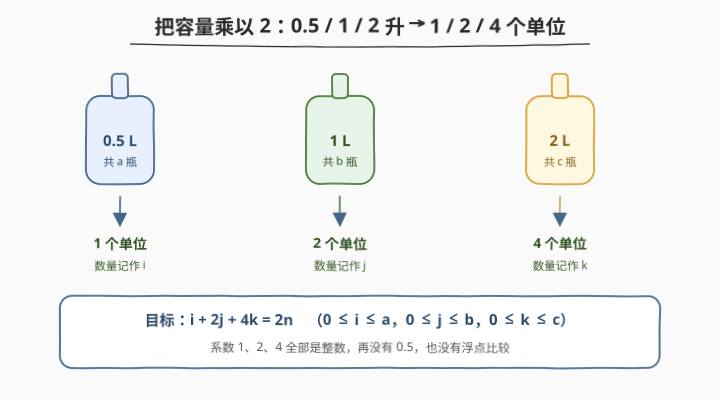
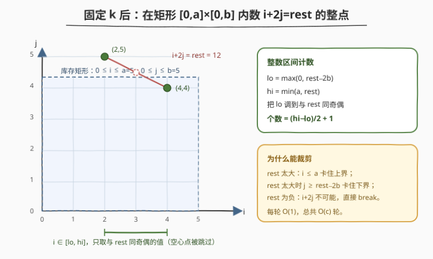
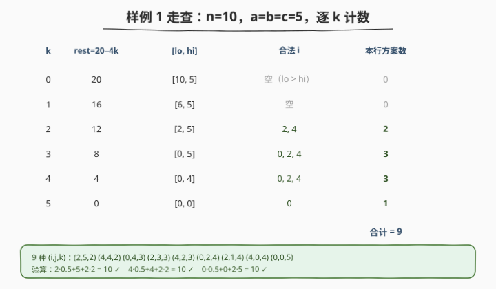

# Codeforces 44B Cola 题解

## 1. 题目概述

- **题目链接**：https://codeforces.com/problemset/problem/44/B
- **比赛来源**：School Team Contest 2 (Winter Computer School 2010/11) · Problem B（UTC 2010-11-06）
- **难度**：1500
- **标签**：实现、枚举、计数
- **评测类型**：普通
- **限制**：时间 2 s / 内存 256 MB

**题意**：商店里只有三种瓶装可乐：$0.5$ 升装 $a$ 瓶、$1$ 升装 $b$ 瓶、$2$ 升装 $c$ 瓶。同种瓶子不可区分，同种瓶子最多买光库存。要求恰好买到 $n$ 升，问有多少种买法（两种买法只要某一种瓶子的数量不同就算不同）。无解输出 0。

形式化地：求满足

$$0\le i\le a,\quad 0\le j\le b,\quad 0\le k\le c,\quad \tfrac{i}{2}+j+2k=n$$

的整数三元组 $(i,j,k)$ 的个数。

**约束**：

- $1\le n\le 10000$：只要把升数全部换成「半升」为单位，方程右边是 $2n\le20000$，量级很小。
- $0\le a,b,c\le 5000$：三重循环是 $(5\cdot10^3)^3=1.25\times10^{11}$ 次，2 s 内绝无可能；但 $c$ 只有 $5001$ 种取值，**枚举一维、另外一维用公式数**就是 $O(c)$。
- 输入只有一行四个整数，只有一组数据。
- 答案规模：例如 $n=10000,a=b=c=5000$ 时答案为 $6\,253\,751$，在 `int` 范围内，但中间量习惯性用 `long long` 更稳。

## 2. 示例与观察

官方样例（输入 / 输出原样，共 2 组）：

```text
输入：
10 5 5 5
输出：
9
```

```text
输入：
3 0 0 2
输出：
0
```

**样例 1 逐步演算**（把升数乘 2，方程变成 $i+2j+4k=20$，$a=b=c=5$）：

| $k$（2 升瓶数） | 剩余 $i+2j$ | 允许的 $i$ 区间 | 合法的 $i$ | 本行方案数 |
| --- | --- | --- | --- | --- |
| 0 | 20 | $[\max(0,20-10),\ \min(5,20)]=[10,5]$ | 空 | 0 |
| 1 | 16 | $[6,5]$ | 空 | 0 |
| 2 | 12 | $[2,5]$ | 2, 4 | 2 |
| 3 | 8 | $[0,5]$ | 0, 2, 4 | 3 |
| 4 | 4 | $[0,4]$ | 0, 2, 4 | 3 |
| 5 | 0 | $[0,0]$ | 0 | 1 |

合计 $0+0+2+3+3+1=9$，与输出一致。这 9 种方案依次是（$i,j,k$）：$(2,5,2),(4,4,2),(0,4,3),(2,3,3),(4,2,3),(0,2,4),(2,1,4),(4,0,4),(0,0,5)$。

**样例 2**：$a=b=0$，只能用 2 升瓶，而 $c=2$ 最多给 4 升，凑不出 3 升，答案 0。

**观察**：对固定的 $k$，方程退化为一条直线 $i+2j=\text{rest}$ 在矩形 $[0,a]\times[0,b]$ 内的整点计数。因为 $j$ 的系数是 2，所以 $i$ 必须与 rest 同奇偶——**每两个相邻的 $i$ 才有一个合法**，于是计数就是对一段区间取一半。

自造样例（标注「自造」）：

| 输入 | 输出 | 说明 |
| --- | --- | --- |
| `1 0 0 0` | 0 | 库存全空 |
| `1 2 0 0` | 1 | 只用半升瓶：$i=2$ |
| `5 0 0 3` | 0 | 只用 2 升瓶凑 5 升，不可能 |
| `5 0 0 0` | 0 | 什么都不买也是 0 升 |
| `5000 5000 5000 5000` | 4691251 | 中等规模，检查区间计数的两侧裁剪 |

## 3. 解题思路

### 3.1 朴素做法与瓶颈

最直观的是三重循环枚举 $(i,j,k)$ 并检查等式：$5001^3\approx1.25\times10^{11}$ 次判断，即使每次只要 1 ns 也要几分钟，2 s 时限下不可行。

也可以写背包：$f[s]$ 表示凑出 $s$ 个半升的方案数，但方案数要按「瓶数上限」统计，三维背包是 $O(abc)$，同样不可行。

### 3.2 核心观察：把 0.5 升放大成整数



$0.5$ 升是唯一的分数，所以**把单位和目标同时乘以 2**：$0.5$ 升变成 $1$ 个单位，$1$ 升变成 $2$ 个单位，$2$ 升变成 $4$ 个单位，$n$ 升变成 $2n$ 个单位。方程变为

$$i+2j+4k=2n,\qquad 0\le i\le a,\ 0\le j\le b,\ 0\le k\le c .$$

这样既避免浮点（$0.5$ 在二进制里虽可精确表示，但用浮点做等值判断从来不是好习惯），又让「$i$ 与 rest 同奇偶」这条整除条件显式化。

### 3.3 算法流程：枚举 $k$，一维公式计数



对每个 $k\in[0,c]$：

1. $\text{rest}=2n-4k$。若 $\text{rest}<0$，由于 $k$ 递增、rest 单调下降，**后面的 $k$ 只会更负，直接 `break`**。
2. 剩下的约束是 $i+2j=\text{rest}$，$0\le i\le a$，$0\le j\le b$。由 $j=(\text{rest}-i)/2$ 得
   $$i\equiv \text{rest}\pmod 2,\qquad \text{rest}-2b\le i\le \text{rest},$$
   合并 $i$ 的上下界：
   $$\text{lo}=\max(0,\ \text{rest}-2b),\qquad \text{hi}=\min(a,\ \text{rest}).$$
3. 若 $\text{lo}>\text{hi}$ 则本行贡献 0；否则把 `lo` 上调到与 rest 同奇偶的第一个值，本行贡献为 $\lfloor(\text{hi}-\text{lo})/2\rfloor+1$（区间内同奇偶的整数个数）。
4. 累加即为答案。

枚举 $k$ 是 $O(c)$ 次，每次常数时间，总时间 $O(c)\le 5001$ 次迭代。

### 3.4 样例走查（样例 1）



$n=10$ 时 $2n=20$，$a=b=c=5$。

- $k=0$：rest $=20$，$i$ 需 $\ge 20-2b=10$ 且 $\le a=5$，区间为空。
- $k=1$：rest $=16$，$i\in[6,5]$，空。
- $k=2$：rest $=12$，$i\in[2,5]$ 中偶数 $2,4$，贡献 2。
- $k=3$：rest $=8$，$i\in[0,5]$ 中偶数 $0,2,4$，贡献 3。
- $k=4$：rest $=4$，$i\in[0,4]$ 中偶数 $0,2,4$，贡献 3。
- $k=5$：rest $=0$，只有 $i=0$，贡献 1。

总计 9。注意 $k=0,1$ 时「$\text{rest}$ 很大但库存 $a$ 装不下」，正是上界 $\min(a,\text{rest})$ 与下界 $\text{rest}-2b$ 一起把区间裁空的情形。

## 4. 正确性证明

**引理 1**：方程 $\frac i2+j+2k=n$ 与 $i+2j+4k=2n$ 在整数上等价。

证明：两边同乘 2 即可；反过来 $i+2j+4k=2n$ 两边除以 2 得原式。乘以非零常数不改变整数解的集合。∎

**引理 2**：固定 $k$ 后，合法 $i$ 的集合恰为
$$S_k=\{i\in\mathbb{Z}:\ \text{lo}\le i\le \text{hi},\ i\equiv \text{rest}\ (\mathrm{mod}\ 2)\},\quad \text{rest}=2n-4k,$$
且 $\text{lo},\text{hi}$ 如 3.3 所定义；每个这样的 $i$ 唯一确定一个合法的 $j$。

证明：由引理 1，固定 $k$ 后需 $i+2j=\text{rest}$，即 $j=(\text{rest}-i)/2$。它必须是整数（$i\equiv$ rest mod 2）、非负（$i\le\text{rest}$）、不超过 $b$（$j\le b\iff i\ge \text{rest}-2b$）；同时 $i\ge0$、$i\le a$。把五条不等式合并即得 $[\text{lo},\text{hi}]$ 与奇偶条件。$j$ 由 $i$ 唯一确定，故合法 $i$ 与合法 $(i,j)$ 一一对应。∎

**引理 3**：整数区间 $[\text{lo},\text{hi}]$ 中与 $r$ 同奇偶的整数个数为 $\lfloor(\text{hi}-\text{lo})/2\rfloor+1$（先把 lo 调成与 $r$ 同奇偶）。

证明：把 lo 上调至同奇偶后，合法值形如 $\text{lo},\text{lo}+2,\dots,\text{lo}+2m$，其中 $m=\lfloor(\text{hi}-\text{lo})/2\rfloor$，共 $m+1$ 个。∎

**定理**：程序输出的和 $\sum_{k=0}^{c} |S_k|$ 等于合法三元组数。

证明：任意合法三元组 $(i,j,k)$ 的 $k$ 必在 $[0,c]$ 内且满足 $4k\le 2n$（否则 rest 为负、$i+2j=$ rest 不可能），故它被唯一的一个 $k$ 统计；反之每个被统计的 $(k,i)$ 通过引理 2 给出合法的 $j$，从而给出合法三元组。于是求和恰好把每个合法三元组数了一次。∎

## 5. 复杂度分析

- 时间：$k$ 至多枚举到 $\min(c,\lfloor n/2\rfloor)\le 5000$，每轮 $O(1)$ 次整数运算，总时间 $O(\min(c,n))$，实测最大数据 $<1$ ms，与 2 s 的时限有三个数量级以上的余量。
- 空间：只用了若干个整型变量，$O(1)$，与 256 MB 限制无关。
- 答案上界：$n=10000,a=b=c=5000$ 时为 $6\,253\,751$，`long long` 绝不会溢出；即使用 `int` 也够，但读入的 $n$ 乘 2、乘 4 时用 64 位更保险。

## 6. 参考代码

### C++17

```cpp
#include <bits/stdc++.h>
using namespace std;

int main() {
    long long n, a, b, c;
    if (!(cin >> n >> a >> b >> c)) return 0;
    long long ways = 0;
    // 以半升为单位：i + 2j + 4k = 2n
    for (long long k = 0; k <= c; ++k) {
        long long rest = 2 * n - 4 * k;
        if (rest < 0) break;
        long long lo = max(0LL, rest - 2 * b);
        long long hi = min(a, rest);
        if (lo > hi) continue;
        if ((lo & 1) != (rest & 1)) ++lo;  // i 与 rest 同奇偶
        if (lo <= hi) ways += (hi - lo) / 2 + 1;
    }
    cout << ways << '\n';
    return 0;
}
```

### Python3

```python
import sys


def main():
    n, a, b, c = map(int, sys.stdin.read().split())
    ways = 0
    for k in range(c + 1):
        rest = 2 * n - 4 * k
        if rest < 0:
            break
        lo = max(0, rest - 2 * b)
        hi = min(a, rest)
        if lo > hi:
            continue
        if (lo & 1) != (rest & 1):
            lo += 1
        if lo <= hi:
            ways += (hi - lo) // 2 + 1
    print(ways)


if __name__ == "__main__":
    main()
```

## 7. 边界情况与易错点

1. **$c$ 很大而 $n$ 很小**：例如 $n=1,c=5000$。若只写 `for k in 0..c` 而不 `break`，rest 会变成大负数，`lo=max(0,rest-2b)` 仍是 0、`hi=min(a,rest)=rest<0`，此时 `lo>hi` 会被 `continue` 掉，答案碰巧仍然正确——但这是**侥幸**，一旦把 `hi` 的写法改成别的形式就会错。正确做法是利用 rest 单调递减直接 `break`。
2. **`a=0` 或 `b=0`**：`lo = max(0, rest-2b)` 在 $b=0$ 时变为 $rest$，与 $hi=\min(a,rest)$ 一起把区间压成单点（当 $a\ge rest$）；若 $a=0$ 则 $hi=0$，只有 rest 为偶数时才有 1 种方案。必须让 $a,b$ 参与区间计算，不能默认它们足够大。
3. **奇偶性**：$j=(\text{rest}-i)/2$ 要求 $i$ 与 rest 同奇偶。漏掉这一步会把非法 $i$ 也数进去，答案偏大（样例 1 会变成 12 而不是 9）。
4. **`lo` 上调后的越界**：把 `lo` 调到同奇偶后可能 $>hi$（区间里只有一个数与 rest 异奇偶），必须再判一次 `lo <= hi` 才能累加，否则会多算 1。
5. **整数类型**：$2n$ 最大 $20000$，$4k$ 最大 $20000$，这些都在 `int` 范围内；但把 `rest - 2*b` 写成 `int` 时若 $b$ 取到 $5000$ 也不会溢出（最小约 $-30000$）。真正需要小心的是最终答案累加与乘法：本程序中无乘法，仍统一用 `long long` 以免在别的写法（如直接算 $a\cdot b$）里溢出。
6. **`0.5` 升不能用量化单位替代**：必须乘 2 变成整数，不能写 `0.5*i + j + 2*k == n` 做浮点比较。

## 8. 验证记录

- **编译环境与命令**：`clang++ -std=c++17 -O2`（经 `codeforces/tools/include` 的 `bits/stdc++.h` 兼容头）；`python3 codeforces/tools/verify_solution.py codeforces/contests/0001-0100/44/B_可乐购买方案.md`，输出 `CF44B: samples 2`、C++ 2/2、Python 2/2。
- **官方样例**：2 / 2 通过（9 与 0）。
- **额外测试**：随机生成 $n\in[1,10]$、$a,b,c\in[0,6]$ 的 240 组数据，与独立暴力（三重循环直接检查 $i+2j+4k=2n$ 的 `brute.cpp`）逐组比对，240/240 一致。
- **最大约束性能**：$n=10000,a=b=c=5000$，答案 $6\,253\,751$，C++ 运行含进程启动约 2~3 ms、纯计算在微秒级，远低于 2 s。
- **复核状态**：`check.py` 0 失败；`check_samples.py` 中本篇 2 组样例逐字一致；3 幅 SVG 均通过 `ElementTree` 解析。

## 相关题目与扩展

- [Codeforces 44A Indian Summer](https://codeforces.com/problemset/problem/44/A)：同场 A 题，集合去重。
- [Codeforces 44E Anfisa the Monkey](https://codeforces.com/problemset/problem/44/E)：同场 E 题，同样是「枚举一维 + 可行性判定」的思路。
- [Codeforces 9C Hexadecimal's Numbers](https://codeforces.com/problemset/problem/9/C)：数满足某种数字限制的整数个数，同样是「按位枚举 + 公式计数」。

**延伸思考**：

1. 若瓶子还有 $3$ 升、$4$ 升两种（容量都变成整数），枚举维度会变成四维。此时应改为「固定其中两种、用公式数另外两种」，或者写生成函数 / 完全背包统计方案数，复杂度约为 $O(\text{容量}\cdot\text{种类})$。
2. 若要求输出所有方案（而不是计数），方案数可达 $6\times10^6$ 量级，输出本身就会超时——这说明本题「只数不输出」是刻意的设计；若数据变小，可以按同样的 $k$ 顺序遍历，内层逐个输出 $i$。
3. 把约束放宽到 $n\le10^9$、$a,b,c\le10^9$ 时，$O(c)$ 也不行了。此时可把计数写成 $\sum_k f(k)$ 的分段形式：$f(k)$ 是 $k$ 的分段线性函数（区间被 $a$、$b$、$2n$ 三处裁剪分成常数段），用等差数列求和即可做到 $O(1)$。
