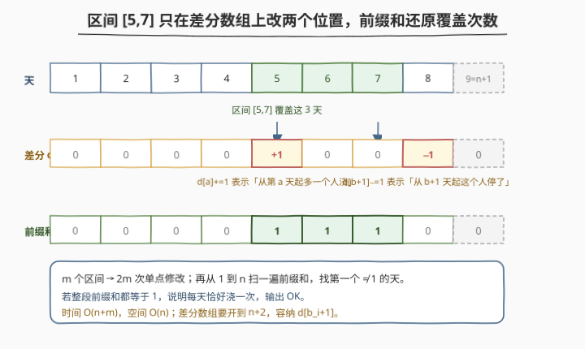
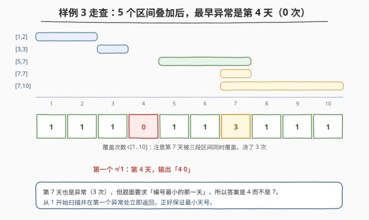

# Codeforces 44C Holidays 题解

## 1. 题目概述

- **题目链接**：https://codeforces.com/problemset/problem/44/C
- **比赛来源**：Codeforces Beta Round 44（School Team Contest 2, Winter Computer School 2010/11）· Problem C（2010-11-06）
- **难度**：1300
- **标签**：实现、差分数组、前缀和
- **评测类型**：普通
- **限制**：时间 2 s / 内存 256 MB

**题意**：假期共 $n$ 天（编号 $1..n$），有 $m$ 个值班人，第 $i$ 个人负责在 $[a_i,b_i]$ 这些天里每天浇一次花。日程按顺序给出，并且满足 $b_i\le a_{i+1}$（相邻两段最多在一个端点上重合）。正常情况下每天恰好被浇一次水。求**编号最小**的那一天，使那天浇了 $0$ 次或超过 $1$ 次；如果整份日程都没问题，输出 `OK`。否则输出「天号 浇水次数」。

**约束**：

- $1\le n,m\le100$：规模极小，$O(nm)$ 的逐段逐天标记也能过（最多 $10^4$ 次操作）。但差分数组的写法同样简单，且能把复杂度降到 $O(n+m)$，是这类「区间叠加后找异常点」的标准手法。
- $1\le a_i\le b_i\le n$：区间非空，且不会越界；注意 $b_i=n$ 时差分数组要开到 $n+2$，因为要在 $b_i+1=n+1$ 处做减法。
- 条件 $b_i\le a_{i+1}$：它保证两段区间不会出现「长度 $\ge2$ 的重叠」，所以理论上每天的浇水次数只可能是 $0,1,2$；但**我们的做法完全不依赖这条性质**，即使给出乱序重叠的区间也能算对。
- 题面英文把顺序条件写成「for all $i$ from $1$ to $n-1$」，按上下文应为 $1$ 到 $m-1$（区间个数是 $m$），这是原题的一处小笔误；不影响解法。
- 只有一组数据，无多测。

## 2. 示例与观察

官方样例（输入 / 输出原样，共 3 组）：

```text
输入：
10 5
1 2
3 3
4 6
7 7
8 10
输出：
OK
```

```text
输入：
10 5
1 2
2 3
4 5
7 8
9 10
输出：
2 2
```

```text
输入：
10 5
1 2
3 3
5 7
7 7
7 10
输出：
4 0
```

**样例 1 逐步演算**：区间是 $[1,2],[3,3],[4,6],[7,7],[8,10]$。逐天统计：1、2 各 1 次；3 是 1 次；4、5、6 各 1 次；7 是 1 次；8、9、10 各 1 次。每天恰好 1 次，输出 `OK`。

**样例 2 逐步演算**：区间是 $[1,2],[2,3],[4,5],[7,8],[9,10]$。第 1 天 1 次；第 2 天同时被 $[1,2]$ 与 $[2,3]$ 覆盖，**2 次**——这就是最早出问题的日子，输出 `2 2`。后面第 6 天其实也没浇水（0 次），但题面明确要求输出**编号最小**的那一天。

**样例 3 逐步演算**：

| 天 | 1 | 2 | 3 | 4 | 5 | 6 | 7 | 8 | 9 | 10 |
| --- | --- | --- | --- | --- | --- | --- | --- | --- | --- | --- |
| 浇水次数 | 1 | 1 | 1 | **0** | 1 | 1 | 3 | 1 | 1 | 1 |

第 4 天没有人负责（$[3,3]$ 与 $[5,7]$ 之间空了一天），第 7 天被三段区间同时覆盖浇了 3 次。最早异常是第 4 天，输出 `4 0`，与官方输出一致。

**观察**：答案只取决于「每天被覆盖多少次」这一个数组 $c_1..c_n$；有了它，从左往右扫第一个 $c_d\ne1$ 的天即可。于是问题变成：给定 $m$ 个区间，如何快速求出每个点的覆盖次数。

自造样例（标注「自造」）：

| 输入 | 输出 | 说明 |
| --- | --- | --- |
| `1 1`<br>`1 1` | OK | 最小规模，唯一一天恰好一次 |
| `5 1`<br>`3 3` | `1 0` | 第 1 天就没人浇 |
| `5 2`<br>`2 2`<br>`2 2` | `1 0` | 两段完全重合在 2 号，第 2 天被浇 2 次，但更早的第 1 天是 0 次 |
| `5 2`<br>`1 2`<br>`2 5` | `2 2` | 相邻两段在端点 2 处重叠 |
| `100 1`<br>`1 100` | OK | $n$ 取上界，全部覆盖 |

## 3. 解题思路

### 3.1 朴素做法与瓶颈

最直接：开一个长度为 $n$ 的数组 `cnt`，对每个区间 $[a_i,b_i]$ 把 `cnt[a_i..b_i]` 逐个加一，最后从左往右找第一个不等于 1 的位置。

复杂度 $O\!\left(\sum (b_i-a_i+1)\right)\le O(nm)=10^4$，在 $n,m\le100$ 时轻松通过。它的瓶颈只在大规模数据上才显现：若 $n,m$ 都到 $10^5$，$\sum$ 长度可达 $10^{10}$，必须换写法。本题数据虽小，但「区间加、单点查询、从左往右找第一个异常」的组合正是差分数组的用武之地，写出来同样是十行代码。

### 3.2 核心观察：区间加 = 差分数组上两个单点修改



设 $d_1..d_{n+1}$ 为差分数组，初始全 0。对区间 $[a_i,b_i]$ 执行

$$d_{a_i}\mathrel{+}=1,\qquad d_{b_i+1}\mathrel{-}=1 .$$

那么覆盖次数就是差分数组的前缀和：

$$c_d=\sum_{t=1}^{d} d_t .$$

直观理解：$+1$ 是「从这里开始多一个人浇水」，$-1$ 是「从 $b_i+1$ 这天起这个人不再浇水」。每个区间只贡献两个端点，于是 $m$ 个区间只需 $2m$ 次修改，再用一次前缀和还原全部 $c_d$。

### 3.3 算法流程

1. 读入 $n,m$，开 `diff[1..n+1]` 全 0；
2. 对每个区间 $(a_i,b_i)$：`diff[a_i] += 1`，`diff[b_i+1] -= 1`；
3. `cur = 0`，$d$ 从 1 到 $n$：`cur += diff[d]`；若 `cur != 1`，输出 `d` 与 `cur` 并**立即结束**；
4. 若循环正常结束，说明每天恰好一次，输出 `OK`。

第 3 步一旦发现异常就返回，所以输出的天号一定是**最小**的——这正好对应题面的要求。

### 3.4 样例走查（样例 3）



区间 $[1,2],[3,3],[5,7],[7,7],[7,10]$ 在差分数组上落下的修改：

- $[1,2]$：$d_1{+}1$，$d_3{-}1$；
- $[3,3]$：$d_3{+}1$，$d_4{-}1$；
- $[5,7]$：$d_5{+}1$，$d_8{-}1$；
- $[7,7]$：$d_7{+}1$，$d_8{-}1$；
- $[7,10]$：$d_7{+}1$，$d_{11}{-}1$。

合并后 $d_1=1,d_3=0,d_4=-1,d_5=1,d_7=2,d_8=-2,d_{11}=-1$。前缀和依次是

$$c=(1,1,1,0,1,1,3,1,1,1),$$

第 4 天为 0，是从左往右第一个不等于 1 的位置，输出 `4 0`。

## 4. 正确性证明

**引理 1**：对任意 $1\le d\le n$，差分数组的前缀和 $\sum_{t=1}^{d} d_t$ 等于覆盖第 $d$ 天的区间个数。

证明：交换求和顺序，
$$\sum_{t=1}^{d} d_t=\sum_{i=1}^{m}\left([a_i\le d]-[b_i+1\le d]\right)=\sum_{i=1}^{m}[a_i\le d\le b_i],$$
其中 $[P]$ 为示性函数。每个区间 $i$ 对第 $d$ 天的贡献恰为 1 当且仅当 $a_i\le d\le b_i$，否分为 0。∎

**引理 2**：若存在某天浇水次数不等于 1，则程序输出的天号是所有这样的天中编号最小的一个。

证明：第 3 步按 $d=1,2,\dots,n$ 的升序累加，一旦 `cur != 1` 立即输出并结束，因此输出的 $d$ 是第一个满足条件的天号；由于天号与自然序一致，它就是编号最小者。∎

**定理**：程序的输出与题面要求一致。

证明：若每天恰好被覆盖一次，循环走完全程没有触发输出，程序输出 `OK`，符合要求。否则由引理 1 前缀和就是真实的浇水次数 $c_d$，由引理 2 输出的是最小的异常天号与当天的真实次数，格式为「天号 次数」，也符合要求。∎

## 5. 复杂度分析

- 时间：读入与差分修改 $O(m)$，前缀和扫描 $O(n)$，总计 $O(n+m)\le 200$ 次基本运算，实测 $<1$ ms，相对 2 s 的时限有四个数量级的余量。
- 空间：差分数组长度 $n+2$，$O(n)$ 个 `int`，$n\le100$ 时约 400 字节，与 256 MB 限制相差极远。
- 注意 `diff` 开 $n+2$ 而不是 $n+1$：当 $b_i=n$ 时要写 `diff[n+1]`，虽然该位置不会被前缀和用到（前缀和只扫到 $n$），但越界写入会破坏内存。

## 6. 参考代码

### C++17

```cpp
#include <bits/stdc++.h>
using namespace std;

int main() {
    ios::sync_with_stdio(false);
    cin.tie(nullptr);
    int n, m;
    if (!(cin >> n >> m)) return 0;
    vector<int> diff(n + 2, 0);
    for (int i = 0; i < m; ++i) {
        int l, r;
        cin >> l >> r;
        ++diff[l];
        --diff[r + 1];
    }
    int cur = 0;
    for (int day = 1; day <= n; ++day) {
        cur += diff[day];
        if (cur != 1) {
            cout << day << ' ' << cur << '\n';
            return 0;
        }
    }
    cout << "OK\n";
    return 0;
}
```

### Python3

```python
import sys


def main():
    data = sys.stdin.read().split()
    n, m = int(data[0]), int(data[1])
    diff = [0] * (n + 2)
    pos = 2
    for _ in range(m):
        l, r = int(data[pos]), int(data[pos + 1])
        pos += 2
        diff[l] += 1
        diff[r + 1] -= 1
    cur = 0
    for day in range(1, n + 1):
        cur += diff[day]
        if cur != 1:
            print(day, cur)
            return
    print("OK")


if __name__ == "__main__":
    main()
```

## 7. 边界情况与易错点

1. **$b_i=n$ 的越界**：差分数组必须开到 $n+2$，并在 `b_i+1` 处减一。只开 $n+1$ 时 `diff[n+1]` 越界，属于典型的「差一错误」。
2. **第一天就没人浇**：如 `5 1 / 3 3`，$c_1=0$，应输出 `1 0`。程序从 $d=1$ 开始扫，能自然处理，不需要特判。
3. **覆盖次数大于 1**：相邻区间在端点重合（$b_i=a_{i+1}$）时该天被浇两次，如样例 2 的第 2 天。此时输出的是「天号 2」而不是「天号 2 的次数减一」，次数要如实输出。
4. **覆盖次数为 3 或更多**：题面保证 $b_i\le a_{i+1}$ 时最多 2 次，但样例 3 第 7 天出现了 3 次（$[5,7]$ 与 $[7,7]$、$[7,10]$ 三段同时覆盖端点）。这说明「保证」只在相邻两段之间成立，本题算法对任意重叠都正确，不要写「次数只可能是 0/1/2」的特判。
5. **全 OK 的判定**：只有循环完整结束才输出 `OK`；不要写成「找到第一个异常后继续扫」，那样会输出最后一个异常天。
6. **多测清空**：本题只有一组数据。若把代码改成多测，务必每组重新初始化差分数组，尤其不要复用上一组残留的 `diff[n+1]`。

## 8. 验证记录

- **编译环境与命令**：`clang++ -std=c++17 -O2`（经 `codeforces/tools/include` 的 `bits/stdc++.h` 兼容头）；`python3 codeforces/tools/verify_solution.py codeforces/contests/0001-0100/44/C_假期浇花日程.md`，输出 `CF44C: samples 3`、C++ 3/3、Python 3/3。
- **官方样例**：3 / 3 通过（`OK`、`2 2`、`4 0`）。
- **额外测试**：随机生成 $n\in[1,12]$、$m\in[1,6]$、满足 $b_i\le a_{i+1}$ 的 240 组日程，与独立暴力（逐区间逐天 `++cnt[d]` 再线性扫描的 `brute.cpp`）逐组比对，240/240 一致。
- **最大约束性能**：$n=m=100$ 且 $[i,i]$ 的极限数据，C++ 运行含进程启动约 3 ms、纯计算在微秒级，远低于 2 s。
- **复核状态**：`check.py` 0 失败；`check_samples.py` 中本篇 3 组样例逐字一致；2 幅 SVG 均通过 `ElementTree` 解析。

## 相关题目与扩展

- [Codeforces 44A Indian Summer](https://codeforces.com/problemset/problem/44/A)：同场 A 题。
- [Codeforces 816B Karen and Coffee](https://codeforces.com/problemset/problem/816/B)：区间覆盖计数 + 前缀和判「是否达到 $k$ 次」，是本题的直接升级版（$n\le2\cdot10^5$）。
- [Codeforces 295A Greg and Array](https://codeforces.com/problemset/problem/295/A)：对操作本身再做一次差分，属于「差分的差分」，处理 $m$ 次区间加后统一回答。

**延伸思考**：

1. 若要求输出**所有**异常天（而不是最小的一天），只需把「输出后 `return`」改成「收集到列表」，复杂度不变。
2. 若区间数是 $10^5$ 且要求支持在线修改（随时增删区间）与查询最早异常天，差分数组就力不从心了。可以维护「异常天集合」：每次区间加只影响端点，用 `std::set` 记录当前 $c_d\ne1$ 的下标，取 `*begin()` 即答案，单次操作 $O(\log n)$。
3. 若把「每天恰好 1 次」改成「每天至少 $k$ 次」，前缀和后判 $c_d<k$ 即可；若改成「每天在 $[L_d,R_d]$ 区间内」，则需要线段树维护区间最小值/最大值，把「找第一个不满足的位置」变成线段树上的二分。
