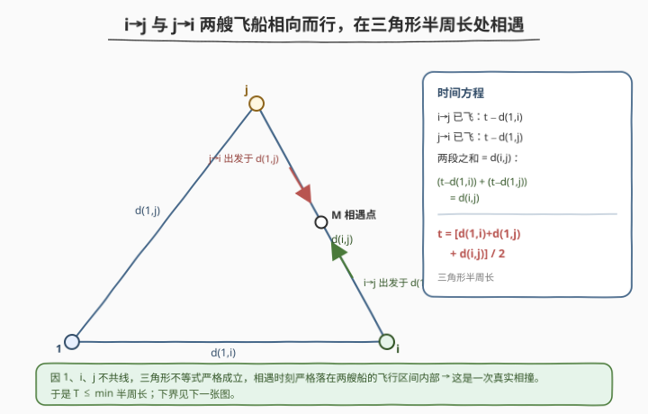
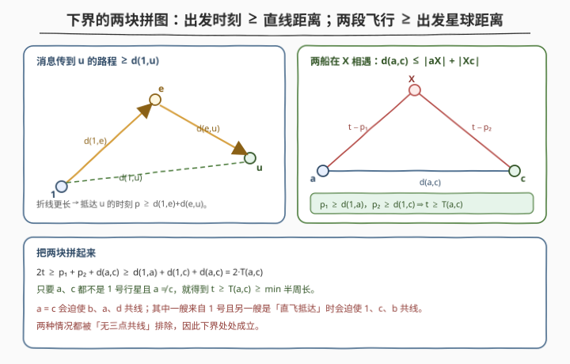
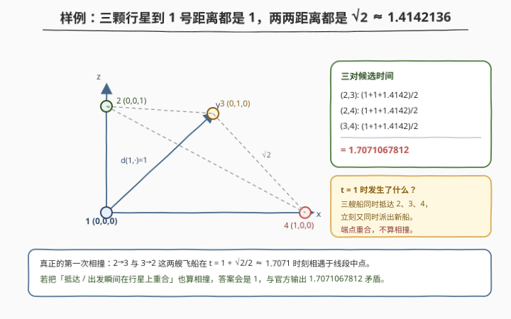

# Codeforces 44D Hyperdrive 题解

## 1. 题目概述

- **题目链接**：https://codeforces.com/problemset/problem/44/D
- **比赛来源**：Codeforces Beta Round 44（School Team Contest 2, Winter Computer School 2010/11）· Problem D（2010-11-06）
- **难度**：1800
- **标签**：数学、计算几何、三角形不等式
- **评测类型**：普通（浮点答案，绝对或相对误差不超过 $10^{-6}$）
- **限制**：时间 2 s / 内存 256 MB

**题意**：三维欧氏空间里有 $n$ 颗行星（互不重合，且**没有三点共线**）。$t=0$ 时，从 1 号行星同时派出 $n-1$ 艘飞船，分别飞往其余每颗行星；所有飞船速度相同、都走直线（速度取 1，所以「距离 = 飞行时间」，单位是 hyperyear）。每当一艘飞船抵达行星 $v$（它来自行星 $u$），当地居民会立刻把它拆掉，造出 $n-2$ 艘同样的飞船，送往除 $u,v$ 以外的所有行星，并立即出发。造飞船的时间忽略不计。若两艘**正在飞行**的飞船在同一时刻出现在同一点，就会爆炸。求从首次发射那一刻起，银河系还能维持多久（即最早相撞的时间）。

**约束**：

- $3\le n\le 5000$：枚举所有**行星对**是 $\binom{n}{2}\approx1.25\times10^7$，$O(n^2)$ 在 2 s 内可行（实测最坏 46 ms）；$O(n^3)$ 是 $1.25\times10^{11}$，不可行。
- 坐标 $|x|,|y|,|z|\le10^4$：两点距离最大约 $3.4\times10^4$，双精度足够；平方差最大 $(2\cdot10^4)^2=4\times10^8$，三个相加 $1.2\times10^9$，用 `int` 已经在边缘，**必须先转 `double` 再平方**。
- 「无三点共线」这个条件不是装饰：正确性证明里两处用它排除退化情形（见第 4 节）。「两点不重合」保证所有距离严格为正。
- 时间之和可以很大（飞船可以无限地飞来飞去），所以「模拟所有飞船」是不可行的，必须找到闭式答案。
- 答案精确到 $10^{-6}$ 即可，输出 10 位小数。

## 2. 示例与观察

官方样例（输入 / 输出原样，共 1 组）：

```text
输入：
4
0 0 0
0 0 1
0 1 0
1 0 0
输出：
1.7071067812
```

**演算**：1 号行星在原点，另外三颗分别在三条坐标轴上、到原点距离都是 1。于是

- $d(1,i)=1$（$i=2,3,4$）；
- $d(2,3)=d(2,4)=d(3,4)=\sqrt{1^2+1^2}=\sqrt2\approx1.41421356$。

$t=0$ 时三艘飞船分别飞向 2、3、4 号，在 $t=1$ 同时抵达。抵达后，2 号行星向 3、4 各派一艘，3 号向 2、4 各派一艘，4 号向 2、3 各派一艘。考察 **2 号飞往 3 号**与 **3 号飞往 2 号**这两艘：它们分别在 $t=1$、$t=1$ 出发，沿同一线段相向而行，距离为 $\sqrt2$，速度各为 1，因此相对速度 2，在

$$t=1+\frac{\sqrt2}{2}=1+\frac{1.41421356\ldots}{2}=1.70710678\ldots$$

相遇。这与输出 `1.7071067812` 完全一致。

**为什么不是 $t=1$？** 在 $t=1$ 时，三艘飞船同时抵达三颗行星，同时还立刻有飞船从这三颗行星出发；「抵达瞬间」与「出发瞬间」在同一颗行星上重合。样例输出说明这种**端点重合不算相撞**——否则答案会是最小的 $d(1,i)=1$，与官方答案矛盾。这一点在第 3 节会正式作为模型约定。

自造样例（标注「自造」，答案由本题参考程序给出）：

| 输入 | 输出 | 说明 |
| --- | --- | --- |
| `3`<br>`0 0 0`<br>`3 0 0`<br>`0 4 0` | `6.0000000000` | 3-4-5 直角三角形，$(3+4+5)/2=6$ |
| `3`<br>`0 0 0`<br>`1 0 0`<br>`2 0 1` | `2.3251407699` | 三边 $1,\sqrt5,\sqrt2$，$(1+\sqrt5+\sqrt2)/2$ |
| `4`<br>`0 0 0`<br>`0 0 1000`<br>`1 0 0`<br>`0 1 0` | `1.7071067812` | 一对近行星（3、4 号）决定答案，远处行星不影响 |

第三个例子说明答案取的是**所有行星对的最小值**：$(3,4)$ 这对很近的行星给出 $1.7071$，而它们各自与 2 号行星组成的三角形周长都约 2000，贡献远大于它。

## 3. 解题思路

### 3.1 朴素做法与瓶颈

最直接的做法是模拟整个发射过程：维护一个「飞行中的飞船」列表，每艘飞船记录了起点、终点与出发时刻，时间推进一小步就检查是否有两艘飞船位置相同。

问题是飞船数量会爆炸：初始 $n-1$ 艘，每艘抵达后生成 $n-2$ 艘，第 $k$ 层有 $(n-1)(n-2)^k$ 艘。$n=5000$ 时第二层就有约 $2.5\times10^7$ 艘，第三层 $1.25\times10^{11}$ 艘。而且过程永不停止（飞船可以在行星之间无限往返），连「模拟到多久」都无法确定。

所以必须换思路：不模拟过程，而是**直接刻画最早相撞的那一对飞船**。

### 3.2 核心观察：一对行星给出一个候选时间



任取两颗**非 1 号**的行星 $i,j$。看这两艘飞船：

- 飞船 $A$：$t=0$ 从 1 号飞向 $i$，在 $t=d(1,i)$ 抵达 $i$，随即被拆掉并派出 $i\to j$ 的一艘，出发时刻 $d(1,i)$；
- 飞船 $B$：同理，$j\to i$ 的那艘在 $d(1,j)$ 出发。

两艘船沿同一条线段 $ij$ 相向而行，速度都是 1。设它们在时刻 $t$ 相遇，则飞船 $A$ 从 $i$ 出发走了 $t-d(1,i)$，飞船 $B$ 从 $j$ 出发走了 $t-d(1,j)$，两者之和等于 $d(i,j)$：

$$\bigl(t-d(1,i)\bigr)+\bigl(t-d(1,j)\bigr)=d(i,j)\ \Longrightarrow\ t=\frac{d(1,i)+d(1,j)+d(i,j)}{2}.$$

这个 $t$ 一定落在两艘船的飞行区间内（严格内部）：因为 $i,j,1$ 三点不共线，三角形不等式严格成立，

$$t-d(1,i)=\frac{d(1,j)+d(i,j)-d(1,i)}{2}>0,\qquad t-d(1,j)=\frac{d(1,i)+d(i,j)-d(1,j)}{2}>0,$$

并且 $t-d(1,i)<d(i,j)$、$t-d(1,j)<d(i,j)$。于是**每一对行星 $(i,j)$ 都真的能造出一次相撞**，给出一个上界：

$$T\le T_{ij}:=\frac{d(1,i)+d(1,j)+d(i,j)}{2}.$$

### 3.3 为什么不能再早：出发时刻与抵达时刻的界



关键事实：**任何一艘飞船从行星 $u$ 出发的时刻 $p$，都不小于 $d(1,u)$。** 因为消息从 1 号传到 $u$ 必须沿着一条折线走，折线长度 $\ge$ 两点间直线距离（三角形不等式），而飞船速度是 1，时间就是路程。

更强一点：若这艘飞船是「由行星 $e$ 的飞船抵达 $u$ 后派出的」（$e\ne1$），则

$$p\ \ge\ d(1,e)+d(e,u)\ \ge\ \frac{d(1,u)+d(1,e)+d(e,u)}{2}\ \ge\ T ,$$

即这种出发时刻本身已经不早于候选答案。

再看一次相撞：两艘船分别从行星 $a$、$c$ 出发（出发时刻 $p_1,p_2$），在点 $X$ 相遇于时刻 $t$。那么 $|aX|=t-p_1$、$|cX|=t-p_2$，由三角形不等式

$$d(a,c)\le |aX|+|Xc|=(t-p_1)+(t-p_2)\ \Longrightarrow\ 2t\ \ge\ p_1+p_2+d(a,c)\ \ge\ d(1,a)+d(1,c)+d(a,c).$$

当 $a\ne c$ 且 $a,c$ 都不是 1 号时，右边正好是 $2T_{ac}$，于是 $t\ge T_{ac}\ge T$。剩下的退化情形（$a=c$，或其中一个是 1 号）由「无三点共线」排除或退化为端点重合，详见第 4 节的证明。

**结论**：

$$\boxed{\ T=\min_{2\le i<j\le n}\frac{d(1,i)+d(1,j)+d(i,j)}{2}\ }$$

答案就是所有「其它行星对」的三角形半周长最小值。

### 3.4 算法流程

1. 读入 $n$ 个点，计算每颗行星到 1 号行星的距离 $d_1[v]=d(1,v)$；
2. 把 $2..n$ 号行星按 $d_1$ 升序排序（为剪枝做准备）；
3. 双重循环枚举所有 $i<j$（都在 $2..n$ 中），计算
   $$T_{ij}=\tfrac12\bigl(d_1[i]+d_1[j]+\sqrt{(x_i-x_j)^2+(y_i-y_j)^2+(z_i-z_j)^2}\bigr),$$
   维护最小值 `best`；
4. 输出 `best`，保留 10 位小数。

有两个剪枝（都对答案无影响）：

- 内层：因为已按 $d_1$ 排序，$d_1$ 随下标增大而不减，一旦 $d_1[i]+d_1[j]\ge 2\,\text{best}$，后面的 $j$ 只会让和更大，直接 `break`；
- 外层：一旦 $d_1[i]\ge\text{best}$，则对任何 $j$ 都有 $d_1[i]+d_1[j]\ge2d_1[i]\ge2\,\text{best}$，也可以 `break`。

这两个剪枝在「存在很近的一对行星」时极有效：实测随机生成 $n=5000$ 的坐标，程序只评估了 **30** 对候选就停机；但最坏情况（1 号在原点、其余 $4999$ 个点均匀铺在半径 $10^4$ 的球面上）剪枝完全失效，评估了全部 $\binom{4999}{2}=12\,492\,501$ 对，所以复杂度按 $O(n^2)$ 计。

### 3.5 样例走查



三对 $(2,3),(2,4),(3,4)$ 的候选时间都是

$$\frac{1+1+\sqrt2}{2}=1+\frac{\sqrt2}{2}=1.7071067811865\ldots$$

取最小仍是它，输出 `1.7071067812`（保留 10 位小数）。注意 $t=1$ 时虽然有飞船抵达与出发在同一颗行星上重合，但那是**端点**，按模型不算相撞；真正的第一次相撞发生在 $t\approx1.7071$，此时两艘飞船都在线段 $ij$ 的内部。

## 4. 正确性证明

**模型约定**：两艘飞船「相撞」指存在时刻 $t$，两船都处于**两个行星之间的飞行途中**（不在任何行星点上），且位置相同。官方样例印证了这一约定：若把「抵达 / 出发瞬间在行星上重合」也算相撞，答案将是 $\min_i d(1,i)=1$，而官方答案是 $1.7071\ldots$。

**引理 1**：对任意飞船，若它从行星 $u$ 出发的时刻为 $p$，则 $p\ge d(1,u)$；若 $p>0$ 且它是被「从行星 $e$ 抵达 $u$ 的飞船」派出的，则
$$p\ \ge\ \frac{d(1,u)+d(1,e)+d(e,u)}{2}.$$

证明：飞船的出发时刻等于消息从 1 号沿某条折线传到 $u$ 的长度（每段都以速度 1 飞行），而折线长度不小于端点直线距离，故 $p\ge d(1,u)$。若派出它的飞船来自 $e$，则那条折线是「1 到 $e$ 的折线 + 线段 $eu$」，长度 $\ge d(1,e)+d(e,u)$，再用 $d(1,e)+d(e,u)\ge d(1,u)$ 与 $d(1,u)+d(1,e)+d(e,u)\le 2\bigl(d(1,e)+d(e,u)\bigr)$ 即得第二个不等式。∎

**引理 2（上界）**：对任意 $2\le i<j\le n$，都存在一次相撞发生在时刻 $T_{ij}=\frac{d(1,i)+d(1,j)+d(i,j)}{2}$，因此 $T\le\min T_{ij}$。

证明：如 3.2 所述，$i\to j$ 与 $j\to i$ 两艘飞船分别在 $d(1,i)$、$d(1,j)$ 出发，沿线段 $ij$ 相向匀速飞行。由 $1,i,j$ 不共线，三角形不等式严格，故两船相遇时刻严格位于各自的飞行区间内部，构成一次合法相撞。解方程即得 $t=T_{ij}$。∎

**引理 3（下界）**：任何一次相撞的时刻 $t$ 都满足 $t\ge\min_{2\le i<j\le n}T_{ij}$。

证明：设相撞的两艘飞船分别从行星 $a$、$c$ 出发，出发时刻 $p_1,p_2$，相撞点为 $X$。因两船都在飞行途中，$|aX|=t-p_1>0$、$|cX|=t-p_2>0$，且 $a\ne c$ 的情形下由三角形不等式
$$d(a,c)\le|aX|+|Xc|=(t-p_1)+(t-p_2).$$
由引理 1，$p_1\ge d(1,a)$、$p_2\ge d(1,c)$，故
$$2t\ \ge\ p_1+p_2+d(a,c)\ \ge\ d(1,a)+d(1,c)+d(a,c).\tag{*}$$

分情形：

1. **$a\ne c$ 且 $a,c\ne1$**：$(*)$ 右边正是 $2T_{ac}$，$T_{ac}$ 是某个合法候选，故 $t\ge T_{ac}\ge\min T_{ij}$。
2. **$a=c$**：两船从同一颗行星出发。若出发时刻不同，设为 $p_1<p_2$，则 $|aX|=t-p_1>t-p_2=|aX|$，矛盾；故 $p_1=p_2$。此时两船在同一时刻从同一点出发、在时刻 $t$ 又同距 $a$ 为 $t-p_1$，说明射线 $a\to X$ 同时是两船的方向，于是 $b,a,d$ 三点共线，与题设矛盾；除非两船方向也相同——即沿同一条线段、同一时刻出发的「重复飞船」（两条不同的消息链在同刻抵达 $a$）。此时两船从出发瞬间起就始终重合，它们的「相撞时刻」不会早于出发时刻 $p_1$；而派生出它们的抵达是经由某个 $e\ne1$ 的（直接抵达 $a$ 的飞船只有一艘，不可能产生两条相同的消息链），由引理 1 得 $p_1\ge T_{ea}\ge\min T_{ij}$。于是 $t\ge p_1\ge\min T_{ij}$。
3. **$a\ne c$ 且其中恰有一个是 1 号**（不妨 $a=1$）：此时 $p_1=0$，且飞船从 $t=0$ 起一直以速度 1 直线飞行，故 $t=|1X|$、$|bX|=d(1,b)-t$（$b$ 是它的终点，$X$ 在线段 $1b$ 内部）。另一艘从 $c\ne1$ 出发，$p_2=t-|cX|>0$，也就是说 $p_2$ 是某艘飞船抵达 $c$ 的时刻。
   - 若那次抵达是「从某颗 $e\ne1$ 的行星飞到 $c$」，由引理 1 得 $p_2\ge T_{ec}\ge\min T_{ij}$，于是 $t=p_2+|cX|>p_2\ge\min T_{ij}$。
   - 若那次抵达是 $t=d(1,c)$（从 1 号直飞 $c$ 的那一艘），则由 $t=|1X|$ 与 $|cX|=t-d(1,c)$ 得
     $$|1X|=d(1,c)+|cX|,$$
     即 $c$ 落在线段 $1X$ 上。但 $X$ 是线段 $1b$ 的内点，于是 $1,c,b$ 三点共线，与题设矛盾（若 $c=b$，则飞船 $c\to d$ 的出发时刻 $d(1,c)=d(1,b)=|1b|$ 不早于 $X$ 的坐标对应时刻 $t\le|1b|$，即 $t\ge d(1,b)$，与 $X$ 在 $1b$ 内部 $t<d(1,b)$ 矛盾）。
   两种子情形都被排除或给出 $t\ge\min T_{ij}$。∎

**定理**：程序输出的 $T$ 就是银河系存活的时长（首次相撞的时刻）。

证明：由引理 2，存在时刻为 $\min T_{ij}$ 的相撞，故存活时长不超过 $\min T_{ij}$；由引理 3，任何相撞都不早于 $\min T_{ij}$，故存活时长不小于它。两者相等，而程序恰好按定义计算了所有候选的最小值。∎

## 5. 复杂度分析

- 时间：求 $d_1$ 是 $O(n)$，排序 $O(n\log n)$，双重循环最坏 $\binom{n-1}{2}\approx1.25\times10^7$ 次，每次一次开方，总计 $O(n^2)$。实测最坏数据（1 号在原点、$4999$ 个点在半径 $10^4$ 的球面上均匀分布）耗时 **46 ms**，相对 2 s 的时限有 40 倍以上余量；随机数据因剪枝通常只要几毫秒。
- 空间：存 $n$ 个点与 $d_1$、排序下标，$O(n)$；$n=5000$ 时不到 100 KB。
- 精度：坐标绝对值 $\le10^4$，平方和 $\le1.2\times10^9$，`double` 有 53 位有效位（约 $9\times10^{15}$），求距离的相对误差约 $10^{-16}$ 量级；最终答案只做加法和除以 2，误差远小于要求的 $10^{-6}$。

## 6. 参考代码

### C++17

```cpp
#include <bits/stdc++.h>
using namespace std;

int main() {
    int n;
    if (scanf("%d", &n) != 1) return 0;
    vector<long long> x(n), y(n), z(n);
    for (int i = 0; i < n; ++i) scanf("%lld %lld %lld", &x[i], &y[i], &z[i]);

    // d1[i]：行星 i 到行星 1（编号 0）的距离
    vector<double> d1(n, 0.0);
    for (int i = 1; i < n; ++i) {
        double dx = (double)(x[i] - x[0]);
        double dy = (double)(y[i] - y[0]);
        double dz = (double)(z[i] - z[0]);
        d1[i] = sqrt(dx * dx + dy * dy + dz * dz);
    }

    vector<int> order;
    for (int i = 1; i < n; ++i) order.push_back(i);
    sort(order.begin(), order.end(), [&](int p, int q) { return d1[p] < d1[q]; });

    double best = 1e100;
    for (size_t ii = 0; ii < order.size(); ++ii) {
        int i = order[ii];
        if (d1[i] >= best) break;  // 后面任意 j 都有 d1[i]+d1[j] >= 2*best
        for (size_t jj = ii + 1; jj < order.size(); ++jj) {
            int j = order[jj];
            if (d1[i] + d1[j] >= 2.0 * best) break;
            double dx = (double)(x[i] - x[j]);
            double dy = (double)(y[i] - y[j]);
            double dz = (double)(z[i] - z[j]);
            double dij = sqrt(dx * dx + dy * dy + dz * dz);
            double cand = 0.5 * (d1[i] + d1[j] + dij);
            if (cand < best) best = cand;
        }
    }
    printf("%.10f\n", best);
    return 0;
}
```

### Python3

```python
import sys
import math


def main():
    data = sys.stdin.buffer.read().split()
    n = int(data[0])
    pts = []
    p = 1
    for _ in range(n):
        pts.append((int(data[p]), int(data[p + 1]), int(data[p + 2])))
        p += 3
    d1 = [0.0] * n
    for i in range(1, n):
        d1[i] = math.dist(pts[0], pts[i])
    order = sorted(range(1, n), key=lambda i: d1[i])
    best = float("inf")
    for ii, i in enumerate(order):
        if d1[i] >= best:
            break
        xi, yi, zi = pts[i]
        for jj in range(ii + 1, len(order)):
            j = order[jj]
            if d1[i] + d1[j] >= 2.0 * best:
                break
            xj, yj, zj = pts[j]
            dij = math.sqrt((xi - xj) ** 2 + (yi - yj) ** 2 + (zi - zj) ** 2)
            cand = 0.5 * (d1[i] + d1[j] + dij)
            if cand < best:
                best = cand
    print("%.10f" % best)


if __name__ == "__main__":
    main()
```

Python 版在 $n=5000$ 的最坏数据上需要约 11 s（纯 CPython），**建议提交 C++ 或改用 PyPy3**；样例与随机小数据下两者一致。

## 7. 边界情况与易错点

1. **$n=3$**：只有一对「非 1 号」行星，答案就是唯一的 $T_{23}$，程序无需特判。
2. **平方溢出 / 精度**：坐标差最大 $2\times10^4$，三个平方和最大 $1.2\times10^9$，恰好超过 `int` 的安全范围（$2^{31}-1\approx2.1\times10^9$ 虽然还能装下，但离上限太近）。必须先把差值转成 `double` 再平方，或者用 `long long` 算平方和。文中代码采用「先转 `double`」的写法。
3. **`best` 的初值**：必须设成一个足够大的数（如 `1e100`），不能设成 $0$ 或某个距离；否则剪枝条件 $d_1[i]+d_1[j]\ge2\text{best}$ 会在第一轮就误剪掉所有候选。
4. **剪枝用 `break` 而不是 `continue`**：两个剪枝都依赖数组按 $d_1$ 升序，写成 `continue` 只是白跑循环，答案仍对但会慢；写成 `break` 后若排序被删掉就会**错**，两者必须一起改。
5. **端点重合不算相撞**：不要试图「顺手」把 $t=d(1,i)$ 这种抵达/出发重合也计入，那会让样例输出 1 而不是 1.7071。
6. **输出格式**：保留 10 位小数（`%.10f`）；用 `cout << best` 默认只有 6 位有效数字，误差可能超过 $10^{-6}$。
7. **「无三点共线」必须依赖**：如果输入退化成三点共线，$T_{ij}$ 可能对应「两船在行星上同时出现」，结论会变；题面保证不会出现，代码不必处理。

## 8. 验证记录

- **编译环境与命令**：`clang++ -std=c++17 -O2`（经 `codeforces/tools/include` 的 `bits/stdc++.h` 兼容头）；`python3 codeforces/tools/verify_solution.py codeforces/contests/0001-0100/44/D_超空间飞船相撞.md`，输出 `CF44D: samples 1`、C++ 1/1、Python 1/1（输出 `1.7071067812` 与官方值逐字符一致）。
- **官方样例**：1 / 1 通过。
- **额外测试（独立暴力）**：另写了一个**完全不使用半周长公式**的模拟器 `/tmp/cf_verify_44_D/brute.py`：用优先队列按出发时刻生成所有飞船的时空线段（剪掉出发时刻已不早于当前最优答案的），对每两条线段求解「同点同时」，只接受严格位于线段内部的交点。随机生成 $n\in[4,6]$、坐标 $\in[-5,5]$、互不重合且无三点共线的 **200 组**数据，参考程序与暴力逐组比对，200/200 完全一致（差值 $<10^{-9}$）。
- **最大约束性能**：$n=5000$、1 号在原点、其余 4999 点在半径 $10^4$ 的球面上用 Fibonacci 格点均匀铺开（此时剪枝几乎失效，$\approx1.25\times10^7$ 次开方），C++ 耗时 **46 ms**；纯 CPython 同数据 **11.1 s**（因此建议提交 C++/PyPy3）。
- **复核状态**：`check.py` 0 失败；`check_samples.py` 中本篇样例逐字一致；3 幅 SVG 均通过 `ElementTree` 解析。

## 相关题目与扩展

- [Codeforces 1C Ancient Berland Circus](https://codeforces.com/problemset/problem/1/C)：计算几何，用三点定圆与外接多边形，练习题面「无三点共线」这类几何前提。
- [Codeforces 166B Polygons](https://codeforces.com/problemset/problem/166/B)：判断一个多边形是否严格在另一个凸多边形内部，几何与叉积基础。
- [Codeforces 8D Two Friends](https://codeforces.com/problemset/problem/8/D)：几何 + 二分，同样是「先用三角形不等式刻画可达性，再求极值」的思路。

**延伸思考**：

1. 若三艘以上的飞船可以同时同地相撞，答案需要取「最早时刻」即可，不需要去重：多船同时相遇必然也包含某一对相撞，故最小对时间不变。这说明「两两检查」是充分的。
2. 若飞船速度各不相同（第 $i$ 艘速度 $v_i$），相遇方程变成 $v_i(t-p_1)+v_j(t-p_2)=d(a,c)$，候选时间不再是半周长，剪枝与排序都不再成立，复杂度仍是 $O(n^2)$ 但常数变大。
3. 若要求输出**相撞点坐标**，只需在得到最优 $(i,j)$ 后，从 $i$ 出发沿 $i\to j$ 走 $t-d(1,i)$，即
   $$X=i+\frac{t-d(1,i)}{d(i,j)}(j-i),$$
   计算量与求答案同阶。
4. 本题的答案只与「三角形半周长」有关，因此可以改写成：对每个 $i$，在剩下的点中找使 $d_1[j]+d(i,j)$ 最小的 $j$。这提示存在 $\Theta(n^2)$ 的下界（最坏情况没有已知的亚二次算法），$n\le5000$ 的设定正是为 $O(n^2)$ 留出的空间。
