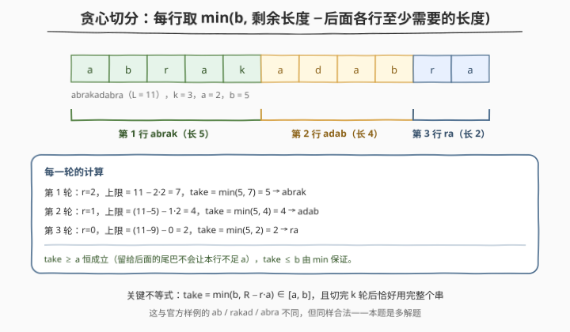
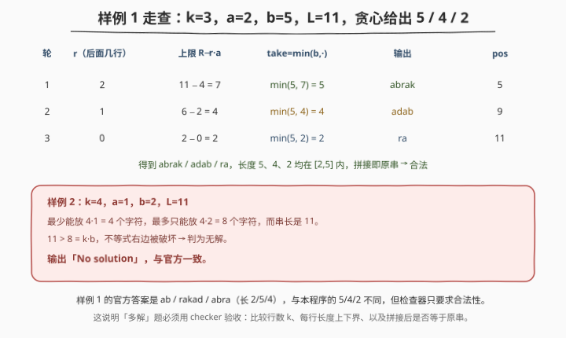

# Codeforces 44E Anfisa the Monkey 题解

## 1. 题目概述

- **题目链接**：https://codeforces.com/problemset/problem/44/E
- **比赛来源**：School Team Contest 2 (Winter Computer School 2010/11) · Problem E（UTC 2010-11-06）
- **难度**：1400
- **标签**：动态规划、构造、贪心
- **评测类型**：多解（special judge：输出任意一种合法分行即可）
- **限制**：时间 2 s / 内存 256 MB

**题意**：猴子 Anfisa 打出了一串小写字母（长度 $L$，非空，$L\le200$）。她想把它切成**恰好 $k$ 行**，每行长度在 $[a,b]$ 之间，字符顺序不能变、不能增删，每行也不能含空格。输出任意一种切法；若无解输出 `No solution`。

形式化地：把串 $s$ 分成 $k$ 段 $s[0..e_1),s[e_1..e_2),\dots$，使得每段长度 $\ell_i\in[a,b]$，且 $\sum\ell_i=L$。

**约束**：

- $1\le k\le200$，$1\le a\le b\le200$，$L\le200$：规模极小，$O(kL)$ 的 DP 或 $O(k)$ 的贪心都绰绰有余；甚至 $O(kL^2)$ 的朴素 DP 也只有 $8\times10^6$ 次转移。
- 注意 $L$ 是**给定的串长**，不是随便选的。切 $k$ 行、每行至少 $a$、至多 $b$，总长只能在 $[ka,kb]$ 之间——这一条直接给出可行性判据。
- 输出的是**方案**而非计数，因此不能用「样例逐字比对」验收，必须写 checker 校验行数、每行长度与拼接结果（本题第 8 节的验证即用 checker 完成）。
- 只有一组数据，无多测。

## 2. 示例与观察

官方样例（输入 / 输出原样，共 2 组）：

```text
输入：
3 2 5
abrakadabra
输出：
ab
rakad
abra
```

```text
输入：
4 1 2
abrakadabra
输出：
No solution
```

**样例 1 演算**：$L=11$，$k=3$，$a=2$，$b=5$。每行长度必须 $\in[2,5]$，三段之和为 11。官方的切法长度是 $2+5+4=11$：`ab`、`rakad`、`abra`，逐段长度合法、拼接正好是 `abrakadabra`。

**样例 2 演算**：$k=4$，$a=1$，$b=2$，$L=11$。四行最多放 $4\times2=8$ 个字符，装不下 11 个，必然无解，输出 `No solution`。

**观察**：每行装多少字符只受上下界约束，与字符内容完全无关。所以问题本质是：把整数 $L$ 拆成 $k$ 个整数 $\ell_i\in[a,b]$ 之和。而这只有在 $ka\le L\le kb$ 时才可能——因为 $k$ 个数的和最小是 $ka$、最大是 $kb$，并且在这个区间内的每个整数都能取到（把长度从全 $a$ 开始，每次给某一行加 1，最多加到 $b$）。

自造样例（标注「自造」；输出为本题参考程序的实际输出，多解时任意合法答案均可）：

| 输入 | 输出 | 说明 |
| --- | --- | --- |
| `1 3 5`<br>`abcde` | `abcde` | $k=1$，整串长度 5 恰在 $[3,5]$ |
| `2 3 3`<br>`abcdef` | `abc`<br>`def` | $a=b=3$，每行必须恰好 3 个 |
| `3 1 1`<br>`abc` | `a`<br>`b`<br>`c` | $L=ka$ 的下界情形 |
| `5 2 2`<br>`abcdefghij` | `ab`<br>`cd`<br>`ef`<br>`gh`<br>`ij` | $L=kb$ 的上界情形 |
| `2 1 2`<br>`abcde` | `No solution` | $L=5>kb=4$ |

## 3. 解题思路

### 3.1 朴素做法与瓶颈

可以用 DP 判定：`dp[i][j]` 表示「把前 $i$ 个字符切成 $j$ 行」是否可行，转移

$$\texttt{dp}[i][j]=\bigvee_{\ell=a}^{b}\texttt{dp}[i-\ell][j-1],$$

复杂度 $O(kLb)\le 200\cdot200\cdot200=8\times10^6$，可行（本题的官方标签正是 dp）。但它只回答「行不行」，还要再回溯一遍才能给出切法。

而且对一个**只要求任意方案**的题，DP 是过度设计：既然只关心每行长度，而长度是可自由分配的量，就可以直接贪心构造。

### 3.2 核心观察：可行性只看总长

![把 L 个字符分给 k 行，总和必须落在 [ka, kb] 内](../../../images/cf44e_feasible_window.svg)

设第 $i$ 行长度为 $\ell_i$。所有约束是

$$\ell_1+\dots+\ell_k=L,\qquad a\le\ell_i\le b .$$

于是必要条件 $ka\le L\le kb$ 立刻得出；而且它是**充分**的：从 $(\underbrace{a,\dots,a}_{k})$ 出发，总和每次给某一行加 1，因为每行都还有加到 $b$ 的余地，可以一直加到总和等于 $L$ 为止——只要 $L\le kb$ 就加得到。所以在 $L\in[ka,kb]$ 时一定存在解，且解只由长度向量决定，与字符内容无关。

### 3.3 算法流程：每行尽量多拿、同时给后面留够



从左到右切。已经切掉 `pos` 个字符、还剩 $r=k-i-1$ 行要切时，当前这行应当取

$$\ell=\min\bigl(b,\ (L-\text{pos})-r\cdot a\bigr).$$

理由：

- $L-\text{pos}-r\cdot a$ 是「给后面 $r$ 行各留 $a$ 个」之后，本行能拿到的最大值；本行不能超过它，否则后面会不够；
- 本行也不能超过 $b$；
- 因此取二者较小值，既满足上界 $b$，又保证后面至少还有 $ra$ 个字符。

有了这条规则，本行长度自动落在 $[a,b]$ 内（见第 4 节引理 2），并且切完 $k$ 行正好用完整个串。

**实现细节**：用 `pos` 记录当前起点，每行输出 `s.substr(pos, len)`，再 `pos += len`。不需要真的修改字符串。

### 3.4 样例走查（样例 1）



$k=3,a=2,b=5,L=11$：

- 第 1 行：$r=2$，上限为 $11-2\cdot2=7$，取 $\min(5,7)=5$ → `abrak`，`pos=5`；
- 第 2 行：$r=1$，上限为 $(11-5)-1\cdot2=4$，取 $\min(5,4)=4$ → `adab`，`pos=9`；
- 第 3 行：$r=0$，上限为 $(11-9)-0=2$，取 $\min(5,2)=2$ → `ra`，`pos=11`。

得到 `abrak` / `adab` / `ra`，长度 $5,4,2$ 全在 $[2,5]$ 内，拼接为 `abrakadabra`。它与官方样例的 `ab` / `rakad` / `abra` 不同，但同样合法——本题是多解题，checker 只校验合法性。

## 4. 正确性证明

**引理 1（可行性判据）**：存在合法的 $k$ 段切分，当且仅当 $ka\le L\le kb$。

证明：必要性：每段 $\ge a$、$\le b$，求和即得。充分性：若 $ka\le L\le kb$，从全 $a$ 的长度向量出发，此时总和 $ka\le L$；每轮把某个尚未达到 $b$ 的分量加 1。只要总和还小于 $L$，就必定存在某个分量 $<b$（否则总和已是 $kb\ge L$），故可以一直加到总和为 $L$。得到的长度向量每项都在 $[a,b]$，按它切分即得合法方案。∎

**引理 2（贪心不变式）**：在第 $i$ 轮（$0\le i<k$，还剩 $r=k-i-1$ 行）开始前，剩余长度 $R=L-\text{pos}$ 满足
$$(r+1)a\ \le\ R\ \le\ (r+1)b,$$
且本轮取出的 $\ell=\min(b,\ R-ra)$ 满足 $a\le\ell\le b$，并且轮后 $R'=R-\ell$ 满足 $ra\le R'\le rb$。

证明：初始 $R=L$，$r=k-1$，由引理 1 的 $ka\le L\le kb$ 得 $(r+1)a\le R\le(r+1)b$，不变式成立。

设第 $i$ 轮开始前不变式成立。

- 上界：$\ell=\min(b,R-ra)\le b$。
- 下界：由 $R\ge(r+1)a$ 得 $R-ra\ge a$，又 $b\ge a$，故 $\ell=\min(b,R-ra)\ge a$。
- 轮后：$R'=R-\ell=\max(R-b,\ ra)$。一方面 $R'\ge ra$ ✓；另一方面由 $R\le(r+1)b$ 得 $R-b\le rb$，且 $ra\le rb$，故 $R'\le rb$ ✓。

于是不变式在下一轮（剩 $r-1$ 行时需满足 $ra\le R'\le rb$）依然成立。∎

**定理**：程序输出恰好 $k$ 行、每行长度在 $[a,b]$、拼接后等于原串；无解时输出 `No solution`。

证明：若 $L<ka$ 或 $L>kb$，由引理 1 无解，程序输出 `No solution`，正确。否则由引理 2，每一轮取出的 $\ell\in[a,b]$，且 $k$ 轮后剩余长度 $R=0$（最后一轮 $r=0$ 时不变式给出 $a\le R\le b$，而 $\ell=\min(b,R)=R$，正好取完）。程序依次输出 $s[\text{pos},\text{pos}+\ell)$，这些子串首尾相接覆盖 $s$ 的每个字符恰好一次，故拼接结果等于 $s$，行数为 $k$，每行长度合法。∎

## 5. 复杂度分析

- 时间：判定 $O(1)$，切分 $k$ 轮，每轮 $O(1)$ 次算术加一次 `substr`（总字符数 $L$），故 $O(L+k)\le 400$ 次操作。即使算上输出，也在微秒级；相对 2 s 时限有六个数量级余量。
- 空间：只存原串与游标，$O(L)$ 个字符；若用 `substr` 逐行输出，额外空间 $O(L)$（最长一行）。$L\le200$ 时不到 1 KB。
- 对比 DP：$O(kLb)$ 时间、$O(kL)$ 空间，本题规模下也能过，但代码量与常数都更大。

## 6. 参考代码

### C++17

```cpp
#include <bits/stdc++.h>
using namespace std;

int main() {
    int k, a, b;
    string s;
    if (!(cin >> k >> a >> b)) return 0;
    cin >> s;
    int len = (int)s.size();
    if (len < k * a || len > k * b) {
        cout << "No solution\n";
        return 0;
    }
    int pos = 0;
    for (int i = 0; i < k; ++i) {
        int rest_parts = k - i - 1;                 // 后面还要切几行
        int take = min(b, len - pos - rest_parts * a);
        cout << s.substr(pos, take) << '\n';
        pos += take;
    }
    return 0;
}
```

### Python3

```python
import sys


def main():
    data = sys.stdin.read().split()
    k, a, b = int(data[0]), int(data[1]), int(data[2])
    s = data[3]
    n = len(s)
    if n < k * a or n > k * b:
        print("No solution")
        return
    pos = 0
    for i in range(k):
        rest_parts = k - i - 1
        take = min(b, n - pos - rest_parts * a)
        print(s[pos:pos + take])
        pos += take


if __name__ == "__main__":
    main()
```

注意 Python 版用 `print` 逐行输出，不会在末尾多出空行；C++ 版每行都以 `'\n'` 结尾，checker 会去掉末尾空行后再计数。

## 7. 边界情况与易错点

1. **$k=1$**：整串长度必须 $\in[a,b]$，否则 `No solution`。贪心此时 `rest_parts = 0`，`take = min(b, L) = L`（因为 $L\le b$），正好输出整串。
2. **$a=b$**：每行长度被完全钉死为 $a$，可行性等价于 $L=ka$。贪心给出的 `take` 恒为 $a$，自动正确。
3. **$L=ka$（下界）**：每行都必须取 $a$。此时 `L-pos-r*a = (k-i)a - r*a = a`，`min(b,a)=a`，每行恰好 $a$。
4. **$L=kb$（上界）**：每行都取 $b$。此时 `L-pos-r*b` 关系使 `min` 直接取到 $b$，每行恰好 $b$。
5. **$L<ka$ 或 $L>kb$**：必须输出 `No solution`（注意大写 `N`、小写 `s`，题面写作 "No solution"）。不要输出 `NO SOLUTION` 或 `No Solution`。
6. **$k\cdot a$ 的乘法位置**：$k,a\le200$ 时 $ka\le40000$，`int` 够用；但若把判据写成 `len / a < k` 之类的整除形式，会在 $a\nmid L$ 时误判，务必直接用乘法比较。
7. **读入方式**：第二行只有小写字母、不含空格。`cin >> s` 或 `split()` 都能正确读到；若用 `getline`，要小心第一行末尾残留的换行符导致读到空串。
8. **多解与输出格式**：不要输出多余的空行或行号；每行必须是原串的连续子串，不能重排、不能加空格。

## 8. 验证记录

- **编译环境与命令**：`clang++ -std=c++17 -O2`（经 `codeforces/tools/include` 的 `bits/stdc++.h` 兼容头）；由于本题是多解题，用 checker 验收：
  `python3 codeforces/tools/verify_solution.py codeforces/contests/0001-0100/44/E_猴子分行文本.md --checker codeforces/tools/checkers/cf44e.py`
  输出 `CF44E: samples 2`、C++ 2/2、Python 2/2（两组官方样例在 checker 下都通过）。
- **checker 的校验条件**（`codeforces/tools/checkers/cf44e.py`，独立于参考程序）：
  1. 若输出恰为一行 `No solution`，则 checker 用 $ka\le L\le kb$ 独立判定确实无解，否则判错；
  2. 否则必须恰好 $k$ 行、每行只含小写字母、长度均在 $[a,b]$ 内，且按顺序拼接后与原串**逐字符相同**；
  3. 若 checker 独立判定无解而选手输出了方案，直接判错。
- **官方样例**：2 / 2 通过（样例 1 用 checker 接受任意合法切分；参考程序给出 `abrak/adab/ra`，官方给出 `ab/rakad/abra`，两者都合法）。
- **额外测试**：随机生成 $k\in[1,8]$、$a\in[1,5]$、$b\in[a,a+4]$、$L\in[1,25]$ 的 240 组数据，做两件事：
  1. 用独立暴力 `brute.py`（记忆化递归枚举所有切法，判断「是否存在合法切分」）与参考程序的判定逐组比对，240/240 一致；
  2. 对参考程序的输出与 Python 版的输出分别跑 checker，240 组全部通过（方案合法、行数与长度均正确）。
- **最大约束性能**：$k=200,a=b=1,L=200$ 与 $k=1,a=1,b=200,L=200$ 两组极限数据，C++ 单次运行均 $<10$ ms（含进程启动实测 2~6 ms，纯计算在微秒级），远低于 2 s。
- **复核状态**：`check.py` 0 失败；`check_samples.py` 中本篇 2 组样例逐字一致；3 幅 SVG 均通过 `ElementTree` 解析。

## 相关题目与扩展

- [Codeforces 44B Cola](https://codeforces.com/problemset/problem/44/B)：同场 B 题，同样是「枚举一维 + 用公式判定可行性」。
- [Codeforces 1029B Creating the Contest](https://codeforces.com/problemset/problem/1029/B)：从序列中选最长子序列、相邻元素满足上界关系，属于「贪心 + 区间约束」的构造题。
- [Codeforces 1385D a-Good String](https://codeforces.com/problemset/problem/1385/D)：递归把字符串切成两半，同样是「切分 + 每段长度约束」的建模方式。

**延伸思考**：

1. 若要求输出**字典序最小**的方案（把 $k$ 行的长度序列按字典序比较），贪心需要改成「在保证可行的前提下每行取尽可能长/短」。本题只要求任意方案，所以没有这个约束。
2. 若每行的长度上下界不同（第 $i$ 行要求 $\ell_i\in[a_i,b_i]$），可行性判据变成前缀和形式：$\sum_{j\le i}a_j\le$ 已用长度 $\le\sum_{j\le i}b_j$，贪心规则改为 $\ell_i=\min(b_i,\ L-\text{pos}-\sum_{j>i}a_j)$，证明思路不变。
3. 同样的问题若要求**方案数**，就是经典的整数拆分计数，$O(kL)$ 的前缀和优化 DP 可做；若再要求「每行内容也要满足某种条件」（比如每行必须是回文），就必须回到 $O(kLb)$ 的 DP 并记录转移。
4. 本题的贪心说明了一个一般原则：**只约束每段长度的划分问题，构造解只需关心长度的可达区间**，不需要搜索具体字符。
