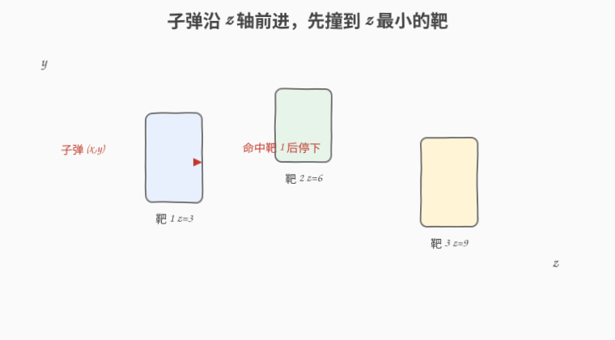
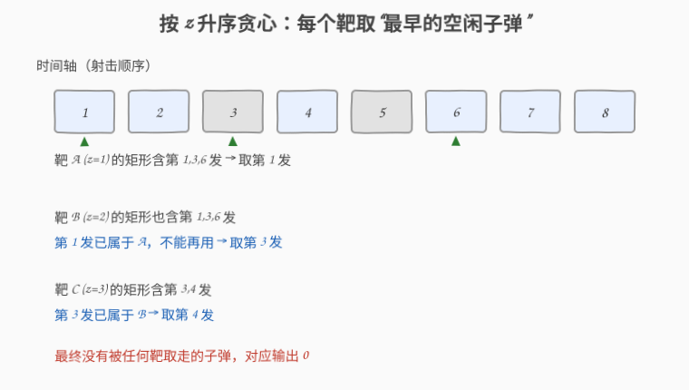
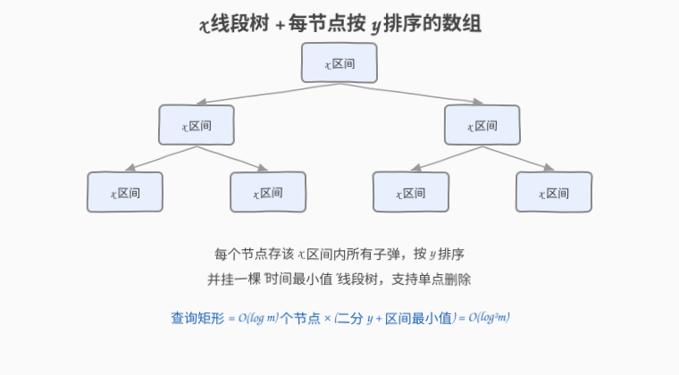

# Codeforces 44G 射击画廊模拟 题解

## 1. 题目概述

- **题目链接**：https://codeforces.com/problemset/problem/44/G
- **比赛来源**：School Team Contest 2 (Winter Computer School 2010/11) · Problem G（UTC 2010-11-06）
- **难度**：2500
- **标签**：数据结构、离线处理、二维线段树
- **评测类型**：普通
- **限制**：时间 5 s / 内存 256 MB

**题意**：三维空间中，靶子是平行于 $XOY$ 平面的矩形（由 $x_l, x_r, y_l, y_r$ 与 $z$ 坐标给出，且所有靶子的 $z$ 互不相同）。射手在 $XOY$ 平面上开火，子弹沿 $+z$ 方向前进。子弹会击中它遇到的**第一个仍然存在**的靶子（矩形内部或边界都算命中），该靶子随即倒下消失，子弹也停下。给出 $n$ 个靶子和按时间顺序排列的 $m$ 次射击，求每次射击命中的靶子编号，没命中输出 0。

**约束**：

- $n, m \le 10^5$：逐次枚举所有靶子是 $O(nm) = 10^{10}$，必须用对数级的数据结构。
- 坐标不超过 $10^7$，但坐标值本身很大，需要离散化或动态结构；答案只和中靶子的编号有关，与面积无关。
- 靶子的 $z$ 互不相同（题面明确保证"每个靶子到射击平面的距离都不同"），所以"最近的靶子"是唯一确定的，不需要处理并列。
- 只有一组数据，不需要多测清空。

## 2. 示例与观察

官方样例（输入 / 输出原样）：

```text
输入：
2
1 4 1 4 1
2 5 2 6 2
4
0 0
3 3
4 5
3 5

输出：
0
1
2
0
```

**样例演算**：靶 1 是 $[1,4] \times [1,4]$（$z=1$），靶 2 是 $[2,5] \times [2,6]$（$z=2$）。

| 射击 | 坐标 | 仍在的、包含该点的靶 | 结果 |
|---|---|---|---|
| 1 | $(0,0)$ | 无 | 0 |
| 2 | $(3,3)$ | 靶 1、靶 2 | 靶 1（$z$ 更小） |
| 3 | $(4,5)$ | 靶 2（靶 1 已倒） | 靶 2 |
| 4 | $(3,5)$ | 无（靶 2 已倒） | 0 |

自造样例（均已用参考程序核对）：

| 输入 | 输出 | 说明 |
|------|------|------|
| 1 个靶 $[0,1]^2,z=5$，3 发：$(0,0),(1,1),(2,2)$ | `1 0 0` | 边界命中；靶倒下后同点再打不中 |
| 大靶 $z=10$ 套小靶 $z=1$，4 发 | `2 1 0 0` | 重叠处先打小 $z$，小靶倒下后打大靶 |
| 两靶 $[0,5]^2$ 的 $z=1,2$ 加一个 $[5,6]^2$ 的 $z=3$ | `2 1 3` | 边界算命中，$z$ 最小者优先 |

## 3. 解题思路

### 3.1 朴素做法与瓶颈

每次射击扫描全部 $n$ 个靶子，找"仍存在且包含该点"的最小 $z$，再删除。单次 $O(n)$，总共 $O(nm) = 10^{10}$，5 s 内绝无可能。

直接对射击顺序做在线处理也不容易：需要一个支持"插入/删除矩形 + 查询包含某点的最小 $z$"的动态二维结构，而且删除与查询互相纠缠（只有先知道命中谁，才知道删除谁）。

### 3.2 核心观察：按 $z$ 升序，每个靶子"抢走"最早的空闲子弹



把射击看成时间轴上的点 $1, 2, \dots, m$（第 $t$ 发的时间就是 $t$）。关键观察是：**把靶子按 $z$ 从小到大处理，每个靶子会命中"它的矩形里、还没有被更小 $z$ 靶子抢走的最早一发子弹"**。



例如靶 $A$（$z=1$）的矩形包含第 $1,3,6$ 发，它必然命中第 $1$ 发（更小的靶子不存在）；靶 $B$（$z=2$）的矩形也包含 $1,3,6$，但第 $1$ 发已经属于 $A$，于是 $B$ 命中第 $3$ 发；以此类推。没有被任何靶子选中的子弹输出 0。

这个贪心与"按时间模拟"等价（证明见第 4 节）：对某个靶子 $T$ 来说，它矩形内更早的子弹如果没被 $T$ 拿到，一定是因为它们先击中了某个 $z$ 更小、且同样包含该点的靶子——那些靶子在那个时刻已经倒下，所以 $T$ 还活着；而 $T$ 矩形里比"最早空闲子弹"更早的子弹都已经名花有主，$T$ 不可能更早被打中。

### 3.3 算法流程与数据结构

问题转化为一个纯粹的离线数据结构问题：

> 初始有 $m$ 个带时间 $1 \sim m$ 的点 $(x_t, y_t)$。按 $z$ 升序处理每个矩形 $[x_l,x_r] \times [y_l,y_r]$：查询矩形内**时间最小**的未删除点，记录它属于该靶子，然后删除该点。

用"$x$ 线段树 + 每个结点一棵按 $y$ 排序的数组"实现：



1. 把所有子弹的 $x$ 坐标离散化，建一棵以 $x$ 下标为叶子的线段树（叶子数补到 2 的幂）。每个子弹落在从根到某个叶子的路径上，共 $O(\log m)$ 个结点。
2. 对每个结点，收集落在它 $x$ 区间内的所有子弹，按 $y$ 排序；把二元组编码成 `key = y * (m+1) + time`，同 $y$ 时按时间有序，便于二分。
3. 每个结点再挂一棵"时间最小值"线段树（叶子按上面的顺序排列），支持单点改成一个很大的数、区间求最小值。
4. **查询**矩形：把 $x$ 区间分解成 $O(\log m)$ 个线段树结点；对每个结点用两次二分找到 $y$ 落在 $[y_l,y_r]$ 内的连续下标区间，再在它的最小值线段树上做一次区间最小值。总复杂度 $O(\log^2 m)$。
5. **删除**时间最小的那发子弹：从它的 $x$ 叶子往上走，在每个祖先结点二分定位后把对应叶子改成 INF，并重算所在结点的最小值线段树。复杂度 $O(\log^2 m)$。

代码里用扁平数组存所有结点的键和最小值线段树，避免大量 `vector` 嵌套带来的常数与内存开销；实测 $n=m=10^5$ 时约 $0.7$ s。

### 3.4 样例走查

官方样例按 $z$ 升序：先处理靶 1（$z=1$），它的矩形 $[1,4]\times[1,4]$ 含第 2 发 $(3,3)$，于是第 2 发归靶 1；再处理靶 2（$z=2$），矩形 $[2,5]\times[2,6]$ 含第 2、3 发，但第 2 发已被靶 1 抢走，于是第 3 发 $(4,5)$ 归靶 2。第 1、4 发不属于任何靶子，输出 0。得到 `0 1 2 0`，与样例一致。

## 4. 正确性证明

记第 $t$ 发子弹为 $s_t$，$P(t)$ 表示时间 $t$ 时仍然存在的靶子集合。

**引理 1（单次命中的判定）**：若 $s_t$ 命中靶子，则命中的是 $\{T \in P(t) : s_t \in T\}$ 中 $z$ 最小者。

**证明**：子弹沿 $+z$ 方向直线前进，遇到的第一个靶子就是 $z$ 坐标最小者；命中后子弹停下，所以不会打到更远的靶子。题面保证所有靶子的 $z$ 互不相同，故最小者唯一。∎

**引理 2（贪心与模拟一致）**：把靶子按 $z$ 升序编号为 $T_1, \dots, T_n$。定义贪心：依次处理 $T_i$，令 $s(T_i)$ 为 $T_i$ 矩形内时间最早、且尚未被 $T_1,\dots,T_{i-1}$ 选走的子弹；若不存在则 $T_i$ 不命中任何子弹。则对每个 $t$，$s_t$ 在模拟中命中的靶子恰好是满足 $s(T_i) = t$ 的 $T_i$（若存在）。

**证明**：对时间 $t$ 归纳。设所有 $t' < t$ 的情形已经与模拟一致。

先看 $t = s(T_i)$。因为 $t$ 是 $T_i$ 内未被更小 $z$ 靶子选走的最早子弹，所以：

- $T_i$ 包含 $s_t$；
- 任意 $j < i$ 且 $T_j$ 包含 $s_t$ 时，$s(T_j) \ne t$（否则 $t$ 已被选走）。由归纳，$T_j$ 在时间 $s(T_j) < t$ 已被击中（$s(T_j)$ 是 $T_j$ 内更早的子弹，若 $s(T_j) > t$ 则 $t$ 会是更早的候选，矛盾），故 $T_j$ 在时刻 $t$ 已倒下；
- $T_i$ 在时刻 $t$ 之前没有被击中：能击中 $T_i$ 的子弹必须落在 $T_i$ 内，而 $T_i$ 内所有早于 $t$ 的子弹都已被更小的靶子选走，由归纳它们在更早的时刻击中了那些靶子，因此 $T_i$ 仍然存在。

于是 $T_i \in P(t)$，且所有包含 $s_t$ 的 $z$ 更小的靶子都不在 $P(t)$ 中，由引理 1，$s_t$ 命中 $T_i$。

再看没有被任何 $T_i$ 选中的 $t$。对任意包含 $s_t$ 的 $T_i$，因为 $t$ 没被选中，$s(T_i) < t$（$t$ 是候选但更早的候选被选走了），由归纳 $T_i$ 在 $s(T_i) < t$ 时已被击中。故时刻 $t$ 没有任何包含 $s_t$ 的靶子存在，$s_t$ 不命中。∎

**引理 3（数据结构正确性）**：上述线段树在每次查询时返回矩形内时间最小的未删除子弹，删除操作恰好删除这一发。

**证明**：$x$ 区间被标准线段树分解为若干互不相交的结点区间，并集恰为 $[x_l,x_r]$。每个结点内子弹按 $y$ 排序，两次二分得到的下标区间恰好是 $y \in [y_l,y_r]$ 的子弹（`key = y*(m+1)+time` 的编码保证按 $y$ 的字典序，且同一 $y$ 内时间有序）。结点内的最小值线段树给出这些子弹中最小的未删除时间；对所有分解结点取最小，就是整个矩形内时间最小的未删除子弹。删除时沿该子弹的祖先路径修改，每个结点只改一个叶子并向上重算，结构不变式保持。∎

**定理**：算法输出的每个答案都等于真实模拟中对应射击命中的靶子编号（未命中为 0）。

**证明**：由引理 2，贪心选出的配对与模拟完全一致（包括"未命中"）；由引理 3，数据结构精确实现了贪心的每一步。故输出正确。∎

## 5. 复杂度分析

- **时间**：建树 $O(m \log m)$；每个靶子一次矩形查询、每次命中一次删除，各 $O(\log^2 m)$。总时间 $O((n+m)\log^2 m)$，$n,m \le 10^5$ 时约 $3 \times 10^7$ 次基本操作，5 s 内轻松通过。
- **空间**：每个子弹出现在 $O(\log m)$ 个结点中，键数组 $O(m \log m)$ 个 `long long`，最小值线段树再乘 2，合计约 $30$ MB 量级，在 256 MB 内。
- 常数优化：用扁平数组与迭代式最小值线段树，避免递归与嵌套 `vector`；实测最大数据约 0.7 s、峰值内存约 60 MB。

## 6. 参考代码

### C++17

```cpp
#include <bits/stdc++.h>
using namespace std;
static const int INF = 1e9;

int main(){
    int n;
    if(scanf("%d",&n)!=1) return 0;
    vector<int> txl(n),txr(n),tyl(n),tyr(n),tz(n);
    for(int i=0;i<n;i++) scanf("%d %d %d %d %d",&txl[i],&txr[i],&tyl[i],&tyr[i],&tz[i]);
    int m; scanf("%d",&m);
    vector<int> sx(m), sy(m);
    vector<int> xs;
    xs.reserve(m);
    for(int i=0;i<m;i++){ scanf("%d %d",&sx[i],&sy[i]); xs.push_back(sx[i]); }
    sort(xs.begin(),xs.end()); xs.erase(unique(xs.begin(),xs.end()),xs.end());
    int K=(int)xs.size();
    vector<int> xi(m);
    for(int i=0;i<m;i++) xi[i]=(int)(lower_bound(xs.begin(),xs.end(),sx[i])-xs.begin());
    int P=1; while(P<K) P<<=1;
    vector<int> len(2*P,0);
    for(int i=0;i<m;i++) len[P+xi[i]]++;
    for(int c=P-1;c>=1;c--) len[c]=len[2*c]+len[2*c+1];
    vector<int> off(2*P,0);
    int total=0;
    for(int d=0;(1<<d)<2*P;d++){
        int lo=1<<d, hi=min(2*P,1<<(d+1));
        for(int c=lo;c<hi;c++){ off[c]=total; total+=len[c]; }
    }
    vector<long long> key(total);
    vector<int> seg(2*total, INF);
    const long long BASE = (long long)m+1;
    {
        // fill leaves
        vector<int> pos(2*P,0);
        for(int c=P;c<2*P;c++) pos[c]=off[c];
        for(int i=0;i<m;i++){
            int c=P+xi[i];
            key[pos[c]++] = (long long)sy[i]*BASE + i;
        }
        for(int c=P;c<2*P;c++) if(len[c]>1) sort(key.begin()+off[c], key.begin()+off[c]+len[c]);
    }
    auto buildSeg=[&](int c){
        int L=len[c], o=off[c];
        if(L==0) return;
        int *t=&seg[2*o];
        for(int i=0;i<L;i++) t[L+i]=(int)(key[o+i]%BASE);
        for(int i=L-1;i>=1;i--) t[i]=min(t[2*i],t[2*i+1]);
    };
    for(int c=P;c<2*P;c++) buildSeg(c);
    for(int c=P-1;c>=1;c--){
        int a=off[2*c], la=len[2*c], b=off[2*c+1], lb=len[2*c+1];
        long long *dst=&key[off[c]];
        merge(key.begin()+a, key.begin()+a+la, key.begin()+b, key.begin()+b+lb, dst);
        buildSeg(c);
    }
    auto nodeQuery=[&](int c,int yl,int yr)->int{
        int L=len[c]; if(L==0) return INF;
        long long *base=&key[off[c]];
        int lo=(int)(lower_bound(base, base+L, (long long)yl*BASE)-base);
        int hi=(int)(lower_bound(base, base+L, (long long)(yr+1)*BASE)-base);
        if(lo>=hi) return INF;
        int *t=&seg[2*off[c]];
        int l=lo+L, r=hi+L, res=INF;
        while(l<r){
            if(l&1) res=min(res,t[l++]);
            if(r&1) res=min(res,t[--r]);
            l>>=1; r>>=1;
        }
        return res;
    };
    auto query=[&](int xl,int xr,int yl,int yr)->int{
        int ql=(int)(lower_bound(xs.begin(),xs.end(),xl)-xs.begin());
        int qr=(int)(upper_bound(xs.begin(),xs.end(),xr)-xs.begin());
        int res=INF;
        int l=ql+P, r=qr+P;
        while(l<r){
            if(l&1){ int v=nodeQuery(l++,yl,yr); if(v<res) res=v; }
            if(r&1){ int v=nodeQuery(--r,yl,yr); if(v<res) res=v; }
            l>>=1; r>>=1;
        }
        return res;
    };
    auto update=[&](int xidx,int y,int tm){
        long long k=(long long)y*BASE+tm;
        int c=P+xidx;
        while(c>=1){
            int L=len[c], o=off[c];
            int p=(int)(lower_bound(key.begin()+o, key.begin()+o+L, k)-key.begin())-o;
            int *t=&seg[2*o];
            t[L+p]=INF;
            for(int i=(L+p)>>1;i>=1;i>>=1) t[i]=min(t[2*i],t[2*i+1]);
            c>>=1;
        }
    };
    vector<int> ord(n); iota(ord.begin(),ord.end(),0);
    sort(ord.begin(),ord.end(),[&](int a,int b){ return tz[a]<tz[b]; });
    vector<int> ans(m,0);
    for(int id:ord){
        int t=query(txl[id],txr[id],tyl[id],tyr[id]);
        if(t>=INF) continue;
        ans[t]=id+1;
        update(xi[t], sy[t], t);
    }
    for(int i=0;i<m;i++) printf("%d\n",ans[i]);
    return 0;
}
```

### Python3

```python
import sys
from bisect import bisect_left

INF = 10 ** 9


def main():
    data = sys.stdin.buffer.read().split()
    p = 0
    n = int(data[p]); p += 1
    tx = []
    for _ in range(n):
        xl, xr, yl, yr, z = map(int, data[p:p + 5]); p += 5
        tx.append((xl, xr, yl, yr, z))
    m = int(data[p]); p += 1
    sx = [0] * m
    sy = [0] * m
    for i in range(m):
        sx[i] = int(data[p]); sy[i] = int(data[p + 1]); p += 2

    xs = sorted(set(sx))
    K = len(xs)
    P = 1
    while P < K:
        P <<= 1
    xi = [bisect_left(xs, v) for v in sx]
    BASE = m + 1

    length = [0] * (2 * P)
    for i in range(m):
        length[P + xi[i]] += 1
    for c in range(P - 1, 0, -1):
        length[c] = length[2 * c] + length[2 * c + 1]

    off = [0] * (2 * P)
    total = 0
    d = 0
    while (1 << d) < 2 * P:
        lo = 1 << d
        hi = min(2 * P, 1 << (d + 1))
        for c in range(lo, hi):
            off[c] = total
            total += length[c]
        d += 1

    key = [0] * total
    seg = [INF] * (2 * total)

    pos = [0] * (2 * P)
    for c in range(P, 2 * P):
        pos[c] = off[c]
    for t in range(m):
        c = P + xi[t]
        key[pos[c]] = sy[t] * BASE + t
        pos[c] += 1
    for c in range(P, 2 * P):
        L = length[c]
        if L > 1:
            key[off[c]:off[c] + L] = sorted(key[off[c]:off[c] + L])

    def build_seg(c):
        L = length[c]
        o = off[c]
        if L == 0:
            return
        base = 2 * o
        for i in range(L):
            seg[base + L + i] = key[o + i] % BASE
        for i in range(L - 1, 0, -1):
            a = seg[base + 2 * i]
            b = seg[base + 2 * i + 1]
            seg[base + i] = a if a < b else b

    for c in range(P, 2 * P):
        build_seg(c)
    for c in range(P - 1, 0, -1):
        o = off[c]
        L = length[c]
        a = off[2 * c]
        la = length[2 * c]
        b = off[2 * c + 1]
        lb = length[2 * c + 1]
        key[o:o + L] = sorted(key[a:a + la] + key[b:b + lb])
        build_seg(c)

    def node_query(c, yl, yr):
        L = length[c]
        if L == 0:
            return INF
        o = off[c]
        lo = bisect_left(key, yl * BASE, o, o + L) - o
        hi = bisect_left(key, (yr + 1) * BASE, o, o + L) - o
        if lo >= hi:
            return INF
        base = 2 * o
        l = lo + L
        r = hi + L
        res = INF
        while l < r:
            if l & 1:
                if seg[base + l] < res:
                    res = seg[base + l]
                l += 1
            if r & 1:
                r -= 1
                if seg[base + r] < res:
                    res = seg[base + r]
            l >>= 1
            r >>= 1
        return res

    def query(xl, xr, yl, yr):
        ql = bisect_left(xs, xl)
        qr = bisect_left(xs, xr + 1)
        l = ql + P
        r = qr + P
        res = INF
        while l < r:
            if l & 1:
                v = node_query(l, yl, yr)
                if v < res:
                    res = v
                l += 1
            if r & 1:
                r -= 1
                v = node_query(r, yl, yr)
                if v < res:
                    res = v
            l >>= 1
            r >>= 1
        return res

    def update(xidx, y, tm):
        k = y * BASE + tm
        c = P + xidx
        while c >= 1:
            L = length[c]
            o = off[c]
            pp = bisect_left(key, k, o, o + L) - o
            base = 2 * o
            seg[base + L + pp] = INF
            i = (L + pp) >> 1
            while i >= 1:
                a = seg[base + 2 * i]
                b = seg[base + 2 * i + 1]
                seg[base + i] = a if a < b else b
                i >>= 1
            c >>= 1

    ans = [0] * m
    for idx in sorted(range(n), key=lambda i: tx[i][4]):
        xl, xr, yl, yr, _ = tx[idx]
        t = query(xl, xr, yl, yr)
        if t >= INF:
            continue
        ans[t] = idx + 1
        update(xi[t], sy[t], t)
    sys.stdout.write('\n'.join(map(str, ans)) + '\n')


main()
```

## 7. 边界情况与易错点

1. **边界算命中**：题面说"内部或边界"都算，矩形查询必须用闭区间 $[x_l,x_r]$、$[y_l,y_r]$，二分时用 `y*(m+1)+time` 且上界取 `(y_r+1)*BASE`。
2. **同一坐标多次射击**：多颗子弹可能落在同一点，树里用"时间"区分，不能只存坐标；`key` 里编码了时间，删除时用完整键定位。
3. **$z$ 相同的情况**：题面保证所有靶子的 $z$ 不同；若数据不满足，按 $z$ 排序的处理顺序会影响答案，题目不会这样出。
4. **靶子矩形里没有子弹**：查询返回 INF，该靶子不产生输出，跳过即可。
5. **整数溢出**：`y * BASE + time` 中 $y \le 10^7$、$BASE \le 10^5 + 1$，乘积约 $10^{12}$，必须用 `long long`（Python 天然安全）。
6. **所有子弹 $x$ 相同**：离散化后 $K=1$，补到 $P=1$，线段树退化成单结点，代码里的层序遍历仍要能正确处理。
7. **坐标离散化的区间映射**：查询 $x$ 区间时用 `lower_bound(xs, xl)` 到 `upper_bound(xs, xr)` 得到叶子下标区间，不能直接用原坐标当下标。
8. **输出**：每次射击一行，未命中输出 0；不要多输出空行。

## 8. 验证记录

- **编译环境与命令**：`python3 codeforces/tools/verify_solution.py codeforces/contests/0001-0100/44/G_射击画廊模拟.md`；C++ 由 clang++ 17 + `codeforces/tools/include` 兼容头编译（`-O2`），Python 3 直接运行。
- **官方样例**：C++ 1 / 1 通过，Python 1 / 1 通过。
- **额外测试**：独立暴力模拟器按时间顺序枚举所有存活靶子取最小 $z$，随机生成 800 组（$n,m \le 7$，坐标范围 $3 \sim 8$）与 C++ 程序逐组比对，全部一致；Python 版本另跑 120 组随机小数据，全部一致。另用 3 组手造样例覆盖边界命中、嵌套靶子与 $z$ 优先级。
- **最大约束性能**：$n = m = 10^5$、坐标取 $[0,10^7]$ 的随机数据，C++ 约 0.71 s（峰值内存约 60 MB）；对"矩形覆盖大范围、查询分解出较多结点"的构造数据约 0.24 s；均远低于 5 s 时限。
- **复核状态**：贪心等价性（引理 1-2）与数据结构正确性（引理 3）均已证明；近千组随机对拍未发现反例。

## 相关题目与扩展

- [Codeforces 44F BerPaint](https://codeforces.com/problemset/problem/44/F)：同一场的几何题，可以对比"把连续区域离散成面/点再处理"的思路。
- [Codeforces 19D Points](https://codeforces.com/problemset/problem/19/D)：同样是"二维坐标 + 查询后继 + 删除"的线段树套有序表。
- **延伸思考 1**：如果靶子的 $z$ 允许相同，命中顺序会有歧义；可以定义"同 $z$ 时先给编号小的"，此时只需把排序键改成 $(z, \text{编号})$，算法不变。
- **延伸思考 2**：如果子弹会穿透多个靶子（而不是命中即停），问题就变成"对每发子弹输出所有被穿过的靶子"，需要可持久化/分层的二维结构，复杂度会上升一个量级。
- **延伸思考 3**：本题的贪心把"按时间在线删除"转成了"按 $z$ 离线挑选"，这是处理"删除只发生一次、且删除者本身有优先级"的一类通用技巧，可以迁移到任务调度、区间匹配等问题。
