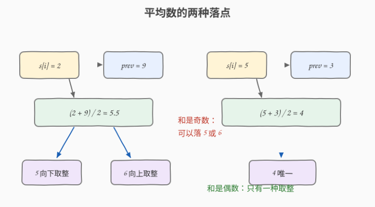
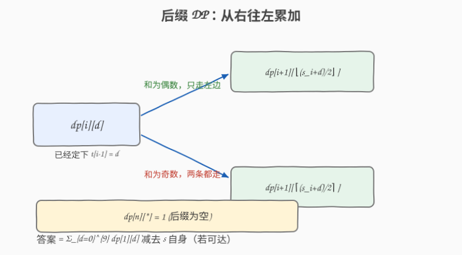
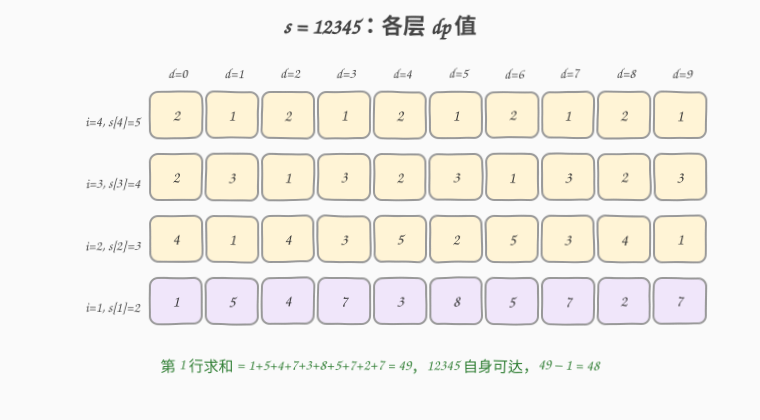

# Codeforces 44H 占卜电话号码 题解

## 1. 题目概述

- **题目链接**：https://codeforces.com/problemset/problem/44/H
- **比赛来源**：Codeforces Beta Round 44（School Team Contest 2, Winter Computer School 2010/11）· Problem H（2010-11-06）
- **难度**：1700
- **标签**：动态规划、计数
- **评测类型**：普通
- **限制**：时间 2 s / 内存 256 MB

**题意**：Masha 有一个长度不超过 50 的数字串 $s$（允许前导零）。她按下面的规则构造"白马王子的电话号码" $t$：

- $t_0$ 可以取 $0 \sim 9$ 中任意一个数字（她最喜欢的数字）；
- 对 $i \ge 1$，$t_i$ 必须是 $\dfrac{s_i + t_{i-1}}{2}$。如果和是偶数，平均值是整数，只有唯一选择；如果和是奇数，平均值是半整数，可以向上或向下取整（两个选择）。

问：所有可以得到的长度为 $|s|$ 的数字串有多少个？如果 $s$ 本身也能被构造出来（Masha 自己的号码），则把它排除，不重复计数。

**约束**：

- $1 \le |s| \le 50$：每一步至多 2 种取整，直接枚举全部方案最多 $10 \cdot 2^{49} \approx 5.6 \times 10^{15}$ 种，不可能枚举，必须用计数 DP。
- 答案上界是 $10 \cdot 2^{49} < 2^{53}$，`long long` 足够；但 $2^{49}$ 已经超出 32 位整数，**绝不能用 `int` 累加**。
- 只有一组输入，没有多测；$s$ 可以以 `0` 开头，必须按"定长数字串"处理，不能转成整数。
- 每步只依赖 $s_i$ 和上一位 $t_{i-1}$，这是 DP 状态可以压缩成 10 个数的关键。

## 2. 示例与观察

官方样例（输入 / 输出原样）：

```text
输入：
12345

输出：
48
```

```text
输入：
09

输出：
15
```

**样例 1 演算**：$s = 12345$。取 $t_0 = 1$ 时，$t_1$ 由 $(2+1)/2 = 1.5$ 取整得到 $1$ 或 $2$；要得到 $s$ 本身就必须选 $2$，接着 $(3+2)/2 = 2.5 \to 3$，$(4+3)/2 = 3.5 \to 4$，$(5+4)/2 = 4.5 \to 5$，所以 $12345$ 自身可达。把所有起点的方案数按后缀 DP 汇总得到 $49$ 个不同的数字串，排除自身后是 $48$。

**样例 2 演算**：$s = 09$，$t_0$ 取 $0 \sim 9$，$t_1$ 由 $(9 + t_0)/2$ 取整：

| $t_0$ | 平均值 | 可取的 $t_1$ |
|---|---|---|
| 0 | 4.5 | 4, 5 |
| 1 | 5 | 5 |
| 2 | 5.5 | 5, 6 |
| 3 | 6 | 6 |
| 4 | 6.5 | 6, 7 |
| 5 | 7 | 7 |
| 6 | 7.5 | 7, 8 |
| 7 | 8 | 8 |
| 8 | 8.5 | 8, 9 |
| 9 | 9 | 9 |

共 $2+1+2+1+2+1+2+1+2+1 = 15$ 个不同的二元串；其中没有任何一个等于 $09$（$t_0 = 0$ 时第二位只能是 4 或 5），所以答案是 $15$。

自造样例（均已用参考程序核对）：

| 输入 | 输出 | 说明 |
|------|------|------|
| `0` | 9 | 长度 1：$10$ 个起点减去自身 |
| `00` | 14 | 和恒为偶数，只有 1 个分支 |
| `12` | 14 | 自身可达，$15 - 1$ |
| `55` | 14 | 奇数起点有 2 个分支 |
| `1111111111` | 121 | 和恒为偶数，分支数不多 |
| 50 个 `9` | 858 | 长度上界，答案仍在 64 位内 |

## 3. 解题思路

### 3.1 朴素做法与瓶颈

枚举 $t_0$（10 种），再对每个 $i$ 枚举取整方向。最坏情况下每一步都有两个分支，总方案数达到 $10 \cdot 2^{49} \approx 5.6 \times 10^{15}$。即使每个方案只花 $O(1)$ 时间也不可能在 2 s 内跑完；而且不同分支可能得到同一个数字串，直接枚举还要额外去重。

瓶颈在于：**不同前缀可能在后缀上完全重合**，而这些重合的前缀只需要记录"当前最后一位是多少"。位置 $i$ 一旦确定、$t_{i-1}$ 一旦确定，后面能接什么就完全确定了，与更早的历史无关。

### 3.2 核心观察：状态只留"上一位数字"



把构造过程看成一棵决策树。每个结点是 $(i, t_{i-1})$，向下连到 $t_i$：

- 若 $s_i + t_{i-1}$ 是偶数，平均数是整数，出边只有 1 条；
- 若 $s_i + t_{i-1}$ 是奇数，平均数落在两个相邻整数正中间，出边有 2 条，分别对应向下、向上取整。

于是"能构造出多少个数字串"等于这棵 DAG 上从第 0 层（$t_0$ 取 $0 \sim 9$）到第 $n-1$ 层的路径条数。同一层的同一个 $t_{i-1}$ 会把后面所有分支复制一遍，用后缀 DP 合并即可。

### 3.3 算法流程与状态转移



定义 $dp[i][d]$ 表示：已经确定 $t_{i-1} = d$，还要填 $t_i, t_{i+1}, \dots, t_{n-1}$ 的方案数。边界是 $dp[n][*] = 1$（没有位置可填）。转移为

$$dp[i][d] = \sum_{v \in A(s_i, d)} dp[i+1][v], \qquad A(s,d) = \begin{cases} \left\{\dfrac{s+d}{2}\right\}, & s+d \text{ 为偶数},\\[4pt] \left\{\left\lfloor\dfrac{s+d}{2}\right\rfloor,\ \left\lceil\dfrac{s+d}{2}\right\rceil\right\}, & s+d \text{ 为奇数}.\end{cases}$$

从 $i = n-1$ 倒推到 $i = 1$，答案先取

$$T = \sum_{d=0}^{9} dp[1][d],$$

它把所有起点 $t_0 = d$ 的方案都算了一遍。不同起点得到的数字串第一位不同，所以不会有重复。

最后处理"排除自身"：$s$ 能由这套规则构造出来，当且仅当每一步都有 $|s_i - s_{i-1}| \le 1$（因为 $\left|s_i - \frac{s_i+s_{i-1}}{2}\right| = \frac{|s_i - s_{i-1}|}{2}$，取整后仍等于 $s_i$ 就必须有 $\frac{|s_i-s_{i-1}|}{2} \le \frac12$）。若可达，输出 $T-1$；否则输出 $T$。

### 3.4 样例走查：$s = 12345$



把四层后缀 DP 的值全部算出来（行是 $i$，列是 $d = t_{i-1}$）：

- $i=4$，$s_4=5$：每个 $d$ 只影响最后一位，方案数都是 $2$ 或 $1$，合计 $15$；
- $i=3$，$s_3=4$：按转移把 $i=4$ 的两个后继相加；
- $i=2$，$s_2=3$：继续向左合并；
- $i=1$，$s_1=2$：得到 $[1,5,4,7,3,8,5,7,2,7]$，求和 $49$。

自身可达（相邻数字差依次为 $1,1,1,1$，都 $\le 1$），所以输出 $49 - 1 = 48$，和官方样例一致。

## 4. 正确性证明

**引理 1（状态充分性）**：在位置 $i \ge 1$，只要知道 $t_{i-1} = d$，那么 $t_i$ 的候选集合恰好是 $A(s_i, d)$，与 $t_0, \dots, t_{i-2}$ 的取值无关。

**证明**：题面规定 $t_i$ 只由 $s_i$ 与 $t_{i-1}$ 的算术平均决定。因此候选值只依赖这两个数；而"能否向上/向下取整"只取决于和是否为奇数。∎

**引理 2（计数不重不漏）**：$dp[i][d]$ 恰好等于所有以 $t_{i-1}=d$ 为前缀末位的合法后缀 $t_i \dots t_{n-1}$ 的个数。

**证明**：对 $i$ 从 $n$ 倒推归纳。$i=n$ 时后缀为空，只有 1 个，$dp[n][d]=1$。设 $dp[i+1][\cdot]$ 正确。任一合法后缀由它的第一位 $v = t_i$ 与剩余后缀唯一分解，$v$ 必须且只能取 $A(s_i,d)$ 中的值；对每个 $v$，剩余后缀有 $dp[i+1][v]$ 种。不同 $v$ 给出不同的 $t_i$，因此这些后缀互不相同，求和既不重也不漏。∎

**引理 3（自身可达判定）**：$s$ 本身能由规则构造出来，当且仅当对一切 $1 \le i < n$ 有 $|s_i - s_{i-1}| \le 1$。

**证明**：固定 $t_0 = s_0$。假设 $t_{i-1} = s_{i-1}$，则平均值是 $(s_i + s_{i-1})/2 = s_i - (s_i - s_{i-1})/2$。取整后要恰好等于 $s_i$，就必须满足 $\left|s_i - (s_i+s_{i-1})/2\right| \le 1/2$，即 $|s_i - s_{i-1}| \le 1$。反之若该不等式成立，取整必能取到 $s_i$，逐步归纳即得 $t = s$。∎

**定理**：算法输出的 $T - [s \text{ 可达}]$ 等于 Masha 实际会拨打的号码个数。

**证明**：由引理 2，$dp[1][d]$ 是以 $t_0=d$ 开头的全部合法数字串数；起点 $t_0$ 不同则首位不同，10 个起点之间没有重复，所以 $T$ 是全部可构造数字串的个数。Masha 的规则是"所有能得到的号码，可能排除自己的号码"，而 $s$ 是否在集合中由引理 3 判定，减 1 次即可。∎

## 5. 复杂度分析

- **时间**：DP 有 $n-1$ 层，每层 10 个状态，每个状态至多 2 次加法，$O(10n) = O(n)$；自身判定 $O(n)$。$n \le 50$ 时不到一千次运算，远快于 2 s。
- **空间**：只保留下一层的 10 个数，$O(10)$（若保留整张表则 $O(10n)$，同样可以忽略）。
- **数值**：每个 $dp$ 值不超过 $2^{49}$，总和不超过 $10 \cdot 2^{49} \approx 5.63 \times 10^{15} < 9.22 \times 10^{18}$，`long long` 安全。

## 6. 参考代码

### C++17

```cpp
#include <bits/stdc++.h>
using namespace std;
int main(){
    string s;
    if(!(cin>>s)) return 0;
    int n=(int)s.size();
    // dp[i][d]: ways to fill positions i..n-1 given t[i-1]=d (i>=1), dp[n][*]=1
    vector<array<long long,10>> dp(n+1);
    for(int d=0;d<10;d++) dp[n][d]=1;
    for(int i=n-1;i>=1;i--){
        int si=s[i]-'0';
        for(int d=0;d<10;d++){
            int sum=si+d;
            long long v=dp[i+1][sum/2];
            if(sum%2) v+=dp[i+1][sum/2+1];
            dp[i][d]=v;
        }
    }
    long long total=0;
    for(int d=0;d<10;d++) total+=dp[1][d];
    // check whether s itself is reachable
    bool self=true;
    for(int i=1;i<n;i++){
        int a=s[i-1]-'0', b=s[i]-'0';
        int sum=a+b;
        if(!(b==sum/2 || (sum%2 && b==sum/2+1))){ self=false; break; }
    }
    if(self) total--;
    cout<<total<<"\n";
    return 0;
}
```

### Python3

```python
import sys


def main():
    s = sys.stdin.readline().strip()
    n = len(s)
    d = [int(c) for c in s]
    # dp[d]: 后缀 i..n-1 的方案数，已知 t[i-1] = d；从 i = n-1 倒推到 i = 1
    nxt = [1] * 10
    for i in range(n - 1, 0, -1):
        cur = [0] * 10
        for prev in range(10):
            sm = d[i] + prev
            v = nxt[sm // 2]
            if sm & 1:
                v += nxt[sm // 2 + 1]
            cur[prev] = v
        nxt = cur
    total = sum(nxt)
    # 自身是否可达：|t[i] - t[i-1]| <= 1
    self_ok = all(abs(d[i] - d[i - 1]) <= 1 for i in range(1, n))
    print(total - (1 if self_ok else 0))


main()
```

## 7. 边界情况与易错点

1. **长度为 1**：$n = 1$ 时没有转移，$T = 10$；$s$ 自身一定可达（$t_0 = s_0$），答案恒为 9，不要漏掉减 1。
2. **前导零**：`09` 是长度为 2 的号码，不能转成整数 `9`；比较自身可达时也必须逐位比较。
3. **偶数平均值只算一次**：$s_i + t_{i-1}$ 为偶数时 $\lfloor \cdot \rfloor = \lceil \cdot \rceil$，若两分支都加会重复计数，必须用 `if (sum % 2)` 控制。
4. **32 位溢出**：答案可达 $5.6 \times 10^{15}$，中间量必须用 `long long`（Python 天然安全）。
5. **"排除自身"是条件性的**：像 `09` 这样自身不可达时不能减 1，否则会少算一个号码。
6. **取整方向**：对非负整数 $s_i + d$，向上取整是 `(sum + 1) / 2`，向下取整是 `sum / 2`；不要写成浮点 `round`，浮点在这种纯整数题里既慢又可能出错。
7. **多测清空**：本题只有一组输入，无需清空；若改成多测，`dp[n][*]=1` 的初始化必须每轮重置。

## 8. 验证记录

- **编译环境与命令**：`python3 codeforces/tools/verify_solution.py codeforces/contests/0001-0100/44/H_占卜电话号码.md`；C++ 由 clang++ 17 + `codeforces/tools/include` 兼容头编译（`-O2`），Python 3 直接运行。
- **官方样例**：C++ 2 / 2 通过，Python 2 / 2 通过。
- **额外测试**：独立暴力程序 `h_brute.py` 递归枚举全部数字串并放进集合去重，随机生成 400 组、长度 $1 \sim 8$ 的输入逐组比对，全部一致；另外手算核对了 `0`、`00`、`12`、`55`、`1111111111` 与 50 个 `9`。
- **最大约束性能**：长度 50 时 C++ 运行时间小于 1 ms（表中的 $O(10n)$ 不足 500 次加法），远低于 2 s。
- **复核状态**：公式、样例、暴力对拍与边界用例均已复核，未发现与题面英文原文冲突之处。

## 相关题目与扩展

- [Codeforces 44E Anfisa the Monkey](https://codeforces.com/problemset/problem/44/E)：同一场比赛的文本分行 DP，可以对照"状态只留必要信息"的思路。
- [Codeforces 474E Pillars](https://codeforces.com/problemset/problem/474/E)：同样是"每步只有常数个转移、合并重叠前缀"的计数 DP。
- **延伸思考 1**：如果题目要求输出**字典序最小**的那个号码而不只是个数，DP 之后按位贪心即可：从 $d=0$ 开始试每个起点，再用 $dp$ 表判断后缀是否还有解，复杂度仍是 $O(10n)$。
- **延伸思考 2**：如果允许的平均规则改成"四舍五入到最近的整数、平局任取"，分支结构完全一样，只是 $A(s,d)$ 的判定从奇偶改成小数部分，DP 不变。
- **延伸思考 3**：若号码长度达到 $10^5$，答案会变成天文数字，需要高精度或对给定模数取模；此时仍可只保留 10 个状态滚动，空间不变。
