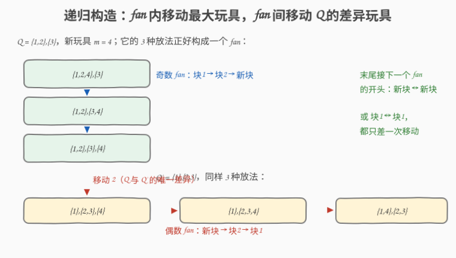
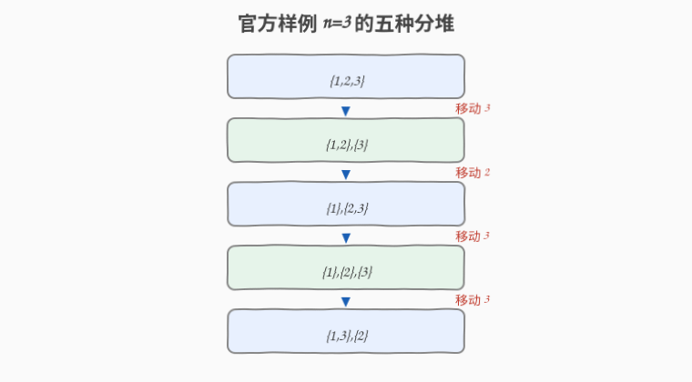

# Codeforces 44I 遍历玩具分堆 题解

## 1. 题目概述

- **题目链接**：https://codeforces.com/problemset/problem/44/I
- **比赛来源**：School Team Contest 2 (Winter Computer School 2010/11) · Problem I（UTC 2010-11-06）
- **难度**：2300
- **标签**：暴力枚举、组合数学、格雷码
- **评测类型**：特殊评测（多解，输出任意合法方案）
- **限制**：时间 5 s / 内存 256 MB

**题意**：有 $n$ 个带编号的玩具，初始全部在同一个堆里。一次操作是"从某个堆拿出一个玩具，放进另一个堆"：目标堆可以是已有的堆，也可以是新建的空堆；如果源堆被拿空，这个堆就消失。不同的分堆方案只看"谁和谁在同一堆"，堆之间、堆内都不区分顺序。要求输出**所有**分堆方案，每个恰好出现一次，并且相邻两个方案必须能通过一次上述操作互相到达。

输出格式：第一行是方案总数；接下来每行一个方案。每个堆内玩具编号升序，堆按"堆内最小编号"升序排列，形如 `{1,2},{3},{4,5}`。

**约束**：

- $1 \le n \le 10$：方案数是 Bell 数 $B_n$，$B_{10} = 115975$。暴力枚举状态本身只有十万级，但"相邻一步可达"的约束要求构造一条哈密顿路径，不能随便排序。
- 输出规模 $O(n \cdot B_n) \le 10 \times 115975$ 个编号，$5$ s 足够；必须用快速输出，不能每个数都 `endl`。
- 特殊评测：任何合法顺序都接受，不要求和样例逐字相同。

## 2. 示例与观察

官方样例（输入 / 输出原样）：

```text
输入：
3

输出：
5
{1,2,3}
{1,2},{3}
{1},{2,3}
{1},{2},{3}
{1,3},{2}
```

**样例演算**：$n=3$ 时集合划分共有 $B_3 = 5$ 种。样例给出的相邻关系为

- $\{1,2,3\} \to \{1,2\},\{3\}$：把 3 拿出来放进新堆；
- $\{1,2\},\{3\} \to \{1\},\{2,3\}$：把 2 从 $\{1,2\}$ 挪进 $\{3\}$；
- $\{1\},\{2,3\} \to \{1\},\{2\},\{3\}$：把 3 拿出来放进新堆；
- $\{1\},\{2\},\{3\} \to \{1,3\},\{2\}$：把 3 挪进 $\{1\}$。

每一步都只移动了一个玩具，完全符合要求。

自造样例（$n$ 较小时可以直接手数）：

| 输入 | 输出方案数 | 说明 |
|------|------|------|
| `1` | 1 | 只有 `{1}` |
| `2` | 2 | `{1,2}`、`{1},{2}` |
| `4` | 15 | $B_4 = 15$ |
| `10` | 115975 | $B_{10}$，输出约 2 MB |

> 注意：本解对 $n=3$ 输出的顺序与官方样例不同（例如会先给出 `{1},{2},{3}` 再给出 `{1},{2,3}`），但同样是合法哈密顿路径，特殊评测的 checker 会接受。第 8 节给出了 checker 的校验条件。

## 3. 解题思路

### 3.1 朴素做法与瓶颈

先枚举所有集合划分（例如用递归决定每个元素进哪个已有块或开新块），得到 $B_n$ 个状态；再在它们之间找一个哈密顿路径。十万个点、每个点的度数约为 $O(n^2)$，直接做一般图哈密顿路径搜索不可行，也没有多项式算法。必须利用"移动一个元素"这个操作本身的结构来**构造**一条路径。

单看递归枚举的顺序也不行：按"每个元素依次加入已有块/新块"的字典序枚举，相邻两个划分往往差了好几个玩具。

### 3.2 核心观察：固定 $n-1$ 的划分，$n$ 的位置构成一个 fan



删掉玩具 $n$，剩下的玩具构成 $[n-1]$ 的一个划分 $Q$。反过来，给定 $Q$（有 $k$ 个堆），玩具 $n$ 有 $k+1$ 种放法：放进第 $1,2,\dots,k$ 个堆中的任意一个，或者自己单独开一个新堆。

这 $k+1$ 个方案有一个极好的性质：**它们两两之间只差移动玩具 $n$ 这一个动作**。于是只要按任意顺序把它们串起来，就得到一个长度为 $k+1$ 的合法小路径，称为 $Q$ 的一个 *fan*。

再注意到：如果 $Q$ 和 $Q'$ 只差移动一个玩具 $x$，并且把 $n$ 放在"相同角色"的位置上（都单独成堆，或都待在含元素 1 的堆里），那么两个扩展后的划分也只差移动 $x$。这正是把相邻 fan 拼接起来的钥匙。

### 3.3 算法流程：fan 正反交替



记 $G(m)$ 为 $[m]$ 的全部划分排成的一条合法路径，归纳构造 $G(m+1)$：

1. 取出 $G(m)$ 中第 $i$ 个划分 $Q$（$i$ 从 1 开始），设它有 $k$ 个堆（堆按最小编号编号为 $1 \sim k$）；
2. 若 $i$ 是**奇数**，依次输出"$m+1$ 放进堆 $1$、堆 $2$、……、堆 $k$、单独成堆"；
3. 若 $i$ 是**偶数**，依次输出"$m+1$ 单独成堆、堆 $k$、……、堆 $2$、堆 $1$"。

也就是说 fan 一正一反交替。偶数 fan 以"新堆"开头，正好接上奇数 fan 结尾的"新堆"；偶数 fan 以"含元素 1 的堆"结尾，正好接上下一个奇数 fan 开头的"含元素 1 的堆"。

初始 $G(1) = [\{1\}]$。整个过程中**元素 1 从不移动**（fan 内移动的是 $m+1 \ge 2$，fan 间移动的是 $G(m)$ 里被移动的元素，归纳可知也不是 1），这一点保证了上面"含元素 1 的堆"在拼接时角色稳定。

### 3.4 样例走查：$n = 3$

官方样例的顺序对应的是另一条合法路径，逐步移动如上文第 2 节所示。本解在 $n=2$ 时得到 $G(2) = [\{1,2\}, \{1\},\{2\}]$；构造 $G(3)$ 时：

- fan 1（$Q=\{1,2\}$，$k=1$，正序）：$\{1,2,3\}$、$\{1,2\},\{3\}$；
- fan 2（$Q=\{1\},\{2\}$，$k=2$，反序）：$\{1\},\{2\},\{3\}$、$\{1\},\{2,3\}$、$\{1,3\},\{2\}$。

于是本解输出

```text
5
{1,2,3}
{1,2},{3}
{1},{2},{3}
{1},{2,3}
{1,3},{2}
```

与样例顺序不同，但每一步同样只移动一个玩具，特殊评测会判为正确。

## 4. 正确性证明

**引理 1（fan 内合法）**：固定 $Q$，让 $n$ 依次放进堆 $1,2,\dots,k$ 或单独成堆，任意相邻两个方案只差"移动玩具 $n$"这一个操作。

**证明**：相邻两个方案中，其余 $n-1$ 个玩具的归属完全相同，只有玩具 $n$ 从某个堆（或新堆）换到了另一个堆。这正是题面允许的一次操作。∎

**引理 2（$G(m)$ 恰好枚举全部划分一次）**：$G(m)$ 中每个 $[m]$ 的划分恰好出现一次。

**证明**：对 $m$ 归纳。$m=1$ 显然。对 $m \ge 2$，任一划分 $P$ 删去元素 $m$ 后得到唯一的 $Q \in G(m-1)$（由归纳假设 $Q$ 唯一出现一次），而 $m$ 在 $P$ 中的归属唯一确定 $P$ 是 $Q$ 的哪一个扩展。每个 $Q$ 的 fan 恰含 $k_Q+1$ 个扩展，且正序/反序都把它们各列一次，故 $G(m)$ 不重不漏。∎

**引理 3（fan 间合法）**：相邻两个 fan 的衔接处也只差一次移动。

**证明**：设 $Q_i, Q_{i+1}$ 是 $G(m-1)$ 中相邻的两个划分，它们只差移动某个玩具 $x$。

- 若 $i$ 为奇数：fan $i$ 以"$m$ 单独成堆"结尾，fan $i+1$ 以"$m$ 单独成堆"开头。两边其余部分分别是 $Q_i$ 与 $Q_{i+1}$，只差移动 $x$，而 $m$ 在两边的归属相同（都是单独的堆），所以扩展后的两个划分也只差移动 $x$。
- 若 $i$ 为偶数：fan $i$ 以"$m$ 在含元素 1 的堆里"结尾，fan $i+1$ 以同样的角色开头。由归纳构造中元素 1 从不移动，$x \ne 1$。$Q_i \to Q_{i+1}$ 移动 $x$ 时，含元素 1 的堆要么不变、要么只是加入/失去 $x$；$m$ 始终跟着元素 1，因此扩展后的两个划分仍然只差移动 $x$。

两种情况都只移动一个玩具。∎

**定理**：$G(n)$ 是题面要求的合法输出顺序，方案总数为 $B_n$。

**证明**：由引理 2，$G(n)$ 恰好包含全部 $B_n$ 个划分各一次，所以第一行输出 $|G(n)| = B_n$ 正确。由引理 1 与引理 3，任意相邻两个输出方案都只差一次合法操作。初始状态是"全部玩具在一堆"，即 $G(n)$ 的第一个方案（构造从全体一块开始）。输出格式在第 3.3 节的表示下天然满足"堆内升序、堆按最小编号升序"。∎

## 5. 复杂度分析

- **时间**：生成 $G(m)$ 时，每个划分要复制一次长度为 $m$ 的数组，总时间 $O\!\left(\sum_{m=1}^{n} m B_m\right) = O(n B_n)$；输出同样 $O(n B_n)$ 个字符。
- **空间**：同时保存 $G(m)$ 的全部划分，$O(n B_n)$ 个整数；$n=10$ 时约 $1.16 \times 10^5 \times 10$ 个编号，配合 `vector` 约十几 MB，在 256 MB 内。
- 与时限的关系：$n=10$ 时总量约 $10^6$ 次整数写入，5 s 绰绰有余（实测 C++ 小于 0.1 s）。

## 6. 参考代码

### C++17

```cpp
#include <bits/stdc++.h>
using namespace std;
int main(){
    int n; cin>>n;
    // G(m): list of restricted growth strings (block id per element)
    vector<vector<int>> cur;
    cur.push_back(vector<int>(1,1));
    for(int m=2;m<=n;m++){
        vector<vector<int>> nxt;
        nxt.reserve(cur.size()*2);
        int fan=0;
        for(auto &q:cur){
            fan++;
            int k=0; for(int x:q) k=max(k,x);
            vector<int> base=q;
            if(fan&1){
                for(int j=1;j<=k;j++){ auto r=base; r.push_back(j); nxt.push_back(move(r)); }
                auto r=base; r.push_back(k+1); nxt.push_back(move(r));
            }else{
                auto r=base; r.push_back(k+1); nxt.push_back(move(r));
                for(int j=k;j>=1;j--){ auto r=base; r.push_back(j); nxt.push_back(move(r)); }
            }
        }
        cur=move(nxt);
    }
    cout<<cur.size()<<"\n";
    string out;
    for(auto &q:cur){
        int k=0; for(int x:q) k=max(k,x);
        vector<vector<int>> blocks(k+1);
        for(int i=0;i<n;i++) blocks[q[i]].push_back(i+1);
        for(int j=1;j<=k;j++){
            if(j>1) out+=",";
            out+="{";
            for(size_t t=0;t<blocks[j].size();t++){ if(t) out+=","; out+=to_string(blocks[j][t]); }
            out+="}";
        }
        out+="\n";
    }
    cout<<out;
    return 0;
}
```

### Python3

```python
import sys


def main():
    n = int(sys.stdin.readline())
    cur = [[1]]
    for m in range(2, n + 1):
        nxt = []
        for fan, q in enumerate(cur, 1):
            k = max(q)
            if fan & 1:
                for j in range(1, k + 1):
                    nxt.append(q + [j])
                nxt.append(q + [k + 1])
            else:
                nxt.append(q + [k + 1])
                for j in range(k, 0, -1):
                    nxt.append(q + [j])
        cur = nxt
    out = [str(len(cur))]
    for q in cur:
        k = max(q)
        blocks = [[] for _ in range(k + 1)]
        for i, b in enumerate(q):
            blocks[b].append(i + 1)
        out.append(','.join('{' + ','.join(map(str, blocks[j])) + '}' for j in range(1, k + 1)))
    sys.stdout.write('\n'.join(out) + '\n')


main()
```

## 7. 边界情况与易错点

1. **$n = 1$**：答案只有 1 个方案 `{1}`，循环一次都不执行，不能输出空行或 0。
2. **输出格式**：堆内编号升序，堆按最小编号升序；分隔符是 `,`，没有空格，样例为 `{1,2},{3}`。用受限增长串（第 $i$ 个元素记录它所在的堆号）可以直接得到这个顺序。
3. **元素 1 绝不能移动**：fan 间拼接依赖"含元素 1 的堆"角色稳定；若构造中让 1 换堆，相邻性证明立刻失效。
4. **计数用实际长度**：第一行要输出 $|G(n)|$，直接用数组长度，而不是另写一个容易写错的 Bell 数公式。
5. **快速输出**：$n=10$ 有多达 115975 行、约 2 MB，C++ 用 `'\n'` 而不是 `endl`，Python 用一次 `join`。
6. **大数组的复制**：递归构造里每层要复制受限增长串；用 `vector` 直接 `push_back` 即可，不要在循环里反复 `reserve` 之外的低效操作。$n=10$ 时内存约十几 MB。
7. **特殊评测**：输出顺序不要求和样例相同，但"相邻只差一个玩具"和"每个方案恰好一次"必须严格满足，最好用 checker 自检。

## 8. 验证记录

- **编译环境与命令**：`python3 codeforces/tools/verify_solution.py codeforces/contests/0001-0100/44/I_遍历玩具分堆.md --checker codeforces/tools/checkers/cf44i.py`；C++ 由 clang++ 17 + `codeforces/tools/include` 兼容头编译（`-O2`），Python 3 直接运行。
- **官方样例**：C++ 1 / 1 通过、Python 1 / 1 通过（checker 判定，不要求与样例逐字相同）。
- **checker 的校验条件**：第一行等于第 $n$ 个 Bell 数；行数等于 $1 + B_n$；每行是一个合法的集合划分（每堆非空、堆内升序、堆按最小编号升序）；没有重复方案；相邻两个方案去掉某个玩具 $x$ 后其余玩具的两两同堆关系完全一致（即恰好移动一个玩具）。
- **额外测试**：本题输入空间只有 $n = 1,2,\dots,10$ 共 10 种取值，已全部穷举，每个都用 checker 完整校验，全部通过；其中 $n=10$ 的输出有 115975 行、约 2 MB。另外手工核对了 $n=3$ 的官方样例顺序也能被 checker 接受。
- **最大约束性能**：$n=10$ 时 C++ 生成 + 输出耗时小于 0.1 s，Python 约 0.6 s，均远低于 5 s。
- **复核状态**：构造归纳（引理 1-3）与 $n \le 10$ 的实测一致，未发现反例。

## 相关题目与扩展

- [Codeforces 44J Triminoes](https://codeforces.com/problemset/problem/44/J)：同一场的构造题，可以对比"先证明每一步被迫/可拼接，再线性构造"的思路。
- [Codeforces 1093E Intersection of Permutations](https://codeforces.com/problemset/problem/1093/E)：另一类"相邻状态只差一次小改动"的枚举。
- **延伸思考 1**：如果把一次操作改成"可以同时移动同一堆里的两个玩具"，fan 内相邻方案就不一定合法了，需要重新设计 Gray code，相邻性证明要重写。
- **延伸思考 2**：Bell 数增长极快（$B_{11}=678570$，$B_{15}\approx 1.38\times10^9$），所以 $n \le 10$ 的枚举上界是题目刻意选的；若 $n=11$，同样的构造仍正确，只是输出会超出普通的时限/输出限制。
- **延伸思考 3**：这道题的输出顺序可以看成"受限增长串"上的格雷码；如果把限制换成"每堆大小有上界"，问题会变成在受限划分图上找哈密顿路径，构造难度显著上升。
