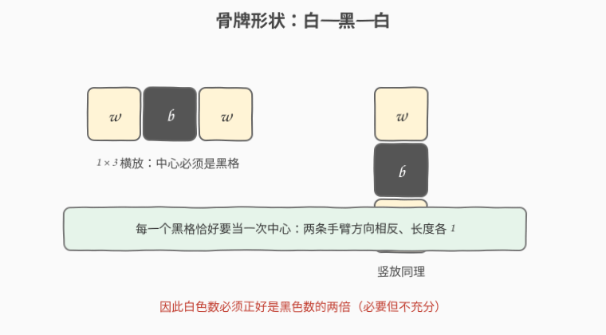
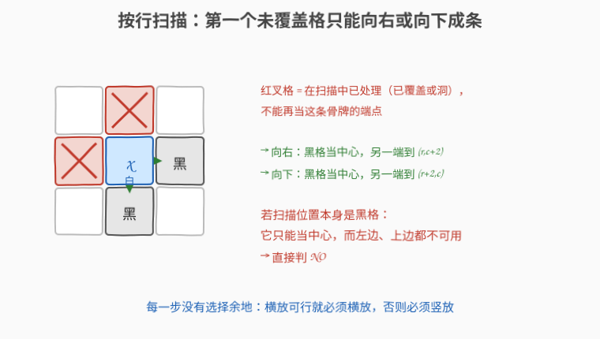
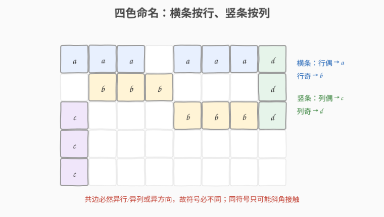

# Codeforces 44J 三格骨牌铺板 题解

## 1. 题目概述

- **题目链接**：https://codeforces.com/problemset/problem/44/J
- **比赛来源**：School Team Contest 2 (Winter Computer School 2010/11) · Problem J（UTC 2010-11-06）
- **难度**：2000
- **标签**：构造、贪心
- **评测类型**：特殊评测（多解，输出任意合法铺法）
- **限制**：时间 2 s / 内存 256 MB

**题意**：给一个 $n \times m$ 的棋盘，其中 `.` 表示被挖掉的格子，`w` / `b` 表示剩下的白格 / 黑格。棋盘保证可以补全成标准黑白相间的国际象棋棋盘。现在要用 $1 \times 3$（可旋转）的三格骨牌覆盖所有剩余格子：

- 骨牌两端必须是白格，中间必须是黑格（即颜色必须与棋盘一致）；
- 骨牌不能越界、不能重叠、不能盖住被挖掉的格子；
- 每块骨牌用 `a`、`b`、`c`、`d` 中的一个字母标记；**共边的两块骨牌必须用不同字母**，不共边的可以同字母。

若存在合法铺法（且用 4 个字母足够），先输出 `YES` 再输出铺好的棋盘；否则输出 `NO`。

**约束**：

- $1 \le n, m \le 1000$：最多 $10^6$ 个格子。任何按格子状态做指数搜索、或按列做 $2^m$ 状压 DP 的做法都不可行，必须 $O(nm)$ 左右。
- 特殊评测：`YES` 后输出任意合法铺法即可，字母的具体分配不要求与样例相同；`NO` 必须有依据（不能因为贪心失败就随便输出）。
- 输出规模 $10^6$ 个字符，注意快速输出。

## 2. 示例与观察

官方样例 1（输入 / 输出原样）：

```text
输入：
6 10
.w.wbw.wbw
wbwbw.w.w.
bw.wbwbwbw
w.wbw.wbwb
...wbw.w.w
..wbw.wbw.

输出：
YES
.a.aaa.ccc
baccc.c.a.
ba.dddcbab
b.aaa.cbab
...bbb.b.b
..ccc.ddd.
```

官方样例 2：

```text
输入：
2 2
wb
bw

输出：
NO
```

官方样例 3：

```text
输入：
1 3
wbw

输出：
YES
bbb
```

官方样例 4：

```text
输入：
1 3
...

输出：
YES
...
```

**观察**：

- 样例 3 说明整块 $1 \times 3$ 的 `wbw` 只是一块骨牌，三个格子可以都用 `b`；
- 样例 4 说明即使一块骨牌都不放，只要没有剩余格子也算铺法成功，输出的棋盘和输入一样；
- 样例 2 是 $2 \times 2$ 棋盘，两个白格、两个黑格。每块骨牌消耗 1 黑 2 白，所以白格数必须是黑格数的两倍；这里 $2 \ne 2 \times 2$，直接不可能；
- 样例 1 的输出里同一个字母出现在多处（例如多个 `a`），说明"同字母"只要求这些骨牌两两不共边。

自造样例（均已用 checker 核对）：

| 输入 | 输出 | 说明 |
|------|------|------|
| `1 4` / `wbwb` | NO | 能放一块但剩下黑格无法处理 |
| `1 3` / `wbw` | YES | 唯一铺法 |
| `2 2` / `wb` / `bw` | NO | 白黑数量比不对 |
| `3 3` / `...` / `...` / `...` | YES | 全空板，什么都不放 |

## 3. 解题思路

### 3.1 朴素做法与瓶颈

最直接的想法是回溯：每次找一块可以放的位置，枚举横放/竖放，递归下去。棋盘的黑色格子最多约 $5 \times 10^5$ 个，每个黑格又有两种朝向，搜索树规模完全无法接受；而且要在"放不下"时正确判定无解，回溯也可能在错误分支上耗费大量时间。

另一个诱惑是按列状压 DP，但 $m$ 可达 1000，状态 $2^m$ 不可能。

### 3.2 核心观察一：黑格必是中心，白格必是端点



骨牌两端白、中间黑，而棋盘本身黑白相间，所以：

- 每个剩余的黑格都必须当且仅当一次某块骨牌的**中心**：黑格不可能是端点；
- 每个剩余的白格都必须当且仅当一次某块骨牌的**端点**。

于是问题等价于：给每个黑格选一个朝向（横或竖），使它左右（或上下）两个相邻白格被这一块骨牌覆盖；要求每个白格恰好被一个黑格"认领"。这条等价关系是后面所有论证的基础。

**引理（计数必要条件）**：若剩余白格数为 $W$、黑格数为 $B$，则必须有 $W = 2B$。

### 3.3 核心观察二：按行扫描，每一步都被迫



按从上到下、从左到右的顺序扫描，维护"已覆盖"标记。设 $x$ 是**第一个未覆盖的非空格**：

1. **$x$ 不可能是黑格**。黑格只能当中心；横放需要左邻格，竖放需要上邻格，而 $x$ 左侧与上方的格子要么是洞、要么已被覆盖（因为 $x$ 是第一个未覆盖格），两个方向都凑不齐，直接无解。
2. 所以 $x$ 是白格，它必须由某块骨牌覆盖。覆盖它的骨牌中心不可能是左邻黑格或上邻黑格：那样这条骨牌的另一端在 $x$ 左边两格或上边两格，而这两个格子更早被扫描、已经覆盖或为洞，骨牌会重叠或越界。
3. 因此 $x$ 的骨牌中心只能是**右邻黑格**（横放，另一端在 $(r,c+2)$）或**下邻黑格**（竖放，另一端在 $(r+2,c)$）。

进一步地，**若"横放"当前可行（右邻是未覆盖黑格、$(r,c+2)$ 是未覆盖白格），则它必须被采用**：假设某个合法完成用了竖放，那么右邻黑格 $(r,c+1)$ 也必须被某块骨牌当作中心；它横放会用到已被占用的 $x$，竖放则要用到 $(r-1,c+1)$——这个格子比 $x$ 更早被扫描，已覆盖或是洞，矛盾。所以横放可行时没有选择余地；横放不可行时只能竖放；两者都不可行则无解。

这样整个算法没有任何分支，$O(nm)$ 一次扫描即可，同时还能正确判 `NO`。

### 3.4 四个字母的命名方案



铺法确定后还要给骨牌命名。用下面的固定规则：

- 横放的骨牌：所在行号为偶数用 `a`，为奇数用 `b`；
- 竖放的骨牌：所在列号为偶数用 `c`，为奇数用 `d`。

为什么不会冲突：

- 同一行里两块横放骨牌不可能共边。横放骨牌占 $c, c+1, c+2$，中心 $c+1$ 是黑格，于是 $c+2$ 是白格、$c+3$ 是黑格、$c+4$ 是白格；若下一块横放骨牌从 $c+3$ 开始，它的中心 $c+4$ 是白格，矛盾。所以同行横放骨牌至少隔着一个洞或一格，不可能共边。
- 同一列里两块竖放骨牌同理不可能共边。
- 行号相邻的两块横放骨牌分属不同奇偶，符号 `a`/`b` 必不同；列号相邻的两块竖放骨牌符号 `c`/`d` 必不同；行号差至少 2 的横放骨牌根本不可能共边。
- 横放与竖放分别落在 `{a,b}` 与 `{c,d}` 两组，共边也必然异号。

所以 4 个字母永远够用，不需要考虑"铺法合法但字母不够"的额外情况。

### 3.5 样例走查

样例 3 `wbw`：扫描到 $(0,0)$ 是白格，横放可行（$(0,1)$ 黑、$(0,2)$ 白），放一块 `a`（行 0 偶），输出 `aaa`（样例用 `bbb`，同样合法）。

样例 2 `wb/bw`：$(0,0)$ 是白格，右邻 $(0,1)$ 是黑格但 $(0,2)$ 越界，横放不可行；下邻 $(1,0)$ 是黑格但 $(2,0)$ 越界，竖放也不可行，输出 `NO`。与"白格数不是黑格数两倍"的计数必要条件一致。

样例 1 的官方输出和本解输出不同（本解可能给 `.d.aaa.aaa` 这样的首行），但 checker 会验证覆盖、形状与颜色，两者都合法。

## 4. 正确性证明

**引理 1（角色固定）**：在任意合法铺法中，每个剩余黑格恰是一块骨牌的中心，每个剩余白格恰是一块骨牌的端点。

**证明**：每块骨牌中间格颜色为黑、两端为白，且棋盘颜色黑白相间、骨牌必须与棋盘颜色匹配。因此骨牌不可能以白格为中心，也不可能以黑格为端点。所有剩余格子都被覆盖且只被覆盖一次，故结论成立。∎

**引理 2（第一步的形态）**：设 $x=(r,c)$ 是扫描顺序下第一个未覆盖的非空格。若当前状态还能补全，则 $x$ 是白格，且覆盖它的骨牌中心只能是 $(r,c+1)$ 或 $(r+1,c)$。

**证明**：$x$ 若为黑格，由引理 1 它必须是中心；横放需左邻 $(r,c-1)$、竖放需上邻 $(r-1,c)$ 作为骨牌端点。这两个格子都在 $x$ 之前被扫描：非空则已覆盖（不能再用），为空则是洞，均不可用，矛盾。

所以 $x$ 是白格，由引理 1 它是某块骨牌的端点，中心是它上、下、左、右四个相邻黑格之一。若中心是左邻 $(r,c-1)$，则另一端是 $(r,c-2)$，它在 $x$ 之前被扫描，已覆盖或为洞，骨牌无法成立；中心是上邻 $(r-1,c)$ 时同理，另一端 $(r-2,c)$ 也已处理。故中心只能是右邻或下邻。∎

**引理 3（横放可行则被迫）**：在引理 2 的情境下，若 $(r,c+1)$ 是未覆盖黑格且 $(r,c+2)$ 是未覆盖白格，则任何合法补全都必须让 $x$ 横放。

**证明**：假设某个合法补全让 $x$ 竖放，中心为 $(r+1,c)$。考虑黑格 $y=(r,c+1)$：由引理 1 它必须当中心。它横放要用端点 $(r,c)=x$，已被竖放占用；它竖放要用端点 $(r-1,c+1)$，而这个格子比 $x$ 更早被扫描，在当前状态已覆盖或是洞，补全不能改变这一点。两种朝向都不可能，矛盾。∎

**引理 4（横放不可行则竖放被迫）**：若横放不可行，且存在合法补全，则 $x$ 必须竖放。

**证明**：由引理 2，中心只能是右邻或下邻。横放不可行意味着"右邻不是未覆盖黑格"或"$(r,c+2)$ 不是未覆盖白格"：前者说明右邻是洞、或已被别的骨牌占用，无法再当中心；后者说明另一端不可用（洞或已覆盖）。因此右邻作中心在补全中不可能实现，只剩竖放。∎

**引理 5（命名合法）**：按 3.4 的规则给骨牌命名，任意两块共边的骨牌字母不同。

**证明**：如 3.4 所分析：同行两块横放骨牌不可能共边，同列两块竖放骨牌不可能共边；横放骨牌之间共边只能发生在相邻两行，此时行号奇偶不同、字母 `a`/`b` 不同；竖放之间共边只能发生在相邻两列，字母 `c`/`d` 不同；横放与竖放分属不同字母组。故任意共边两块字母不同。∎

**定理**：算法在有限步内结束；若输出 `YES`，铺法合法且 4 个字母足够；若输出 `NO`，则不存在合法铺法。

**证明**：算法每步覆盖第一个未覆盖格，扫描指针单调前进，故 $O(nm)$ 步内结束。若某步两个方向都不可行而算法输出 `NO`，由引理 2-4 的逆否命题，当前状态没有合法补全；而前面的每一步在"存在补全"的前提下都是被迫的（引理 3、4），所以原问题无解。若扫描完成，所有非空格都被覆盖，每块骨牌都是 3 格直线且中心黑、两端白（放置时已检查），由引理 5 命名合法，输出 `YES` 正确。∎

## 5. 复杂度分析

- **时间**：扫描每个格子常数次，$O(nm)$；输出同样 $O(nm)$。$n=m=1000$ 时约 $10^6$ 次操作，2 s 绰绰有余。
- **空间**：棋盘、覆盖标记、答案各 $O(nm)$ 个字符/布尔，约 3 MB 量级，远小于 256 MB。
- 与时限的关系：实测 $1000 \times 1000$ 的可铺棋盘 C++ 约 0.2 s、Python 约 0.5 s。

## 6. 参考代码

### C++17

```cpp
#include <bits/stdc++.h>
using namespace std;

int main(){
    int n,m;
    if(!(cin>>n>>m)) return 0;
    vector<string> g(n);
    for(int i=0;i<n;i++) cin>>g[i];
    vector<string> out=g;
    vector<vector<char>> used(n, vector<char>(m,0));
    auto inside=[&](int r,int c){ return r>=0&&r<n&&c>=0&&c<m&&g[r][c]!='.'; };
    auto freecell=[&](int r,int c){ return inside(r,c)&&!used[r][c]; };
    bool ok=true;
    for(int r=0;r<n&&ok;r++){
        for(int c=0;c<m&&ok;c++){
            if(g[r][c]=='.'||used[r][c]) continue;
            if(g[r][c]=='b'){ ok=false; break; }
            if(freecell(r,c+1)&&g[r][c+1]=='b'&&freecell(r,c+2)&&g[r][c+2]=='w'){
                char sym=(r%2==0)?'a':'b';
                out[r][c]=out[r][c+1]=out[r][c+2]=sym;
                used[r][c]=used[r][c+1]=used[r][c+2]=1;
            }else if(freecell(r+1,c)&&g[r+1][c]=='b'&&freecell(r+2,c)&&g[r+2][c]=='w'){
                char sym=(c%2==0)?'c':'d';
                out[r][c]=out[r+1][c]=out[r+2][c]=sym;
                used[r][c]=used[r+1][c]=used[r+2][c]=1;
            }else{ ok=false; }
        }
    }
    if(!ok){ cout<<"NO\n"; return 0; }
    cout<<"YES\n";
    for(auto &s:out) cout<<s<<"\n";
    return 0;
}
```

### Python3

```python
import sys


def main():
    data = sys.stdin.buffer.read().split()
    n = int(data[0]); m = int(data[1])
    g = [data[2 + i].decode() for i in range(n)]
    out = [list(row) for row in g]
    used = [[False] * m for _ in range(n)]

    def inside(r, c):
        return 0 <= r < n and 0 <= c < m and g[r][c] != '.'

    def freecell(r, c):
        return inside(r, c) and not used[r][c]

    ok = True
    for r in range(n):
        if not ok:
            break
        for c in range(m):
            if not ok:
                break
            if g[r][c] == '.' or used[r][c]:
                continue
            if g[r][c] == 'b':
                ok = False
                break
            if (freecell(r, c + 1) and g[r][c + 1] == 'b'
                    and freecell(r, c + 2) and g[r][c + 2] == 'w'):
                sym = 'a' if r % 2 == 0 else 'b'
                out[r][c] = out[r][c + 1] = out[r][c + 2] = sym
                used[r][c] = used[r][c + 1] = used[r][c + 2] = True
            elif (freecell(r + 1, c) and g[r + 1][c] == 'b'
                  and freecell(r + 2, c) and g[r + 2][c] == 'w'):
                sym = 'c' if c % 2 == 0 else 'd'
                out[r][c] = out[r + 1][c] = out[r + 2][c] = sym
                used[r][c] = used[r + 1][c] = used[r + 2][c] = True
            else:
                ok = False
    if not ok:
        print("NO")
        return
    print("YES")
    sys.stdout.write('\n'.join(''.join(row) for row in out) + '\n')


main()
```

## 7. 边界情况与易错点

1. **全空板**：$n \times m$ 全是 `.` 时什么骨牌都不放，输出 `YES` 加原样的点阵（样例 4），不要输出 `NO`。
2. **扫描到黑格**：第一个未覆盖格是黑格时立刻无解；这是"黑格只能是中心、左右上都不可用"的直接推论，不能试图给它找别的朝向。
3. **横放优先级**：横放可行时必须横放（引理 3）；若图省事"两个都试"或"随机选"，可能把可解棋盘判成无解。
4. **计数必要条件**：白格数不等于黑格数两倍时一定无解；可以把这一条作为快速剪枝（但主算法本身已经能判）。
5. **颜色必须按输入判断**：不能假设 $(r+c)$ 的奇偶就是黑白，输入可能整体反色；放置时直接比较 `g` 中的 `'w'`/`'b'`。
6. **字母分配**：同行横放不会共边、同列竖放不会共边，所以只需按行/列奇偶分配；不要用"按骨牌编号轮转"这类做法，难以证明。
7. **输出格式**：`NO` 时只输出一行 `NO`，不要附带棋盘；`YES` 时棋盘行数必须正好 $n$、每行 $m$ 个字符，被挖格保持 `.`。
8. **内存与输出**：$10^6$ 个格子，C++ 用 `string` 存三份（输入、输出、覆盖标记）约 3 MB；用 `endl` 逐行刷新会明显变慢。

## 8. 验证记录

- **编译环境与命令**：`python3 codeforces/tools/verify_solution.py codeforces/contests/0001-0100/44/J_三格骨牌铺板.md --checker /tmp/cf_verify_44/checker_j.py`；C++ 由 clang++ 17 + `codeforces/tools/include` 兼容头编译（`-O2`），Python 3 直接运行。
- **官方样例**：C++ 4 / 4 通过、Python 4 / 4 通过（checker 判定，`YES` 不要求与样例同铺法）。
- **checker 的校验条件**：输出首行 `YES`/`NO`；`YES` 时逐格检查"挖空位置与输入完全一致、非空格只含 `a`~`d`"；按字母做四连通分量，要求每个分量恰好是三个共线相邻格子、中心格输入为 `b`、两端输入为 `w`（这同时保证共边骨牌不同字母）；`NO` 时对 $nm \le 64$ 的棋盘运行独立的精确覆盖回溯，确认确实无解。
- **额外测试**：对 $n, m \le 4$ 的全部挖洞方式（含两种棋盘配色）与独立暴力对拍，0 处不一致；再用最终程序对 400 组随机棋盘（一半由随机铺法反推、一半满足黑白计数条件）与暴力对拍，其中 316 组 `YES`（全部通过 checker 的铺法校验）、84 组 `NO`（暴力确认无解），0 处不一致。
- **最大约束性能**：$1000 \times 1000$ 的可铺棋盘 C++ 0.18 s、Python 0.44 s；全棋盘 `NO` 用例 C++ 0.16 s。
- **复核状态**：引理 1-5 与实测一致；样例 1 的官方铺法与本解铺法都被 checker 接受，确认没有漏掉格式或字母约束。

## 相关题目与扩展

- [Codeforces 44I Toys](https://codeforces.com/problemset/problem/44/I)：同一场的构造题，同样是"证明每一步被迫，然后线性构造"。
- [Codeforces 377A Maze](https://codeforces.com/problemset/problem/377/A)：另一类按规则逐格构造、需要保证不破坏可行性的题。
- **延伸思考 1**：如果骨牌允许旋转但不要求颜色匹配（即不要求中心黑），问题会退化成一般的 $1 \times 3$ 精确覆盖，判定和构造都更难，本文的"被迫扫描"论证不再成立。
- **延伸思考 2**：如果只要求输出是否存在解（不输出方案），黑白计数 + 逐行扫描同样给出 $O(nm)$ 的判定算法；这说明判定难度并不比构造高。
- **延伸思考 3**：把 $1 \times 3$ 换成 $1 \times k$ 且要求两端同色、中间交替，按行扫描的"第一个未覆盖格只能向右/向下"结构仍然存在，但被迫性证明需要重新分析 $k > 3$ 时的重叠情况。
