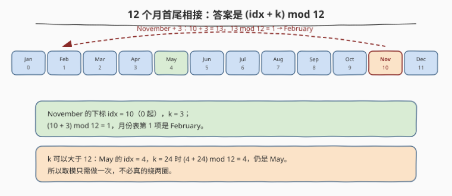
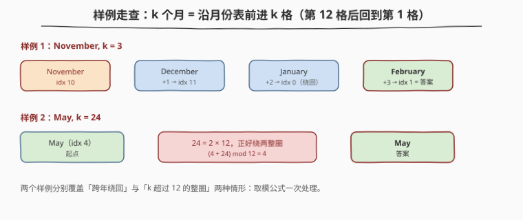

# Codeforces 45A 月份循环推算 题解

## 1. 题目概述

- **题目链接**：https://codeforces.com/problemset/problem/45/A
- **比赛来源**：Codeforces Beta Round 45 · Problem A（2010-10-13）
- **难度**：900
- **标签**：实现
- **评测类型**：普通
- **限制**：时间 2 s / 内存 256 MB

**题意**：输入当前月份名和一个整数 $k$，输出 $k$ 个月之后是哪个月。月份名固定为英文的 January、February、…、December，首字母大写、其余小写。$k$ 可以为 $0$，也可以超过 $12$，此时要正确绕圈。

**约束**：

- $0 \le k \le 100$：最多 100 个整圈，逐月模拟也只需 $100$ 步，但取模是一次性的、更简洁的写法。
- 月份表长度为 $12$，是固定常量：把月份名映射到 $0 \sim 11$ 的下标后做加法即可，不需要处理闰年、大小月。
- 输入只有一组数据，且月份名保证合法，不用做容错。

## 2. 示例与观察

官方样例 1（输入 / 输出原样）：

```text
输入：
November
3

输出：
February
```

**演算**：November 的下标是 $10$；$10 + 3 = 13$，$13 \bmod 12 = 1$，下标 $1$ 对应 February。

官方样例 2（输入 / 输出原样）：

```text
输入：
May
24

输出：
May
```

**演算**：May 的下标是 $4$；$4 + 24 = 28$，$28 \bmod 12 = 4$，还是 May。$24 = 2 \times 12$ 恰好是两整圈，所以答案与起点相同。

**观察**：

1. 月份是一个长度为 $12$ 的**循环表**：December 的下一个月是 January。
2. 因此"$k$ 个月后"就是从当前下标出发，沿循环表前进 $k$ 格，落点下标为 $(\text{idx} + k) \bmod 12$。
3. 由于 $k \ge 0$，C++ 的 `%` 语义（负数取模才需要修正）在这里是安全的。



## 3. 解题思路

### 3.1 朴素做法与瓶颈

最直白的写法是逐月前进：从当前月份出发，重复 $k$ 次"下一个月"，遇到 December 就回到 January。因为 $k \le 100$，这个模拟最多做 $100$ 步，本身完全可以通过。

但它没有必要：$k$ 步模拟被重复了 $k$ 次同样的动作，而月份表是周期的，$k$ 整圈之后回到原地，只有 $k \bmod 12$ 这部分真正影响答案。

### 3.2 核心观察：只需一次取模

把月份名换成下标 $i \in [0, 11]$，则 $k$ 个月之后的下标是

$$j = (i + k) \bmod 12 .$$

因为从 $i$ 出发走 $k$ 步，每走 $12$ 步回到同一格，所以只需关心 $k$ 除以 $12$ 的余数。这同时解释了样例 2：$k = 24$ 时余数为 $0$，答案就是起点。

### 3.3 算法流程

1. 建一张长度为 $12$ 的字符串数组，按顺序存放十二个月份名；
2. 读入月份名，在数组里找到它的下标 $i$；
3. 读入 $k$，计算 $j = (i + k) \bmod 12$；
4. 输出数组第 $j$ 项。

### 3.4 样例走查



样例 1 走三步：November(10) → December(11) → January(0，绕回) → February(1)。样例 2 走 $24$ 步，正好两整圈，回到 May(4)。两条路径都落公式 $(i + k) \bmod 12$ 上。

## 4. 正确性证明

**引理 1（周期）**：对任意下标 $i$ 和整数 $t \ge 0$，从 $i$ 出发沿月份表前进 $t$ 步后的下标等于 $(i + t) \bmod 12$。

**证明**：对 $t$ 归纳。$t = 0$ 时下标为 $i = (i + 0) \bmod 12$。若 $t$ 时成立，则再走一步：若当前下标 $x < 11$，下一步是 $x + 1 = (x + 1) \bmod 12$；若 $x = 11$，下一步回到 $0 = (11 + 1) \bmod 12$。两种情形都等于 $(i + t + 1) \bmod 12$。∎

**定理**：算法输出的月份名就是 $k$ 个月之后的月份。

**证明**：由引理 1，$k$ 步之后的下标为 $(i + k) \bmod 12$，其中 $i$ 是输入月份在固定表中的下标。算法输出的正是表中该下标的字符串，而表中字符串与月份名一一对应，故输出正确。∎

## 5. 复杂度分析

- **时间**：$O(12)$ 建表与查表（常数），取模 $O(1)$；总体 $O(1)$，与 $k$ 无关。
- **空间**：$O(12)$ 的字符串表，$O(1)$。
- **与时限的关系**：2 s 时限下，任何实现都是微秒级，毫无压力。

## 6. 参考代码

### C++17

```cpp
#include <bits/stdc++.h>
using namespace std;
int main(){
    ios::sync_with_stdio(false);
    cin.tie(nullptr);
    string s;
    if(!(cin>>s)) return 0;
    long long k; cin>>k;
    static const char* mon[12]={"January","February","March","April","May","June",
        "July","August","September","October","November","December"};
    int idx=0;
    for(int i=0;i<12;i++) if(s==mon[i]) idx=i;
    cout<<mon[(int)((idx + k%12)%12)]<<"\n";
    return 0;
}
```

### Python3

```python
import sys

def main():
    data = sys.stdin.read().split()
    s = data[0]
    k = int(data[1])
    months = ["January","February","March","April","May","June",
              "July","August","September","October","November","December"]
    i = months.index(s)
    print(months[(i + k) % 12])

if __name__ == "__main__":
    main()
```

## 7. 边界情况与易错点

1. **$k = 0$**：直接输出输入月份，取模公式天然给出 $(i + 0) \bmod 12 = i$，不要写成 `(i + k - 1) % 12` 之类的偏移。
2. **$k$ 是 $12$ 的倍数**：例如 `May` + $24$，答案是 May 而不是 June；样例 2 专门考这一点。
3. **跨年绕回**：November、December 加几个月会越过 December 回到 January，必须用取模而不是简单的 `idx + k`。
4. **下标基准**：月份下标从 $0$ 开始（January $= 0$），输出时不要再 $+1$，否则会整体错位一个月。
5. **字符串匹配**：月份名要靠查表比较得到下标，不要用 `s[0]` 之类的首字母猜测（J 同时是 January、June、July 的首字母）。
6. **输入读取**：月份名与 $k$ 在两行，用 `cin >> s >> k` 或 `split` 读入即可，不要整行读入后忘记处理换行。

## 8. 验证记录

- **编译环境与命令**：`g++ -std=c++17 -O2`（本机为 clang++ 兼容头方案，`verify_solution.py` 自动处理），Python 3.12。
- **官方样例**：2 / 2 通过（`verify_solution.py` 输出 `CF45A: samples 2 / C++ 编译 OK, 样例 2/2 / Python 语法 OK, 样例 2/2`）。
- **额外测试**：随机对拍 $400$ 组，月份随机、$k \in [0, 100]$，与一份"逐月前进"的独立实现逐组比对，全部一致。
- **最大约束性能**：$k = 100$ 时 C++ 约 $3$ ms、Python 约 $10$ ms（均为含进程启动的整程序耗时，算法本身是常数级）。
- **复核状态**：`check.py` 0 失败；样例与 `.cf-meta/statements/CF45A.json` 逐字一致。

## 相关题目与扩展

- [Codeforces 45B School](https://codeforces.com/problemset/problem/45/B)：同样要在环形结构上走若干步，但步长很大、还要统计首次到达。
- [Codeforces 4A 西瓜](https://codeforces.com/problemset/problem/4/A)：同场次的入门实现题，可作难度对照。

**延伸思考**：

1. 如果输入改成"闰年 2 月 29 天、每月天数不同"，公式就变成对 $365$ 或 $366$ 取模，需要先做天数前缀和再二分定位月份；这是日历类题目的通用套路。
2. 如果 $k$ 可以取到 $10^{18}$，仍然只需 $k \bmod 12$：周期性让大数输入退化为一次取模，注意 Python 可直接算、C++ 要用 `long long`。
3. 如果要求"输出两个日期之间的月份差"，可以把月份映射到绝对月序号（年 $\times 12 +$ 月）再相减，这比逐月模拟更稳。
