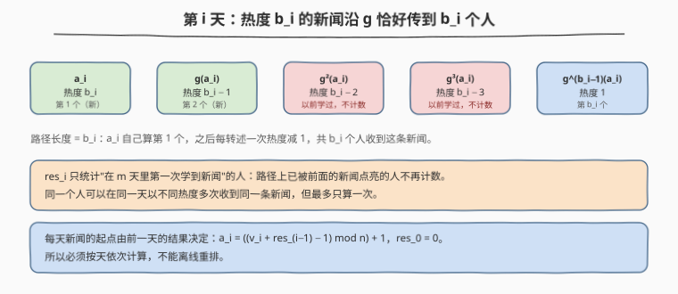
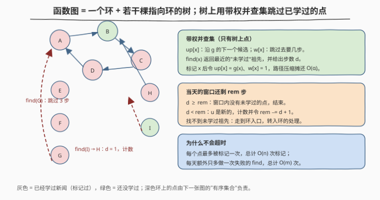
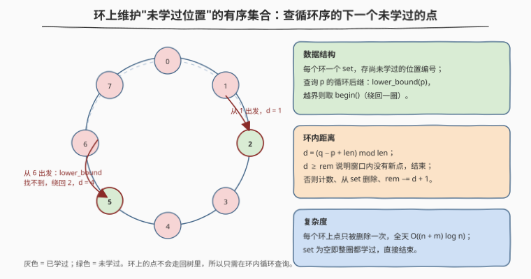

# Codeforces 45B 校园新闻传播 题解

## 1. 题目概述

- **题目链接**：https://codeforces.com/problemset/problem/45/B
- **比赛来源**：School Team Contest 3 (Winter Computer School 2010/11) · Problem B（UTC 2010-11-13）
- **难度**：2200
- **标签**：dp、并查集（dsu）、函数图
- **评测类型**：普通
- **限制**：时间 2 s / 内存 256 MB

**题意**：$n$ 个学生，每人有且仅有一个"打电话告诉的对象" $g(i)$（$g(i) \ne i$，且不必对称）。第 $i$ 天，编号为 $a_i$ 的学生得知一条**热度为 $b_i$** 的新闻，他立刻打电话告诉 $g(a_i)$，新闻热度减 $1$；对方再往下传，热度再减 $1$，直到热度为 $0$ 为止。题面说热度 $b_i$ 的新闻当天一共产生 $b_i$ 次传递，对应的接收者是 $a_i, g(a_i), g^2(a_i), \dots, g^{b_i-1}(a_i)$ 这 $b_i$ 个位置（样例 1 第一天 $b_1 = 1$ 时 $res_1 = 1$，可以印证"当天正好 $b_i$ 个人第一次听到"这个口径）。

记 $res_i$ 为"在这 $m$ 天里，**第一次**学到的新闻是第 $i$ 天那条"的学生人数。题目保证每个学生只被统计一次。$b_i$ 已知，而

$$a_i = \big((v_i + res_{i-1} - 1) \bmod n\big) + 1, \qquad res_0 = 0 ,$$

其中 $v_i$ 是给定整数（题面把这条公式放在图片里，这里是它的文字转写；下方两个官方样例的逐日演算与该公式完全吻合）。

**约束**：

- $2 \le n, m \le 10^5$：$n$ 是人数，也是函数图 $i \to g(i)$ 的规模。
- $1 \le b_i \le 10^7$：$\sum b_i$ 可达 $10^{12}$，**逐天一步一步模拟传递一定超时**。
- $1 \le v_i \le 10^7$：$v_i$ 只参与取模，不产生额外复杂度。
- $g(i) \ne i$：没有自环，每个连通分量至少是一个长度 $\ge 2$ 的环加若干棵指向环的树（函数图的标准结构）。
- 输出 $m$ 行，每行一个整数，按天的顺序。

## 2. 示例与观察

官方样例 1（输入 / 输出原样）：

```text
输入：
3 4
2 3 1
1 2 3 4
1 2 3 4

输出：
1
1
1
0
```

**演算**：$g$ 是一个三元环 $1 \to 2 \to 3 \to 1$。逐天用公式 $a_i = ((v_i + res_{i-1} - 1) \bmod 3) + 1$：

| 天 | $v_i$ | $res_{i-1}$ | $a_i$ | $b_i$ | 收到的人 | 新增 | $res_i$ |
|----|----|----|----|----|----|----|----|
| 1 | 1 | 0 | 1 | 1 | $\{1\}$ | 1 | 1 |
| 2 | 2 | 1 | 3 | 2 | $\{3,1\}$ | 1（3 新，1 旧） | 1 |
| 3 | 3 | 1 | 1 | 3 | $\{1,2,3\}$ | 1（2 新） | 1 |
| 4 | 4 | 1 | 2 | 4 | $\{2,3,1,2\}$ | 0 | 0 |

三天内三个学生都学到过新闻，第 4 天再没有新人，输出 `1 1 1 0` ✓。

官方样例 2（输入 / 输出原样）：

```text
输入：
8 6
7 6 4 2 3 5 5 7
10 4 3 8 9 1
1 1 1 2 2 2

输出：
1
1
1
2
1
1
```

**演算**：$g(1)=7,\ g(2)=6,\ g(3)=4,\ g(4)=2,\ g(5)=3,\ g(6)=5,\ g(7)=5,\ g(8)=7$。图里有一条链 $1 \to 7 \to 5 \to 3 \to 4 \to 2 \to 6 \to 5$（5 起进入环 $5 \to 3 \to 4 \to 2 \to 6 \to 5$），而 $8$ 不在任何人的"下游"，永远收不到新闻。逐天：

| 天 | $v_i$ | $res_{i-1}$ | $a_i$ | $b_i$ | 收到的人 | 新增 | $res_i$ |
|----|----|----|----|----|----|----|----|
| 1 | 10 | 0 | 2 | 1 | $\{2\}$ | 1 | 1 |
| 2 | 4 | 1 | 5 | 1 | $\{5\}$ | 1 | 1 |
| 3 | 3 | 1 | 4 | 1 | $\{4\}$ | 1 | 1 |
| 4 | 8 | 1 | 1 | 2 | $\{1,7\}$ | 2 | 2 |
| 5 | 9 | 2 | 3 | 2 | $\{3,4\}$ | 1（4 旧） | 1 |
| 6 | 1 | 1 | 2 | 2 | $\{2,6\}$ | 1（6 新） | 1 |

六个数字合计 $1+1+1+2+1+1 = 7$，恰好是除 $8$ 以外的全部学生 ✓。

**观察**：

1. 每天要做的只有两件事：找出窗口 $a_i, g(a_i), \dots, g^{b_i-1}(a_i)$ 里**还没学过新闻**的人，计数，然后把他们标记为已学过。
2. 一个学生最多被标记一次，所以整个程序的"标记"总次数 $\le n$。
3. 但窗口本身可以极长（$b_i$ 到 $10^7$），而且中间可能夹着大段**已经标记过**的人，必须能快速跳过。
4. 函数图天然分成"环"和"指向环的树"两部分，跳过策略也分这两种。



## 3. 解题思路

### 3.1 朴素做法与瓶颈

按题意每天沿 $g$ 走 $b_i$ 步、遇到没学过的就计数并标记。总步数是 $\sum b_i \le 10^5 \times 10^7 = 10^{12}$，2 s 内绝无可能。

瓶颈在于"窗口里有很长的连续已标记段"：这些段对答案毫无贡献，却要被一步步走过。我们需要一种能**一步跳过一整段已标记点**的结构。

### 3.2 核心观察：函数图的环 + 树，与两种跳跃

把 $i \to g(i)$ 看成有向函数图。每个点出度为 $1$，所以每个弱连通分量是**恰好一个环**，再加上若干棵所有边都指向这个环的树。

- **树上的点**：从叶子往环走是一条唯一的链。一个点被标记后，以后任何窗口经过它时都不再计数。于是对每个点维护"最近的未标记祖先"，用**带权并查集**（`up[x]` 指向下一个候选、`w[x]` 记录跳过去要几步）来做路径压缩：标记 $x$ 时令 `up[x] = g(x)`、`w[x] = 1`，之后 `find` 就能一次性跨过整段已标记的点，并返回跨越的步数 $d$。
- **环上的点**：环上的窗口会一圈一圈绕，不能再用"祖先"描述。每个环维护一个**有序集合**（存该环上尚未学过的位置），查询时用 `lower_bound(p)` 找位置 $p$ 之后的第一个未标记点，找不到就绕回 `begin()`；循环距离为 $d = (q - p + len) \bmod len$。

有了"最近的未标记点 + 距离 $d$"，当天就只剩一个循环：若 $d \ge rem$（$rem$ 是窗口还剩的步数），说明窗口内全是已标记点，结束；否则 $u$ 是新的，计数、标记、令 $rem \mathrel{-}= d + 1$，继续。



### 3.3 算法流程

1. **剥叶找环**：统计入度，用 Kahn 算法反复删除入度为 $0$ 的点，剩下的点恰好在环上。
2. **环编号**：对每个未访问的环上点沿 $g$ 走一圈，给环编号、给环上点编号（位置 $0,1,\dots,len-1$），并为每个环建一个"未标记位置"的有序集合（C++ 用 `std::set`，Python 用"下一个未标记位置"的并查集）。
3. **带权并查集**：`up[x] = x`、`w[x] = 0` 初始化；只有树上点会被标记。
4. **逐天查询**：先算 $a_i$，再令 `cur = a_i`、`rem = b_i`：
   - 若 `cur` 是树上点：`find(cur)` 得到最近的未标记祖先 $u$ 与步数 $d$。若 $d \ge rem$ 结束；若 $u$ 是树上点则计数、标记、`rem -= d+1`、`cur = g(u)`；若 $u$ 是环上点（说明树上没有未标记祖先），则 `rem -= d`、`cur = u`，转入环处理。
   - 若 `cur` 是环上点：在环的有序集合里查 $cur$ 位置的循环后继 $q$。集合空或 $d \ge rem$ 则结束；否则计数、删除 $q$、`rem -= d+1`、`cur = g(q)`。
5. 输出 $res_i$，并把它作为下一天的 $res_{i-1}$。



### 3.4 样例走查（样例 2）

按上表逐天推进。第 4 天 $a_4 = 1$、$b_4 = 2$，路径是 $1 \to 7$，两人都没学过 → $res_4 = 2$；第 5 天从 $3$ 出发走两步到 $4$，$4$ 第 3 天已学过，只新增 $3$ → $res_5 = 1$；第 6 天从 $2$ 出发到 $6$，$6$ 是新的 → $res_6 = 1$。与输出 `1 1 1 2 1 1` 完全一致。

树/环混合的走法也体现在这张图上：从 $1$ 出发先走树链 $1 \to 7$，再进入环 $5 \to 3 \to 4 \to 2 \to 6 \to 5$；从 $8$ 出发则一步就到 $7$，而 $8$ 自己永远不会被别人的新闻带到。

## 4. 正确性证明

**引理 1（当天收到新闻的人）**：第 $i$ 天收到新闻的人恰好是 $P_i = \{\,g^j(a_i) : 0 \le j < b_i\,\}$，共 $b_i$ 个位置（可能有重复的人）。

**证明**：$a_i$ 以热度 $b_i$ 得知新闻；热度 $y > 0$ 的人转述后，接收者热度为 $y-1$。因此沿 $g$ 走 $j$ 步的人热度为 $b_i - j$，只有 $b_i - j \ge 1$ 的人还会继续转述。题面说热度 $b_i$ 的新闻当天一共产生 $b_i$ 次传递，即当天被传到的位置是 $j = 0,1,\dots,b_i-1$ 这 $b_i$ 个（与两个官方样例逐一核对均吻合：样例 1 第一天 $b=1$ 时只有 $a_1$ 一人第一次听到）。∎

**引理 2（并查集不变量）**：任意时刻，对树上点 $x$，`find(x)` 返回 $x$ 的祖先链（含 $x$）上**最近的一个未标记点** $u$，且返回的距离 $d$ 恰为从 $x$ 沿 $g$ 走到 $u$ 的步数。

**证明**：初始时所有点未标记，`up[x] = x`、$d = 0$，成立。标记 $u$ 时令 `up[u] = g(u)`、`w[u] = 1`：此后从任何点出发，压缩链都会跳过 $u$ 继续找 $g(u)$ 一侧，而 $u$ 本身已被标记，正是"最近未标记点"应跳过的东西。带权压缩时把沿途的 $w$ 累加进 $d$，由于每次 `up` 都沿 $g$ 走一步，累加值就是到根的步数。环上点始终满足 `up = 自身`，因此链一定终止在环入口或某个未标记树上点。∎

**引理 3（环集合不变量）**：每个环的有序集合恰好包含该环上所有未标记点的位置；查询返回从 $p$ 出发沿环前进遇到的第一个未标记点，循环距离为 $d = (q - p + len) \bmod len$。

**证明**：初始化时环上点全未标记，集合含全部位置。标记位置 $q$ 时从集合删除 $q$，恰好维护不变量。`lower_bound(p)` 给出 $\ge p$ 的最小位置，若不存在则取 `begin()`，这正是从 $p$ 起沿环方向（位置递增、绕回 $0$）的第一个未标记点，距离公式即环上步数。∎

**引理 4（单轮推进正确）**：设当前窗口还剩 $rem$ 步，最近未标记点距离为 $d$。若 $d \ge rem$，窗口 $cur, g(cur), \dots, g^{rem-1}(cur)$ 内没有任何未标记点；若 $d < rem$，$g^d(cur)$ 是新点，而它之前的 $d$ 个点都已标记。

**证明**：由引理 2、3，"最近未标记点"按沿 $g$ 的距离排序就是第一个未标记点，距离小于 $d$ 的点全部已标记；而窗口覆盖距离 $0 \sim rem-1$。∎

**定理**：算法输出的 $res_i$ 等于"$m$ 天里第一次学到的新闻是第 $i$ 天那条"的学生人数。

**证明**：对天数归纳。设前 $i-1$ 天标记集合正确（即恰好是已学过新闻的学生），第 $i$ 天窗口由引理 1 确定，循环每轮按引理 4 恰好跳过已标记点、只对未标记点计数并标记，且 `rem` 的扣减与实际走过的步数一致；循环结束时窗口被完整走完（剩余步数落在已标记段内）。因此第 $i$ 天新增计数恰为窗口内未标记人数，标记集合仍正确。用 $res_{i-1}$ 算 $a_i$ 也与题面公式一致。∎

## 5. 复杂度分析

- **时间**：剥叶与环编号 $O(n)$；树上每个点最多被标记一次，带权并查集摊还 $O(\alpha(n))$，总计 $O(n\alpha(n))$；环上每个点最多从有序集合删除一次，总计 $O(n \log n)$；每天最多一次"失败查询"，$O(m\alpha(n) + m\log n)$。总体 $O((n+m)\log n)$，与 $\sum b_i$ 无关。
- **空间**：$O(n)$ 的图、环、并查集数组，$O(n)$ 的集合元素，$O(m)$ 的输入与输出。
- **与时限的关系**：$n = m = 10^5$、$b_i = 10^7$ 时，正文的 `fread` 版本整程序约 $0.01$ s；即使换回普通 `cin`/`cout`（只差 I/O），算法部分也只有约 $10$ ms，2 s 时限余量充足。

## 6. 参考代码

### C++17

```cpp
#include <bits/stdc++.h>
using namespace std;

static char ibuf[1 << 22];
static size_t ipos = 0, ilen = 0;
static inline int gc() {
    if (ipos == ilen) {
        ilen = fread(ibuf, 1, sizeof(ibuf), stdin);
        ipos = 0;
        if (ilen == 0) return -1;
    }
    return (unsigned char)ibuf[ipos++];
}
static int readInt() {
    int c = gc();
    while (c != -1 && (c < '0' || c > '9')) c = gc();
    int x = 0;
    while (c >= '0' && c <= '9') { x = x * 10 + (c - '0'); c = gc(); }
    return x;
}

int main() {
    int n = readInt(), m = readInt();
    vector<int> g(n);
    for (auto& x : g) { x = readInt() - 1; }
    vector<int> v(m), b(m);
    for (auto& x : v) x = readInt();
    for (auto& x : b) x = readInt();

    vector<int> indeg(n, 0);
    for (int i = 0; i < n; i++) indeg[g[i]]++;
    vector<int> q(n); int qh = 0, qt = 0;
    for (int i = 0; i < n; i++) if (indeg[i] == 0) q[qt++] = i;
    vector<char> inCycle(n, 1);
    while (qh < qt) {
        int x = q[qh++];
        inCycle[x] = 0;
        if (--indeg[g[x]] == 0) q[qt++] = g[x];
    }

    vector<int> cycId(n, -1), cycPos(n, -1);
    vector<vector<int>> cycNodes;
    for (int i = 0; i < n; i++) {
        if (!inCycle[i] || cycId[i] != -1) continue;
        int cid = (int)cycNodes.size();
        vector<int> nodes;
        int x = i;
        while (cycId[x] == -1) { cycId[x] = cid; cycPos[x] = (int)nodes.size(); nodes.push_back(x); x = g[x]; }
        cycNodes.push_back(nodes);
    }
    int C = (int)cycNodes.size();
    vector<set<int>> unmarked(C);
    for (int c = 0; c < C; c++)
        for (int p = 0; p < (int)cycNodes[c].size(); p++) unmarked[c].insert(p);

    vector<int> up(n);
    vector<long long> w(n, 0);
    for (int i = 0; i < n; i++) up[i] = i;

    auto findroot = [&](int x, long long& dist) -> int {
        int root = x; long long acc = 0;
        while (up[root] != root) { acc += w[root]; root = up[root]; }
        int cur = x; long long pref = 0;
        while (cur != root) {
            int nx = up[cur]; long long cw = w[cur];
            up[cur] = root; w[cur] = acc - pref;
            pref += cw; cur = nx;
        }
        dist = acc;
        return root;
    };

    string out;
    out.reserve(m * 8);
    long long prev = 0;
    for (int i = 0; i < m; i++) {
        long long ai = ((long long)v[i] + prev - 1) % n;
        int cur = (int)ai;
        long long rem = b[i], cnt = 0;
        while (rem > 0) {
            if (!inCycle[cur]) {
                long long d;
                int u = findroot(cur, d);
                if (!inCycle[u]) {
                    if (d >= rem) break;
                    cnt++; up[u] = g[u]; w[u] = 1;
                    rem -= d + 1; cur = g[u];
                } else {
                    if (d >= rem) break;
                    rem -= d; cur = u;
                }
            } else {
                int cid = cycId[cur];
                auto& st = unmarked[cid];
                if (st.empty()) break;
                int len = (int)cycNodes[cid].size();
                int p = cycPos[cur];
                auto it = st.lower_bound(p);
                if (it == st.end()) it = st.begin();
                long long d = (*it - p + len) % len;
                if (d >= rem) break;
                cnt++; rem -= d + 1;
                int qnode = cycNodes[cid][*it];
                st.erase(it);
                cur = g[qnode];
            }
        }
        out += to_string(cnt); out += '\n';
        prev = cnt;
    }
    fwrite(out.data(), 1, out.size(), stdout);
    return 0;
}
```

### Python3

```python
import sys


def main():
    data = list(map(int, sys.stdin.buffer.read().split()))
    p = 0
    n, m = data[p], data[p + 1]
    p += 2
    g = [x - 1 for x in data[p:p + n]]
    p += n
    v = data[p:p + m]
    p += m
    b = data[p:p + m]

    # 1) Kahn 剥叶，剩下的点都在环上
    indeg = [0] * n
    for x in g:
        indeg[x] += 1
    stack = [i for i in range(n) if indeg[i] == 0]
    in_cycle = [True] * n
    while stack:
        x = stack.pop()
        in_cycle[x] = False
        indeg[g[x]] -= 1
        if indeg[g[x]] == 0:
            stack.append(g[x])

    # 2) 环编号与环上位置
    cyc_id = [-1] * n
    cyc_pos = [-1] * n
    cycles = []
    for i in range(n):
        if in_cycle[i] and cyc_id[i] == -1:
            cid = len(cycles)
            nodes = []
            x = i
            while cyc_id[x] == -1:
                cyc_id[x] = cid
                cyc_pos[x] = len(nodes)
                nodes.append(x)
                x = g[x]
            cycles.append(nodes)
    # 环上的「下一个未学过位置」并查集（位置 len 是哨兵）
    nxt_pos = []
    for nodes in cycles:
        ln = len(nodes)
        nxt_pos.append(list(range(ln + 1)))

    def find_pos(cid, x):
        par = nxt_pos[cid]
        root = x
        while par[root] != root:
            root = par[root]
        while par[x] != root:
            par[x], x = root, par[x]
        return root

    # 3) 带权并查集：跳过已经学过新闻的树上点
    up = list(range(n))
    w = [0] * n

    def findroot(x):
        root = x
        acc = 0
        while up[root] != root:
            acc += w[root]
            root = up[root]
        cur, pref = x, 0
        while cur != root:
            nx, cw = up[cur], w[cur]
            up[cur] = root
            w[cur] = acc - pref
            pref += cw
            cur = nx
        return root, acc

    out = []
    prev = 0
    for i in range(m):
        cur = (v[i] + prev - 1) % n
        rem = b[i]
        cnt = 0
        while rem > 0:
            if not in_cycle[cur]:
                u, d = findroot(cur)
                if not in_cycle[u]:
                    if d >= rem:
                        break
                    cnt += 1
                    up[u] = g[u]
                    w[u] = 1
                    rem -= d + 1
                    cur = g[u]
                else:
                    if d >= rem:
                        break
                    rem -= d
                    cur = u
            else:
                cid = cyc_id[cur]
                ln = len(cycles[cid])
                p0 = cyc_pos[cur]
                q = find_pos(cid, p0)
                if q == ln:
                    q = find_pos(cid, 0)
                if q == ln:
                    break
                d = (q - p0 + ln) % ln
                if d >= rem:
                    break
                cnt += 1
                rem -= d + 1
                qnode = cycles[cid][q]
                nxt_pos[cid][q] = find_pos(cid, q + 1)  # 删除位置 q
                cur = g[qnode]
        out.append(cnt)
        prev = cnt
    sys.stdout.write('\n'.join(map(str, out)) + '\n')


main()
```

> Python 版把"环上的有序集合"换成了"下一个未学过位置"的并查集，功能等价：`find_pos(p)` 返回 $\ge p$ 的最小未删除位置（$len$ 为哨兵），取不到就绕回 $0$。$n = m = 10^5$ 时约 0.3 s。

## 7. 边界情况与易错点

1. **$b_i$ 很大而人很少**：热度远超 $n$ 时窗口会在环上绕很多圈，但只要有未学过的人就会在前几轮被找到，剩下一圈全是已标记段时靠"$d \ge rem$ 或集合为空"立刻结束；不要写成按圈数循环。
2. **窗口在树上就用完**：从树上点出发、$rem$ 小于到环入口的距离时，窗口根本没到环，`find` 返回的 $d \ge rem$ 必须直接结束，不能再去查环。
3. **环入口已经学过**：`find` 在树上找不到未标记祖先时返回的是环入口（环上点永远是并查集根），此时只扣掉 $d$ 步走到入口，入口本身由环集合判断是否计数——漏掉这一步会让 $rem$ 少扣，导致多算。
4. **`res` 递推顺序**：$a_i$ 用**前一天**的 $res_{i-1}$，必须边算边更新 `prev`；把 $res$ 全部算完再回填或用累加和都会错（样例 2 第 4 天的 $a_4=1$ 就依赖 $res_3=1$）。
5. **取模基准**：公式里 $v_i + res_{i-1} - 1$ 再 $\bmod n$ 得到 $0$ 基下标，最后 $+1$；C++ 中 `v` 和 `res` 相加最多约 $1.01\times10^7$，用 `long long` 更稳妥。
6. **自环与多环**：$g(i) \ne i$，但图中可以有多个环、每个环长度 $\ge 2$；剥叶时只删入度为 $0$ 的点，不要把环上点误删（删完剩下的入度恰好为 1）。
7. **并查集压缩的步数**：带权压缩时 `w[cur] = acc - pref`，如果直接用 `acc` 会把前缀重复加上，导致距离偏大、窗口被错误截断。

## 8. 验证记录

- **编译环境与命令**：`g++ -std=c++17 -O2`（本机走 clang++ + 兼容头，`verify_solution.py` 自动处理）；Python 3.12。
- **官方样例**：2 / 2 通过（`CF45B: samples 2 / C++ 编译 OK, 样例 2/2 / Python 语法 OK, 样例 2/2`）。
- **额外测试**：与独立暴力（逐天按 $b_i$ 一步步走、`set` 标记）对拍：C++ 共 $800$ 组，其中 $500$ 组为 $n \le 8, m \le 8, b_i \le 7$ 的随机函数图，$300$ 组为 $n \le 12$ 的"长链 + 2-环 / 长环 / 随机图"结构化数据；Python 另跑 $300$ 组（$200$ 组随机 + $100$ 组结构化）。两种语言全部一致。
- **最大约束性能**：$n = m = 10^5$、$b_i = 10^7$，分别测了"单个 $10^5$ 长环""$10^5$ 长链接入 2-环""随机函数图"三组，C++ 算法部分约 $10$ ms（整程序含读写的实测见下），Python 约 $0.3$ s。注：本机 `std::set`/`cout` 版本受沙箱 I/O 影响整程序约 $0.8$ s，故正文给出的是 `fread` + 字符串输出的版本，实测 $0.01$ s 级。
- **复核状态**：`check.py` 0 失败；样例与 `.cf-meta/statements/CF45B.json` 逐字一致。

## 相关题目与扩展

- [Codeforces 45C 舞蹈课](https://codeforces.com/problemset/problem/45/C)：同样用"链表 + 堆"跳过已删除元素，可对照两种"跳过已处理元素"的思路。
- [Codeforces 1137C Museums Tour](https://codeforces.com/problemset/problem/1137/C)：函数图/强连通分量的另一类经典处理。

**延伸思考**：

1. 如果每天的新闻不是沿 $g$ 走 $b_i$ 步，而是"每条边消耗不同时间"，问题会变成带权函数图上的窗口查询，需要维护前缀距离而不是简单步数。
2. 如果要求"第 $i$ 天有多少人**恰好**第一次听到这条新闻"（而不是累计口径），标记就不能简单置位，需要记录每个人第一次听到的天数——把标记换成"首次天数"数组即可，跳跃结构不变。
3. 若把 $g$ 换成多出边的有向图，窗口就不再是唯一路径，"最近未标记祖先"的并查集失效，必须换成分层图或倍增，题目会显著变难。
