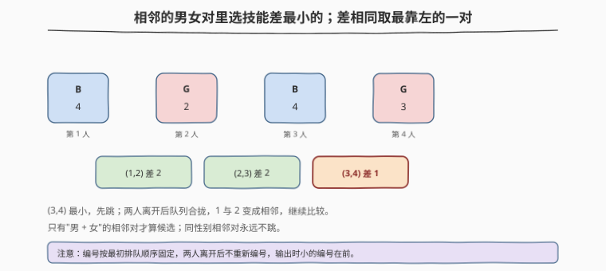
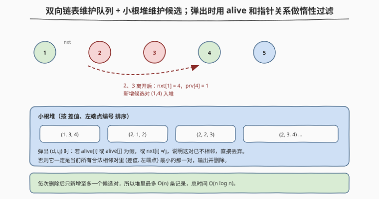
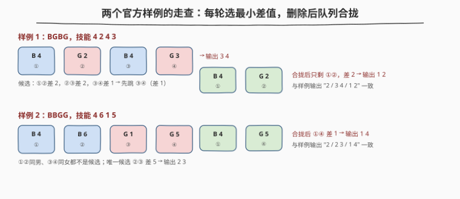

# Codeforces 45C 舞蹈课上的配对 题解

## 1. 题目概述

- **题目链接**：https://codeforces.com/problemset/problem/45/C
- **比赛来源**：Codeforces Beta Round 45 · Problem C（2010-10-13）
- **难度**：1900
- **标签**：数据结构（链表 + 优先队列）
- **评测类型**：普通
- **限制**：时间 2 s / 内存 256 MB

**题意**：$n$ 个人从左到右排成一排，第 $i$ 个人性别为 `B`（男）或 `G`（女），舞蹈水平为 $a_i$。只要队里还存在**相邻的一男一女**，就重复：在所有这些相邻男女对中，选 $|a_i - a_j|$ 最小的一对（并列时选最靠左的一对）出列跳舞，队伍随即合拢。求按顺序输出的所有配对（编号固定为初始位置 $1 \sim n$，每对内部小编号在前）。

**约束**：

- $n \le 2 \cdot 10^5$：每轮扫描整个队列是 $O(n^2)$，会超时，必须做到 $O(n \log n)$ 级别。
- $a_i \le 10^7$：差值最大 $10^7$，`int` 足够，但差值参与比较时用 `long long` 更省心。
- 队伍会不断合拢，配对之间相互影响，不能离线一次性排序解决。
- 输出需要按"实际跳舞顺序"，且配对内部编号升序、人数不变。

## 2. 示例与观察

官方样例 1（输入 / 输出原样）：

```text
输入：
4
BGBG
4 2 4 3

输出：
2
3 4
1 2
```

**演算**：初始相邻对：$(1,2)$ 差 $2$、$(2,3)$ 差 $2$、$(3,4)$ 差 $1$，都是男女对。最小差是 $(3,4)$ 的 $1$，先出列；剩下 $1,2$ 相邻，差 $2$，再出列。输出 `3 4`、`1 2` ✓。

官方样例 2（输入 / 输出原样）：

```text
输入：
4
BBGG
4 6 1 5

输出：
2
2 3
1 4
```

**演算**：$(1,2)$、$(3,4)$ 是同性，唯一候选是 $(2,3)$，差 $5$，出列后 $1,4$ 合拢成男女对，差 $1$，出列 ✓。

官方样例 3（输入 / 输出原样）：

```text
输入：
4
BGBB
1 1 2 3

输出：
1
1 2
```

**演算**：$(1,2)$ 差 $0$、$(2,3)$ 差 $1$，$(3,4)$ 同性。先跳 $(1,2)$；剩下 $3,4$ 都是男生，没有候选，结束 ✓。

**观察**：

1. 候选只可能是"相邻的男女"，同性别相邻对永远不参与。
2. 一次出列只改变**两个位置**的邻居关系：设出列的是 $i, j$（$i$ 在 $j$ 左边且相邻），那么只有 $i$ 的左边 $L$ 与 $j$ 的右边 $R$ 会变成新邻居；其它相邻关系不变。
3. 因此每轮只需要"取出当前最小候选"和"插入至多一个新候选"——这正是优先队列 + 惰性删除的用武之地。



## 3. 解题思路

### 3.1 朴素做法与瓶颈

每一轮扫描 $i = 1 \sim n-1$，检查 $i$ 与 $i+1$ 是否都还在、是否异性，取差值最小者删除。一轮 $O(n)$，最多 $n/2$ 轮，总计 $O(n^2)$。$n = 2\cdot10^5$ 时约 $4\times10^{10}$ 次操作，远超 2 s。

瓶颈在于"每轮都重新扫描全部相邻对"，而实际上每轮只有一处相邻关系发生变化，其余候选的大小关系并没有变。

### 3.2 核心观察：每轮只新增一个候选

用双向链表维护当前队列：`prv[x]`、`nxt[x]` 是 $x$ 左右还活着的人。删除相邻的 $i, j$ 后：

- $L = prv[i]$、$R = nxt[j]$；
- 令 `nxt[L] = R`、`prv[R] = L`（若存在）；
- 唯一新出现的相邻对是 $(L, R)$，若两者存在且异性，就把它加入候选。

于是用一个以 $(\text{差值}, \text{左端点编号})$ 为键的小根堆保存候选。每次取堆顶时做**惰性过滤**：

- 任一端点已被删除（`alive` 为假）→ 丢弃；
- 两端点已不相邻（`nxt[i] != j`）→ 丢弃；
- 否则它就是当前所有合法候选里键值最小的一对，输出并删除。



### 3.3 算法流程

1. 读入 $n$、性别串、技能数组；初始化 `prv[i] = i-1`、`nxt[i] = i+1`（`nxt[n-1] = -1`）。
2. 把初始的 $n-1$ 个相邻对中所有异性对压入堆，键为 $(\lvert a_i - a_j\rvert, i)$（$i$ 是左端点）。
3. 反复弹出堆顶，按上面的规则过滤：
   - 合法则记录答案，`alive[i] = alive[j] = false`，链接 $L$ 与 $R$，若 $L, R$ 都存在且异性则把 $(L,R)$ 压堆；
   - 不合法则继续弹。
4. 堆空后输出答案对数与每一对（编号 $+1$，左端点在前）。

### 3.4 样例走查



样例 1 中三对候选的差是 $2,2,1$，堆顶是 $(1,3)$（差 $1$、左端点 $3$），删除后 $(1,2)$ 成为新邻居、差 $2$，再弹出；堆里残留的 $(2,1)$、$(2,2)$ 会因 `alive`／`nxt` 检查被丢弃。样例 2 初始只有一对候选，删除后合拢出 $(1,4)$。两条路径都与输出一致。

## 4. 正确性证明

**引理 1（新候选唯一）**：一次删除相邻对 $(i,j)$ 后，队列中新增的相邻关系只有 $(prv[i], nxt[j])$ 一条（若两端都存在）。

**证明**：删除前队列中相邻关系为 $\dots, (L,i), (i,j), (j,R), \dots$；删除后 $i,j$ 之间以及它们与外侧的关系全部消失，唯一"跨过缺口"的新相邻关系是 $(L,R)$。其余相邻关系不变。∎

**引理 2（合法性判定精确）**：堆中条目 $(i,j)$ 在弹出时是"当前合法候选"，当且仅当 `alive[i] && alive[j] && nxt[i] == j`。

**证明**：若三人中有人被删，`alive` 为假；若 `nxt[i] != j`，说明 $i$ 与 $j$ 之间已有别人或 $i$ 已不是 $j$ 的左邻，二者不再相邻。反之若两者都活着且 `nxt[i] == j`，由链表不变式它们就是相邻的；性别在入堆时已筛过，因此是合法候选。∎

**引理 3（不会漏候选）**：任意时刻，每个合法候选都已在堆中（可能带着已失效的旧条目）。

**证明**：一对相邻关系在它"诞生"时（初始或由引理 1 产生）若为异性就被压入堆；此后它要么保持相邻并留在堆中，要么因某次删除而失效。失效的相邻关系不可能重新出现：相邻关系一旦被删除破坏，两人中至少一人已出列或中间隔了别人，而链表只会继续删除、不会插入。故堆中始终含有全部当前合法候选。∎

**定理**：算法按题目要求的顺序输出所有配对。

**证明**：每轮堆顶经引理 2 过滤后，是当前合法候选中键 $(\text{差值}, \text{左端点})$ 最小者，而"最靠左"在编号保序下等价于左端点编号最小，正好是题面的选择规则；引理 3 保证不会漏掉更优候选；引理 1 保证删除后只添加必要的新候选，不重不漏。于是每轮的选择与题目过程一致，归纳可得输出顺序与配对集合完全正确。∎

## 5. 复杂度分析

- **时间**：初始化压入 $O(n)$ 个候选，每次删除压入 $O(1)$ 个，堆操作 $O(\log n)$；每条堆记录最多被弹出一次，总计 $O(n\log n)$。
- **空间**：链表、`alive`、堆各 $O(n)$，答案 $O(n)$。
- **与时限的关系**：$n = 2\cdot 10^5$ 时堆操作约 $4\times10^5$ 次；实测 C++ 整程序约 $0.6$ s，但同规模的纯读写程序也要 $0.6$ s（本机管道 I/O 开销），算法部分可忽略；Python 约 $0.45$ s。2 s 时限有充足余量。

## 6. 参考代码

### C++17

```cpp
#include <bits/stdc++.h>
using namespace std;

struct Item { long long d; int i, j; };
struct Cmp {
    bool operator()(const Item& A, const Item& B) const {
        if (A.d != B.d) return A.d > B.d;
        return A.i > B.i;
    }
};

int main() {
    ios::sync_with_stdio(false);
    cin.tie(nullptr);
    int n;
    if (!(cin >> n)) return 0;
    string s;
    cin >> s;
    vector<long long> a(n);
    for (auto& x : a) cin >> x;

    vector<int> prv(n), nxt(n);
    for (int i = 0; i < n; i++) { prv[i] = i - 1; nxt[i] = i + 1; }
    nxt[n - 1] = -1;

    priority_queue<Item, vector<Item>, Cmp> pq;
    auto push = [&](int i, int j) {
        if (i < 0 || j < 0) return;
        if (s[i] == s[j]) return;
        pq.push({llabs(a[i] - a[j]), i, j});
    };
    for (int i = 0; i + 1 < n; i++) push(i, i + 1);

    vector<char> alive(n, 1);
    vector<pair<int, int>> ans;
    while (!pq.empty()) {
        Item it = pq.top(); pq.pop();
        int i = it.i, j = it.j;
        if (!alive[i] || !alive[j]) continue;
        if (nxt[i] != j) continue;
        ans.push_back({i, j});
        alive[i] = alive[j] = 0;
        int L = prv[i], R = nxt[j];
        if (L >= 0) nxt[L] = R;
        if (R >= 0) prv[R] = L;
        push(L, R);
    }
    cout << ans.size() << "\n";
    for (auto& p : ans) cout << p.first + 1 << ' ' << p.second + 1 << "\n";
    return 0;
}
```

### Python3

```python
import sys
import heapq


def main():
    data = sys.stdin.buffer.read().split()
    n = int(data[0])
    s = data[1].decode()
    a = list(map(int, data[2:2 + n]))

    prv = [i - 1 for i in range(n)]
    nxt = [i + 1 for i in range(n)]
    nxt[n - 1] = -1
    alive = bytearray([1]) * n

    heap = []

    def push(i, j):
        if i < 0 or j < 0:
            return
        if s[i] == s[j]:
            return
        heapq.heappush(heap, (abs(a[i] - a[j]), i, j))

    for i in range(n - 1):
        push(i, i + 1)

    ans = []
    while heap:
        _, i, j = heapq.heappop(heap)
        if not alive[i] or not alive[j]:
            continue
        if nxt[i] != j:
            continue
        ans.append((i + 1, j + 1))
        alive[i] = alive[j] = 0
        L, R = prv[i], nxt[j]
        if L >= 0:
            nxt[L] = R
        if R >= 0:
            prv[R] = L
        if L >= 0 and R >= 0:
            push(L, R)

    out = [str(len(ans))]
    out += [f"{x} {y}" for x, y in ans]
    sys.stdout.write('\n'.join(out) + '\n')


main()
```

## 7. 边界情况与易错点

1. **$n = 1$**：没有相邻对，答案 0，只输出一行 `0`；不要把 `nxt[-1]` 之类的越界访问写进去。
2. **全部同性**：堆里没有任何候选，直接输出 0。
3. **并列最小**：键必须是 $(\text{差值}, \text{左端点})$，只按差值排序会随机打破并列，输出与题面要求的"最靠左"不符。
4. **惰性删除的两个条件**：只看 `alive` 不够——两个人都活着但中间插进了别人（`nxt[i] != j`）时也必须丢弃，否则会输出不相邻的配对。
5. **编号顺序**：输出时 `i < j`（左端点在前），且所有人按初始编号，删除后不重新编号。
6. **差值溢出**：$a_i \le 10^7$，`int` 差值本身不溢出，但为了与 `long long` 堆键一致，C++ 用 `llabs` 或 `long long` 更稳。
7. **重复入堆**：删除后只压入 $(L,R)$ 一对，不要把所有邻居都重新压一遍，否则堆里会出现大量重复，复杂度退化。

## 8. 验证记录

- **编译环境与命令**：`g++ -std=c++17 -O2`（clang++ + 兼容头，`verify_solution.py` 自动处理）；Python 3.12。
- **官方样例**：3 / 3 通过（`CF45C: samples 3 / C++ 编译 OK, 样例 3/3 / Python 语法 OK, 样例 3/3`）。
- **额外测试**：与独立 $O(n^2)$ 暴力对拍：C++ $600$ 组（$n \le 8$，性别随机、技能 $\le 8$），Python 另跑 $400$ 组（$n \le 9$），逐字比对输出顺序，全部一致。
- **最大约束性能**：$n = 2\cdot10^5$，随机性别与技能：C++ 整程序 $0.60$ s（含 I/O），Python $0.45$ s；"交替性别 + 递增技能"的最坏形态 C++ $0.54$ s。
- **复核状态**：`check.py` 0 失败；三个样例与 `.cf-meta/statements/CF45C.json` 逐字一致。

## 相关题目与扩展

- [Codeforces 45B 校园新闻](https://codeforces.com/problemset/problem/45/B)：另一种"跳过已处理元素"的链表/并查集技巧。
- [Codeforces 1367E 项链组装](https://codeforces.com/problemset/problem/1367/E)：同样是"每次取最优、结构动态收缩"的贪心。

**延伸思考**：

1. 如果并列规则改成"优先选右端点更靠左"或"优先选技能和更小"，只需换堆的键，惰性删除框架不变。
2. 如果要求"每次选全局差值最小，不要求相邻"，问题就变成一般图的匹配，复杂度立刻升到 $O(n^3)$ 量级，相邻性正是本题可做的关键。
3. 若队列允许在中间插入新人，链表需要支持按位置插入，可改用平衡树维护序列，候选仍然是"跨度为一"的相邻对。
