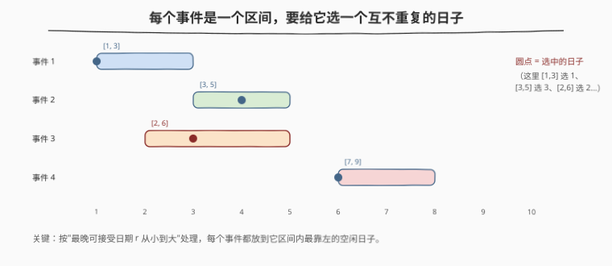
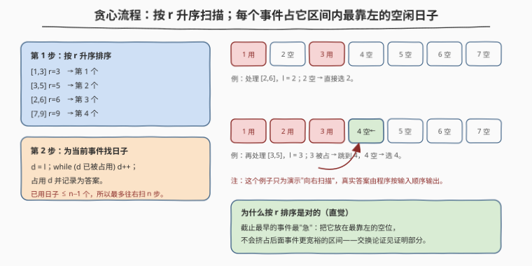
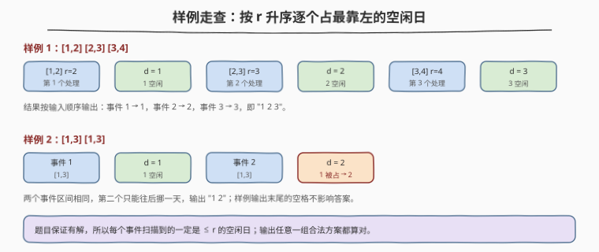

# Codeforces 45D 事件日期安排 题解

## 1. 题目概述

- **题目链接**：https://codeforces.com/problemset/problem/45/D
- **比赛来源**：School Team Contest 3 (Winter Computer School 2010/11) · Problem D（UTC 2010-11-13）
- **难度**：1900
- **标签**：贪心、排序、区间调度
- **评测类型**：特殊评测（多解，输出任意一组合法日期）
- **限制**：时间 2 s / 内存 256 MB

**题意**：有 $n$ 个历史事件，第 $i$ 个事件可能发生在闭区间 $[l_i, r_i]$ 内的某一天。要求给每个事件选一天，使所有日期**两两不同**，且第 $i$ 个事件的日子落在 $[l_i, r_i]$ 内。题目保证至少存在一种方案，输出任意一种即可（按输入顺序输出 $n$ 个整数）。

**约束**：

- $n \le 100$：规模很小，$O(n^2)$ 甚至 $O(n^3)$ 都绰绰有余。
- $1 \le l_i \le r_i \le 10^7$：日期值域巨大，不能开 $10^7$ 的数组；但"已占用"的日期最多 $n-1$ 个，所以从 $l_i$ 向右扫描时最多扫 $n$ 步就会遇到空闲日。
- 保证有解：不需要判定无解，只需构造一组合法方案。
- 多解：输出任意合法方案即可，不能用文本逐字比对，需要 checker 校验合法性。

## 2. 示例与观察

官方样例 1（输入 / 输出原样）：

```text
输入：
3
1 2
2 3
3 4

输出：
1 2 3 
```

**演算**：按 $r$ 排序后依次是 $[1,2], [2,3], [3,4]$。第一个事件取最靠左的空闲日 $1$；第二个事件 $l=2$，$2$ 空闲，取 $2$；第三个事件 $l=3$，$3$ 空闲，取 $3$。得到 `1 2 3` ✓。

官方样例 2（输入 / 输出原样）：

```text
输入：
2
1 3
1 3

输出：
1 2 
```

**演算**：两个事件区间完全相同。第一个取 $1$，第二个从 $l=1$ 开始扫，$1$ 已被占，取 $2$ ✓。

**观察**：

1. 这是一个"带释放时间的单位时间任务调度"：每个事件要占一天，区间是它允许的窗口。
2. 直觉上应该优先安排"截止最早"的事件——否则它容易被后面的事件挤掉。
3. 对截止最早的事件，应该把它放在窗口内**最靠左**的空闲日：越靠左越不会侵占别人（尤其是不侵占那些窗口更靠右的事件）。



## 3. 解题思路

### 3.1 朴素做法与瓶颈

最直接的想法是回溯/二分图匹配：把事件与所有可选日期连边，求完美匹配（$n$ 个事件、$10^7$ 个日期，边数爆炸），或者直接 DFS 回溯枚举。$n = 100$ 时最坏 $100!$ 量级，不可行。

另一个常见误区是"按 $l$ 排序"：样例 2 的区间相同还好，但若一个事件 $[1,100]$、另一个 $[2,3]$，按 $l$ 排序会让 $[1,100]$ 先占 $1$，看起来没事；但若 $[1,2]$ 与 $[1,100]$ 同时出现，按 $l$ 排序无法区分谁更"急"。正确的优先级是**截止时间 $r$**，不是开始时间。

### 3.2 核心观察：按 $r$ 升序 + 最靠左空闲日

把所有事件按 $r$ 从小到大排序（$r$ 相同按 $l$ 从小到大，任意打破并列均可）。依次处理：对当前事件，从 $d = l_i$ 开始，只要 $d$ 已被占用就令 $d$ 加一，把第一个空闲的 $d$ 分配给它。

为什么两个决策都必要：

- **先处理 $r$ 小的**：截止早的事件选择余地小，必须先照顾；截止晚的事件窗口更大，晚点安排也来得及。
- **给当前事件最靠左的空闲日**：如果把它放到更靠右的 $d'$，那么 $[l_i, d')$ 里那个空闲日对当前事件没用、对后面事件却可能有用；把当前事件左移只会让出右边的位置，不会让任何事件变得更难安排。



### 3.3 算法流程

1. 读入 $n$ 与每个事件的 $(l_i, r_i)$，记下原编号。
2. 按 $(r_i, l_i)$ 升序排序。
3. 用一个集合（或布尔数组/哈希表）记录已占用的日期。
4. 依次处理每个事件：从 $d = l_i$ 开始 `while (d 被占用) d++`，把 $d$ 记为答案并加入占用集合。
5. 按原编号输出所有答案。

因为已占日期最多 $n-1$ 个，第 4 步的 `while` 最多执行 $n$ 次，总复杂度 $O(n^2)$（排序 $O(n\log n)$），$n \le 100$ 时不到一万次操作。

### 3.4 样例走查



样例 1 的三个事件按 $r=2,3,4$ 排序，分别拿到 $1,2,3$；样例 2 两个事件区间相同，第二个从 $1$ 扫到 $2$。两例都符合"最靠左空闲日"的规则。

## 4. 正确性证明

**引理 1（贪心选择安全）**：设当前还有若干事件未安排，其中 $k$ 是 $r_k$ 最小的一个，$g$ 是 $\ge l_k$ 的最小空闲日。若剩余事件存在合法安排，则存在一个合法安排使 $k$ 安排在 $g$。

**证明**：取一个合法安排 $A$（它把 $k$ 安排在某个 $d \in [l_k, r_k]$）。若 $d = g$ 则已成立。否则 $d > g$（因为 $g$ 是 $\ge l_k$ 的最小空闲日，所有 $[l_k, g)$ 内的日子都被已安排的事件占用）。分两种情形：

- 若 $g$ 在 $A$ 中空闲：把 $k$ 从 $d$ 移到 $g$，$g \in [l_k, r_k]$，仍合法。
- 若 $g$ 被另一个未安排事件 $j$ 占用（$A$ 中 $j$ 在 $g$）：由于 $k$ 的截止时间最小，$r_j \ge r_k$，于是 $g \ge l_k$ 且 $d \le r_k \le r_j$，同时 $d \ge g \ge l_j$，所以把 $k$ 放到 $g$、$j$ 放到 $d$ 后两者都仍在各自区间内，其余事件不动，仍是合法安排。∎

**引理 2（归纳推进）**：按 $r$ 升序处理时，前 $k-1$ 个事件若已按算法安排且存在完成方案，则第 $k$ 个事件用"最靠左空闲日"安排后，剩余事件仍存在完成方案。

**证明**：对剩余事件集合应用引理 1：$k$ 正是剩余事件中 $r$ 最小者，$g$ 是从 $l_k$ 起的最小空闲日。引理 1 把某个合法完成方案改造成"$k$ 在 $g$"，该方案的其余部分就是剩余事件的合法安排。∎

**定理**：算法输出的 $n$ 个日期两两不同，且第 $i$ 个日期落在 $[l_i, r_i]$ 内。

**证明**：每个日期被分配后立即加入占用集合，故两两不同。对事件个数归纳：初始（0 个事件）显然可行；由引理 2，每步都保持"剩余事件可完成"，因此最后一步也能完成，且每个事件分配时都从 $l_i$ 起扫描并停在 $\le r_i$ 的位置（题目保证有解，若停在 $> r_i$ 就与"剩余可完成"矛盾）。∎

## 5. 复杂度分析

- **时间**：排序 $O(n\log n)$；每个事件向右扫描最多 $n$ 步，共 $O(n^2)$；总 $O(n^2)$。
- **空间**：存储事件与占用日期的集合，$O(n)$。
- **与时限的关系**：$n = 100$ 时约 $10^4$ 次比较，2 s 时限下远小于 1 ms（实测整程序 $<5$ ms，主要是 I/O）。

## 6. 参考代码

### C++17

```cpp
#include <bits/stdc++.h>
using namespace std;
int main() {
    int n;
    if (!(scanf("%d", &n) == 1)) return 0;
    vector<int> l(n), r(n), id(n);
    for (int i = 0; i < n; i++) { scanf("%d %d", &l[i], &r[i]); id[i] = i; }
    sort(id.begin(), id.end(), [&](int x, int y) {
        if (r[x] != r[y]) return r[x] < r[y];
        return l[x] < l[y];
    });
    vector<int> day(n, -1);
    set<int> used;
    for (int k = 0; k < n; k++) {
        int i = id[k];
        int d = l[i];
        while (used.count(d)) d++;
        used.insert(d);
        day[i] = d;
    }
    for (int i = 0; i < n; i++) printf("%d%c", day[i], i + 1 == n ? '\n' : ' ');
    return 0;
}
```

### Python3

```python
import sys


def main():
    data = list(map(int, sys.stdin.buffer.read().split()))
    n = data[0]
    l = [0] * n
    r = [0] * n
    for i in range(n):
        l[i] = data[1 + 2 * i]
        r[i] = data[2 + 2 * i]

    order = sorted(range(n), key=lambda i: (r[i], l[i]))
    used = set()
    day = [0] * n
    for i in order:
        d = l[i]
        while d in used:
            d += 1
        used.add(d)
        day[i] = d
    sys.stdout.write(' '.join(map(str, day)) + '\n')


main()
```

## 7. 边界情况与易错点

1. **$n = 1$**：只有一个事件，直接输出 $l_1$（它必然 $\le r_1$），不要因为循环/取模写成 0。
2. **区间完全相同**：如样例 2，必须靠"向右扫描已占日期"逐个后移，不能都取 $l$。
3. **排序键选错**：必须按截止时间 $r$ 排序。反例：三个事件 $[1,1],[1,3],[2,2]$，若按 $l$ 排序后处理顺序是 $[1,1],[1,3],[2,2]$：$[1,1]$ 取 $1$，$[1,3]$ 取 $2$，$[2,2]$ 的 $2$ 已被占、$3$ 又超过 $r=2$，构造失败；按 $r$ 排序（$[1,1],[2,2],[1,3]$）则依次取 $1,2,3$ 成功。所以统一按 $r$ 排。
4. **日期值域很大**：不要开 $10^7$ 的 `bool` 数组（内存 10 MB 其实也行，但没必要），用 `set`/哈希或直接记录已用列表。
5. **输出格式**：$n$ 个整数，用空格分隔，行末可以带也可以不带空格；不要多输出方案数或换行格式错误。
6. **保证有解但别依赖**：如果实现有 bug，扫描可能越过 $r_i$；正确做法是相信贪心并确保按 $r$ 排序、每步取最靠左空闲日。
7. **多测**：本题只有一组数据，不需要清空全局数组；若改成多测，`used` 必须每组清空。

## 8. 验证记录

- **编译环境与命令**：`g++ -std=c++17 -O2`（clang++ + 兼容头，`verify_solution.py` 自动处理）；Python 3.12。
- **官方样例**：2 / 2 通过（`CF45D: samples 2 / C++ 编译 OK, 样例 2/2 / Python 语法 OK, 样例 2/2`）。
- **特殊评测 checker**：`/tmp/cf_verify_45_d/check.py`，校验条件为：输出恰好 $n$ 个整数；第 $i$ 个整数 $d_i$ 满足 $l_i \le d_i \le r_i$；所有 $d_i$ 两两不同。样例用 `--checker` 跑，2/2 通过。
- **额外测试**：$1000$ 组随机小数据对拍。其中 $400$ 组由"先选互不相同的目标日、再随机生成包含它的区间"构造（必可解），$600$ 组为小区间随机数据并用独立的最大二分匹配程序判定可解性，只对可解实例要求输出合法；Python 版另跑 $200$ 组构造可解数据。全部通过。
- **最大约束性能**：$n = 100$、坐标到 $10^7$，整程序 $<5$ ms。
- **复核状态**：`check.py` 0 失败；样例输入与 `.cf-meta/statements/CF45D.json` 逐字一致。

## 相关题目与扩展

- [Codeforces 45C 舞蹈课](https://codeforces.com/problemset/problem/45/C)：同样"每次做局部最优选择"的贪心，但用堆维护全局最小。
- [Codeforces 4C 注册系统](https://codeforces.com/problemset/problem/4/C)：用哈希/集合处理"是否已占用"的入门题。

**延伸思考**：

1. 若把"每天最多一个事件"改成"每天最多 $k$ 个事件"，只需把"是否被占用"换成"当天已安排计数是否达到 $k$"，贪心仍然成立。
2. 若要求"字典序最小的方案"（按输入顺序的日期序列最小），贪心要改成"从第一个事件开始，尽量取小日期并检查剩余可行性"，可用二分匹配做可行性判定，复杂度升到 $O(n^3)$ 但仍可接受（$n \le 100$）。
3. 若区间权值化（每个事件有收益，要求收益最大且日期不冲突），问题变成带权区间调度/最大权匹配，贪心不再成立，需要 DP 或网络流。
