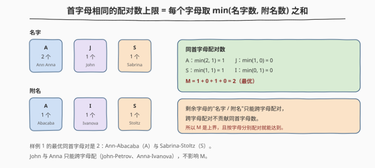
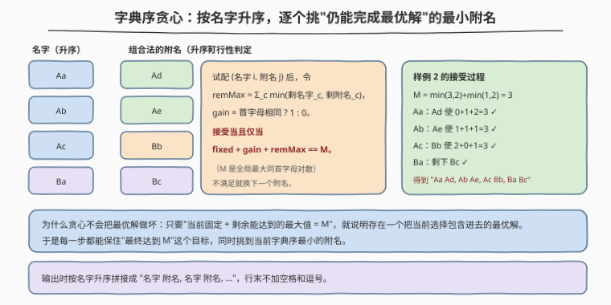
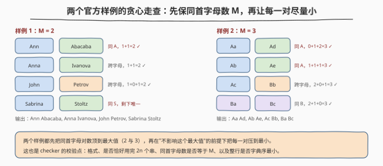

# Codeforces 45E 姓名配对方案 题解

## 1. 题目概述

- **题目链接**：https://codeforces.com/problemset/problem/45/E
- **比赛来源**：Codeforces Beta Round 45 · Problem E（2010-10-13）
- **难度**：2000
- **标签**：构造、贪心、字典序
- **评测类型**：构造（答案唯一，按行比对；本地用 checker 校验格式与最小性）
- **限制**：时间 2 s / 内存 256 MB

**题意**：给出 $n$ 个名字和 $n$ 个附名（$2n$ 个字符串两两不同，均首字母大写、其余小写）。把名字与附名一一配对，要求：

1. 首字母相同的配对数**尽可能多**；
2. 在此前提下，输出的一整行字符串**字典序最小**。

输出格式严格为 `Name1 Surname1, Name2 Surname2, ..., Namen Surnamen`：名字与附名之间恰好一个空格，配对之间恰好一个逗号加一个空格，行末不能多空格或逗号。

**约束**：

- $n \le 100$：$n!$ 枚举不可能（$100!$ 天文数字），但 $O(n^2)$、$O(n^3)$ 的多项式做法绰绰有余。
- 每个字符串长度 $\le 10$，$2n$ 个字符串两两不同：这保证"按名字升序排列配对"就是字典序最小的行序，不会出现重名歧义。
- 字母表只有 $26$ 个大写首字母：可以按首字母统计计数。
- 输出是**一整行**、格式固定：多一个空格或逗号都算错。

## 2. 示例与观察

官方样例 1（输入 / 输出原样）：

```text
输入：
4
Ann
Anna
Sabrina
John
Petrov
Ivanova
Stoltz
Abacaba

输出：
Ann Abacaba, Anna Ivanova, John Petrov, Sabrina Stoltz
```

**演算**：按首字母统计，名字侧 A:2（Ann、Anna）、J:1（John）、S:1（Sabrina）；附名侧 A:1（Abacaba）、I:1（Ivanova）、P:1（Petrov）、S:1（Stoltz）。同首字母对数上限为 $\min(2,1)+\min(1,0)+\min(1,1)+\min(0,1) = 1+0+1+0 = 2$。构造：Ann–Abacaba（同 A，1 对）、Sabrina–Stoltz（同 S，1 对），剩下的 John、Anna 与 Petrov、Ivanova 跨字母配。输出行按名字升序：`Ann Abacaba, Anna Ivanova, John Petrov, Sabrina Stoltz` ✓。

官方样例 2（输入 / 输出原样）：

```text
输入：
4
Aa
Ab
Ac
Ba
Ad
Ae
Bb
Bc

输出：
Aa Ad, Ab Ae, Ac Bb, Ba Bc
```

**演算**：名字侧 A:3、B:1；附名侧 A:2、B:2。$M = \min(3,2) + \min(1,2) = 2 + 1 = 3$。贪心按名字升序：Aa 配 Ad（同 A）、Ab 配 Ae（同 A）、Ac 配 Bb（跨字母，因为 A 的附名已经用完了）、Ba 配 Bc（同 B）✓。

**观察**：

1. 第一目标（同首字母对数）只和"每个字母各有几个名字/附名"有关，上限是 $M = \sum_c \min(\#name_c, \#surname_c)$，而且这个上限一定可达（同字母先配，剩下的跨字母配）。
2. 第二目标是整行字典序最小。由于所有名字互不相同、且 `' '`（空格）比任何字母都小，配对在行内的顺序实际上由**名字**决定：字典序最小的行一定按名字升序排列配对。
3. 于是问题变成：按名字升序，依次给每个名字挑一个还没用过的附名，要求这一选择不破坏"最终同首字母对数 $= M$"，并且当前挑的附名尽量小。



## 3. 解题思路

### 3.1 朴素做法与瓶颈

直接枚举所有配对（$n!$ 种），逐一计算同首字母对数和整行字符串，取最优。$n = 100$ 时 $100!$ 完全不可行；即使 $n = 10$ 也要 $3.6\times10^6$ 次字符串比较。

退一步，只枚举"哪些名字与哪些附名同字母配对"仍然是指数级。需要利用"同首字母对数只依赖每个字母的计数"这一结构。

### 3.2 核心观察

**(a) 同首字母对数的最大值。** 记 $\mathrm{cn}_c$、$\mathrm{cs}_c$ 分别为首字母 $c$ 的名字数、附名数。第 $c$ 个字母最多贡献 $\min(\mathrm{cn}_c, \mathrm{cs}_c)$ 对，所以

$$M = \sum_{c} \min(\mathrm{cn}_c, \mathrm{cs}_c) .$$

这个上界可达：让每个字母内部先配 $\min(\mathrm{cn}_c, \mathrm{cs}_c)$ 对，剩下的名字或附名在每个字母里必然只有一侧非空，于是"跨字母配对"总能配完（任意一侧的总量与另一侧相等）。

**(b) 行的顺序。** 一整行是若干 `Name Surname` 用 `, ` 连接。比较两行时，第一个不同的配对决定大小；而配对内部的比较先看名字。名字互不相同；若一个名字是另一个的前缀，短名字后面紧跟的是空格（ASCII $32$），比任何小写字母都小，所以短名字所在的配对仍然排在前。因此"按配对字符串排序"与"按名字排序"一致，字典序最小的行必然按名字升序拼接。

**(c) 逐位确定的可行性。** 按名字升序处理到第 $i$ 个名字时，前面已经固定了 `fixed` 个同字母对。若把它与附名 $j$ 配对，记 `gain = 1` 当且仅当首字母相同，剩余部分的同字母对数上限为

$$\text{remMax} = \sum_c \min(\text{剩余名字}_c, \text{剩余附名}_c) .$$

最终能达到 $M$ 当且仅当 `fixed + gain + remMax == M`：因为剩余部分最多再贡献 `remMax`，要凑够 $M$ 必须一点不浪费。



### 3.3 算法流程

1. 读入 $n$ 与 $2n$ 个字符串，把名字、附名分别按字典序排序。
2. 统计两侧每个首字母的数量，算出 $M$。
3. 维护"未被使用的附名"以及两侧按字母的剩余计数：
   - 对第 $i$ 个名字（按升序），先把它从名字计数中扣除；
   - 按升序尝试每个未使用的附名 $j$：临时扣除附名 $j$ 的计数，算 `gain` 与 `remMax`；
   - 若 `fixed + gain + remMax == M`，则确定 `match[i] = j`、标记 $j$ 已用、`fixed += gain`，处理下一个名字；
   - 否则恢复附名 $j$ 的计数，试下一个。
4. 按名字升序、用 `, ` 连接输出。

### 3.4 样例走查



样例 1 中 Ann 先试同字母的 Abacaba（`0+1+1=2=M`），接受；Anna 试 Ivanova（`1+0+1=2`）接受；John 试 Petrov（`1+0+1=2`）接受；Sabrina 只剩 Stoltz。样例 2 中 $M=3$，每一步都恰好满足 `fixed + gain + remMax = 3`，得到 `Aa Ad, Ab Ae, Ac Bb, Ba Bc`。

## 4. 正确性证明

**引理 1（$M$ 是最优值）**：任意配对方案的同首字母对数不超过 $M$，且存在达到 $M$ 的方案。

**证明**：首字母为 $c$ 的名字只能与首字母相同的附名组成同字母对，故第 $c$ 类最多 $\min(\mathrm{cn}_c, \mathrm{cs}_c)$ 对，求和得上界。构造：每个 $c$ 内部先配 $\min$ 对；此时每个字母至少有一侧耗尽，剩余的名字（或附名）分散在不同字母且"每个字母只可能有一侧有剩余"，把剩余的名字与剩余的附名任意一一配对即可（两侧总数相等，且不会出现同字母的强制冲突——同字母的两侧不可能同时有剩余）。∎

**引理 2（行序）**：字典序最小的输出行中，配对按名字升序排列。

**证明**：对任意一组合法配对，其最小行序是把配对字符串升序排列。设两个配对 `N1 S1`、`N2 S2` 且 $N_1 < N_2$（字典序）。若 $N_1$ 不是 $N_2$ 的前缀，则比较在第 $|N_1|$ 位之前就由名字决定，`N1 S1` 更小；若 $N_1$ 是 $N_2$ 的前缀，则 `N1` 后是空格（$32$），而 $N_2$ 的对应位置是字母（$\ge 65$），仍是 `N1 S1` 更小。故按名字升序即按配对字符串升序。∎

**引理 3（可行性判据）**：固定了前 $i-1$ 个配对且已得 `fixed` 个同字母对后，存在一种完成方式使总数达到 $M$，当且仅当对剩余问题有 `fixed + remMax == M` 的潜力，即 `remMax` 等于还需要的数量。

**证明**：剩余部分的同字母对数不超过 `remMax`（引理 1 的上界论证逐字母适用），且 `remMax` 可达（引理 1 的构造论证逐字母适用，剩余两侧总数相等）。因此"能达到 $M$"当且仅当"需要补齐的数量恰好是 `remMax`"。∎

**定理**：算法输出的行是所有合法方案中同首字母对数最多、且字典序最小的那一行。

**证明**：设最优行为 $L^*$，其第 $i$ 个配对（按名字升序）为 $(name_i, s_i^*)$。归纳证明算法第 $i$ 步选的附名 $j_i \le s_i^*$（字典序）。第 $i$ 步时，由于 $L^*$ 是一个达到 $M$ 的完成方案，把 $name_i$ 配给 $s_i^*$ 后剩余部分仍能达到 $M$，即此时候选 $s_i^*$ 满足判据，故算法按升序尝试时不会越过 $s_i^*$（它选的 $j_i$ 是满足判据的最小者，$j_i \le s_i^*$）。若 $j_i < s_i^*$，则算法得到的行在第 $i$ 个配对上就更小，与 $L^*$ 最小矛盾；故 $j_i = s_i^*$，算法输出与 $L^*$ 完全相同，自然也是同首字母对数最多的方案。∎

## 5. 复杂度分析

- **时间**：排序 $O(n\log n)$；对每个名字（共 $n$ 个）按升序尝试附名（最多 $n$ 个），每次用 $O(26)$ 重算 `remMax`，总计 $O(26n^2)$，$n=100$ 时约 $2.6\times 10^5$ 次操作。
- **空间**：$O(n)$ 的字符串与计数数组。
- **与时限的关系**：2 s 时限下远小于 1 ms；Python 同样瞬间完成。

## 6. 参考代码

### C++17

```cpp
#include <bits/stdc++.h>
using namespace std;

int main() {
    ios::sync_with_stdio(false);
    cin.tie(nullptr);
    int n;
    if (!(cin >> n)) return 0;
    vector<string> names(n), sur(n);
    for (auto& s : names) cin >> s;
    for (auto& s : sur) cin >> s;
    sort(names.begin(), names.end());
    sort(sur.begin(), sur.end());

    int rn[26] = {0}, rs[26] = {0};
    for (auto& s : names) rn[s[0] - 'A']++;
    for (auto& s : sur) rs[s[0] - 'A']++;
    int M = 0;
    for (int c = 0; c < 26; c++) M += min(rn[c], rs[c]);

    vector<char> usedS(n, 0);
    vector<int> match(n, -1);
    int fixed = 0;
    for (int i = 0; i < n; i++) {
        int cn = names[i][0] - 'A';
        rn[cn]--;
        for (int j = 0; j < n; j++) {
            if (usedS[j]) continue;
            int cs = sur[j][0] - 'A';
            rs[cs]--;
            int gain = (cs == cn) ? 1 : 0;
            int rem = 0;
            for (int c = 0; c < 26; c++) rem += min(rn[c], rs[c]);
            if (fixed + gain + rem == M) {
                match[i] = j;
                usedS[j] = 1;
                fixed += gain;
                break;
            }
            rs[cs]++;
        }
    }
    for (int i = 0; i < n; i++) {
        if (i) cout << ", ";
        cout << names[i] << ' ' << sur[match[i]];
    }
    cout << "\n";
    return 0;
}
```

### Python3

```python
import sys


def main():
    data = sys.stdin.buffer.read().split()
    n = int(data[0])
    names = sorted(x.decode() for x in data[1:1 + n])
    sur = sorted(x.decode() for x in data[1 + n:1 + 2 * n])

    rn = [0] * 26
    rs = [0] * 26
    for s in names:
        rn[ord(s[0]) - 65] += 1
    for s in sur:
        rs[ord(s[0]) - 65] += 1
    M = sum(min(rn[c], rs[c]) for c in range(26))

    used = [False] * n
    match = [-1] * n
    fixed = 0
    for i in range(n):
        cn = ord(names[i][0]) - 65
        rn[cn] -= 1
        for j in range(n):
            if used[j]:
                continue
            cs = ord(sur[j][0]) - 65
            rs[cs] -= 1
            gain = 1 if cs == cn else 0
            rem = sum(min(rn[c], rs[c]) for c in range(26))
            if fixed + gain + rem == M:
                match[i] = j
                used[j] = True
                fixed += gain
                break
            rs[cs] += 1

    sys.stdout.write(', '.join(f"{names[i]} {sur[match[i]]}" for i in range(n)) + '\n')


main()
```

## 7. 边界情况与易错点

1. **$n = 1$**：直接输出唯一的名字与附名、没有逗号；注意不要多输出 `, `。
2. **$M = 0$**（所有名字与附名首字母都不同）：此时每一步只要 `gain = 0` 且剩余仍能配完即可，贪心会退化为"每个名字取当前最小的可用附名"。
3. **同首字母数用完后的跨字母配对**：例如样例 2 的 Ac 必须配 Bb；如果贪心只看"同字母优先"，会误配成不可行（A 的附名已耗尽），必须按可行性判据而不是"优先同字母"。
4. **输出格式**：`名字 附名` 之间恰好一个空格，配对之间恰好 `, `，行末不能有空格或逗号；多输出方案数、换行位置错误都会判错。
5. **字符串比较基准**：C++ 的 `std::string` 与 Python 的 `str` 都按字节/码点比较，本题只有大小写拉丁字母，两者结果一致；不要用忽略大小写的比较。
6. **名字是前缀**：如 `Aa` 与 `Aab`，`Aa` 的配对在行内应排在前面（空格 < 字母），按名字升序正好满足。
7. **计数恢复**：临时尝试附名 $j$ 失败时必须把 `rs[cs]` 加回去，否则后面的可行性判断会用到错误的计数，导致贪心卡死或输出错误。

## 8. 验证记录

- **编译环境与命令**：`g++ -std=c++17 -O2`（clang++ + 兼容头，`verify_solution.py` 自动处理）；Python 3.12。
- **官方样例**：2 / 2 通过（`CF45E: samples 2 / C++ 编译 OK, 样例 2/2 / Python 语法 OK, 样例 2/2`）。
- **特殊评测 checker**：`/tmp/cf_verify_45_e/checker.py`，校验条件为：单行、行首行尾无多余空白、不以逗号或空格结尾；按 `, ` 切出恰好 $n$ 对，每对恰好一个空格；所有名字与附名都恰好用尽（与输入多重集相同）；同首字母对数等于最大值 $M$；当 $n \le 8$ 时对附名做全排列（与名字升序组合）求真正的字典序最小行并要求逐字相等；当 $n > 8$ 时改为逐位验证最小性证书——当前位选中的附名必须满足 `fixed + gain + remMax == M`，且任何更小的未用附名都做不到。样例以 `--checker` 运行，2/2 通过；另用 $n = 9 \sim 60$ 的随机数据验证该证书分支 $60$ 组，全部通过。
- **额外测试**：与"全排列 + 先比同首字母数、再比行字符串"的独立暴力对拍 $400$ 组：$300$ 组首字母取自 A/B/C（$n \le 6$，含互为前缀的名字），另 $100$ 组使用全部 $26$ 个首字母（$n \le 6$，C++ 与 Python 同时校验），全部一致。
- **最大约束性能**：$n = 100$ 时整程序 $<5$ ms（C++ 与 Python 均远低于时限）。
- **复核状态**：`check.py` 0 失败；样例与 `.cf-meta/statements/CF45E.json` 逐字一致。

## 相关题目与扩展

- [Codeforces 45D 事件日期安排](https://codeforces.com/problemset/problem/45/D)：同为"贪心 + 可行性"的构造题，可对照"每一步选择都不破坏可达性"的证明套路。
- [Codeforces 45C 舞蹈课](https://codeforces.com/problemset/problem/45/C)：动态结构上的贪心选择。

**延伸思考**：

1. 如果目标改成"先最大化同首字母对数、再最小化**总字典序**但允许配对内部顺序任意"，只需把输出前按配对字符串排序；本题由于名字唯一，两种口径一致。
2. 如果名字可以有重复，行序不再由名字唯一决定，需要把"名字 + 附名"整体作为排序键，可行性判据也要改成按后缀统计。
3. 如果再加一目标"同首字母对数最多、其次首字母相同的位置尽量靠前"，可以用带权匹配（$O(n^3)$ 匈牙利）或费用流求解，字典序目标则需逐位加约束。
