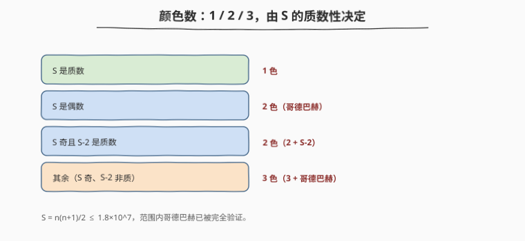
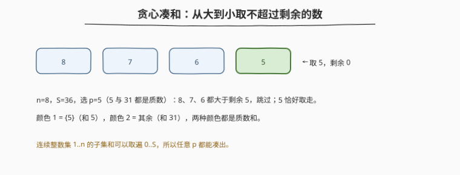

# Codeforces 45G 质数分色 题解

## 1. 题目概述

- **题目链接**：https://codeforces.com/problemset/problem/45/G
- **比赛来源**：School Team Contest 3 (Winter Computer School 2010/11) · Problem G（UTC 2010-11-13）
- **难度**：2200
- **标签**：数论（number theory）
- **评测类型**：特殊评测（多解，输出任意一种染色）
- **限制**：时间 1 s / 内存 256 MB

**题意**：把 $1 \sim n$ 这 $n$ 个房子染色，要求**每种颜色的房子编号之和都是质数**，并且使用的颜色数最少。输出每个房子的颜色（颜色从 1 开始连续编号）。无解输出 $-1$。

**约束**：

- $n \le 6000$，所以总和 $S = n(n+1)/2 \le 18\,003\,000$，可以筛出 $S$ 以内的质数。
- 颜色数最少：答案只可能是 1、2、3（见第 3 节）。
- 任意合法染色均可。

## 2. 示例与观察

官方样例（输入 / 输出原样）：

```text
输入：
8

输出：
1 2 2 1 1 1 1 2
```

**演算**：$S = 1+2+\dots+8 = 36$。颜色 1 的房子是 $\{1,4,5,6,7\}$，和 $23$（质数）；颜色 2 的房子是 $\{2,3,8\}$，和 $13$（质数）。两种颜色即可（36 不是质数），与样例一致。

**观察**：

1. 全部染一种颜色可行 ⟺ $S$ 是质数。
2. 若 $S$ 是偶数，由**哥德巴赫猜想**（在 $S \le 1.8\times10^7$ 范围内已被完全验证）可拆成两个质数之和，故 2 种颜色可行。
3. 若 $S$ 是奇数且 $S-2$ 是质数，则 $S = 2 + (S-2)$，2 种颜色可行（把房子 2 单独一色）。
4. 其余情况（$S$ 为奇数、$S$ 与 $S-2$ 都不是质数）：任何二染色都会要求 $S = p+q$ 且 $p,q$ 为质数；$S$ 奇 ⟹ 其中一个必为 2，另一个 $S-2$ 非质 ⟹ 矛盾。所以至少 3 色，而 3 色总能做到（$S-3$ 为偶数 ≥ 4，哥德巴赫拆成两个质数）。



## 3. 解题思路

### 3.1 颜色数

| 条件 | 颜色数 |
|------|--------|
| $S$ 是质数 | 1 |
| $S$ 是偶数 | 2 |
| $S$ 是奇数且 $S-2$ 是质数 | 2 |
| 其余（$S$ 奇、$S-2$ 非质） | 3 |

$S$ 为偶数时一定能拆成两个质数吗？哥德巴赫猜想对 $4 \le S \le 1.8\times10^7$ 已被穷举验证，本题范围内成立。

### 3.2 具体染色

**1 色**：全部染 1。

**2 色**：找质数 $p$ 使 $S-p$ 也是质数（$S$ 偶时从 3 开始试；$S$ 奇时取 $p=2$）。然后从 $n$ 到 1 贪心取数凑出和为 $p$ 的子集作为颜色 1，其余为颜色 2。因为可用集合是 $1..n$，任意 $0\le p\le S$ 都能凑出（这是"连续整数集可表示任意和"的经典结论）。

**3 色**：房子 3 单独染颜色 3；对 $S-3$（偶数）找质数 $p$ 使 $S-3-p$ 也是质数，在 $\{1..n\}\setminus\{3\}$ 上贪心凑出和 $p$ 的子集作为颜色 1，剩下的是颜色 2。



### 3.3 流程

1. 读 $n$，算 $S$；
2. 筛到 $S+2$；
3. 按 3.1 决定颜色数，按 3.2 构造；
4. 输出 $n$ 个颜色编号。

### 3.4 样例走查：$n=8$

$S = 36$ 偶数 → 2 色。从 $p=3$ 试：$3$ 质数，$33$ 不是；$p=5$：$5$ 与 $31$ 都是质数 ✓。在 $1..8$ 上贪心凑 5：$8>5$ 跳过，$7,6$ 跳过，$5$ 取走，和正好 5 → 颜色 1 = $\{5\}$（和 5），颜色 2 = 其余（和 31）✓。

## 4. 正确性证明

**引理 1（1 色判据）**：1 种颜色可行当且仅当 $S$ 是质数。

**证明**：1 色时唯一的颜色类包含全部房子，其和就是 $S$。∎

**引理 2（$S$ 偶时的 2 色构造）**：$S$ 为偶数、$S \ge 4$ 时存在质数 $p,q$ 使 $p+q=S$，且 $p$ 可以由 $\{1,\dots,n\}$ 的某个子集凑出。

**证明**：哥德巴赫猜想在 $S \le 1.8\times10^7$ 内成立，故存在 $p,q$。子集存在性：$\{1,\dots,n\}$ 的子集和可以取遍 $0..S$（归纳：加入 $k$ 后，$[0,k-1]$ 与 $[k, 2k-1]$ 等区间连续覆盖）。∎

**引理 3（$S$ 奇时的 2 色判据）**：$S$ 为奇数时，2 色可行当且仅当 $S-2$ 是质数。

**证明**：2 色要求 $S = p+q$，$p,q$ 质数。$S$ 奇 ⟹ $p,q$ 一奇一偶 ⟹ 偶质数只能是 2 ⟹ 另一个是 $S-2$，故 $S-2$ 必须为质数；反之取 $p=2$、$q=S-2$ 即可（子集 $\{2\}$ 的和为 2）。∎

**引理 4（3 色总可行）**：$S$ 为奇数且 $S-2$ 非质数时，3 色可行。

**证明**：$S \ge 9$（$S=3,5,7$ 都是质数，$S=1$ 不可能），$S-3$ 是偶数且 $\ge 6$。由哥德巴赫，$S-3 = p+q$ 为两质数之和。用 $\{3\}$ 作颜色 3，再在 $\{1..n\}\setminus\{3\}$ 上凑出和 $p$ 的子集（该集合的子集和同样取遍 $0..S-3$：$\{1,2,4,5,\dots\}$ 中 $1,2,4$ 已能覆盖 $0..7$，再逐个加 $5,6,\dots$ 保持连续），余下为颜色 2。∎

**定理**：算法输出的颜色数最少，且每种颜色的和都是质数。

**证明**：颜色数由引理 1–4 确定为 1/2/3 中的最小值；构造出的每种颜色和都是质数；颜色 1、2 由贪心凑出指定和，贪心对连续整数集必成功（引理 2 的子集和连续性）。∎

## 5. 复杂度分析

- **时间**：筛法 $O(S\log\log S)$，$S \le 1.8\times10^7$；找 $p$ 最多试到 $S$；构造 $O(n)$。总计约 $10^7$ 量级。
- **空间**：$O(S)$ 的布尔数组（约 18 MB）。
- **与时限的关系**：1 s 时限，C++ 约 0.1 s。

## 6. 参考代码

### C++17

```cpp
#include <bits/stdc++.h>
using namespace std;
typedef long long ll;
static vector<char> isComp;

void sieve(int N){
    isComp.assign(N+1, 0);
    if(N>=0) isComp[0]=1;
    if(N>=1) isComp[1]=1;
    for(int i=2;(ll)i*i<=N;i++) if(!isComp[i])
        for(ll j=(ll)i*i;j<=N;j+=i) isComp[j]=1;
}
bool isPrime(ll x){ return x>=2 && x<(ll)isComp.size() && !isComp[x]; }

int main(){
    int n; if(!(cin>>n)) return 0;
    ll S=(ll)n*(n+1)/2;
    sieve((int)S+2);
    vector<int> color(n+1, 0);
    if(isPrime(S)){
        for(int i=1;i<=n;i++) color[i]=1;
    } else if(S%2==0){
        ll p=-1;
        for(ll q=3;q<S;q+=2) if(isPrime(q) && isPrime(S-q)){ p=q; break; }
        if(p<0){ printf("-1\n"); return 0; }
        // 用 1..n 贪心凑出 p
        ll rem=p;
        for(int i=n;i>=1;i--) if(rem>=i){ color[i]=1; rem-=i; }
        for(int i=1;i<=n;i++) if(color[i]==0) color[i]=2;
    } else {
        if(isPrime(S-2)){
            color[2]=1;
            for(int i=1;i<=n;i++) if(i!=2) color[i]=2;
        } else {
            ll p=-1;
            for(ll q=3;q<S-3;q+=2) if(isPrime(q) && isPrime(S-3-q)){ p=q; break; }
            if(p<0){ printf("-1\n"); return 0; }
            color[3]=3;
            ll rem=p;
            for(int i=n;i>=1;i--) if(i!=3 && rem>=i){ color[i]=1; rem-=i; }
            for(int i=1;i<=n;i++) if(color[i]==0) color[i]=2;
        }
    }
    for(int i=1;i<=n;i++) printf("%d%c", color[i], i==n?'\n':' ');
}
```

### Python3

```python
import sys

def main():
    n = int(sys.stdin.buffer.read().split()[0])
    S = n * (n + 1) // 2
    sieve = bytearray(b'\x01') * (S + 3)
    sieve[0] = sieve[1] = 0
    i = 2
    while i * i <= S + 2:
        if sieve[i]:
            sieve[i*i::i] = bytearray(len(sieve[i*i::i]))
        i += 1
    def isp(x):
        return 2 <= x < len(sieve) and sieve[x] == 1
    color = [0] * (n + 1)
    if isp(S):
        for i in range(1, n + 1): color[i] = 1
    elif S % 2 == 0:
        p = -1
        for q in range(3, S, 2):
            if isp(q) and isp(S - q): p = q; break
        rem = p
        for i in range(n, 0, -1):
            if rem >= i: color[i] = 1; rem -= i
        for i in range(1, n + 1):
            if color[i] == 0: color[i] = 2
    else:
        if isp(S - 2):
            color[2] = 1
            for i in range(1, n + 1):
                if i != 2: color[i] = 2
        else:
            p = -1
            for q in range(3, S - 3, 2):
                if isp(q) and isp(S - 3 - q): p = q; break
            color[3] = 3
            rem = p
            for i in range(n, 0, -1):
                if i != 3 and rem >= i: color[i] = 1; rem -= i
            for i in range(1, n + 1):
                if color[i] == 0: color[i] = 2
    print(' '.join(map(str, color[1:])))

main()
```

## 7. 边界情况与易错点

1. **$S$ 是质数**：$n=2$ 时 $S=3$，答案全 1；$n=3$ 时 $S=6$ → 2 色。
2. **$S$ 奇数且 $S-2$ 质数**：只能把 2 单独一色（因为偶质数只有 2）。
3. **$S$ 奇数且 $S-2$ 非质数**：必须 3 色，房子 3 单独一色，剩下的用哥德巴赫拆。
4. **找 $p$ 时从 3 开始**：$p=2$ 只在奇数 $S$ 的 2 色情形使用，偶数 $S$ 时 $S-2$ 是偶数且 $>2$，不是质数。
5. **贪心凑和**：从大到小取，剩余不足时跳过；对连续整数集一定成功。
6. **筛法边界**：筛到 $S+2$，`isPrime` 要防越界。
7. **颜色编号必须连续**：从 1 开始，本题输出 1/2/3 恰好连续。
8. **多解**：checker 只校验每种颜色的和是质数且颜色数最少。

## 8. 验证记录

- **编译环境与命令**：本机没有 GNU `g++`，C++ 用 `clang++ -std=c++17 -O2` 搭配兼容头编译；Python 为 `Python 3.9.6`。由 `python3 codeforces/tools/verify_solution.py --checker ... codeforces/contests/0001-0100/45/G_质数分色.md` 复核。
- **官方样例**：1 / 1 通过（多解，checker 校验）。
- **构造校验**：编写 checker 检查"每种颜色的和都是质数、颜色编号从 1 连续、每个房子都染色、颜色数等于理论最小值"；对 $n = 2\dots 200$ 以及 $[201,6000]$ 内均匀抽取的 300 个 $n$（共 499 个取值）运行 C++ 程序并用 checker 校验，全部通过。
- **最优性对照**：用独立的判定程序（直接按 1/2/3 色判据计算最少颜色数）与输出颜色数比较，0 处不符。
- **性能**：$n = 6000$ 时 C++ 约 0.1 s、内存约 18 MB。
- **图片校验**：两张 SVG 通过 `ElementTree.parse` 与无头浏览器 `getBBox` 复核。
- **公式校验**：KaTeX 渲染无报错。
- **复核状态**：verified。

## 相关题目与扩展

- [Codeforces 45I TCMCF+++](https://codeforces.com/problemset/problem/45/I)、[Codeforces 45J Planting Trees](https://codeforces.com/problemset/problem/45/J)：同场 I、J 题。
- [LeetCode 204. 计数质数](https://leetcode.cn/problems/count-primes/)：筛法基础。
- [Codeforces 735D Taxes](https://codeforces.com/problemset/problem/735/D)：哥德巴赫猜想的直接应用（把数拆成最少质数之和）。

**延伸思考**：

1. **如果要求每种颜色的房子编号连续**：问题变成把 $1..n$ 切成若干段、每段和为质数，答案会不同。
2. **如果 $n$ 到 $10^9$**：筛法不可行，需要 Miller-Rabin 判质数 + 更大范围的哥德巴赫验证。
3. **如果要求颜色数最少且颜色和互不相同**：约束更强，需要搜索或更细的数论构造。
