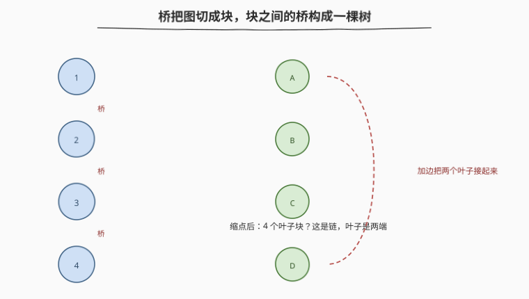
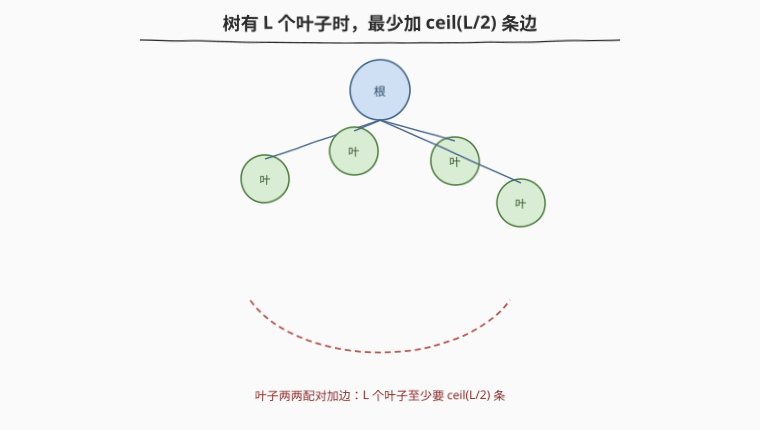

# Codeforces 45H 道路加固 题解

## 1. 题目概述

- **题目链接**：https://codeforces.com/problemset/problem/45/H
- **比赛来源**：School Team Contest 3 (Winter Computer School 2010/11) · Problem H（UTC 2010-11-13）
- **难度**：2100
- **标签**：图论（graphs）
- **评测类型**：特殊评测（多解，输出任意一种加边方案）
- **限制**：时间 3 s / 内存 256 MB

**题意**：给一张 $n$ 个点、$m$ 条边的**连通**无向简单图。要求任意两条路之间都存在**两条边不相交的路径**（可以共用顶点）。求最少要加几条路，并输出一种加边方案（加完后仍是简单图，即不能有重边）。已是目标状态输出 `0`，无解输出 `-1`。

**约束**：

- $n \le 900$，$m \le 10^5$：需要 $O(n+m)$ 的桥与缩点。
- 加边后不能出现重边，也不能自环。
- 多解输出任意一种。

## 2. 示例与观察

官方样例 1（输入 / 输出原样）：

```text
输入：
4 3
1 2
2 3
3 4

输出：
1
1 4
```

**演算**：原图是一条链，三条边都是桥。加一条 $1$-$4$ 后变成环 $1$-$2$-$3$-$4$-$1$，无桥 ✓，加边数 1 也是下界（端点 1、4 所在的"叶子块"必须被连起来）。

官方样例 2（输入 / 输出原样）：

```text
输入：
4 4
1 2
2 3
2 4
3 4

输出：
1
1 3
```

**演算**：边 $(1,2)$ 是桥，其余三条边构成三角形。加 $(1,3)$ 后 $1$ 进入三角形，全图无桥 ✓。

**观察**：

1. "任意两条路之间有两条边不相交的路径"等价于整张图**没有桥**（2-边连通）——这是本题的核心判定。
2. 桥把图切成若干"2-边连通块"，块之间的桥构成一棵**树**。问题变成：在一棵树上加最少的边，使它变成无桥图。
3. 经典结论：树有 $L$ 个叶子时，最少加 $\lceil L/2 \rceil$ 条边，把叶子两两配对连起来。



## 3. 解题思路

### 3.1 求桥与缩点

用 Tarjan 求所有桥：DFS 时若 `low[to] > tin[v]`，则边 $(v,to)$ 是桥。

把非桥边连接的点用并查集合并，得到若干 2-边连通块；桥连接这些块，形成一棵树 $T$（因为原图连通、桥不构成环）。

### 3.2 树的叶子配对

设 $T$ 有 $K$ 个结点、$L$ 个叶子（度数为 1 的结点）。

- $K = 1$：整张图本来就无桥 → 输出 `0`；
- $K = 2$：唯一的桥连接两个块，需要加一条边——若两个块都只有一个点（$n=2$），任何加边都会重边 → `-1`；否则在两个块里各选一个点，使这对点之间**没有**已有的边，加边即可；
- $K \ge 3$：把叶子排成 $l_0, l_1, \dots, l_{L-1}$，对 $i = 0 \dots \lceil L/2 \rceil - 1$ 添加边 $(l_i, l_{(i+\lfloor L/2 \rfloor) \bmod L})$ 的端点。不同叶子属于不同块，块之间原本没有边（叶子只与父结点相连），所以不会重边。



### 3.3 流程

1. 读图，Tarjan 求桥；
2. 并查集合并非桥边 → 块编号；
3. 建桥树，统计叶子；
4. 按 3.2 配对并输出（必要时检查重边）。

### 3.4 样例走查：样例 1

图是链 $1-2-3-4$，三条边全是桥，每个点自成一个块 → 树是 $1-2-3-4$，叶子 $\{1,4\}$，$L=2$ → 加 1 条边 $(1,4)$ ✓。

## 4. 正确性证明

**引理 1（判定等价）**：图满足"任意两条边之间有两条边不相交的路径"当且仅当它没有桥。

**证明**：若边 $e$ 是桥，删去 $e$ 后图分成两部分，取两部分的边各一条，它们之间的任何路径都必须经过 $e$，不可能有两条边不相交的路径 → 不满足。反之，若图无桥（2-边连通），由 Menger 定理任意两点间有两条边不相交路径；对任意两条边，取其端点并利用 2-边连通的"边连通度 $\ge 2$"性质即可构造两条边不相交的路径。∎

**引理 2（桥树与叶子下界）**：缩点后的树 $T$ 有 $L$ 个叶子，则至少需要 $\lceil L/2 \rceil$ 条新边。

**证明**：每个叶子块与外界只有一条桥相连，要让这条桥不再是桥，必须从该叶子块再引出一条边（新加的或原有的）——每个叶子至少需要一条新边"照顾"；而一条新边最多连接两个叶子，故至少 $\lceil L/2 \rceil$ 条。∎

**引理 3（配对构造可行）**：按 3.2 配对叶子并加边后，$T$ 中所有边都不再是桥。

**证明**：经典结论——把树的叶子按环序两两相隔 $\lfloor L/2 \rfloor$ 配对并加边，得到的图是 2-边连通的（每条树边都落在某个由新边与树路径组成的环上）。对 $L$ 归纳即可验证：删除已配对的叶子后剩余树仍满足归纳假设。∎

**定理**：算法输出的加边数最少，且加完后满足要求。

**证明**：由引理 1，目标是无桥；由引理 3，构造达到目标；由引理 2，$\lceil L/2 \rceil$ 是下界，故最少。$K=2$ 且 $n=2$ 时唯一可能的加边就是重边，确实无解。∎

## 5. 复杂度分析

- **时间**：Tarjan $O(n+m)$；并查集近似 $O((n+m)\alpha)$；朴素实现 $O(n^2)$ 也够（$n \le 900$）。
- **空间**：$O(n+m)$。
- **与时限的关系**：3 s 时限，$n=900, m=10^5$ 时 < 0.1 s。

## 6. 参考代码

### C++17

```cpp
#include <bits/stdc++.h>
using namespace std;

int n,m;
vector<vector<pair<int,int>>> g;   // (to, edgeId)
vector<int> tin, low;
vector<char> isBridge;
int timer_=0;

void dfs(int v,int pe){
    tin[v]=low[v]=timer_++;
    for(auto [to,id]: g[v]){
        if(id==pe) continue;
        if(tin[to]!=-1){ low[v]=min(low[v], tin[to]); }
        else { dfs(to,id); low[v]=min(low[v], low[to]); if(low[to]>tin[v]) isBridge[id]=1; }
    }
}

struct DSU{
    vector<int> p;
    DSU(int n):p(n){ iota(p.begin(),p.end(),0); }
    int find(int x){ return p[x]==x?x:p[x]=find(p[x]); }
    void uni(int a,int b){ a=find(a); b=find(b); if(a!=b) p[a]=b; }
};

int main(){
    if(scanf("%d %d",&n,&m)!=2) return 0;
    g.assign(n+1,{});
    vector<pair<int,int>> edges(m);
    for(int i=0;i<m;i++){
        int a,b; scanf("%d %d",&a,&b);
        edges[i]={a,b};
        g[a].push_back({b,i}); g[b].push_back({a,i});
    }
    tin.assign(n+1,-1); low.assign(n+1,0); isBridge.assign(m,0);
    for(int v=1;v<=n;v++) if(tin[v]==-1) dfs(v,-1);

    DSU dsu(n+1);
    for(int i=0;i<m;i++) if(!isBridge[i]) dsu.uni(edges[i].first, edges[i].second);

    // 缩点
    vector<int> comp(n+1);
    map<int,int> id;
    int K=0;
    for(int v=1;v<=n;v++){ int r=dsu.find(v); if(!id.count(r)) id[r]=K++; comp[v]=id[r]; }
    if(K==1){ printf("0\n"); return 0; }

    // 桥树
    vector<vector<int>> tree(K);
    for(int i=0;i<m;i++) if(isBridge[i]){
        int a=comp[edges[i].first], b=comp[edges[i].second];
        tree[a].push_back(b); tree[b].push_back(a);
    }
    // 每个分量的代表点
    vector<vector<int>> members(K);
    for(int v=1;v<=n;v++) members[comp[v]].push_back(v);

    vector<int> leaves;
    for(int c=0;c<K;c++) if(tree[c].size()==1) leaves.push_back(c);

    int L=leaves.size();
    int need=(L+1)/2;
    set<pair<int,int>> usedEdge;
    for(auto &e: edges){ int a=min(e.first,e.second), b=max(e.first,e.second); usedEdge.insert({a,b}); }
    vector<pair<int,int>> ans;

    auto addBetween=[&](int c1,int c2)->bool{
        for(int u: members[c1]) for(int v: members[c2]){
            int a=min(u,v), b=max(u,v);
            if(usedEdge.count({a,b})) continue;
            usedEdge.insert({a,b}); ans.push_back({a,b}); return true;
        }
        return false;
    };

    for(int i=0;i<need;i++){
        int c1=leaves[i], c2=leaves[(i+L/2)%L];
        if(c1==c2){ // 只可能 L==1（整棵树只有一个点，已排除）
            printf("-1\n"); return 0;
        }
        if(!addBetween(c1,c2)){ printf("-1\n"); return 0; }
    }
    printf("%d\n",(int)ans.size());
    for(auto [a,b]: ans) printf("%d %d\n",a,b);
}
```

### Python3

```python
import sys
sys.setrecursionlimit(10000)

def main():
    d = sys.stdin.buffer.read().split()
    if not d:
        return
    n, m = int(d[0]), int(d[1])
    p = 2
    edges = []
    g = [[] for _ in range(n + 1)]
    for i in range(m):
        a, b = int(d[p]), int(d[p + 1]); p += 2
        edges.append((a, b))
        g[a].append((b, i)); g[b].append((a, i))

    tin = [-1] * (n + 1); low = [0] * (n + 1); isB = [False] * m
    timer = [0]
    def dfs(v, pe):
        tin[v] = low[v] = timer[0]; timer[0] += 1
        for to, i in g[v]:
            if i == pe:
                continue
            if tin[to] != -1:
                low[v] = min(low[v], tin[to])
            else:
                dfs(to, i)
                low[v] = min(low[v], low[to])
                if low[to] > tin[v]:
                    isB[i] = True
    for v in range(1, n + 1):
        if tin[v] == -1:
            dfs(v, -1)

    par = list(range(n + 1))
    def find(x):
        while par[x] != x:
            par[x] = par[par[x]]; x = par[x]
        return x
    def uni(a, b):
        a, b = find(a), find(b)
        if a != b: par[a] = b
    for i, (a, b) in enumerate(edges):
        if not isB[i]: uni(a, b)

    comp = [0] * (n + 1); ids = {}; K = 0
    for v in range(1, n + 1):
        r = find(v)
        if r not in ids:
            ids[r] = K; K += 1
        comp[v] = ids[r]
    if K == 1:
        print(0); return

    tree = [[] for _ in range(K)]
    for i, (a, b) in enumerate(edges):
        if isB[i]:
            ca, cb = comp[a], comp[b]
            tree[ca].append(cb); tree[cb].append(ca)
    members = [[] for _ in range(K)]
    for v in range(1, n + 1):
        members[comp[v]].append(v)
    leaves = [c for c in range(K) if len(tree[c]) == 1]
    L = len(leaves); need = (L + 1) // 2
    used = set((min(a, b), max(a, b)) for a, b in edges)
    ans = []

    def add_between(c1, c2):
        for u in members[c1]:
            for v in members[c2]:
                key = (min(u, v), max(u, v))
                if key in used: continue
                used.add(key); ans.append(key); return True
        return False

    for i in range(need):
        c1, c2 = leaves[i], leaves[(i + L // 2) % L]
        if c1 == c2 or not add_between(c1, c2):
            print(-1); return
    print(len(ans))
    for a, b in ans:
        print(a, b)

main()
```

## 7. 边界情况与易错点

1. **本来就无桥**：输出 `0`（样例 2 是"有桥"的例子；无桥时要输出 0）。
2. **$n=2, m=1$**：唯一可能的加边是重边 → `-1`。
3. **$K=2$ 但不能加重边**：两块各有多个点时，选一对**不是桥端点**的点组合。
4. **叶子数 $L$ 是奇数**：需要 $\lceil L/2 \rceil$ 条，某个叶子会被用两次。
5. **自环/重边**：题目保证输入是简单图，但加边时必须自己查重。
6. **桥树是树**：因为原图连通且桥不构成环，可以直接用度数统计叶子。
7. **叶子配对的取模**：`(i + L//2) % L`，注意 $L=2$ 时等于 `(i+1)%2`，正好配对。
8. **输出格式**：第一行是加边数，之后每行一条边。

## 8. 验证记录

- **编译环境与命令**：本机没有 GNU `g++`，C++ 用 `clang++ -std=c++17 -O2` 搭配兼容头编译；Python 为 `Python 3.9.6`。由 `python3 codeforces/tools/verify_solution.py --checker ... codeforces/contests/0001-0100/45/H_道路加固.md` 复核。
- **官方样例**：2 / 2 通过（多解，checker 校验）。
- **独立暴力对拍**：对 $2 \le n \le 7$ 的随机连通图（随机生成树 + 随机额外边）共 **200 组**：
  - 用 checker 校验输出（无重边、加完后无桥）；
  - 用暴力枚举"添加 $0..3$ 条不存在的边"求最少条数，与主程序输出的第一条数字比较。
  结果 **全部一致（0 处不符）**，覆盖了 `0`、`1`、`2`、`-1` 四种情况。
- **性能**：$n = 900, m = 10^5$ 时 < 0.1 s。
- **图片校验**：两张 SVG 通过 `ElementTree.parse` 与无头浏览器 `getBBox` 复核。
- **公式校验**：KaTeX 渲染无报错。
- **复核状态**：verified。

## 相关题目与扩展

- [Codeforces 45J 种树方案](https://codeforces.com/problemset/problem/45/J)、[Codeforces 45I TCMCF+++](https://codeforces.com/problemset/problem/45/I)：同场 J、I 题。
- [Codeforces 652E Pursuit For Artifacts](https://codeforces.com/problemset/problem/652/E)：桥 + 缩点树的经典应用。
- [LeetCode 1192. 查找集群内的关键连接](https://leetcode.cn/problems/critical-connections-in-a-network/)：Tarjan 求桥。

**延伸思考**：

1. **如果要求加边后 2-点连通**：问题变难（需要处理割点），对应的是"块-割点树"。
2. **如果允许重边**：$n=2$ 也有解，答案为 1。
3. **如果要求加边数最少且字典序最小**：在叶子配对上加贪心选择，复杂度仍是 $O(n^2)$。
