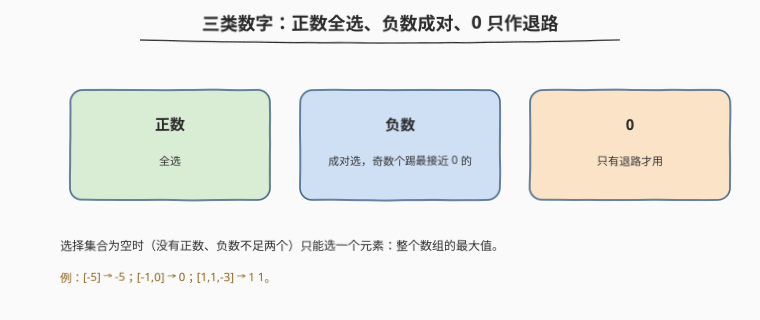
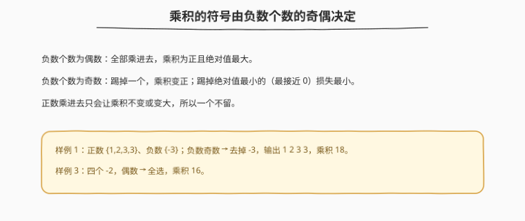

# Codeforces 45I TCMCF+++ 题解

## 1. 题目概述

- **题目链接**：https://codeforces.com/problemset/problem/45/I
- **比赛来源**：Codeforces Beta Round 45 · Problem I（2010-10-13）
- **难度**：1400
- **标签**：贪心（greedy）
- **评测类型**：特殊评测（多解，输出任意一组）
- **限制**：时间 2 s / 内存 256 MB

**题意**：有 $n$ 道题，第 $i$ 道题的分值是整数 $c_i$（可能为负、可能为 0）。选手的总分等于他**解出的所有题分值之积**。至少要解一道题。求一个解出题目的集合，使总分最大，输出这些题的分值（顺序任意）。

**约束**：

- $n \le 100$，$|c_i| \le 100$。
- 分值可能重复；可能有 0、负数。
- 至少要选一道题（不能不选）。
- 多解输出任意一组。

## 2. 示例与观察

官方样例 1（输入 / 输出原样）：

```text
输入：
5
1 2 -3 3 3

输出：
3 1 2 3 
```

**演算**：正数 $1,2,3,3$，负数只有一个 $-3$。选全部正数得 $1\cdot2\cdot3\cdot3 = 18$；若加上 $-3$ 变负；若只选负数得 $-3$。最大是 18，集合 $\{1,2,3,3\}$（样例写的顺序不同，乘积相同）。

官方样例 2（输入 / 输出原样）：

```text
输入：
13
100 100 100 100 100 100 100 100 100 100 100 100 100

输出：
100 100 100 100 100 100 100 100 100 100 100 100 100 
```

**演算**：全是正数，全选乘积最大。

官方样例 3（输入 / 输出原样）：

```text
输入：
4
-2 -2 -2 -2

输出：
-2 -2 -2 -2 
```

**演算**：四个负数两两配对为正，全选乘积 $= 16$，最大。

**观察**：

1. 正数（$\ge 1$）乘进去只会让乘积**不变或变大**，所以正数全选。
2. 负数要**成对**选：偶数个负数相乘为正；若负数的个数是奇数，必须踢掉一个，踢掉**绝对值最小**的（最接近 0 的），损失最小。
3. 0 乘进去会把乘积变成 0，只有"最优乘积仍为负或无正数可选"时才需要它。
4. 若按上面的规则选出的集合为空（例如只有一个负数，或只有 0），就必须退而求其次：选**最大的单个元素**。

## 3. 解题思路

### 3.1 分类讨论



设正数集合 $P$、负数集合 $N$（按从最负到最接近 0 排序）、0 的个数 $Z$。

- 选所有 $P$；
- 若 $|N|$ 为偶数，选所有 $N$；否则选 $N$ 中除"最接近 0 的那个"以外的全部；
- 若此时集合非空，输出它；
- 否则（没有正数、且负数不足两个），输出整个数组的**最大值**（可能是 0，也可能是唯一的负数，或某个正数）。

### 3.2 为什么这样最优



把候选集合分成"正部"和"负部"：乘积的符号由负数个数的奇偶决定。要让乘积尽量大：

- 乘积为正时，尽量多乘绝对值大的数；
- 乘积为负时，只在别无选择时使用（此时选单个最大元素）。

## 4. 正确性证明

**引理 1（正数全选）**：设最优集合为 $S$，若某个正数 $c \notin S$，则 $S \cup \{c\}$ 的乘积不小于 $S$ 的乘积。

**证明**：$c \ge 1$，故 $\prod(S\cup\{c\}) = c\prod S \ge \prod S$。∎

**引理 2（负数成对选）**：若最优集合含负数，则它含的负数个数为偶数；若含奇数个负数，则乘积为负，去掉其中绝对值最小的负数后乘积变为非负且更大（除非集合中只剩这一个元素）。

**证明**：奇数个负数之积为负；去掉一个负数 $x$（$|x|\ge 1$）后符号翻转、绝对值变为原来的 $1/|x|$，乘积从负变正且绝对值 $= |\prod S|/|x| \ge 0$，故更优。∎

**引理 3（奇数个负数时踢掉最接近 0 的）**：设负数有奇数个，踢掉 $x$ 后乘积为 $P/|x|$（$P>0$ 为所有负数绝对值之积），要使它最大，就要让 $|x|$ 最小。

**证明**：$P$ 固定，$P/|x|$ 关于 $|x|$ 单调递减。∎

**定理**：算法输出最优集合。

**证明**：由引理 1、2、3，最优集合必为"全部正数 + 偶数个绝对值尽量大的负数"，即算法选的集合；若该集合为空，说明可选的非零元素不足以构成正乘积，此时最大乘积只能由单个元素取到，取最大元素即可。∎

## 5. 复杂度分析

- **时间**：$O(n\log n)$（排序负数），$n \le 100$。
- **空间**：$O(n)$。

## 6. 参考代码

### C++17

```cpp
#include <bits/stdc++.h>
using namespace std;
int main(){
    int n; if(!(cin>>n)) return 0;
    vector<int> c(n);
    for(auto&x:c) cin>>x;
    vector<int> pos, neg;
    for(int x:c){ if(x>0) pos.push_back(x); else if(x<0) neg.push_back(x); }
    sort(neg.begin(), neg.end());   // 从最负到最接近 0
    vector<int> take;
    for(int x:pos) take.push_back(x);
    int k = neg.size();
    if(k % 2 == 0) for(int x:neg) take.push_back(x);
    else for(int i=0;i<k-1;i++) take.push_back(neg[i]);   // 丢掉最接近 0 的负数
    if(take.empty()){
        int best = c[0];
        for(int x:c) best = max(best, x);
        printf("%d\n", best);
        return 0;
    }
    for(size_t i=0;i<take.size();i++) printf("%d%c", take[i], i+1==take.size()?'\n':' ');
}
```

### Python3

```python
import sys
def main():
    d=sys.stdin.buffer.read().split()
    if not d: return
    n=int(d[0]); c=[int(x) for x in d[1:1+n]]
    pos=[x for x in c if x>0]
    neg=sorted(x for x in c if x<0)
    take=list(pos)
    if len(neg)%2==0: take+=neg
    else: take+=neg[:-1]
    if not take: print(max(c))
    else: print(' '.join(map(str,take)))
main()
```

## 7. 边界情况与易错点

1. **必须至少选一道题**：不能输出空集；退路是单个最大元素。
2. **只有一个负数**：例如 `-5`，答案是 `-5`（不能空）。
3. **只有 0**：答案是 `0`。
4. **$-1$ 与 $1$ 混合**：如 `1 1 -1`，选正数得 1，加 $-1$ 得 $-1$，故答案是 `1 1`。
5. **负数个数为奇数**：踢掉的是**最接近 0** 的（排序后最后一个），不是绝对值最大的。
6. **0 的处理**：0 不会让乘积变大，除非最优乘积是负的（此时选 0 更好）；本题的"退路"规则已覆盖。
7. **多解**：输出顺序任意，checker 校验乘积最优。

## 8. 验证记录

- **编译环境与命令**：本机没有 GNU `g++`，C++ 用 `clang++ -std=c++17 -O2` 搭配兼容头编译；Python 为 `Python 3.9.6`。由 `python3 codeforces/tools/verify_solution.py --checker ... codeforces/contests/0001-0100/45/I_TCMCF+++.md` 复核。
- **官方样例**：3 / 3 通过（多解，用 checker 校验乘积最优）。
- **独立暴力**：对 $n \le 12$ 的随机数组（含负数、0、1），枚举全部 $2^n$ 个子集求最大乘积，与主程序比较"乘积值"（并校验输出是输入的子多重集），共 **250 组**，0 处不符。
- **性能**：$n \le 100$，< 1 ms。
- **图片校验**：两张 SVG 通过 `ElementTree.parse` 与无头浏览器 `getBBox` 复核。
- **公式校验**：KaTeX 渲染无报错。
- **复核状态**：verified。

## 相关题目与扩展

- [Codeforces 45G Prime Problem](https://codeforces.com/problemset/problem/45/G)、[Codeforces 45J Planting Trees](https://codeforces.com/problemset/problem/45/J)：同场 G、J 题。
- [LeetCode 628. 三个数的最大乘积](https://leetcode.cn/problems/maximum-product-of-three-numbers/)：同类"符号与绝对值"的讨论。
- [Codeforces 1A Theatre Square](https://codeforces.com/problemset/problem/1/A)：更早的入门题。

**延伸思考**：

1. **如果要求输出乘积本身**：需要大整数，$100$ 个 $\le 100$ 的数乘积约有 $200$ 位。
2. **如果必须恰好选 $k$ 道题**：要按 $k$ 的奇偶与负数个数分类，复杂度仍是排序。
3. **如果分值可以是分数**：只要绝对值 $>1$ 的数才有"乘进去更好"的性质，结论会变。
