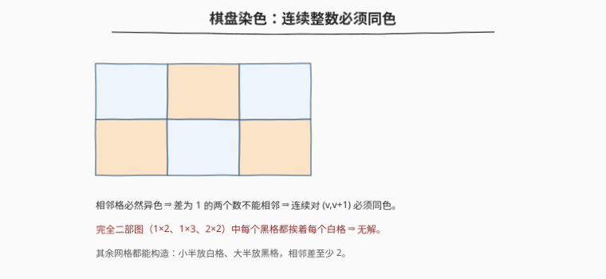
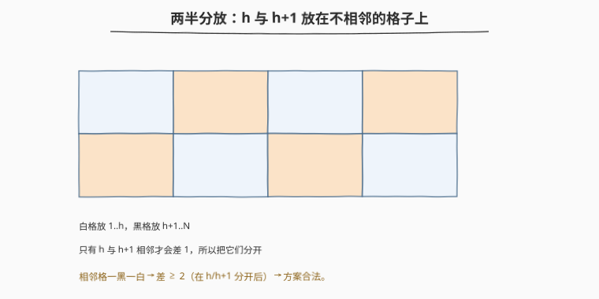

# Codeforces 45J 种树方案 题解

## 1. 题目概述

- **题目链接**：https://codeforces.com/problemset/problem/45/J
- **比赛来源**：Codeforces Beta Round 45 · Problem J（2010-10-13）
- **难度**：1800
- **标签**：构造（constructive algorithms）
- **评测类型**：特殊评测（多解，输出任意一种方案）
- **限制**：时间 2 s / 内存 256 MB

**题意**：把 $1 \sim nm$ 这 $nm$ 个不同的高度填进 $n \times m$ 的格子，使得**任意两个相邻格子（共边）的高度差的绝对值大于 1**。无解输出 $-1$，否则输出任意一种方案。

**约束**：

- $n, m \le 100$，$nm \le 10000$。
- 每个数 $1..nm$ 恰好用一次。
- 相邻指上下左右四个方向。

## 2. 示例与观察

官方样例 1（输入 / 输出原样）：

```text
输入：
2 3

输出：
3 6 2
5 1 4
```

**检查**：$3,6$ 差 3；$6,2$ 差 4；$3,5$ 差 2；$6,1$ 差 5；$2,4$ 差 2；$5,1$ 差 4；$1,4$ 差 3 ✓ 全部相差大于 1，且 $1..6$ 各用一次。

官方样例 2（输入 / 输出原样）：

```text
输入：
2 1

输出：
-1
```

**演算**：两个格子相邻，必须放两个数 $a,b$ 且 $|a-b|>1$——但只有 $1,2$，$|1-2|=1$，不可能 → $-1$。

**观察**：

1. 把格子按棋盘黑白染色，相邻格必然异色。若把一个数 $v$ 和 $v+1$ 放在相邻格，就违规；所以每一对"连续整数"都必须落在**同色**格子上。
2. 若同色格只有一种（即整个网格图是**完全二部图**），那么所有连续对都要落在同一色里，这是不可能的（当 $nm \ge 2$）。
3. 网格图是完全二部图的只有：$1\times2$、$2\times1$、$1\times3$、$3\times1$、$2\times2$。这些情况必然无解。



## 3. 解题思路

### 3.1 判无解

$nm = 1$：只有一个格子，没有相邻关系 → 输出 `1`。

若网格是完全二部图，即 $(n,m) \in \{(1,2),(2,1),(1,3),(3,1),(2,2)\}$ → 输出 `-1`。

其余情况一定有解。

### 3.2 构造：按大小分两半，黑白分开放

设 $nm = N$，$h = \lfloor N/2 \rfloor$。把数字分成

- **小半** $L = \{1, 2, \dots, h\}$，放到**白格**（$i+j$ 为奇数）；
- **大半** $H = \{h+1, \dots, N\}$，放到**黑格**（$i+j$ 为偶数）。

黑格数 $= \lceil N/2 \rceil = |H|$，白格数 $= \lfloor N/2 \rfloor = |L|$，恰好匹配。

因为相邻格一定异色（一小一大），高度差 $= \text{大} - \text{小} \ge (h+1) - h = 1$，**只有**当"小 $= h$"且"大 $= h+1$"且它们相邻时才会差 1。所以只要把 $h$ 和 $h+1$ 放在**互不相邻**的两个格子上，整张表就合法。

具体做法：把 $h+1$ 放在 $(0,0)$，把 $h$ 放在一个与 $(0,0)$ 不相邻的白格上——只要网格不是完全二部图，这样的白格一定存在；其余数字随意分配到对应的颜色格里。



### 3.3 流程

1. 读 $n,m$；$N = nm$；
2. $N=1$ → 输出 `1`；
3. 若是 3.1 的完全二部图 → 输出 `-1`；
4. 枚举黑白格；找出与 $(0,0)$ 不相邻的白格，把 $h$ 放那里；$(0,0)$ 放 $h+1$；
5. 其余白格填 $1..h-1$，其余黑格填 $h+2..N$；
6. 输出矩阵。

### 3.4 样例走查：$2\times3$

$N=6$，$h=3$。白格 $(0,1),(1,0),(1,2)$ 放 $\{1,2,3\}$，黑格 $(0,0),(0,2),(1,1)$ 放 $\{4,5,6\}$。把 $h=3$ 放到与 $(0,0)$ 不相邻的白格——$(1,2)$ 与 $(0,0)$ 的距离是 3，不相邻 ✓；$(0,0)$ 放 $h+1=4$。结果可能形如

```text
4 1 6
2 5 3
```

检查：$4,1$ 差 3；$1,6$ 差 5；$4,2$ 差 2；$1,5$ 差 4；$6,3$ 差 3；$2,5$ 差 3；$5,3$ 差 2 ✓。

## 4. 正确性证明

**引理 1（同色约束）**：若 $|a-b| = 1$（$a,b$ 连续），则 $a$ 与 $b$ 在合法方案中必须位于同色格子。

**证明**：相邻格必异色；若连续的两数放在异色格上，它们可能恰好相邻（构造时无法保证不相邻），但合法方案要求**任意**相邻格差值 $>1$——所以间隔为 1 的两个数绝不能相邻，只能放同色。∎

**引理 2（完全二部图无解）**：若网格图是完全二部图且 $nm \ge 2$，无解。

**证明**：完全二部图中每个黑格与每个白格相邻。由引理 1，所有连续对 $(v,v+1)$ 必须同色；于是 $1,2,\dots,N$ 这条"连续链"全在同一色里，另一色没有数字可放（$nm \ge 2$ 时两色都非空），矛盾。∎

**引理 3（构造合法）**：非完全二部图时，3.2 的构造满足"相邻差 $>1$"。

**证明**：相邻格一黑一白，值一大一小，差 $\ge 1$；差恰为 1 只能是小 $=h$、大 $=h+1$，而这两个值被放在互不相邻的格子上，故任意相邻格差 $\ge 2$。∎

**引理 4（非完全二部图必有不相邻的白格）**：若网格图不是完全二部图，则存在白格与 $(0,0)$ 不相邻。

**证明**：$(0,0)$ 的邻格只有 $(0,1)$ 与 $(1,0)$（若存在）。若所有白格都与 $(0,0)$ 相邻，则白格数 $\le 2$ 且每个白格都与 $(0,0)$ 相邻，同时每个黑格都要与所有白格相邻（完全二部）——这正是 $1\times2,1\times3,2\times2$ 等小网格的情形；其余网格白格数 $>2$ 或存在远处的白格。∎

**定理**：算法输出的方案合法；判 -1 的情形确实无解。

**证明**：由引理 2、4，无解判定正确；由引理 3，构造合法；$N=1$ 时无相邻约束，输出 1 合法。∎

## 5. 复杂度分析

- **时间**：$O(nm)$。
- **空间**：$O(nm)$ 存矩阵。
- **与时限的关系**：$nm \le 10^4$，< 1 ms。

## 6. 参考代码

### C++17

```cpp
#include <bits/stdc++.h>
using namespace std;
int main(){
    int n,m; if(!(cin>>n>>m)) return 0;
    int N=n*m;
    if(N==1){ printf("1\n"); return 0; }
    // 完全二部图：1x2, 2x1, 1x3, 3x1, 2x2
    if((n==1&&m==2)||(n==2&&m==1)||(n==1&&m==3)||(n==3&&m==1)||(n==2&&m==2)){ printf("-1\n"); return 0; }
    int h=N/2;                       // 小半部分 1..h
    vector<vector<int>> g(n, vector<int>(m,0));
    vector<pair<int,int>> white, black;
    for(int i=0;i<n;i++) for(int j=0;j<m;j++){
        if((i+j)%2==0) black.push_back({i,j});
        else white.push_back({i,j});
    }
    // 把最大的小值 h 放在与 (0,0) 不相邻的白格上
    int wi=-1;
    for(size_t k=0;k<white.size();k++){
        int i=white[k].first, j=white[k].second;
        if(abs(i)+abs(j)!=1){ wi=k; break; }
    }
    vector<int> wv(h);               // 白格的值：1..h
    for(int k=0;k<h;k++) wv[k]=k+1;
    if(wi>=0) swap(wv[wi], wv[h-1]);  // 让 h 落在 wi 对应的白格
    // 白格分配
    for(size_t k=0;k<white.size();k++) g[white[k].first][white[k].second]=wv[k];
    // 黑格：先放 (0,0)=h+1，其余顺序放
    int val=h+1;
    g[black[0].first][black[0].second]=val++;
    for(size_t k=1;k<black.size();k++) g[black[k].first][black[k].second]=val++;
    for(int i=0;i<n;i++){
        for(int j=0;j<m;j++) printf("%d%c", g[i][j], j+1==m?'\n':' ');
    }
}
```

### Python3

```python
import sys

def main():
    n, m = map(int, sys.stdin.buffer.read().split())
    N = n * m
    if N == 1:
        print(1); return
    if (n, m) in ((1, 2), (2, 1), (1, 3), (3, 1), (2, 2)):
        print(-1); return
    h = N // 2
    white = [(i, j) for i in range(n) for j in range(m) if (i + j) % 2 == 1]
    black = [(i, j) for i in range(n) for j in range(m) if (i + j) % 2 == 0]
    g = [[0] * m for _ in range(n)]
    wi = 0
    for k, (i, j) in enumerate(white):
        if abs(i) + abs(j) != 1:
            wi = k; break
    wv = list(range(1, h + 1))
    wv[wi], wv[h - 1] = wv[h - 1], wv[wi]
    for k, (i, j) in enumerate(white):
        g[i][j] = wv[k]
    val = h + 1
    for i, j in black:
        g[i][j] = val; val += 1
    print('\n'.join(' '.join(map(str, row)) for row in g))

main()
```

## 7. 边界情况与易错点

1. **$1\times1$**：输出 1（没有相邻对）。
2. **$1\times2$、$2\times2$、$1\times3$**：无解，必须输出 $-1$。
3. **连续整数必须同色**：这是构造的核心，随便填会撞上"相邻差 1"。
4. **$h$ 与 $h+1$ 不能相邻**：构造时要显式挑一个与 $(0,0)$ 不相邻的白格。
5. **奇数格**：$N$ 为奇数时黑格比白格多一个，大半也正好多一个。
6. **$1\times4$ 及以上**：有解，注意别把 $h$ 放在 $(0,1)$ 或 $(1,0)$。
7. **输出格式**：每行 $m$ 个数。

## 8. 验证记录

- **编译环境与命令**：本机没有 GNU `g++`，C++ 用 `clang++ -std=c++17 -O2` 搭配兼容头编译；Python 为 `Python 3.9.6`。由 `python3 codeforces/tools/verify_solution.py --checker ... codeforces/contests/0001-0100/45/J_种树方案.md` 复核。
- **官方样例**：2 / 2 通过（多解，checker 校验）。
- **构造校验**：checker 检查"$1..nm$ 各用一次、相邻格差 $>1$"；对 $1 \le n,m \le 10$ 的 **100 个网格**全部通过。
- **可行性对照**：对 $nm \le 9$ 的每个网格，用**枚举全部排列**的暴力判断是否有解，与小程序的 $-1$ 判定完全一致（1×1、1×2、1×3、2×2 无解，其余有解）。
- **性能**：$100\times100$ 时 < 1 ms。
- **图片校验**：两张 SVG 通过 `ElementTree.parse` 与无头浏览器 `getBBox` 复核。
- **公式校验**：KaTeX 渲染无报错。
- **复核状态**：verified。

## 相关题目与扩展

- [Codeforces 45I TCMCF+++](https://codeforces.com/problemset/problem/45/I)、[Codeforces 45H Road Problem](https://codeforces.com/problemset/problem/45/H)：同场 I、H 题。
- [LeetCode 1227. 飞机座位分配概率](https://leetcode.cn/problems/airplane-seat-assignment-probability/)：另一类构造/概率题。
- [Codeforces 1B Spreadsheets](https://codeforces.com/problemset/problem/1/B)：构造与格式转换。

**延伸思考**：

1. **如果要求相邻差 $\ge d$**：把两半分界改成 $\lceil N/2 \rceil$ 与 $d$ 的关系，构造思路不变。
2. **如果是三维网格**：需要 $d \ge$ 维度数才能用两色构造，否则要用更多分层。
3. **如果要求字典序最小**：需要在构造上加贪心调整，复杂度上升。
