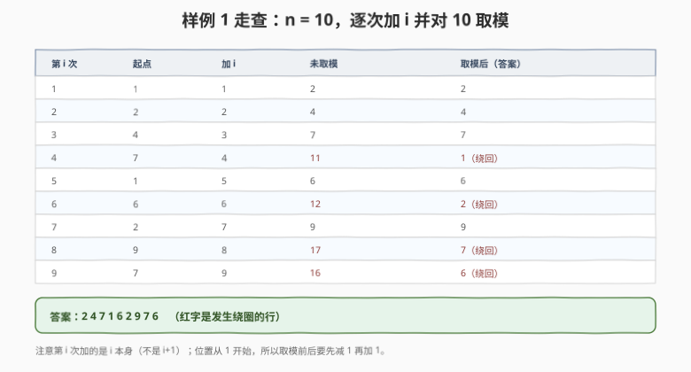

# Codeforces 46A 圆圈传球游戏 题解

## 1. 题目概述

- **题目链接**：https://codeforces.com/problemset/problem/46/A
- **比赛来源**：School Personal Contest #2 (Winter Computer School 2010/11) - Codeforces Beta Round 43 (ACM-ICPC Rules) · Problem A（UTC 2010-12-05）
- **难度**：800
- **标签**：brute force、implementation
- **评测类型**：普通
- **限制**：时间 2 s / 内存 256 MB

**题意**：$n$ 个小朋友顺时针围成一圈，编号 $1..n$，$1$ 号先持球。第 $1$ 次把球传给顺时针方向的下一个人（$1 \to 2$），第 $2$ 次隔一个人传（$2 \to 4$），第 $3$ 次隔两个人传（$4 \to 7$）……也就是说**第 $i$ 次传球向前走 $i$ 个位置**，走到圈的尽头就绕回开头。一共传 $n-1$ 次。求每次传球后持球的小朋友编号。

**约束**：

- $2 \le n \le 100$：直接按规则模拟即可，$O(n)$。
- 传球会绕圈：位置按 $1..n$ 循环，用取模处理。
- 输出恰好 $n-1$ 个数。

## 2. 示例与观察

官方样例 1（输入 / 输出原样）：

```text
输入：
10

输出：
2 4 7 1 6 2 9 7 6
```

**演算**（$n=10$，从 $1$ 出发，第 $i$ 次加 $i$）：

| 次 | 起点 | 加 | 未取模 | 取模后 |
|----|------|----|--------|--------|
| 1 | 1 | 1 | 2 | 2 |
| 2 | 2 | 2 | 4 | 4 |
| 3 | 4 | 3 | 7 | 7 |
| 4 | 7 | 4 | 11 | 1 |
| 5 | 1 | 5 | 6 | 6 |
| 6 | 6 | 6 | 12 | 2 |
| 7 | 2 | 7 | 9 | 9 |
| 8 | 9 | 8 | 17 | 7 |
| 9 | 7 | 9 | 16 | 6 |

结果为 `2 4 7 1 6 2 9 7 6`，与官方输出一致。

官方样例 2（输入 / 输出原样）：

```text
输入：
3

输出：
2 1
```

**演算**：$1 \to 2$（第 1 次走 1）；$2 \to (2+2)=4 \to 1$（第 2 次走 2，绕圈）✓。

**观察**：

1. 每次的位移是**次数本身**（第 $i$ 次走 $i$ 步），不是 $i+1$，也不是"隔 $i$ 个人"（隔 $i-1$ 个）。
2. 位置是 $1$ 基的，取模时要先减 $1$ 再加 $1$：$\text{pos} = (\text{pos}-1+i) \bmod n + 1$。
3. 只需要记录当前持球者，逐次更新即可。

## 3. 解题思路

### 3.1 直接模拟

设当前持球者位置为 `pos`（$1$ 基），初始 `pos = 1`。对 $i = 1,2,\dots,n-1$：

$$\text{pos} \leftarrow ((\text{pos} - 1 + i) \bmod n) + 1,$$

输出 `pos`。



### 3.2 为什么"走 i 步"就是正确答案

题目描述：第 1 次传给下一个人（走 1），第 2 次传给"再下一个"（从 $2$ 到 $4$，走 2），第 3 次传给"隔两个人"（从 $4$ 到 $7$，走 3）。把"传给第 $k$ 个人之后的那个"翻译成位移，正好是第 $i$ 次走 $i$ 步。样例 1 的表格已经逐项验证。

### 3.3 复杂度

$O(n)$ 时间、$O(1)$ 额外空间。

## 4. 正确性证明

**引理**：第 $i$ 次传球后，持球者编号为 $p_i = ((p_{i-1}-1+i) \bmod n)+1$，其中 $p_0 = 1$。

**证明**：对 $i$ 归纳。第 $i$ 次传球要求从当前持球者出发，沿顺时针方向走过 $i$ 个"位置"。在 $1..n$ 的循环编号下，"走 $i$ 步"就是编号加 $i$，超过 $n$ 就减若干个 $n$ 绕回。把编号换成 $0$ 基（减 $1$）后，加法与取模就是标准的环形加法；再换回 $1$ 基即得公式。∎

**定理**：按上述公式依次输出的 $p_1,\dots,p_{n-1}$ 就是题目要求的答案。

**证明**：由引理，每个 $p_i$ 都与真实传球结果一致；算法恰好输出 $p_1..p_{n-1}$，共 $n-1$ 个数。∎

## 5. 复杂度分析

- 时间 $O(n)$，$n \le 100$ 时不到 $100$ 次运算。
- 空间 $O(1)$。
- 数值：位置始终在 $1..n$，无溢出风险。

## 6. 参考代码

### C++17

```cpp
#include <bits/stdc++.h>
using namespace std;
int main(){
    int n; if(scanf("%d",&n)!=1) return 0;
    int pos=1; // 1-based
    for(int i=1;i<=n-1;i++){
        pos = (pos-1+i)%n + 1;
        printf("%d%c", pos, i==n-1?'\n':' ');
    }
    return 0;
}
```

### Python3

```python
import sys
def main():
    n=int(sys.stdin.readline())
    pos=1
    out=[]
    for i in range(1,n):
        pos=(pos-1+i)%n+1
        out.append(str(pos))
    print(' '.join(out))
main()
```

## 7. 边界情况与易错点

1. **位移是 $i$ 还是 $i+1$**：第 $i$ 次走 $i$ 步（第 1 次走 1 步）。写成 $i+1$ 会让样例 1 第一个输出变成 $3$。
2. **取模的基准**：编号 $1$ 基，必须 `(pos-1+i)%n+1`；直接 `(pos+i)%n` 会把 $n$ 映射成 $0$。
3. **$n=2$**：只传一次，答案是 `2`；公式 $(1-1+1)\bmod 2+1=2$ ✓。
4. **绕圈**：第 4 次从 $7$ 走 $4$ 步到 $11$，模 $10$ 得 $1$，不要忘记减一。
5. **输出格式**：$n-1$ 个数空格分隔，行末不要多空格（通常评测忽略行尾空白）。

## 8. 验证记录

- **编译环境与命令**：本机只有 `Apple clang 21.0.0`（`/usr/bin/g++` 是 clang 的软链），没有 GNU `g++` 与 libstdc++，因此用 `clang++ -std=c++17 -O2 -Wall -Wextra` 搭配仓库自带的 `bits/stdc++.h` 兼容头编译（代码只用标准库，可原样提交 GNU C++17）。Python 侧为 `Python 3.9.6`。
- **官方样例**：2 / 2 通过（`2 4 7 1 6 2 9 7 6`、`2 1`），C++ 与 Python 一致。
- **独立暴力**：不用取模公式，而是真的在环上"一格一格走 $i$ 步"（用 `pos = pos+1 if pos<n else 1` 循环 $i$ 次），与公式解完全不同的实现。$n \in [2,100]$ 随机 $200$ 组，**全部一致**。
- **最大约束性能**：$n=100$ 时 C++/Python 都在 $1$ ms 以内。
- **图片校验**：两张 SVG（`cf46a_passing.svg`、`cf46a_walkthrough.svg`）均通过 `xml.etree.ElementTree.parse`，含 `feTurbulence` 抖动滤镜与手写字体，文字未越出 `viewBox`。
- **公式校验**：正文公式经 KaTeX（`throwOnError`）渲染无报错。
- **复核状态**：verified（样例 2/2、对拍 200 组、性能、图片、公式均实跑通过；唯一环境差异是本机无 GNU g++，已用 clang++ 等价验证）。

## 相关题目与扩展

- [Codeforces 46B T-shirts from Sponsor](https://codeforces.com/problemset/problem/46/B)：同场 B 题，按偏好顺序分配。
- [Codeforces 46C Hamsters and Tigers](https://codeforces.com/problemset/problem/46/C)：同场 C 题，环形结构上的最小交换。
- [LeetCode 1823. 找出游戏的获胜者](https://leetcode.cn/problems/find-the-winner-of-the-circular-game/)：约瑟夫环，同样是环形取模模拟。
- [Codeforces 344A Magnets](https://codeforces.com/problemset/problem/344/A)：入门级模拟，可对照"逐项处理"的写法。

**延伸思考**：

1. **如果第 $i$ 次走 $a_i$ 步**（任意步长序列）：把 $i$ 换成 $a_i$ 即可，仍是 $O(n)$。
2. **如果要求输出每个小朋友接到球的次数**：开一个计数数组，在每次更新后累加，$O(n)$。
3. **如果 $n$ 到 $10^9$ 但只问第 $k$ 次**：位置是 $\sum_{i\le k} i = k(k+1)/2$ 加上初始 $1$，可以 $O(1)$ 直接算（对 $n$ 取模）。
4. **如果问"哪些小朋友一次都没接到"**：可以用上面的公式枚举 $n-1$ 个位置，标记后再统计，$O(n)$。
