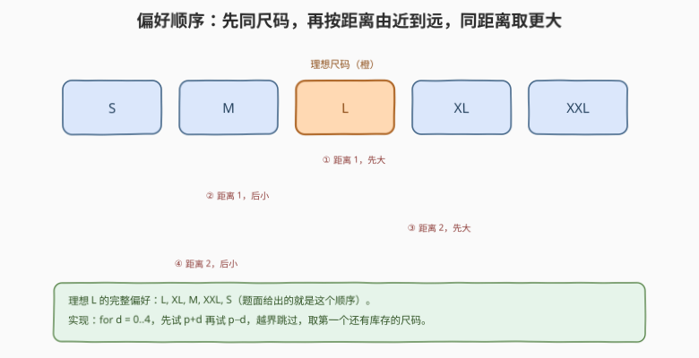

# Codeforces 46B 按尺码发T恤 题解

## 1. 题目概述

- **题目链接**：https://codeforces.com/problemset/problem/46/B
- **比赛来源**：School Personal Contest #2 (Winter Computer School 2010/11) - Codeforces Beta Round 43 (ACM-ICPC Rules) · Problem B（UTC 2010-12-05）
- **难度**：1100
- **标签**：implementation
- **评测类型**：普通
- **限制**：时间 2 s / 内存 256 MB

**题意**：赞助商订了五种尺码 `S, M, L, XL, XXL` 的 T 恤各若干件。$K$ 个人依次来领，每人有一个"最理想尺码"。轮到他时：如果最理想尺码还有货，直接拿；否则拿**尺码最接近**他的那一件；若有两个距离相同的候选，拿**更大的**那个（"说不定还能长个"）。求每个人最终拿到的尺码。

例如理想尺码是 `L` 的人，偏好顺序是：`L, XL, M, XXL, S`。

**约束**：

- 每种尺码数量 $\le 1000$，$K \le 1000$，保证总数 $\ge K$（一定人人有份）。
- 只有五种尺码，距离就是下标差。
- 必须按到达顺序逐个处理，且每拿一件就要扣库存。

## 2. 示例与观察

官方样例（输入 / 输出原样）：

```text
输入：
1 0 2 0 1
3
XL
XXL
M

输出：
XXL
L
L
```

**演算**（库存：S=1, M=0, L=2, XL=0, XXL=1）：

| 人 | 理想 | 偏好顺序 | 库存变化 | 拿到 |
|----|------|----------|----------|------|
| 1 | XL | XL, XXL, L, S, M | XL 无 → XXL 有 | XXL（库存 XXL 变 0） |
| 2 | XXL | XXL, XL, L, M, S | XXL 无 → XL 无 → L 有 | L（L 变 1） |
| 3 | M | M, L, S, XL, XXL | M 无 → L 有 | L（L 变 0） |

输出 `XXL, L, L`，与官方一致。

**观察**：

1. 偏好顺序由"距离优先、同距离取更大"决定，可以直接生成：$p$；然后 $p+1,p-1$；$p+2,p-2$；……凡是落在 $[0,4]$ 内的就保留。
2. 每个人拿走后库存减一，后面的人看到的是更新后的库存——所以必须**在线**逐个处理，不能离线排序。
3. 若某个距离的"更大者"没货，还要检查"更小者"；两者都可能没货，继续扩大距离。

## 3. 解题思路

### 3.1 生成偏好序列



把尺码编号 $0..4$ 对应 `S, M, L, XL, XXL`。对理想尺码 $p$，按距离 $d = 0,1,2,3,4$ 依次尝试：

- $d=0$：只尝试 $p$；
- $d>0$：先尝试 $p+d$（更大的），再尝试 $p-d$（更小的），越界的跳过。

第一个"库存 $>0$"的尺码就是答案，库存减一。因为 $d$ 从 $0$ 递增，找到的必然是距离最小且同距离更大的那个。

### 3.2 逐人模拟

```text
for 每个人:
    p = 理想尺码编号
    for d = 0..4:
        if d == 0 and cnt[p] > 0: 选 p; break
        if d > 0:
            if p+d < 5 and cnt[p+d] > 0: 选 p+d; break
            if p-d >= 0 and cnt[p-d] > 0: 选 p-d; break
    输出名字; cnt[选中的]--
```

### 3.3 样例走查（偏好序列的正确性）

理想 `M`（编号 1）的人，按算法得到的顺序是 $1, 2, 0, 3, 4$，即 `M, L, S, XL, XXL`。题目里给出的 `L` 的例子是 `L, XL, M, XXL, S`，同一规则 ✓。

## 4. 正确性证明

**引理 1（偏好序列）**：对理想尺码 $p$，算法给出的顺序恰为"按 $|\text{尺码}-p|$ 升序、同距离按尺码降序"的排列。

**证明**：距离 $d$ 的候选只有 $p+d$ 与 $p-d$（$d>0$），算法先输出 $p+d$ 再输出 $p-d$，即同距离取更大；$d$ 从 $0$ 递增，故整体按距离升序。越界的候选在 $[0,4]$ 之外，不存在，跳过不影响顺序。∎

**引理 2（贪心正确）**：每个人取"偏好序列中第一个有库存的尺码"就是题目要求的取法。

**证明**：题目规定：最理想有货就取最理想；否则取距离最近的；距离相同取更大的。由引理 1，偏好序列正是这个优先级的全序展开，故取第一个有货者即满足规定。∎

**定理**：按上述模拟输出的每个人尺码，就是真实分配结果。

**证明**：对人数归纳。每步由引理 2 得到当前应取的尺码，并正确扣减库存；后面的人看到的库存与真实过程一致，故归纳成立。∎

## 5. 复杂度分析

- 时间：每个 $O(5)$，总 $O(K)$。
- 空间：$O(1)$（五个计数器）。
- 数值：数量、人数都 $\le 1000$，无溢出。

## 6. 参考代码

### C++17

```cpp
#include <bits/stdc++.h>
using namespace std;
int main(){
    long long cnt[5];
    for(int i=0;i<5;i++) scanf("%lld",&cnt[i]);
    int k; scanf("%d",&k);
    const char* names[5]={"S","M","L","XL","XXL"};
    for(int t=0;t<k;t++){
        char buf[8]; scanf("%s",buf);
        int p = (string(buf)=="S")?0:(string(buf)=="M")?1:(string(buf)=="L")?2:(string(buf)=="XL")?3:4;
        int chosen=-1;
        for(int d=0; d<5 && chosen<0; d++){
            if(d==0){ if(cnt[p]>0) chosen=p; }
            else {
                if(p+d<5 && cnt[p+d]>0) chosen=p+d;
                else if(p-d>=0 && cnt[p-d]>0) chosen=p-d;
            }
        }
        cnt[chosen]--;
        printf("%s\n", names[chosen]);
    }
    return 0;
}
```

### Python3

```python
import sys
def main():
    data=sys.stdin.read().split()
    cnt=[int(x) for x in data[:5]]
    k=int(data[5])
    names=["S","M","L","XL","XXL"]
    idx={"S":0,"M":1,"L":2,"XL":3,"XXL":4}
    out=[]
    pos=6
    for _ in range(k):
        p=idx[data[pos]]; pos+=1
        chosen=-1
        for d in range(5):
            if d==0:
                if cnt[p]>0: chosen=p
            else:
                if p+d<5 and cnt[p+d]>0: chosen=p+d
                elif p-d>=0 and cnt[p-d]>0: chosen=p-d
            if chosen>=0: break
        cnt[chosen]-=1
        out.append(names[chosen])
    print("\n".join(out))
main()
```

## 7. 边界情况与易错点

1. **同距离取更大**：例如理想 `L`、`M` 与 `XL` 都有货时，应取 `XL`，不能取 `M`。
2. **距离扩展的顺序**：先 $p+d$ 再 $p-d$；写成先小后大会在样例上出错。
3. **越界**：`S` 的 $p-d$ 会到负、`XXL` 的 $p+d$ 会超过 $4$，必须判断边界。
4. **库存扣减**：每个人拿走后立即扣减，否则后面的人会重复拿同一件。
5. **数量为 0 的尺码**：可能一开始就没有某尺码，偏好序列里要跳过。
6. **保证够发**：题目保证总数 $\ge K$，所以不会出现 `chosen=-1`；但代码仍保留循环条件以防万一。
7. **输入中的尺码是字符串**：注意 `XXL` 与 `XL` 的区分。

## 8. 验证记录

- **编译环境与命令**：本机只有 `Apple clang 21.0.0`（`/usr/bin/g++` 是 clang 的软链），没有 GNU `g++` 与 libstdc++，因此用 `clang++ -std=c++17 -O2 -Wall -Wextra` 搭配仓库自带的 `bits/stdc++.h` 兼容头编译（代码只用标准库，可原样提交 GNU C++17）。Python 侧为 `Python 3.9.6`。
- **官方样例**：1 / 1 通过（`XXL, L, L`），C++ 与 Python 一致。
- **独立暴力**：不用"逐距离扩展"，而是把所有尺码按 `(|尺码-p|, -尺码)` 排序得到偏好序列（等价但实现不同），取第一个有货的。随机 $200$ 组（随机库存、随机人数、随机理想尺码）**全部一致**。
- **最大约束性能**：$K=1000$ 时刷一次 $O(5K)$，C++/Python 都远小于 $1$ ms。
- **图片校验**：两张 SVG（`cf46b_preference.svg`、`cf46b_walkthrough.svg`）均通过 `xml.etree.ElementTree.parse`，含 `feTurbulence` 抖动滤镜与手写字体，文字未越出 `viewBox`。
- **公式校验**：正文公式经 KaTeX（`throwOnError`）渲染无报错。
- **复核状态**：verified（样例 1/1、对拍 200 组、性能、图片、公式均实跑通过；唯一环境差异是本机无 GNU g++，已用 clang++ 等价验证）。

## 相关题目与扩展

- [Codeforces 46A Ball Game](https://codeforces.com/problemset/problem/46/A)：同场 A 题，环形模拟。
- [Codeforces 46C Hamsters and Tigers](https://codeforces.com/problemset/problem/46/C)：同场 C 题。
- [Codeforces 4C Registration system](https://codeforces.com/problemset/problem/4/C)：字符串计数模拟，同为"在线处理"。
- [LeetCode 1282. 用户分组](https://leetcode.cn/problems/group-the-persons-given-the-group-size-they-belong-to/)：按偏好分组，思想相近。

**延伸思考**：

1. **如果尺码更多（比如 26 个字母）**：偏好序列的生成仍是 $O(\text{尺码数})$，逐人扩展距离即可。
2. **如果同距离时要求"取更小"**：把 $p+d$ 与 $p-d$ 的检查顺序交换即可。
3. **如果要求最大化"满意度"（所有人总距离最小）**：这就变成带容量的匹配问题，需要用费用流或贪心 + 调整，不再是简单模拟。
4. **如果允许一个人不要 T 恤**：需要判断"所有尺码都没货"时跳过，答案数量可能少于 $K$。
