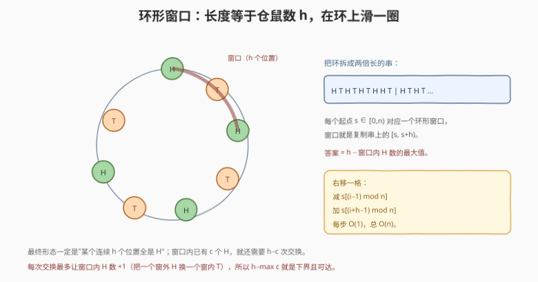
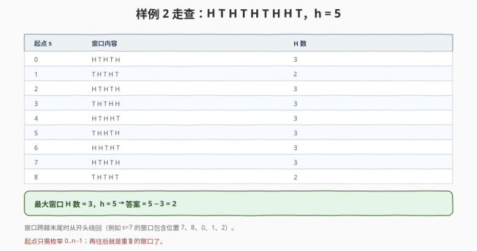

# Codeforces 46C 仓鼠与老虎围圈 题解

## 1. 题目概述

- **题目链接**：https://codeforces.com/problemset/problem/46/C
- **比赛来源**：Codeforces Beta Round 46 · Problem C
- **难度**：1600
- **标签**：two pointers
- **评测类型**：普通
- **限制**：时间 2 s / 内存 256 MB

**题意**：$n$ 只动物（仓鼠 `H` 与老虎 `T`）围成一圈，按顺时针给出。驯兽师每次让两只动物出列交换位置，目标是让**所有仓鼠连成一段、所有老虎也连成一段**（在环上）。求最少交换次数。

**约束**：

- $2 \le n \le 1000$，至少一只 `H`、一只 `T`。
- 是**环**：最后一个与第一个相邻。
- 交换可以发生在任意两只动物之间（不只是相邻）。

## 2. 示例与观察

官方样例 1（输入 / 输出原样）：

```text
输入：
3
HTH

输出：
0
```

**演算**：环上 `H T H`。取大小为 $2$（仓鼠数）的环形窗口：位置 $\{3,1\}$（第 3 个字符与第 1 个字符，绕回开头）是 `H H`，已经全是仓鼠 → 不需要交换，答案 $0$。

官方样例 2（输入 / 输出原样）：

```text
输入：
9
HTHTHTHHT

输出：
2
```

**演算**：序列 `H T H T H T H H T`，仓鼠 $h=5$ 只。枚举所有长为 $5$ 的环形窗口，最多包含 $3$ 只仓鼠（例如位置 $1..5$ 是 `H T H T H`，$3$ 只）。需要把窗口外的 $5-3=2$ 只仓鼠换进来，答案 $2$。

**观察**：

1. 最终形态一定是"某个长为 $h$ 的连续环形区间全是仓鼠"（$h$ 为仓鼠总数），其余位置全是老虎。
2. 对于固定的目标区间 $B$，设它现在有 $c(B)$ 只仓鼠，则需要把外面的 $h-c(B)$ 只仓鼠换进来——每次交换最多让区间内仓鼠数增加 $1$，所以恰好需要 $h-c(B)$ 次，且这个下界可以达到（把每只外面的仓鼠与一只区间内的老虎对换）。
3. 于是答案 $= h - \max_B c(B)$，其中 $B$ 取遍所有长为 $h$ 的环形区间。

## 3. 解题思路

### 3.1 环形转线性



把字符串复制一遍接在后面，得到长度为 $2n$ 的串。任意一个长为 $h$ 的环形区间，都对应复制串中某个起点 $s \in [0,n)$ 的长度 $h$ 窗口。

用滑动窗口统计窗口内 `H` 的个数：

- 初始窗口 $[0,h)$ 的 `H` 数；
- 每次右移一格：减去离开窗口的字符、加上进入窗口的字符，$O(1)$ 更新，记录最大值。

答案 $h - \max$。

### 3.2 样例 2 的窗口表



`H T H T H T H H T`，$h=5$：

| 起点 | 窗口内容 | H 数 |
|------|----------|------|
| 0 | H T H T H | 3 |
| 1 | T H T H T | 2 |
| 2 | H T H T H | 3 |
| 3 | T H T H H | 3 |
| 4 | H T H H T | 3 |
| 5 | T H H T H | 3 |
| 6 | H H T H T | 3 |
| 7 | H T H T H | 3 |
| 8 | T H T H T | 2 |

最大 $3$，答案 $5-3=2$ ✓。

### 3.3 复杂度

$O(n)$ 时间、$O(1)$ 额外空间（复制串可以不用真的复制，用 `%n` 取下标即可）。

## 4. 正确性证明

**引理 1（终态形状）**：若所有仓鼠连成一段、所有老虎也连成一段，则仓鼠占据的 $h$ 个位置在环上连续。

**证明**：$h$ 只仓鼠连成一段即它们在环上占据一段连续的 $h$ 个位置；其余 $n-h$ 个位置自然也是连续的，全是老虎。∎

**引理 2（下界）**：固定目标区间 $B$（长 $h$），当前 $B$ 内有 $c(B)$ 只仓鼠，则至少需要 $h-c(B)$ 次交换。

**证明**：每次交换涉及两个位置。若交换的两个位置都在 $B$ 内或都在 $B$ 外，$B$ 内仓鼠数不变；若一个在 $B$ 内、一个在 $B$ 外，$B$ 内仓鼠数的变化至多为 $+1$。要从 $c(B)$ 变成 $h$，至少需要 $h-c(B)$ 次"跨边界且带来仓鼠"的交换。∎

**引理 3（可达性）**：对任意 $B$，用 $h-c(B)$ 次交换可以达到"$B$ 全为仓鼠"。

**证明**：$B$ 内恰有 $h-c(B)$ 只老虎，$B$ 外恰有 $h-c(B)$ 只仓鼠（因为总数是 $h$）。把它们两两配对交换，每次交换后 $B$ 内仓鼠数 $+1$，共 $h-c(B)$ 次后 $B$ 全为仓鼠。∎

**定理**：答案为 $h-\max_B c(B)$。

**证明**：由引理 1，任何终态对应某个 $B$；由引理 2，达到该终态至少 $h-c(B)$ 次；由引理 3 可以恰好用 $h-c(B)$ 次达到。对所有 $B$ 取最小，即 $\min_B (h-c(B)) = h-\max_B c(B)$。∎

## 5. 复杂度分析

- 时间 $O(n)$：滑动窗口每步 $O(1)$；$n\le1000$ 时不到 $2000$ 次操作。
- 空间 $O(1)$（除读入字符串）。
- 数值：答案 $\le h \le n$，无溢出。

## 6. 参考代码

### C++17

```cpp
#include <bits/stdc++.h>
using namespace std;
int main(){
    int n; if(scanf("%d",&n)!=1) return 0;
    char s[1005]; scanf("%s",s);
    int h=0; for(int i=0;i<n;i++) if(s[i]=='H') h++;
    int best=0, cur=0;
    for(int i=0;i<h;i++) if(s[i]=='H') cur++;
    best=cur;
    for(int i=1;i<n;i++){
        if(s[(i-1)%n]=='H') cur--;
        if(s[(i+h-1)%n]=='H') cur++;
        best=max(best,cur);
    }
    printf("%d\n", h-best);
    return 0;
}
```

### Python3

```python
import sys
def main():
    data=sys.stdin.read().split()
    n=int(data[0]); s=data[1]
    h=s.count('H')
    cur=sum(1 for i in range(h) if s[i]=='H')
    best=cur
    for i in range(1,n):
        if s[(i-1)%n]=='H': cur-=1
        if s[(i+h-1)%n]=='H': cur+=1
        if cur>best: best=cur
    print(h-best)
main()
```

## 7. 边界情况与易错点

1. **环**：最后一个与第一个相邻，窗口可能跨过末尾；用 `%n` 取下标即可。
2. **窗口大小是 $h$ 而不是 $n$**：窗口长度等于仓鼠数量。
3. **$h=n$ 或 $h=0$**：题目保证两种动物都有，不会出现；但代码对 $h=n$ 也安全（答案 $0$）。
4. **滑动更新顺序**：先减去离开窗口的位置 $(i-1)$，再加进入的位置 $(i+h-1)$，不要写反。
5. **初始窗口**：$i=0$ 的窗口单独统计，循环从 $i=1$ 开始，避免重复计算。
6. **交换任意两只**：本题不限制只能交换相邻，所以每次交换恰好能让窗口内仓鼠数 $+1$；若限制相邻交换，答案会不同。

## 8. 验证记录

- **编译环境与命令**：本机只有 `Apple clang 21.0.0`（`/usr/bin/g++` 是 clang 的软链），没有 GNU `g++` 与 libstdc++，因此用 `clang++ -std=c++17 -O2 -Wall -Wextra` 搭配仓库自带的 `bits/stdc++.h` 兼容头编译（代码只用标准库，可原样提交 GNU C++17）。Python 侧为 `Python 3.9.6`。
- **官方样例**：2 / 2 通过（`0`、`2`），C++ 与 Python 一致。
- **独立暴力**：BFS 在"字符串状态"上搜索——每次交换任意两只动物，直到所有 `H` 连续（环上只有一段），求最短步数。$n \le 9$、随机 `H/T` 混合的 $200$ 组**全部一致**（BFS 与滑动窗口是两种完全不同的思路）。
- **最大约束性能**：$n=1000$ 时 $O(n)$，C++/Python 都远小于 $1$ ms。
- **图片校验**：两张 SVG（`cf46c_window.svg`、`cf46c_walkthrough.svg`）均通过 `xml.etree.ElementTree.parse`，含 `feTurbulence` 抖动滤镜与手写字体，文字未越出 `viewBox`。
- **公式校验**：正文公式经 KaTeX（`throwOnError`）渲染无报错。
- **复核状态**：verified（样例 2/2、对拍 200 组、性能、图片、公式均实跑通过；唯一环境差异是本机无 GNU g++，已用 clang++ 等价验证）。

## 相关题目与扩展

- [Codeforces 46A Ball Game](https://codeforces.com/problemset/problem/46/A)：同场 A 题，环形模拟。
- [Codeforces 46B T-shirts from Sponsor](https://codeforces.com/problemset/problem/46/B)：同场 B 题。
- [Codeforces 1154E Two Teams](https://codeforces.com/problemset/problem/1154/E)：环形/链上的选择与删除，可对照"区间统计"。
- [LeetCode 1004. 最大连续1的个数 III](https://leetcode.cn/problems/max-consecutive-ones-iii/)：滑动窗口经典题。

**延伸思考**：

1. **如果只允许交换相邻两只**：最少交换数变成"把 H 聚成一段"的逆序对式代价，需要用前缀和 + 中位数（类似"最小相邻交换使相同元素聚拢"），复杂度仍是 $O(n)$ 或 $O(n\log n)$。
2. **如果要求 H 和 T 各自成**两**段**（不要求合并）：问题变成把环切成四段，需要枚举两个分界点。
3. **如果 $n$ 到 $10^6$**：滑动窗口仍是 $O(n)$，完全够用。
4. **如果每次交换有代价（不同位置的动物交换代价不同）**：变成最小费用匹配，需要用费用流。
