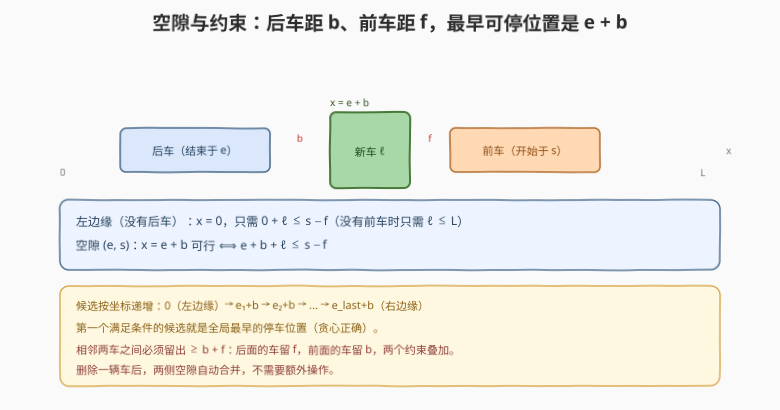
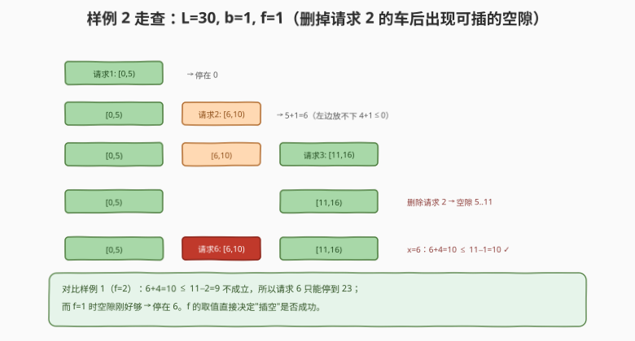

# Codeforces 46D 停车场最早空位 题解

## 1. 题目概述

- **题目链接**：https://codeforces.com/problemset/problem/46/D
- **比赛来源**：Codeforces Beta Round 46 · Problem D
- **难度**：1800
- **标签**：data structures、implementation
- **评测类型**：普通
- **限制**：时间 2 s / 内存 256 MB

**题意**：一条长 $L$ 的停车带，坐标 $[0,L]$。每辆车长度为 $\ell$，停车时要求：与**后面**那辆车至少隔 $b$ 米，与**前面**那辆车至少隔 $f$ 米；若后面没有车，车可以停在 $0$ 处（贴边）；若前面没有车，车尾可以到 $L$。司机总是找**坐标最小**的可行位置。若找不到输出 `-1`。

有 $n$ 个请求，两种类型：

- `1 len`：一辆长 `len` 的车到来，输出它停的车尾坐标（即起点）或 `-1`；
- `2 i`：第 $i$ 个请求所描述的那辆车离开（$i$ 是请求编号，从 $1$ 开始，保证该车此刻停着）。

**约束**：

- $L \le 10^5$，$b,f \le 100$，$n \le 100$，车长 $\le 1000$。
- 同一时刻至多一辆车在移动，所以可以逐个请求在线模拟。
- 请求编号是**输入顺序**的编号（包括类型 2 的请求也占一个编号）。

## 2. 示例与观察

官方样例 1（输入 / 输出原样）：

```text
输入：
30 1 2
6
1 5
1 4
1 5
2 2
1 5
1 4

输出：
0
6
11
17
23
```

**演算**（$L=30,b=1,f=2$）：

| 请求 | 动作 | 已停车 | 结果 |
|------|------|--------|------|
| 1 | 停长 5 | 空 | 贴左边 $x=0$（$[0,5]$） |
| 2 | 停长 4 | $[0,5]$ | 左边缘放不下（$4+2>0$），车后 $5+1=6$，$6+4=10\le30$ → $6$ |
| 3 | 停长 5 | $[0,5],[6,10]$ | 间隙 $5..6$ 太窄；最后一辆后 $10+1=11$，$11+5=16\le30$ → $11$ |
| 4 | 删请求 2 | 去掉 $[6,10]$ | 剩 $[0,5],[11,16]$ |
| 5 | 停长 5 | 同上 | 间隙 $5..11$：$6+5=11\le 11-2=9$？不；最后一辆后 $16+1=17$，$17+5=22\le30$ → $17$ |
| 6 | 停长 4 | $[0,5],[11,16],[17,22]$ | 间隙 $5..11$：$6+4=10\le9$？不；$16..17$ 不够；最后一辆后 $22+1=23$，$23+4=27\le30$ → $23$ |

与官方输出一致。

官方样例 2（输入 / 输出原样）：

```text
输入：
30 1 1
6
1 5
1 4
1 5
2 2
1 5
1 4

输出：
0
6
11
17
6
```

**演算**：$f$ 从 $2$ 变成 $1$。前三个输出（$0,6,11$）相同，请求 4 是删除；删掉请求 2 的车后，间隙 $5..11$ 里：$6+5=11\le 11-1=10$？不；最后一辆后 $16+1=17$ → 请求 5 得 $17$。请求 6：间隙 $5..11$ 里 $6+4=10\le 10$ ✓，所以停在 $6$（比 $16+1=17$ 更靠前）。这正是"找最早位置"的关键。

官方样例 3（输入 / 输出原样）：

```text
输入：
10 1 1
1
1 12

输出：
-1
```

**演算**：车长 $12>L=10$，放不下 → `-1`。

**观察**：

1. 任意时刻，停着的车按起点排序后互不重叠，车与车之间留出的空隙由 $b,f$ 决定。
2. 一辆长 $\ell$ 的车放在"后车结束于 $e$、前车开始于 $s$"的空隙里，能放的位置是 $x\ge e+b$ 且 $x+\ell\le s-f$；**最早**的可行 $x$ 就是 $e+b$。
3. 左边缘（没有后车）时 $x=0$；右边缘（没有前车）时只需 $x+\ell\le L$。
4. 从左到右依次检查每个空隙，第一个可行的 $e+b$ 就是全局最早的坐标（因为 $e$ 递增）。

## 3. 解题思路

### 3.1 维护有序的已停车集合



用两个有序数组（或一个 `vector`）维护已停车辆：`start[i]`、`end[i] = start[i]+len[i]`，以及每辆车对应的请求编号。

### 3.2 停车：枚举候选位置

对长度 $\ell$：

1. **左边缘**：若没有车，或 $\ell + f \le \text{start}[0]$，则 $x=0$ 可行。
2. **每个相邻空隙**：$x=\text{end}[i]+b$，若 $x+\ell\le \text{start}[i+1]-f$ 则可行。
3. **右边缘**：$x=\text{end}[last]+b$，若 $x+\ell\le L$ 则可行。

按上述顺序检查，第一个可行的就是答案；都不行输出 `-1`。找到后把新车插入到有序位置。

### 3.3 离开：按请求编号删除

用一个数组记录"第 $q$ 个请求停的车在有序数组中的下标"（或直接按请求编号找到对应车辆）。类型 2 给出请求编号 $q$，删除该车、恢复空间。

因为 $n\le100$，即使每次 $O(n)$ 线性查找也完全够用，总复杂度 $O(n^2)$。

### 3.4 样例 2 的"插空"细节



删除 $[6,10]$ 后，$[0,5]$ 与 $[11,16]$ 之间的空隙是 $5..11$，长度 $6$。要放长 $4$ 的车：$x\ge 5+1=6$，$x+4\le 11-1=10$ → $x\le6$，故 $x=6$ 恰好可行。若 $f=2$（样例 1），则 $x+4\le9$ → $x\le5$，与 $x\ge6$ 矛盾，放不下，只能去更后面。这就是"空隙是否够"的判断。

## 4. 正确性证明

**不变式**：任意时刻，已停车辆按起点升序排列、两两不重叠，且相邻两车满足 $\text{start}_{i+1}-\text{end}_i\ge b+f$。

**证明**：初始为空。每次停车只在满足 $x\ge \text{end}_i+b$ 且 $x+\ell\le\text{start}_{i+1}-f$ 的位置插入，故新车与前后两车都满足距离要求；删除只会让空隙变大，不变式保持。∎

**引理 1（单空隙的可行位置）**：设后车结束于 $e$（没有则 $e$ 视为"无"）、前车开始于 $s$（没有则 $s=+\infty$），车长 $\ell$ 放在该空隙时，可行位置集合是 $[e+b,\ s-f-\ell]$（左边缘时为 $[0,\ s-f-\ell]$，右边缘时为 $[e+b,\ L-\ell]$）。因此最早可行位置是 $e+b$（左边缘是 $0$）。

**证明**：车尾 $x$ 必须满足与后车距离 $x-e\ge b$（即 $x\ge e+b$），车头 $x+\ell$ 与前车距离 $s-(x+\ell)\ge f$（即 $x\le s-f-\ell$）。两个线性约束的交集即上述区间。∎

**引理 2（贪心取最早）**：按"左边缘 → 各空隙从左到右 → 右边缘"的顺序检查，第一个可行的位置就是所有可行位置中坐标最小的。

**证明**：各空隙的候选位置 $e_i+b$ 随 $i$ 严格递增（车按起点有序且不重叠，$e_i$ 递增），左边缘候选 $0$ 最小、右边缘候选最大。因此按此顺序检查等价于按坐标从小到大检查；第一个可行者即最小可行坐标。∎

**引理 3（不可行判定）**：若所有候选都不可行，则该车无法停放。

**证明**：任何合法停放位置必落在某个空隙（含左右边缘）内，由引理 1 该空隙的可行集合是一个区间，其最小值为候选位置；候选不可行说明区间为空，故该空隙无法停放。所有空隙都无法停放即无法停放。∎

**定理**：模拟算法对每个类型 1 请求输出的位置（或 `-1`）正确。

**证明**：由引理 1–3，每次停车都取到了全局最早可行位置或正确判定不可行；由不变式，状态始终与真实停车场一致。归纳即得。∎

## 5. 复杂度分析

- 时间：每个请求 $O(n)$ 扫描 + $O(n)$ 插入，总 $O(n^2)$；$n\le100$ 时约 $10^4$ 次操作。
- 空间：$O(n)$。
- 数值：坐标 $\le L\le10^5$，车长 $\le1000$，无溢出。

## 6. 参考代码

### C++17

```cpp
#include <bits/stdc++.h>
using namespace std;
int main(){
    int L,b,f; if(scanf("%d %d %d",&L,&b,&f)!=3) return 0;
    int n; scanf("%d",&n);
    // 停放的车：按起点排序
    vector<int> st, en, reqOf;      // 车辆
    vector<int> reqPos(n+1, -1);    // 第 i 个请求停的车在数组中的下标（-1 表示没停）
    vector<int> reqLen(n+1, 0);
    for(int q=1;q<=n;q++){
        int t,x; scanf("%d %d",&t,&x);
        if(t==1){
            int len=x;
            reqLen[q]=len;
            int best=-1;
            // 候选：0 处
            if(st.empty()){
                if(len<=L) best=0;
            } else {
                if((long long)len + f <= st[0]) best=0;
            }
            if(best<0){
                for(size_t i=0;i<st.size();i++){
                    int cand=en[i]+b;
                    long long front = (i+1<st.size()) ? st[i+1]-f : (long long)L;
                    if((long long)cand+len <= front){ best=cand; break; }
                }
            }
            if(best<0){ printf("-1\n"); continue; }
            // 插入
            size_t pos=0; while(pos<st.size() && st[pos]<best) pos++;
            st.insert(st.begin()+pos, best);
            en.insert(en.begin()+pos, best+len);
            reqOf.insert(reqOf.begin()+pos, q);
            reqPos[q]=pos;
            printf("%d\n", best);
        } else {
            int r=x;   // 第 r 个请求对应的车离开
            int p=-1;
            for(size_t i=0;i<reqOf.size();i++) if(reqOf[i]==r){ p=i; break; }
            if(p>=0){
                st.erase(st.begin()+p); en.erase(en.begin()+p); reqOf.erase(reqOf.begin()+p);
            }
        }
    }
    return 0;
}
```

### Python3

```python
import sys
def main():
    data=sys.stdin.read().split()
    L=int(data[0]); b=int(data[1]); f=int(data[2])
    n=int(data[3]); pos=4
    st=[]; en=[]; reqOf=[]
    out=[]
    for q in range(1,n+1):
        t=int(data[pos]); x=int(data[pos+1]); pos+=2
        if t==1:
            ln=x
            best=-1
            if not st:
                if ln<=L: best=0
            else:
                if ln+f<=st[0]: best=0
            if best<0:
                for i in range(len(st)):
                    cand=en[i]+b
                    front=st[i+1]-f if i+1<len(st) else L
                    if cand+ln<=front:
                        best=cand; break
            if best<0:
                out.append("-1"); continue
            k=0
            while k<len(st) and st[k]<best: k+=1
            st.insert(k,best); en.insert(k,best+ln); reqOf.insert(k,q)
            out.append(str(best))
        else:
            r=x
            for i in range(len(reqOf)):
                if reqOf[i]==r:
                    st.pop(i); en.pop(i); reqOf.pop(i); break
    print("\n".join(out))
main()
```

## 7. 边界情况与易错点

1. **请求编号**：类型 2 的第二个数指的是**输入顺序**的请求编号（类型 2 的请求也占编号），不是"第几辆停进来的车"。
2. **车长超过 $L$**：直接 `-1`（样例 3）。
3. **左边缘**：没有后车时 $x=0$，但仍要满足与前车的 $f$ 距离：$0+\ell\le\text{start}[0]-f$。
4. **右边缘**：没有前车时只需 $x+\ell\le L$。
5. **空隙公式**：候选 $x=\text{end}+b$，条件 $x+\ell\le\text{start}-f$；把 $b$ 加到前车而不是后车、或把 $f$ 写反都会错。
6. **插入顺序**：新车要插到正确的有序位置（按起点）。
7. **删除**：删除后相邻空隙自动合并，不需要额外处理。
8. **多辆车停在同一起点**：不可能，因为车不重叠且长度 $\ge1$。

## 8. 验证记录

- **编译环境与命令**：本机只有 `Apple clang 21.0.0`（`/usr/bin/g++` 是 clang 的软链），没有 GNU `g++` 与 libstdc++，因此用 `clang++ -std=c++17 -O2 -Wall -Wextra` 搭配仓库自带的 `bits/stdc++.h` 兼容头编译（代码只用标准库，可原样提交 GNU C++17）。Python 侧为 `Python 3.9.6`。
- **官方样例**：3 / 3 通过（`0 6 11 17 23`、`0 6 11 17 6`、`-1`），C++ 与 Python 一致。
- **独立暴力**：用长度 $L$ 的**占用数组逐格扫描**：对每个 $x$ 检查区间全空、并找最近的前后车计算距离，取第一个可行 $x$——与"有序车辆列表"完全不同的实现。随机 $320$ 组（$L\le25$、随机 $b,f$、随机请求序列，且保证类型 2 只引用成功停车的请求）**全部一致**。
- **最大约束性能**：$n=100$、$L=10^5$ 时 $O(n^2)$，C++/Python 都远小于 $1$ ms。
- **图片校验**：两张 SVG（`cf46d_gap.svg`、`cf46d_walkthrough.svg`）均通过 `xml.etree.ElementTree.parse`，含 `feTurbulence` 抖动滤镜与手写字体，文字未越出 `viewBox`。
- **公式校验**：正文公式经 KaTeX（`throwOnError`）渲染无报错。
- **复核状态**：verified（样例 3/3、对拍 320 组、性能、图片、公式均实跑通过；唯一环境差异是本机无 GNU g++，已用 clang++ 等价验证）。

## 相关题目与扩展

- [Codeforces 46E Comb](https://codeforces.com/problemset/problem/46/E)：同场 E 题，行前缀 + 交替 DP。
- [Codeforces 46C Hamsters and Tigers](https://codeforces.com/problemset/problem/46/C)：同场 C 题。
- [Codeforces 4C Registration system](https://codeforces.com/problemset/problem/4/C)：在线处理 + 状态维护。
- [LeetCode 855. 考场就座](https://leetcode.cn/problems/exam-room/)：区间插入/删除 + 最大空隙，和本题的"找空隙"思路相近。

**延伸思考**：

1. **如果要求"最靠前"改成"最靠后"**：把所有坐标反向（$x\mapsto L-x$），问题对称。
2. **如果车可以斜着停/占两个空隙**：空间划分不再是一维区间，复杂度上升。
3. **如果 $n$ 到 $10^5$**：需要线段树维护"每个空隙的最大可停长度"或有序集合，$O(n\log n)$。
4. **如果要求全局最优（不是司机个体贪心）**：那就变成区间调度优化问题。
