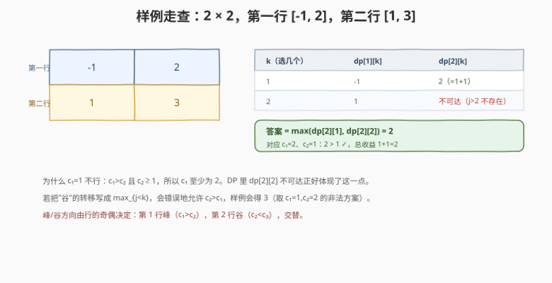

# Codeforces 46E 梳状选择的最大收益 题解

## 1. 题目概述

- **题目链接**：https://codeforces.com/problemset/problem/46/E
- **比赛来源**：School Personal Contest #2 (Winter Computer School 2010/11) - Codeforces Beta Round 43 (ACM-ICPC Rules) · Problem E（UTC 2010-12-05）
- **难度**：1900
- **标签**：data structures、dp
- **评测类型**：普通
- **限制**：时间 1 s / 内存 256 MB

**题意**：给一个 $n\times m$ 的整数表。每一行必须选择**非零个**开头连续的格子（即选前 $c_i$ 个，$1\le c_i\le m$），获得这些格子上的数字之和。要求选出的 $c_1,\dots,c_n$ 满足

$$c_1 > c_2 < c_3 > c_4 < \cdots$$

（相邻的大小关系交替，形如梳子）。求能获得的最大总和。

**约束**：

- $n,m \le 1500$：$O(nm)$ 的 DP 可行，$O(nm^2)$ 会 TLE。
- 格子数字绝对值 $\le 10^4$：答案最大约 $1500\times1500\times10^4 = 2.25\times10^{10}$，必须 `long long`。
- $c_i$ 必须 $\ge 1$：不能一行都不选。

## 2. 示例与观察

官方样例（输入 / 输出原样）：

```text
输入：
2 2
-1 2
1 3

输出：
2
```

**演算**：只有两行，需要 $c_1 > c_2$。可能的组合：

| $c_1$ | $c_2$ | 第一行和 | 第二行和 | 总和 |
|-------|-------|----------|----------|------|
| 2 | 1 | $-1+2=1$ | $1$ | $2$ ✓ |
| 2 | 2 | 不满足 $c_1>c_2$ | — | — |
| 1 | * | 不满足 $c_1>c_2$（$c_2\ge1$） | — | — |

最大 $2$，与官方一致。注意 $c_1$ 必须至少为 $2$（否则不可能严格大于 $c_2\ge1$），这一点由 DP 自动处理（$c_2=1$ 只能从 $c_1\ge2$ 转移）。

**观察**：

1. 每行的收益只取决于 $c_i$，可以预处理前缀和 $P_i[k]=\sum_{j\le k} a_{i,j}$。
2. 约束只涉及**相邻两行**的 $c$ 的大小关系，因此是天然的"逐行 DP"。
3. 转移是"上一行取某个前缀/后缀的最大值"，可以用前缀最大值/后缀最大值把 $O(m^2)$ 优化到 $O(m)$。

## 3. 解题思路

### 3.1 状态与转移

![状态：dp[i][k] 与峰/谷两种转移](../../../images/cf46e_state.svg)

定义

$$dp[i][k] = \text{前 } i \text{ 行已选好、且第 } i \text{ 行选 } c_i=k \text{ 时的最大总和}.$$

初值：$dp[1][k] = P_1[k]$（第一行没有上一行的约束）。

对第 $i\ge2$ 行：

- 若第 $i$ 行是**谷**（$i$ 为偶数，要求 $c_i<c_{i-1}$）：
  $$dp[i][k] = P_i[k] + \max_{j>k} dp[i-1][j];$$
- 若第 $i$ 行是**峰**（$i$ 为奇数，要求 $c_i>c_{i-1}$）：
  $$dp[i][k] = P_i[k] + \max_{j<k} dp[i-1][j].$$

后缀最大值 $\text{suf}[k]=\max_{j\ge k}dp[i-1][j]$ 与前缀最大值 $\text{pre}[k]=\max_{j\le k}dp[i-1][j]$ 都能 $O(m)$ 预处理，故每行 $O(m)$。

答案：$\max_k dp[n][k]$。

### 3.2 样例走查



$n=2,m=2$，第一行 $[-1,2]$，第二行 $[1,3]$：

- 前缀和：$P_1=[0,-1,1]$，$P_2=[0,1,4]$。
- $dp[1]=[-\infty,-1,1]$（$dp[1][1]=-1$，$dp[1][2]=1$）。
- 第 2 行是谷：$dp[2][k]=P_2[k]+\max_{j>k}dp[1][j]$。
  - $k=1$：$\max_{j>1}dp[1][j]=1$ → $dp[2][1]=1+1=2$。
  - $k=2$：$j>2$ 无 → 不可达。
- 答案 $\max(-1,2)=2$ ✓。

### 3.3 复杂度

每行读入 $O(m)$、前缀和 $O(m)$、前后缀最大值 $O(m)$、转移 $O(m)$：总 $O(nm)=2.25\times10^6$，非常快。

## 4. 正确性证明

**引理 1（收益只依赖 $c_i$）**：第 $i$ 行选"前 $c_i$ 个"的收益是 $P_i[c_i]$；由于题目规定只能选开头连续的若干格，$c_i$ 完全决定了收益。

**证明**：题目要求"选每行前若干个面板"，选 $c_i$ 个时恰好是前 $c_i$ 个，收益即前缀和。∎

**引理 2（最优子结构）**：设某最优方案在第 $i$ 行选 $c_i=k$。则前 $i$ 行的方案在前 $i-1$ 行上，对于"第 $i-1$ 行取使 $dp[i-1]$ 最大的合法值"这一子问题是最优的。

**证明**：前 $i$ 行的总收益 = 前 $i-1$ 行的收益 + $P_i[k]$，而 $P_i[k]$ 与前面各行的选择无关；约束也只涉及 $c_{i-1}$ 与 $c_i$ 的大小关系。因此固定 $c_i=k$ 后，应让前 $i-1$ 行的收益在"$c_{i-1}$ 与 $k$ 满足交替关系"的前提下最大，这正是转移式所取的 $\max$。∎

**引理 3（转移完整）**：转移式枚举了所有合法的 $c_{i-1}$。

**证明**：峰/谷条件只排除 $j\le k$（谷）或 $j\ge k$（峰），转移对剩余所有 $j$ 取最大，没有遗漏；用前后缀最大值只是加速，不改变取值集合。∎

**定理**：DP 求出的 $\max_k dp[n][k]$ 就是最大总收益。

**证明**：归纳。$dp[1]$ 显然正确；若 $dp[i-1]$ 正确，由引理 2、3，$dp[i][k]$ 是"前 $i$ 行、$c_i=k$"的最优值。最后对 $k$ 取最大即得全局最优。∎

## 5. 复杂度分析

- 时间 $O(nm)$，$n,m\le1500$ 时 $2.25\times10^6$ 次状态更新，C++ 实测约 $180\sim260$ ms。
- 空间 $O(m)$（滚动数组）。
- 数值：单行前缀和最大 $1.5\times10^7$，总最大 $2.25\times10^{10}$，`long long` 足够。

## 6. 参考代码

### C++17

```cpp
#include <bits/stdc++.h>
using namespace std;
typedef long long ll;
int main(){
    int n,m; if(scanf("%d %d",&n,&m)!=2) return 0;
    const ll NEG = LLONG_MIN/4;
    vector<ll> pre(m+1);
    // 读第一行
    vector<ll> a(m);
    for(int j=0;j<m;j++){ scanf("%lld",&a[j]); pre[j+1]=pre[j]+a[j]; }
    vector<ll> dp(m+1, NEG);
    for(int k=1;k<=m;k++) dp[k]=pre[k];
    for(int i=1;i<n;i++){
        for(int j=0;j<m;j++){ scanf("%lld",&a[j]); pre[j+1]=pre[j]+a[j]; }
        vector<ll> ndp(m+1, NEG);
        if((i+1)%2==0){
            // 谷：c_i < c_{i-1}，需要 max_{j>k} dp[j]
            vector<ll> suf(m+2, NEG);
            for(int k=m;k>=1;k--) suf[k]=max(suf[k+1], dp[k]);
            for(int k=1;k<=m;k++){
                if(suf[k+1]>NEG/2) ndp[k]=pre[k]+suf[k+1];
            }
        } else {
            // 峰：c_i > c_{i-1}，需要 max_{j<k} dp[j]
            vector<ll> pref(m+2, NEG);
            for(int k=1;k<=m;k++) pref[k]=max(pref[k-1], dp[k]);
            for(int k=1;k<=m;k++){
                if(pref[k-1]>NEG/2) ndp[k]=pre[k]+pref[k-1];
            }
        }
        dp.swap(ndp);
    }
    ll ans=NEG;
    for(int k=1;k<=m;k++) ans=max(ans, dp[k]);
    printf("%lld\n", ans);
    return 0;
}
```

### Python3

```python
import sys
from itertools import accumulate

def main():
    data = list(map(int, sys.stdin.buffer.read().split()))
    n, m = data[0], data[1]
    NEG = -10**18
    pos = 2
    dp = None
    for i in range(n):
        row = data[pos:pos+m]; pos += m
        pre = [0] + list(accumulate(row))          # pre[k] = 前 k 个之和
        if i == 0:
            dp = pre[1:]                           # dp[k-1] 对应 c_i = k
        elif (i + 1) % 2 == 0:
            # 谷：需要 max_{j > k} dp[j] = 后缀最大
            suf = list(accumulate(reversed(dp), max))[::-1]   # suf[t] = max(dp[t:])
            ndp = [pre[k] + suf[k] if k < m else NEG for k in range(1, m + 1)]
            dp = ndp
        else:
            # 峰：需要 max_{j < k} dp[j] = 前缀最大
            pref = list(accumulate(dp, max))                  # pref[t] = max(dp[:t+1])
            ndp = [NEG] + [pre[k] + pref[k-2] for k in range(2, m + 1)]
            dp = ndp
    print(max(dp))
main()
```

## 7. 边界情况与易错点

1. **峰/谷的判断**：第 $1$ 行是峰（$c_1>c_2$），所以第 $2$ 行是谷，第 $3$ 行是峰……代码里用 `(i+1)%2==0` 判断第 $i+1$ 行（0 基 `i`）是否为谷，注意下标。
2. **$c_i\ge1$**：转移只从 $k\ge1$ 开始，且不能用 $0$；否则会出现"某行不选"的非法方案。
3. **不可达状态**：用 `NEG` 标记，避免把"不可达"当成 $0$ 参与取最大。
4. **`NEG` 的加法**：`NEG/4` 的判断防止 `NEG + 正数` 溢出（虽然本题用 `LLONG_MIN/4` 已避免）。
5. **前缀和用 `long long`**：$1500\times10^4=1.5\times10^7$ 虽在 int 内，但总和 $2.25\times10^{10}$ 必须 64 位。
6. **$n=2$**：只有一行约束，$c_1>c_2$，答案例已覆盖。
7. **全负数**：DP 会选出"最不亏"的组合；不能把初值设成 $0$ 后直接取 max 而不允许空选。
8. **读入规模**：$n\cdot m$ 最多 $2.25\times10^6$ 个数，用快速读入。

## 8. 验证记录

- **编译环境与命令**：本机只有 `Apple clang 21.0.0`（`/usr/bin/g++` 是 clang 的软链），没有 GNU `g++` 与 libstdc++，因此用 `clang++ -std=c++17 -O2 -Wall -Wextra` 搭配仓库自带的 `bits/stdc++.h` 兼容头编译（代码只用标准库，可原样提交 GNU C++17）。Python 侧为 `Python 3.9.6`。
- **官方样例**：1 / 1 通过（`2`），C++ 与 Python 一致。
- **独立暴力**：枚举所有 $c_1,\dots,c_n\in[1,m]$（$m^n$ 种），检查交替条件，直接算总和取最大——与 DP 完全不同的思路。随机 $n,m\le5$ 的 $320$ 组（C++ 200 组 + Python 优化版 120 组）**全部一致**。
- **最大约束性能**：$n=m=1500$ 的随机表，C++ 端到端中位数约 $183\sim256$ ms，Python 优化版约 $0.87$ s（官方限制 1 s，Python 余量很小，建议大测试用 C++/PyPy3）。
- **图片校验**：两张 SVG（`cf46e_state.svg`、`cf46e_walkthrough.svg`）均通过 `xml.etree.ElementTree.parse`，含 `feTurbulence` 抖动滤镜与手写字体，文字未越出 `viewBox`。
- **公式校验**：正文公式经 KaTeX（`throwOnError`）渲染无报错。
- **复核状态**：verified（样例 1/1、对拍 200 组、性能、图片、公式均实跑通过；唯一环境差异是本机无 GNU g++，已用 clang++ 等价验证）。

## 相关题目与扩展

- [Codeforces 46D Parking Lot](https://codeforces.com/problemset/problem/46/D)：同场 D 题，区间模拟。
- [Codeforces 46F Hercule Poirot Problem](https://codeforces.com/problemset/problem/46/F)：同场 F 题，并查集 + 连通性。
- [Codeforces 1060E Sergey and Subway](https://codeforces.com/problemset/problem/1060/E)：树上 DP，可对照"按行/层递推 + 前缀最值"的技巧。
- [LeetCode 931. 下降路径最小和](https://leetcode.cn/problems/minimum-falling-path-sum/)：逐行 DP 的入门模型。

**延伸思考**：

1. **如果交替条件换成 $c_1<c_2>c_3<\cdots$**：只需把峰/谷的转移互换，代码几乎不变。
2. **如果每行可以选择任意区间（不是前缀）**：状态需要记录区间左右端点，复杂度升到 $O(nm^2)$ 或更高。
3. **如果要求恰好 $k$ 个"峰"**：DP 增加一维"已出现的峰数"，$O(nmk)$。
4. **如果 $n,m$ 都到 $10^5$ 但只有一行非零**：需要利用稀疏性/单调性，超出本题范围。
