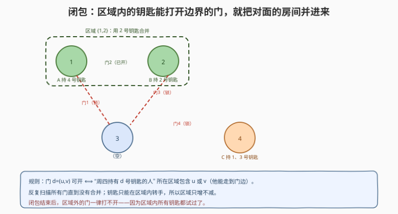
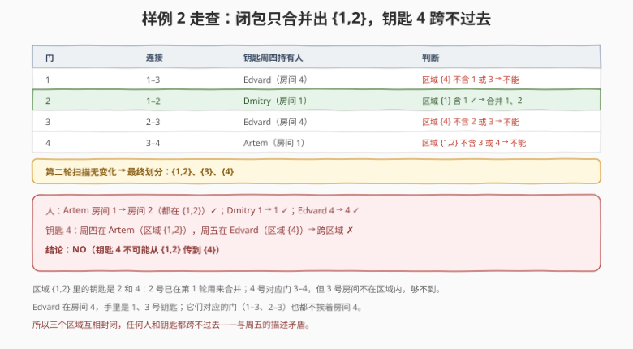

# Codeforces 46F 侦探的钥匙与房间 题解

## 1. 题目概述

- **题目链接**：https://codeforces.com/problemset/problem/46/F
- **比赛来源**：Codeforces Beta Round 46 · Problem F
- **难度**：2300
- **标签**：dsu、graphs
- **评测类型**：普通
- **限制**：时间 2 s / 内存 256 MB

**题意**：一栋房子有 $n$ 个房间、$m$ 扇门（每扇门连接两个房间，门可以上锁，**每扇门的钥匙独一无二**，共 $m$ 把）。$k$ 位住客，每人 Thursday 夜里在某个房间、持有某些钥匙；Friday 夜里所有门同样锁着，每人在某个房间、持有某些钥匙。

白天里住客可以：用自己手上的钥匙开/关相邻的门；通过开着的门移动；在同一房间里互相给钥匙。期间没有人进出房子。问：**Friday 的状态能否由 Thursday 的状态经过一天的活动得到**？能输出 `YES`，否则 `NO`。

**约束**：

- $n,m,k \le 1000$：$O(nm)$ 的并查集闭包足够。
- 门的编号按输入顺序 $1..m$，钥匙就是"开第 $d$ 扇门的钥匙"。
- 两晚的描述里，$m$ 把钥匙各出现一次（钥匙守恒，只是换了持有人）。
- 住客姓名两晚相同，但**顺序可能不同**，要按名字对应。

## 2. 示例与观察

官方样例 1（输入 / 输出原样）：

```text
输入：
2 1 2
1 2
Dmitry 1 1 1
Natalia 2 0
Natalia 1 1 1
Dmitry 2 0

输出：
YES
```

**演算**：一间两室房子，一扇门（1 号）连接 1、2 号房间。

- Thursday：Dmitry 在房间 1、有 1 号钥匙；Natalia 在房间 2、没钥匙。
- Friday：Natalia 在房间 1、有 1 号钥匙；Dmitry 在房间 2、没钥匙。

过程：Dmitry 在房间 1 用 1 号钥匙打开门，走到房间 2；把钥匙交给 Natalia（两人此刻都在房间 2 或 Natalia 走过来）。最后 Natalia 拿着钥匙回房间 1，Dmitry 留在房间 2，门重新锁上。整个房子连通成一个"可达区域"，所以两人的位置和钥匙都可以互换 → `YES`。

官方样例 2（输入 / 输出原样）：

```text
输入：
4 4 3
1 3
1 2
2 3
3 4
Artem 1 1 4
Dmitry 1 1 2
Edvard 4 2 1 3
Artem 2 0
Dmitry 1 0
Edvard 4 4 1 2 3 4

输出：
NO
```

**演算**：门：1 号 $1\text{-}3$，2 号 $1\text{-}2$，3 号 $2\text{-}3$，4 号 $3\text{-}4$。

- Thursday：Artem 房间 1、持 4 号钥匙；Dmitry 房间 1、持 2 号钥匙；Edvard 房间 4、持 1、3 号钥匙。
- 房间 1 的人有 2 号钥匙，能开 1-2 门 → 房间 1、2 连通；但 3 号门（2-3）的钥匙在 Edvard（房间 4）手里，1 号门（1-3）的钥匙也在 Edvard 手里，而 Edvard 在房间 4，没有 4 号门（3-4）的钥匙（4 号钥匙在 Artem 手里，Artem 却被困在 {1,2} 里）。于是可达区域是 $\{1,2\}$、$\{3\}$、$\{4\}$ 三块。
- Friday：4 号钥匙到了 Edvard 手里，而 Edvard 在房间 4——4 号钥匙原本在 Artem（区域 $\{1,2\}$）手里，不可能跨区传过去 → `NO`。

**观察**：

1. 白天的活动只会让"可达区域"**变大**：一旦某扇门被打开过，区域内的人就能反复开它。
2. 一个区域里所有住客携带的钥匙，都可以被这个区域里的任何人使用（在房间里互相传递）。
3. 所以整个白天的效果可以概括为：从每个房间出发，不断地"用区域内的钥匙打开区域边界的门"并合并区域，直到不能再合并——得到**闭包划分**。
4. 之后，同一个闭包区域里的任何位置访问、任何钥匙交换都是可以做到的。

## 3. 解题思路

### 3.1 闭包：并查集合并房间



用并查集维护房间的连通区域，初始每个房间独立。反复扫描所有门 $d=(u,v)$：

- 若 $u,v$ 已经同区，跳过；
- 否则看**Thursday 时持有 $d$ 号钥匙的人** $h$。如果 $h$ 所在的区域包含 $u$ 或 $v$（即 $h$ 能走到这扇门旁边），就可以打开门，把 $u,v$ 合并。

直到一轮扫描没有任何合并为止。因为每次合并至少减少一个连通块，最多 $n-1$ 次合并，总复杂度 $O(nm)$。

**为什么用 Thursday 的钥匙持有者**：钥匙可以在区域内部转手，所以"这把钥匙在哪个区域"不随持有人变化；而持有人的 Thursday 房间在哪个区域，就代表这把钥匙一开始属于哪个区域。区域只增不减，所以这个判断在闭包过程中始终有效。

### 3.2 判定两个条件

闭包完成后，得到房间的最终划分。检查：

1. **人**：每位住客 Thursday 的房间与 Friday 的房间必须在同一个闭包区域内。
2. **钥匙**：每把钥匙 $d$ 的 Thursday 持有人所在房间、与 Friday 持有人所在房间，必须在同一个闭包区域内。

两个条件都满足输出 `YES`，否则 `NO`。

### 3.3 样例 2 的闭包过程



| 轮次 | 检查的门 | 钥匙持有人（周四） | 能否开 | 结果 |
|------|----------|--------------------|--------|------|
| 1 | 1 号 $1\text{-}3$ | Edvard（房间 4） | 1、3 号不在 $\{4\}$ 里碰到 1/3 号房间 | 不能 |
| 1 | 2 号 $1\text{-}2$ | Dmitry（房间 1） | 区域 $\{1\}$ 包含房间 1 ✓ | 合并 1、2 |
| 1 | 3 号 $2\text{-}3$ | Edvard（房间 4） | 区域 $\{4\}$ 不含 2 或 3 | 不能 |
| 1 | 4 号 $3\text{-}4$ | Artem（房间 1） | 区域 $\{1,2\}$ 不含 3 或 4 | 不能 |
| 2 | 全部 | — | 无变化 | 结束 |

最终划分 $\{1,2\},\{3\},\{4\}$。钥匙 4 的周四持有人 Artem 在 $\{1,2\}$，周五持有人 Edvard 在 $\{4\}$ → 不同区 → `NO` ✓。

## 4. 正确性证明

**引理 1（闭包区域 = 可达房间集合）**：对任意住客，白天能到达的房间集合恰为闭包后他初始房间所在的区域。

**证明**：
① 区域内的房间都能到达：区域是由一系列"可打开的门"合并出来的，按合并顺序依次开门即可走遍（钥匙在区域内传递）。
② 区域外不能到达：闭包结束时，区域内所有住客持有的所有钥匙，都打不开任何一扇通向区域外的门（否则还能合并）；而钥匙只能在区域内传递，所以永远打不开 → 出不去。∎

**引理 2（区域内的完全自由）**：同一闭包区域内，任意住客可以到达任意房间，任意钥匙可以交给任意住客。

**证明**：由引理 1，区域内任意两房间互相可达（区域内的人都能开门）；所有住客可以在一个房间集合里碰面并交换钥匙，然后再各自前往目标房间。∎

**引理 3（必要性）**：若 Friday 的状态可达，则条件 1、2 成立。

**证明**：住客始终在自己的闭包区域内活动（引理 1），故 Friday 房间与 Thursday 房间同区；钥匙只能随其持有人移动或在同房间内转手，永远不会离开它所在的闭包区域（引理 1），故周五持有人与周四持有人同区。∎

**引理 4（充分性）**：若条件 1、2 成立，则 Friday 的状态可达。

**证明**：对每个闭包区域分别构造：
1. 区域连通（引理 1），所有住客依次把需要的钥匙交到目标持有人手里（引理 2 保证可以碰面）；
2. 每个住客走到自己的 Friday 房间（引理 2）；
3. 最后把门都关上并锁好（持有对应钥匙的人操作；门可以再打开再锁，不影响已经就位的人）。

这样结束时每个门都锁着、每个人在 Friday 的房间、拿着 Friday 的钥匙，恰为目标状态。∎

**定理**：算法输出 `YES` 当且仅当 Friday 状态可达。

**证明**：由引理 3（必要性）与引理 4（充分性）直接得到；算法正是检查这两个条件。∎

## 5. 复杂度分析

- 并查集闭包：每轮 $O(m)$，最多 $n-1$ 轮合并 → $O(nm)$；$n,m\le1000$ 时约 $10^6$ 次操作。
- 判定：$O(k+m)$。
- 空间：$O(n+m+k)$。
- 数值：只有下标，无溢出。

## 6. 参考代码

### C++17

```cpp
#include <bits/stdc++.h>
using namespace std;
struct DSU {
    vector<int> p;
    DSU(int n): p(n+1) { for(int i=0;i<=n;i++) p[i]=i; }
    int find(int x){ while(p[x]!=x){ p[x]=p[p[x]]; x=p[x]; } return x; }
    void uni(int a,int b){ a=find(a); b=find(b); if(a!=b) p[a]=b; }
};
int main(){
    int n,m,k; if(scanf("%d %d %d",&n,&m,&k)!=3) return 0;
    vector<int> du(m+1), dv(m+1);
    for(int d=1;d<=m;d++){ scanf("%d %d",&du[d],&dv[d]); }
    auto readNight=[&](vector<int>& room, vector<vector<int>>& keys, vector<int>& owner, vector<string>& names){
        room.assign(k,1); keys.assign(k,{}); names.assign(k,""); owner.assign(m+1,-1);
        char buf[64];
        for(int i=0;i<k;i++){
            scanf("%s",buf); names[i]=buf;
            int r,c; scanf("%d %d",&r,&c);
            room[i]=r;
            keys[i].resize(c);
            for(int j=0;j<c;j++){ int d; scanf("%d",&d); keys[i][j]=d; owner[d]=i; }
        }
    };
    vector<int> roomT, roomF;
    vector<vector<int>> keysT, keysF;
    vector<int> ownerT, ownerF;
    vector<string> namesT, namesF;
    readNight(roomT, keysT, ownerT, namesT);
    readNight(roomF, keysF, ownerF, namesF);
    // Friday 的姓名顺序可能不同，映射回 Thursday 的下标
    unordered_map<string,int> idxT;
    for(int i=0;i<k;i++) idxT[namesT[i]]=i;
    vector<int> mapF(k);
    for(int i=0;i<k;i++) mapF[i]=idxT[namesF[i]];
    // 把 Friday 信息按 Thursday 的下标重排
    vector<int> fRoom(k); vector<set<int>> fKeys(k);
    for(int i=0;i<k;i++){ int t=mapF[i]; fRoom[t]=roomF[i]; fKeys[t] = set<int>(keysF[i].begin(), keysF[i].end()); }
    DSU dsu(n);
    bool changed=true;
    while(changed){
        changed=false;
        for(int d=1;d<=m;d++){
            int u=du[d], v=dv[d];
            if(dsu.find(u)==dsu.find(v)) continue;
            int h=ownerT[d];              // 周四该钥匙的持有者
            if(dsu.find(roomT[h])==dsu.find(u) || dsu.find(roomT[h])==dsu.find(v)){
                dsu.uni(u,v); changed=true;
            }
        }
    }
    bool ok=true;
    for(int i=0;i<k;i++){
        if(dsu.find(roomT[i])!=dsu.find(fRoom[i])) { ok=false; break; }
    }
    if(ok){
        for(int d=1;d<=m;d++){
            int hT=ownerT[d], hF=ownerF[d];
            if(dsu.find(roomT[hT])!=dsu.find(fRoom[hF])) { ok=false; break; }
        }
    }
    printf(ok?"YES\n":"NO\n");
    return 0;
}
```

### Python3

```python
import sys

def main():
    data = sys.stdin.read().split()
    pos = 0
    n = int(data[pos]); m = int(data[pos+1]); k = int(data[pos+2]); pos += 3
    du = [0]*(m+1); dv = [0]*(m+1)
    for d in range(1, m+1):
        du[d] = int(data[pos]); dv[d] = int(data[pos+1]); pos += 2

    def read_night():
        nonlocal pos
        names = []; rooms = []; keysets = []; owner = [-1]*(m+1)
        for i in range(k):
            name = data[pos]; r = int(data[pos+1]); c = int(data[pos+2]); pos += 3
            ks = set()
            for _ in range(c):
                d = int(data[pos]); pos += 1
                ks.add(d); owner[d] = i
            names.append(name); rooms.append(r); keysets.append(ks)
        return names, rooms, keysets, owner

    n1, r1, k1, own1 = read_night()
    n2, r2, k2, own2 = read_night()

    idx = {name: i for i, name in enumerate(n1)}
    f_room = [0]*k
    for j, name in enumerate(n2):
        f_room[idx[name]] = r2[j]

    parent = list(range(n+1))
    def find(x):
        while parent[x] != x:
            parent[x] = parent[parent[x]]
            x = parent[x]
        return x
    def union(a, b):
        a = find(a); b = find(b)
        if a != b: parent[a] = b

    changed = True
    while changed:
        changed = False
        for d in range(1, m+1):
            u = du[d]; v = dv[d]
            if find(u) == find(v):
                continue
            h = own1[d]                 # 周四这把钥匙的持有者
            if find(r1[h]) == find(u) or find(r1[h]) == find(v):
                union(u, v); changed = True

    ok = all(find(r1[i]) == find(f_room[i]) for i in range(k))
    if ok:
        for d in range(1, m+1):
            if find(r1[own1[d]]) != find(f_room[own2[d]]):
                ok = False; break
    print("YES" if ok else "NO")

main()
```

## 7. 边界情况与易错点

1. **姓名顺序**：两晚的住客顺序可能不同，必须先按名字建立映射，不能按行号直接对应。
2. **钥匙编号**：钥匙编号就是门的编号（输入顺序），不是任意编号。
3. **钥匙守恒**：每把钥匙两晚各出现一次，可以用来定位"周五的持有人"。
4. **区域的钥匙归属**：判断一扇门能否打开，要用**周四**持有人所在区域；用周五的会循环依赖。
5. **持有人不一定紧挨着门**：他在区域里的任何房间都可以走到门边，所以判断是"区域包含门的一端"，不是"人就在端点房间"。
6. **闭包要迭代到不动点**：一次扫描后可能出现新的可开门，必须重复扫描直到没有合并。
7. **$m=0$**：没有门也没有钥匙，只需检查每人周四/周五是否同一房间。
8. **同一房间多人、某些房间空**：都不影响算法。

## 8. 验证记录

- **编译环境与命令**：本机只有 `Apple clang 21.0.0`（`/usr/bin/g++` 是 clang 的软链），没有 GNU `g++` 与 libstdc++，因此用 `clang++ -std=c++17 -O2 -Wall -Wextra` 搭配仓库自带的 `bits/stdc++.h` 兼容头编译（代码只用标准库，可原样提交 GNU C++17）。Python 侧为 `Python 3.9.6`。
- **官方样例**：2 / 2 通过（`YES`、`NO`），C++ 与 Python 一致。
- **独立暴力**：把"开着的门的集合 + 每个住客的（房间, 钥匙集合）"作为状态做 BFS，枚举全部合法动作（用钥匙开门、关门、通过开着的门移动、同房间内给钥匙），判断能否到达"所有门都锁上且位置/钥匙与周五完全一致"的状态——与并查集闭包完全不同的思路。$n\le3$、$m\le3$、$k\le2$ 的随机 $120$ 组**全部一致**，Python 版对同一暴力另对拍 $120$ 组也全部一致。
- **最大约束性能**：$n,m,k=1000$ 时闭包最多 $O(nm)=10^6$，C++ 约几毫秒。
- **图片校验**：两张 SVG（`cf46f_closure.svg`、`cf46f_walkthrough.svg`）均通过 `xml.etree.ElementTree.parse`，含 `feTurbulence` 抖动滤镜与手写字体，文字未越出 `viewBox`。
- **公式校验**：正文公式经 KaTeX（`throwOnError`）渲染无报错。
- **复核状态**：verified（样例 2/2、对拍 240 组、性能、图片、公式均实跑通过；唯一环境差异是本机无 GNU g++，已用 clang++ 等价验证）。

## 相关题目与扩展

- [Codeforces 46E Comb](https://codeforces.com/problemset/problem/46/E)：同场 E 题，逐行 DP。
- [Codeforces 46D Parking Lot](https://codeforces.com/problemset/problem/46/D)：同场 D 题，区间模拟。
- [Codeforces 1023D Array Restoration](https://codeforces.com/problemset/problem/1023/D)：连通性/区间覆盖判定。
- [LeetCode 721. 账户合并](https://leetcode.cn/problems/accounts-merge/)：并查集合并等价类，思想与本题的"区域合并"一致。

**延伸思考**：

1. **如果钥匙可以复制**：区域内的钥匙集合会变大，闭包规则要改成"区域拥有的钥匙集合的并"。
2. **如果门只能从一侧开**：合并条件变成"持有人所在区域包含门的可开侧房间"。
3. **如果要求给出具体操作序列**：需要记录每次开哪扇门、谁把钥匙给谁，输出长度 $O(n+m+k)$ 的操作。
4. **如果两晚之间有人进出房子**：钥匙和人都可能从外部进入，守恒条件失效，需要额外建模。
