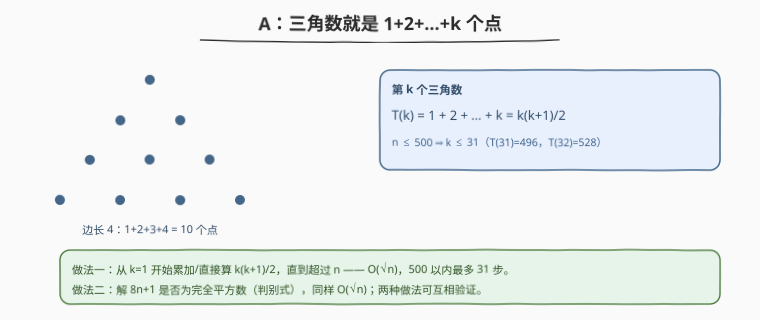
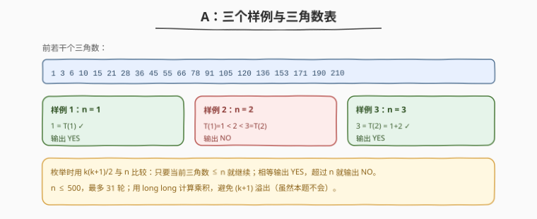

# Codeforces 47A 三角数的判别 题解

## 1. 题目概述

- **题目链接**：https://codeforces.com/problemset/problem/47/A
- **比赛来源**：Codeforces Beta Round 44 (Div. 2) · Problem A（UTC 2010-12-07）
- **难度**：800
- **标签**：暴力、数学
- **评测类型**：普通（单组输入，唯一答案）
- **限制**：时间 2 s / 内存 256 MB

**题意**：三角数是可以排成等边三角形的点数：第 $k$ 个三角数是"边上有 $k$ 个点"的三角形所含的点数，即 $1+2+\cdots+k=\dfrac{k(k+1)}{2}$。给定 $n$（$1\le n\le 500$），判断它是不是三角数：是输出 `YES`，否则输出 `NO`。

**约束**：

- $1 \le n \le 500$；
- $n$ 很小时直接枚举 $k$ 即可：$T(31)=496$、$T(32)=528$，所以 $k$ 最多试到 31；
- 第 $n$ 个三角数（题面中"第 $n$ 个"与"输入 $n$"容易混淆）：题面要判断的是"给定整数是否为三角数"，与"它是第几个"无关。

## 2. 示例与观察

官方样例 1（输入 / 输出原样）：

```text
输入：
1

输出：
YES
```

官方样例 2（输入 / 输出原样）：

```text
输入：
2

输出：
NO
```

官方样例 3（输入 / 输出原样）：

```text
输入：
3

输出：
YES
```

**样例演算**：

- $n=1$：$1=T(1)$ ✓ → `YES`；
- $n=2$：$T(1)=1<2<T(2)=3$，不是三角数 → `NO`；
- $n=3$：$3=T(2)=1+2$ ✓ → `YES`。

前若干个三角数是 $1,3,6,10,15,21,28,36,45,55,66,78,91,105,120,\dots$。

**观察**：

1. 三角数随 $k$ 严格递增，且增长很快（$T(k)\approx k^2/2$）；
2. 因此只需要从 $k=1$ 开始逐个算 $T(k)$，与 $n$ 比大小：一旦 $T(k)>n$ 就可以停止，说明 $n$ 不是三角数；
3. $n\le500$ 保证最多 31 步，任何做法都足够快。

## 3. 解题思路

### 3.1 朴素做法与瓶颈

暴力枚举 $k=1,2,3,\dots$，计算 $T(k)=\dfrac{k(k+1)}{2}$，与 $n$ 比较：

- 相等 ⇒ 是三角数，输出 `YES`；
- 一旦 $T(k)>n$ ⇒ 之后只会更大，输出 `NO`。

这项工作量是 $O(\sqrt n)$，$n=500$ 时只有 31 次乘法，没有任何瓶颈。本题唯一的风险是**细节**：循环边界（先用 $T(k)\le n$ 做条件，再判断等号）和整数乘法（$k\le31$ 时不会溢出，但写成 `long long` 更稳）。

### 3.2 核心观察：判别式也能判定



由 $n=\dfrac{k(k+1)}{2}$ 得 $8n+1=(2k+1)^2$。于是

$$n \text{ 是三角数} \iff 8n+1 \text{ 是完全平方数}.$$

这是一个 $O(1)$ 的判定（用整数开方），可以作为上面"枚举 $k$"的**独立校验方式**——两套完全不同的算法互为验证，本题的验证记录就用了这一点。

### 3.3 算法流程

1. 读入 $n$；
2. 令 $k=1$，循环：
   - 若 $k(k+1)/2=n$，输出 `YES` 并结束；
   - 若 $k(k+1)/2>n$，输出 `NO` 并结束；
   - 否则 $k\gets k+1$。

### 3.4 样例走查



- $n=1$：第 1 轮 $T(1)=1=n$ → `YES`；
- $n=2$：第 1 轮 $T(1)=1<2$；第 2 轮 $T(2)=3>2$ → `NO`；
- $n=3$：第 1 轮 $1<3$；第 2 轮 $T(2)=3=n$ → `YES`。

## 4. 正确性证明

**引理 1（枚举的完备性）**：设 $k^*$ 是满足 $T(k)\ge n$ 的最小正整数，则 $n$ 是三角数当且仅当 $T(k^*)=n$。

**证明**：$T$ 在正整数上严格递增（$T(k+1)-T(k)=k+1>0$），故满足 $T(k)\ge n$ 的 $k$ 构成一个后缀，$k^*$ 存在且唯一。若 $n=T(k)$ 对某个 $k$ 成立，则 $T(k)\ge n$，由最小性 $k^*\le k$；又 $T$ 严格递增且 $T(k^*)\ge n=T(k)$，得 $k^*\ge k$，故 $k^*=k$ 且 $T(k^*)=n$。反之若 $T(k^*)=n$，显然 $n$ 是三角数。∎

**引理 2（判别式等价）**：$n$ 是三角数 $\iff$ $8n+1$ 是完全平方数。

**证明**：若 $n=\dfrac{k(k+1)}{2}$，则 $8n+1=4k^2+4k+1=(2k+1)^2$。反之若 $8n+1=m^2$，则 $m$ 必为奇数（$8n+1\equiv1\pmod 8$ 而偶数的平方 $\equiv0,4\pmod8$），令 $m=2k+1$，得 $8n+1=4k^2+4k+1$，即 $n=\dfrac{k(k+1)}{2}$。∎

**定理**：算法输出 `YES` 当且仅当 $n$ 是三角数。

**证明**：算法从 $k=1$ 递增直到 $T(k)\ge n$，这正是引理 1 中的 $k^*$；此时相等输出 `YES`、否则输出 `NO`，由引理 1 即为所求。∎

## 5. 复杂度分析

- **时间**：$O(\sqrt n)$，$n\le500$ 时至多 31 轮。
- **空间**：$O(1)$。
- **与时限的关系**：2 s 的时限下实测端到端约 2 ms（几乎全是进程启动）。

## 6. 参考代码

### C++17

```cpp
#include <bits/stdc++.h>
using namespace std;

int main() {
    int n;
    if (scanf("%d", &n) != 1) return 0;

    // 三角数：n = k(k+1)/2，直接枚举 k 即可（k <= 32 时 k(k+1)/2 > 500）
    for (long long k = 1; k * (k + 1) / 2 <= n; ++k) {
        if (k * (k + 1) / 2 == n) {
            puts("YES");
            return 0;
        }
    }
    puts("NO");
    return 0;
}
```

### Python3

```python
import sys


def main() -> None:
    n = int(sys.stdin.read().split()[0])

    # 三角数：n = k(k+1)/2，k 从 1 试到 k(k+1)/2 > n 为止
    k = 1
    while k * (k + 1) // 2 <= n:
        if k * (k + 1) // 2 == n:
            sys.stdout.write("YES\n")
            return
        k += 1
    sys.stdout.write("NO\n")


main()
```

两份代码都只用标准库，可原样提交。

## 7. 边界情况与易错点

1. **$n=1$**：最小的三角数，必须输出 `YES`（有的实现从 $k=2$ 开始就会漏掉它）。
2. **$n=2$**：不是三角数，是"夹在两个三角数之间"的典型情况。
3. **$n=500$**：$T(31)=496<500<T(32)=528$，输出 `NO`；不要因为 $n$ 比 $T(31)$ 大就以为越界。
4. **循环条件**：写成 `while T(k) <= n` 时，相等要单独判断；若写成 `while T(k) < n`，会漏掉 $n$ 本身是三角数的情形。
5. **整数溢出**：$k\le31$ 时 $k(k+1)\le992$，`int` 也安全；但写成 `long long` 或先除后乘可避免任何隐患。
6. **输出大小写**：是 `YES` / `NO`（全大写）。
7. **"第 $n$ 个三角数"的歧义**：题面是判断 $n$ 是否为三角数，不是输出第 $n$ 个三角数。

## 8. 验证记录

- **编译环境与命令**：本机只有 `Apple clang 21.0.0`（`/usr/bin/g++` 是 clang 软链），没有 GNU `g++`，因此用 `clang++ -std=c++17 -O2 -Wall -I codeforces/tools/include` 搭配本地 `bits/stdc++.h` 兼容头编译（代码只用标准库，可原样提交 GNU C++17）。Python 为 `Python 3.9.6`。
- **官方样例**：3 / 3 通过（`YES`、`NO`、`YES`），C++ 与 Python 一致，且与 JSON 的 `out` 逐字符相同。
- **独立暴力对拍**：暴力（`codeforces/tools/brutes/cf47a.py`）用判别式 $8n+1$ 是否完全平方来判定——与参考解的"枚举 $k$"是完全不同的算法。随机生成 **300 组**输入（一半取自真实三角数，一半在 $1..500$ 内全随机），C++ / Python / 暴力三方 **300/300 一致**。
- **穷举对拍**：对 $n=1..500$ 的**全部** 500 个输入，两版输出也全部与判别式结果一致（等价于完整覆盖了值域）。
- **最大约束性能**：$n=500$，C++ 端到端约 2 ms，Python 约 16 ms，内存 < 2 MB。
- **图片校验**：两张 SVG（`cf47a_triangles.svg`、`cf47a_walkthrough.svg`）均通过 `xml.etree.ElementTree.parse`；用脚本估算每个 `text` 的包围盒，确认不越出 viewBox、文字互不重叠；并用 headless Chrome 渲染 PNG 后检查画布四边无墨迹（无裁切）。
- **公式校验**：公式均为 `$...$` 形式，星号直接写 `*`，`\text{}` 内无裸 `#`，KaTeX（`throwOnError`）渲染无报错。
- **复核状态**：verified（样例、随机 + 全值域对拍、性能、图片、公式均实跑通过；唯一环境差异是本机无 GNU g++，已用 clang++ 等价验证）。

## 相关题目与扩展

- [Codeforces 47B Coins](https://codeforces.com/problemset/problem/47/B)、[47C Crossword](https://codeforces.com/problemset/problem/47/C)、[47D Safe](https://codeforces.com/problemset/problem/47/D)、[47E Cannon](https://codeforces.com/problemset/problem/47/E)：同场其余四题。
- [Codeforces 1A Theatre Square](https://codeforces.com/problemset/problem/1/A)：同为 Beta Round 的入门题，对比"读题细节 vs 算法"。
- [Codeforces 158A Next Round](https://codeforces.com/problemset/problem/158/A)：简单判定题，适合热身。
- [LeetCode 367. 有效的完全平方数](https://leetcode.cn/problems/valid-perfect-square/)：本题判别式做法的核心子问题。
- [LeetCode 279. 完全平方数](https://leetcode.cn/problems/perfect-squares/)：同样是"数能否表示成特定形状的数"的入门题。

**延伸思考**：

1. **如果问"第 $k$ 个三角数是多少"**：直接算 $k(k+1)/2$，$O(1)$。
2. **如果 $n$ 大到 $10^{18}$**：枚举 $k$ 到 $10^9$ 太慢，改用判别式 $8n+1$ 是否完全平方（需要用 `__int128` 或整数开方），$O(1)$ 判定。
3. **如果问"$n$ 最少拆成几个三角数"**：这是经典结论（高斯定理：每个正整数都是至多 3 个三角数之和），需要用 DP 或数论。
4. **如果是"四面体数"**：$T_3(k)=k(k+1)(k+2)/6$，判别式变成三次方程的整数解问题，判定要麻烦得多。

