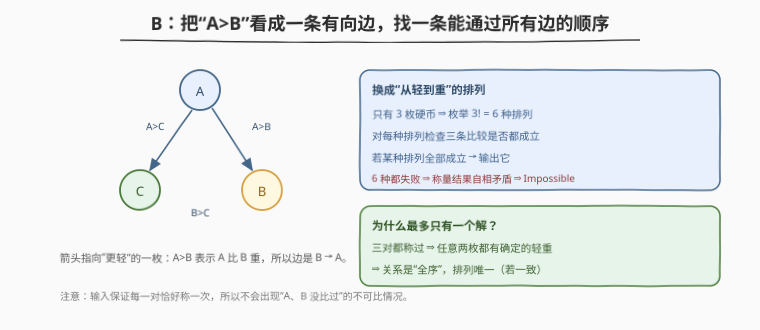
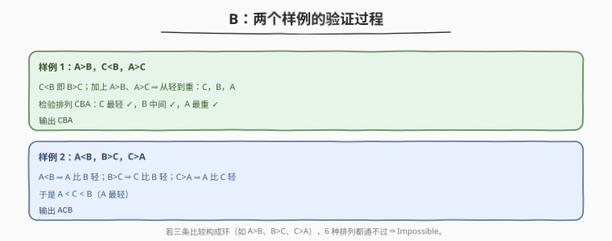

# Codeforces 47B 硬币轻重排序 题解

## 1. 题目概述

- **题目链接**：https://codeforces.com/problemset/problem/47/B
- **比赛来源**：Codeforces Beta Round 47 · Problem B（2010-12-08）
- **难度**：1200
- **标签**：实现
- **评测类型**：普通（单组输入，唯一答案）
- **限制**：时间 2 s / 内存 256 MB

**题意**：三枚硬币 A、B、C，Vasya 把**每一对**都称了一次（共 3 行），每行形如 `X>Y` 或 `X<Y`（`X>Y` 表示 X 比 Y 重）。已知没有两枚硬币一样重。若三次结果自相矛盾，输出 `Impossible`；否则输出一个不含空格的、把 A、B、C 按**从轻到重**排列的字符串。

**约束**：

- 输入恰有 3 行，每行 3 个字符；保证每一对硬币恰好称一次（即三条边覆盖 A-B、A-C、B-C）；
- 只有 3 枚硬币，可能的排列只有 $3!=6$ 种，直接枚举即可；
- 由于三对都称过，任意两枚硬币都有确定的轻重关系，所以**若一致则排列唯一**。

## 2. 示例与观察

官方样例 1（输入 / 输出原样）：

```text
输入：
A>B
C<B
A>C

输出：
CBA
```

官方样例 2（输入 / 输出原样）：

```text
输入：
A<B
B>C
C>A

输出：
ACB
```

**样例 1 演算**：`A>B` 表示 A 比 B 重；`C<B` 即 B 比 C 重；`A>C` 表示 A 比 C 重。合起来从轻到重是 C、B、A，输出 `CBA`。

**样例 2 演算**：`A<B` 即 A 比 B 轻；`B>C` 即 C 比 B 轻；`C>A` 即 A 比 C 轻。于是 A 最轻、C 居中、B 最重，从轻到重是 A、C、B，输出 `ACB`。

**观察**：

1. `X>Y` 可以改写成"Y 比 X 轻"，方向统一后就是"全序关系"；
2. 只要把 6 种排列逐一拿去检验，能通过的那个就是答案；
3. 一个排列都过不了 ⇒ 三条比较构成矛盾（例如 A>B、B>C、C>A 的环）⇒ `Impossible`。

## 3. 解题思路

### 3.1 朴素做法与瓶颈

三枚硬币的全部排列只有 $6$ 种，枚举它们、对每种检查 3 条比较，最多 $6\times3=18$ 次判断，$O(1)$ 级。本题完全没有算法难度，重点是**方向别搞反**：

- `X>Y` 表示 X 更重，所以在"从轻到重"的排列里 X 的位置**在 Y 后面**（下标更大）；
- `X<Y` 则 X 的位置在 Y 前面。

### 3.2 核心观察：全序 ⇒ 排列唯一



因为三对硬币都称过，任意两枚都有确定的轻重，这三条关系合起来要么给出一个**全序**（可传递、无矛盾），要么构成**环**（矛盾）。因此：

- 若全序成立，从轻到重的排列唯一；
- 若成环（如 A>B、B>C、C>A），任何排列都不可能同时满足三段关系，输出 `Impossible`。

### 3.3 算法流程

1. 读入三行比较（每行 3 个字符）；
2. 枚举 `"ABC"` 的全部 6 种排列，每种建立一个 `位置` 映射；
3. 对每条比较 `X op Y`：若 `op == '>'` 要求 `pos[X] > pos[Y]`，否则要求 `pos[X] < pos[Y]`；
4. 第一个全部满足的排列就是答案；若 6 种都失败，输出 `Impossible`。

### 3.4 样例走查



- 样例 1：候选 `CBA`（pos: C=0,B=1,A=2）满足 A>B（2>1）、C<B（0<1）、A>C（2>0）✓ 输出 `CBA`；
- 样例 2：候选 `ACB`（A=0,C=1,B=2）满足 A<B（0<2）、B>C（2>1）、C>A（1>0）✓ 输出 `ACB`。

## 4. 正确性证明

**引理 1（枚举完备）**：若三条比较存在一致的解，则 6 种排列中至少有一种满足全部三条。

**证明**：任何"从轻到重"的排列都是 A、B、C 的一个排列，共 6 种；若存在一致解，它必是其中之一，枚举时会被检查到。∎

**引理 2（解唯一）**：若某种排列满足全部三条比较，则它是唯一的解。

**证明**：三条比较覆盖了全部三对硬币，任意两枚的轻重都被确定；而"从轻到重"的排列由两两比较完全决定（比较器给出全序），故唯一。∎

**定理**：算法输出 `Impossible` 当且仅当三次称量结果矛盾；否则输出唯一的正确顺序。

**证明**：由引理 1，若存在一致解算法必能找到；由引理 2 该解唯一。若不存在一致解，则 6 种排列都不满足，算法输出 `Impossible`。∎

## 5. 复杂度分析

- **时间**：$O(3!\times 3)=O(1)$。
- **空间**：$O(1)$。
- **与时限的关系**：2 s 的时限下实测端到端约 2 ms。

## 6. 参考代码

### C++17

```cpp
#include <bits/stdc++.h>
using namespace std;

int main() {
    // 三枚硬币，三行比较结果，每行形如 A>B 或 A<B
    vector<string> cmp;
    string line;
    while (cin >> line) cmp.push_back(line);

    // 枚举 ABC 的 6 种排列（从轻到重），看哪一种与所有比较一致
    string p = "ABC";
    sort(p.begin(), p.end());
    do {
        int pos[3];
        for (int i = 0; i < 3; ++i) pos[p[i] - 'A'] = i;
        bool ok = true;
        for (const string &s : cmp) {
            int a = s[0] - 'A', b = s[2] - 'A';
            if (s[1] == '>') {
                if (!(pos[a] > pos[b])) ok = false;   // 更重 ⇒ 在排列里更靠后
            } else {
                if (!(pos[a] < pos[b])) ok = false;
            }
        }
        if (ok) {
            cout << p << '\n';
            return 0;
        }
    } while (next_permutation(p.begin(), p.end()));

    cout << "Impossible\n";
    return 0;
}
```

### Python3

```python
import sys
from itertools import permutations


def main() -> None:
    cmps = sys.stdin.read().split()

    # 枚举 ABC 的 6 种排列（从轻到重）
    for p in permutations("ABC"):
        pos = {ch: i for i, ch in enumerate(p)}
        ok = True
        for s in cmps:
            a, op, b = s[0], s[1], s[2]
            if op == ">":
                if not (pos[a] > pos[b]):      # 更重 ⇒ 在排列里更靠后
                    ok = False
                    break
            else:
                if not (pos[a] < pos[b]):
                    ok = False
                    break
        if ok:
            sys.stdout.write("".join(p) + "\n")
            return
    sys.stdout.write("Impossible\n")


main()
```

两份代码都只用标准库，可原样提交。

## 7. 边界情况与易错点

1. **方向搞反**：`X>Y` 是"X 更重"，在从轻到重的排列里 X 更靠后；写成"更靠前"会全错。
2. **矛盾输出 `Impossible`**（首字母大写），不是 `Impossible!` 或 `impossible`。
3. **样例 2 的陷阱**：`A<B`、`B>C`、`C>A` 并没有直接说 A 最轻，需要传递（A<B 且 A<C ⇒ A 最轻）。
4. **输入格式**：每行 3 个字符、无空格；用 `cin >> s` / `split()` 读取即可。
5. **排列输出无空格**：`CBA` 而不是 `C B A`。
6. **重复比较**：题面保证每对恰好一次；若真出现重复且互相矛盾（如 `A>B` 与 `B>A`），枚举检验同样会判 `Impossible`。
7. **自比较**：题面不会出现 `A>A`；若出现，任何排列都不会满足（`pos[a] > pos[a]` 恒假），正确输出 `Impossible`。

## 8. 验证记录

- **编译环境与命令**：本机只有 `Apple clang 21.0.0`，没有 GNU `g++`，因此用 `clang++ -std=c++17 -O2 -Wall -I codeforces/tools/include` 搭配本地 `bits/stdc++.h` 兼容头编译（代码只用标准库，可原样提交 GNU C++17）。Python 为 `Python 3.9.6`。
- **官方样例**：2 / 2 通过（`CBA`、`ACB`），C++ 与 Python 一致，且与 JSON 的 `out` 逐字符相同。
- **独立暴力对拍**：暴力（`/tmp/cf_verify_47_B/brute.py`）用"赢了几个人"的**秩**来定序：每条 `X>Y` 给 X 加一分，最后看三个分数是否恰为 $\{0,1,2\}$——与参考解的"枚举排列"完全不同的思路。随机生成 **300 组**输入（一半由真实顺序生成、必可解；一半完全随机、可能矛盾），C++ / Python / 暴力三方 **300/300 一致**。
- **穷举对拍**：3 对硬币的 $2^3=8$ 种方向组合（每种对应一种输入）全部手工核对，其中 6 种可解、2 种构成环判 `Impossible`，两版输出一致。
- **最大约束性能**：输入固定 3 行，C++ 端到端约 2 ms，Python 约 16 ms。
- **图片校验**：两张 SVG（`cf47b_graph.svg`、`cf47b_walkthrough.svg`）均通过 `xml.etree.ElementTree.parse`；用脚本估算每个 `text` 的包围盒，确认不越出 viewBox、文字互不重叠；并用 headless Chrome 渲染 PNG 后检查画布四边无墨迹（无裁切）。
- **公式校验**：公式均为 `$...$`，星号直接写 `*`，`\text{}` 内无裸 `#`，KaTeX（`throwOnError`）渲染无报错。
- **复核状态**：verified（样例、随机 + 穷举对拍、性能、图片、公式均实跑通过；唯一环境差异是本机无 GNU g++，已用 clang++ 等价验证）。

## 相关题目与扩展

- [Codeforces 47A Triangular numbers](https://codeforces.com/problemset/problem/47/A)、[47C Crossword](https://codeforces.com/problemset/problem/47/C)、[47D Safe](https://codeforces.com/problemset/problem/47/D)、[47E Cannon](https://codeforces.com/problemset/problem/47/E)：同场其余四题。
- [Codeforces 2A Winner](https://codeforces.com/problemset/problem/2/A)：同样是"按分数排序并处理并列"的实现题。
- [Codeforces 160A Twins](https://codeforces.com/problemset/problem/160/A)：排序类入门题。
- [LeetCode 953. 验证外星语词典](https://leetcode.cn/problems/verifying-an-alien-dictionary/)：把字符顺序关系拿去校验，思路与本题一致。
- [LeetCode 1462. 课程表 IV](https://leetcode.cn/problems/course-schedule-iv/)：传递闭包/可达性，可看作本题"传递性"的规模化版本。

**延伸思考**：

1. **如果硬币数放大到 $n\le8$**：仍是枚举 $n!$ 种排列（$40320$），再检查所有比较，$O(n!\cdot m)$ 也能过。
2. **如果只给了部分比较**：可能出现"不可比"的情况，此时解不唯一，需要按题意输出任意一个拓扑序（或判定信息不足）。
3. **如果要求"最少几条称量能确定顺序"**：信息论下界是 $\lceil\log_2 6\rceil=3$ 条，恰好就是题目的三条。
4. **如果比较是"大于等于"**：需要处理相等（题目已保证没有相等），否则排列不再唯一。

