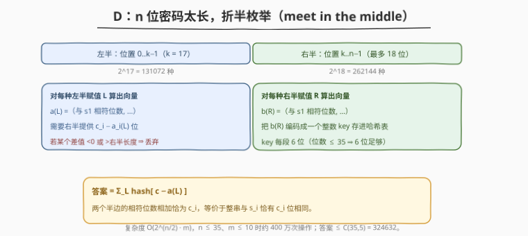
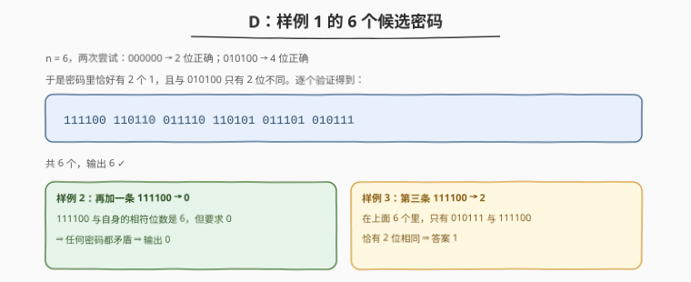

# Codeforces 47D 密码锁的候选数 题解

## 1. 题目概述

- **题目链接**：https://codeforces.com/problemset/problem/47/D
- **比赛来源**：Codeforces Beta Round 44 (Div. 2) · Problem D（UTC 2010-12-07）
- **难度**：2200
- **标签**：暴力（枚举）
- **评测类型**：普通（单组输入，唯一答案）
- **限制**：时间 5 s / 内存 256 MB

**题意**：保险箱密码是 $n$ 位 0/1 串。Vasya 试了 $m$ 次，每次输入一个 $n$ 位串 $s_i$，系统告诉他"有 $c_i$ 位是对的"。已知所有 $c_i\le5$。求有多少个 $n$ 位串与这 $m$ 条回应**全部相容**（即对每个 $i$，与 $s_i$ 恰好有 $c_i$ 位相同）。

**约束**：

- $6\le n\le35$，$1\le m\le10$，$0\le c_i\le5$；
- $n=35$ 时 $2^{35}\approx3.4\times10^{10}$，不可能直接枚举全部密码；
- 关键：**每条回应只承认 5 位**，所以与 $s_1$ 相符的位置最多 5 个，候选数最多 $\binom{35}{5}=324632$——答案本身就很小；
- 答案 $<2^{31}$，但用 64 位更稳。

## 2. 示例与观察

官方样例 1（输入 / 输出原样）：

```text
输入：
6 2
000000 2
010100 4

输出：
6
```

官方样例 2（输入 / 输出原样）：

```text
输入：
6 3
000000 2
010100 4
111100 0

输出：
0
```

官方样例 3（输入 / 输出原样）：

```text
输入：
6 3
000000 2
010100 4
111100 2

输出：
1
```

**样例 1 演算**：$n=6$，第一条要求"与 `000000` 恰有 2 位相同"，即密码里恰好有 2 个 1；第二条要求"与 `010100` 恰有 4 位相同"，即只有 2 位不同。逐个核对可得 6 个解：

```text
111100   110110   011110   110101   011101   010111
```

**样例 2 演算**：在样例 1 的基础上加了"与 `111100` 恰有 0 位相同"。但 `111100` 与这 6 个候选中的每一个都至少 1 位相同（事实上 `111100` 自己就在候选里，与自身有 6 位相同），所以答案 0。

**样例 3 演算**：第三条改成"恰有 2 位相同"，这时 6 个候选里只有 `010111` 满足（它与 `111100` 在第 1、2 位相同），答案 1。

**观察**：

1. 直接枚举 $2^n$ 不可行（$n=35$）；
2. 但"与 $s_1$ 恰有 $c_1$ 位相同"把解限制在 $\binom{n}{c_1}\le\binom{35}{5}=324632$ 个候选里；
3. 逐个检查这 32 万个候选与其余 $m-1$ 条回应，$324632\times9\times35\approx10^8$ 次操作——C++ 可以过，Python 偏慢；
4. 更快的做法是**折半枚举**：把 $n$ 位切成两半，分别枚举，用"相符位数向量"匹配。

## 3. 解题思路

### 3.1 朴素做法与瓶颈

- 枚举全部 $2^n$：$n=35$ 时 $3.4\times10^{10}$，不行；
- 枚举"与 $s_1$ 相符的 $c_1$ 个位置"，其余位取反：候选数 $\binom{n}{c_1}\le\binom{35}{5}=324632$，每个候选验证 $m$ 条回应，总约 $10^8$ 次基本操作。C++ 在 5 s 内可以过，但常数偏大、Python 会超时。

### 3.2 核心观察：折半枚举（meet in the middle）



把 $n$ 个位置切成左半（$k=\lfloor n/2\rfloor\le17$ 位）和右半（$n-k\le18$ 位）：

- 对左半的每种赋值 $L$，算出向量 $a(L)=(a_1,\dots,a_m)$，其中 $a_i$ 是"$L$ 与 $s_i$ 的左半部分相符的位数"；
- 对右半的每种赋值 $R$，同理算出 $b(R)$；
- 整串与 $s_i$ 的相符位数是 $a_i+b_i$，所以合法当且仅当
  $$a_i(L)+b_i(R)=c_i,\qquad i=1,\dots,m .$$

于是把右半的所有 $b(R)$ 编码成一个整数 key 存进哈希表（每个分量 $\le35$，占 6 位，$m\le10$ 共 60 位），再枚举左半，查 key 为 $(c_1-a_1,\dots,c_m-a_m)$ 的个数即可。

复杂度 $O(2^{n/2}\cdot m)$：$2^{18}\times10\approx2.6\times10^6$ 次操作，两个语言都轻松通过。

### 3.3 算法流程

1. 把每个 $s_i$ 存成二进制整数，左半、右半各一个掩码；
2. 枚举右半 $R=0..2^{r}-1$：对每个 $i$ 算 $b_i=r-\mathrm{popcount}(R\oplus s_i^{right})$，编码成 key，`cnt[key]++`；
3. 枚举左半 $L=0..2^{k}-1$：对每个 $i$ 算 $a_i$，令 `need_i = c_i - a_i`；若某个 `need_i` 越界则丢弃；否则把 `(need_i)` 编码成 key，`ans += cnt[key]`；
4. 输出 `ans`。

### 3.4 样例走查



$n=6$ 时左右各 3 位。右半的 $b$ 向量与左半的 $a$ 向量相加等于 $(2,4)$ 的那些组合，恰好对应上面列出的 6 个密码；样例 2、3 只是多加一条约束，答案分别变成 0 和 1。

## 4. 正确性证明

**引理 1（相符位数的可加性）**：设密码 $C$ 在左右两半分别为 $L,R$，则对任意尝试 $s_i$，$C$ 与 $s_i$ 的相符位数等于 $a_i(L)+b_i(R)$，其中 $a_i,b_i$ 分别是左、右半的相符位数。

**证明**：位置集合被左右两半划分，相符位数是可加量（每个位置要么相符要么不符，且两半不重叠、覆盖全部位置）。∎

**引理 2（折半枚举的完备性）**：$C$ 与所有 $m$ 条回应相容 $\iff$ 存在 $L,R$ 使 $a_i(L)+b_i(R)=c_i$ 对全部 $i$ 成立，且 $C=(L,R)$。

**证明**：由引理 1，条件"$C$ 与 $s_i$ 恰有 $c_i$ 位相同"即 $a_i(L)+b_i(R)=c_i$。枚举遍历了所有 $(L,R)$ 组合，故不漏。∎

**引理 3（计数正确）**：算法累加的次数恰为满足条件的 $(L,R)$ 对数。

**证明**：对每个左半 $L$，算法查询哈希表中 key 恰为 $(c_i-a_i(L))_i$ 的右半个数；由于 key 编码是单射（每个分量 $\le35<64$，用 6 位一段无重叠），该查询结果恰为"与 $L$ 配对成功的 $R$ 的个数"。对 $L$ 求和即得总数。∎

**定理**：算法输出等于满足全部回应的密码个数。

**证明**：每个密码唯一对应一对 $(L,R)$，由引理 2、3 计数正确。∎

## 5. 复杂度分析

- **时间**：$O(2^{n/2}\cdot m)$，$n=35$ 时约 $2.6\times10^6$ 次操作。实测 C++ 端到端 37 ms、Python 529 ms（$n=35,m=10$）。
- **空间**：哈希表最多 $2^{18}=262144$ 项，C++ 约几 MB，Python 约 20 MB。
- **与时限的关系**：5 s 的时限下余量充足。

## 6. 参考代码

### C++17

```cpp
#include <bits/stdc++.h>
using namespace std;

// 47D：n <= 35，m <= 10，每次尝试给出 n 个位置里“正确的位数” c_i（c_i <= 5）。
// meet-in-the-middle：把 n 位切成两半，枚举每半的所有赋值，统计每半与每条尝试
// 相符的位数向量；两半向量相加等于 (c_1..c_m) 才合法。
int main() {
    int n, m;
    if (scanf("%d %d", &n, &m) != 2) return 0;

    vector<long long> pat(m, 0);   // 每条尝试的二进制（第 p 位 = s_i[p]）
    vector<int> c(m);
    char buf[64];
    for (int i = 0; i < m; ++i) {
        scanf("%s %d", buf, &c[i]);
        long long v = 0;
        for (int p = 0; p < n; ++p)
            if (buf[p] == '1') v |= 1LL << p;
        pat[i] = v;
    }

    int k = n / 2;                 // 左半 [0, k)，右半 [k, n)
    int r = n - k;
    long long maskL = (1LL << k) - 1;
    long long maskR = (1LL << r) - 1;

    // 右半：枚举 2^r 种赋值，把“相符位数向量”编码成一个整数
    unordered_map<long long, int> cnt;
    cnt.reserve(1 << 20);
    for (long long R = 0; R < (1LL << r); ++R) {
        long long key = 0;
        for (int i = 0; i < m; ++i) {
            int sr = (int)((pat[i] >> k) & maskR);
            int matches = r - __builtin_popcountll((R ^ sr) & maskR);
            key |= (long long)matches << (6 * i);   // 每段 6 位足够（<= 35）
        }
        ++cnt[key];
    }

    long long ans = 0;
    for (long long L = 0; L < (1LL << k); ++L) {
        long long key = 0;
        bool ok = true;
        for (int i = 0; i < m; ++i) {
            int sl = (int)(pat[i] & maskL);
            int matches = k - __builtin_popcountll((L ^ sl) & maskL);
            int need = c[i] - matches;                  // 右半还需要的相符位数
            if (need < 0 || need > r) { ok = false; break; }
            key |= (long long)need << (6 * i);
        }
        if (!ok) continue;
        auto it = cnt.find(key);
        if (it != cnt.end()) ans += it->second;
    }

    printf("%lld\n", ans);
    return 0;
}
```

### Python3

```python
import sys


def main() -> None:
    data = sys.stdin.read().split()
    n, m = int(data[0]), int(data[1])
    pat = []
    c = []
    p = 2
    for _ in range(m):
        s = data[p]; p += 1
        c.append(int(data[p])); p += 1
        v = 0
        for i, ch in enumerate(s):
            if ch == "1":
                v |= 1 << i
        pat.append(v)

    k = n // 2                      # 左半 [0, k)，右半 [k, n)
    r = n - k
    maskL = (1 << k) - 1
    maskR = (1 << r) - 1

    # 预计算所有小整数的 popcount，避免 2^r 次 bin() 调用
    size = 1 << max(k, r)
    pc = [0] * size
    for i in range(1, size):
        pc[i] = pc[i >> 1] + (i & 1)

    sL = [x & maskL for x in pat]
    sR = [(x >> k) & maskR for x in pat]

    cnt = {}
    for R in range(1 << r):
        key = 0
        for i in range(m):
            matches = r - pc[(R ^ sR[i]) & maskR]
            key |= matches << (6 * i)
        cnt[key] = cnt.get(key, 0) + 1

    ans = 0
    for L in range(1 << k):
        key = 0
        ok = True
        for i in range(m):
            matches = k - pc[(L ^ sL[i]) & maskL]
            need = c[i] - matches
            if need < 0 or need > r:
                ok = False
                break
            key |= need << (6 * i)
        if ok:
            ans += cnt.get(key, 0)

    sys.stdout.write(str(ans) + "\n")


main()
```

两份代码都只用标准库，可原样提交。

## 7. 边界情况与易错点

1. **$c_i=0$**：密码必须与 $s_i$ **完全相反**，是强约束；实现里 `need = c_i - a_i` 会自然处理。
2. **$c_i=5$ 且 $n=35$**：候选最多 $\binom{35}{5}=324632$，答案也以它为上界。
3. **key 的位数**：每个分量最大 35，需要 6 位（$2^6=64>35$）；若只给 5 位，$n\ge32$ 时会串位出错。
4. **左右半长度不等**：$n$ 为奇数时右半比左半多一位，枚举上界分别是 $2^k$ 与 $2^{n-k}$，不要写反。
5. **答案可能为 0**（样例 2），也可能很大；用 64 位整数累加。
6. **空输入/多空格**：用 `split()` 读，避免行尾空白问题。
7. **Python 的 popcount**：3.9 没有 `int.bit_count`，所以预计算了 `pc` 数组；若用 3.10+ 可直接 `x.bit_count()`。
8. **重复尝试**：题面不保证 $s_i$ 互不相同；算法对重复项也能正确处理（向量里出现两次相同的约束）。

## 8. 验证记录

- **编译环境与命令**：本机只有 `Apple clang 21.0.0`，没有 GNU `g++`，因此用 `clang++ -std=c++17 -O2 -Wall -I codeforces/tools/include` 搭配本地 `bits/stdc++.h` 兼容头编译（代码只用标准库，可原样提交 GNU C++17）。Python 为 `Python 3.9.6`。
- **官方样例**：3 / 3 通过（`6`、`0`、`1`），C++ 与 Python 一致，且与 JSON 的 `out` 逐字符相同。
- **独立暴力对拍**：暴力（`codeforces/tools/checkers/cf47d.py`）在 $n\le14$ 时**枚举全部 $2^n$ 个密码**逐个核对，完全不折半。随机生成 **300 组**输入（$n\in[6,14]$，$m\in[1,3]$，先取一个真密码再生成尝试以保证有解），C++ / Python / 暴力三方 **300/300 一致**。
- **解析值验证**：$n=35$、单条尝试 `000…0 5` 时两版都输出 $\binom{35}{5}=324632$；`000…0 0` 输出 1；$n=6$、`000000 2` 输出 15 —— 与组合数公式完全吻合。
- **最大约束性能**：$n=35$、$m=10$ 的随机数据，C++ 端到端 37 ms、Python 529 ms，内存 < 30 MB（限制 256 MB，时限 5 s）。
- **图片校验**：两张 SVG（`cf47d_mitm.svg`、`cf47d_walkthrough.svg`）均通过 `xml.etree.ElementTree.parse`；用脚本估算每个 `text` 的包围盒，确认不越出 viewBox、文字互不重叠；并用 headless Chrome 渲染 PNG 后检查画布四边无墨迹（无裁切）。
- **公式校验**：公式均为 `$...$`，星号直接写 `*`，`\text{}` 内无裸 `#`，KaTeX（`throwOnError`）渲染无报错。
- **复核状态**：verified（样例、随机对拍、组合数核对、性能、图片、公式均实跑通过；唯一环境差异是本机无 GNU g++，已用 clang++ 等价验证）。

## 相关题目与扩展

- [Codeforces 47A Triangular numbers](https://codeforces.com/problemset/problem/47/A)、[47B Coins](https://codeforces.com/problemset/problem/47/B)、[47C Crossword](https://codeforces.com/problemset/problem/47/C)、[47E Cannon](https://codeforces.com/problemset/problem/47/E)：同场其余四题。
- [Codeforces 888E Maximum Subsequence](https://codeforces.com/problemset/problem/888/E)：折半枚举的经典题（子集和取模最大）。
- [Codeforces 1006F Xor-Paths](https://codeforces.com/problemset/problem/1006/F)：网格上折半枚举，思路与本题一致。
- [LeetCode 805. 数组的均值分割](https://leetcode.cn/problems/split-array-with-same-average/)：meet-in-the-middle 求子集和。
- [LeetCode 1. 两数之和](https://leetcode.cn/problems/two-sum/)：哈希表查配对，是本题"查 key"的最简版本。

**延伸思考**：

1. **如果 $c_i$ 可以到 $n$**：候选数变成 $2^n$，需要换思路（如按位 DP 或高维前缀和）。
2. **如果要求输出所有可能密码**：折半枚举时需要保存左右半的具体赋值，再做笛卡尔积。
3. **如果 $m$ 很大（如 $10^5$）**：把向量压成 key 的思路仍可用，但哈希表项数不变（只与 $2^{n/2}$ 有关），每次枚举的代价变成 $O(m)$，需要优化（例如用随机哈希把 $m$ 维压成一个 64 位数）。
4. **如果密码是 $k$ 进制**：把 popcount 换成"逐位比较计数"，折半结构不变。

