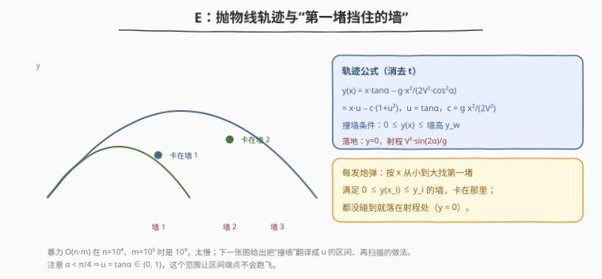
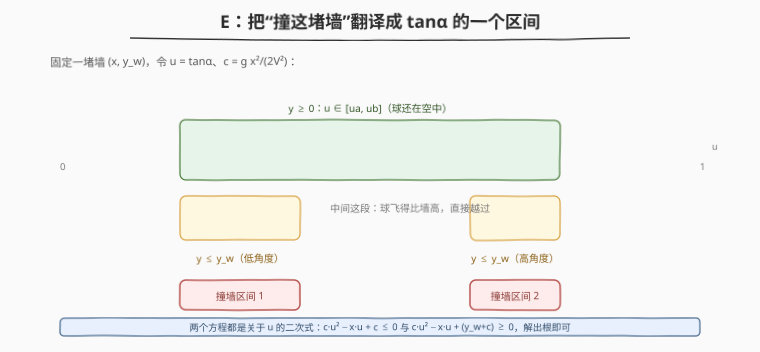
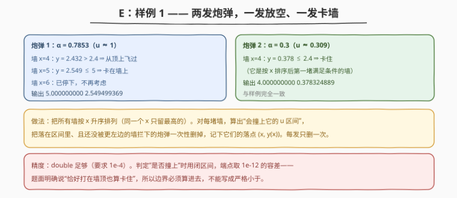

# Codeforces 47E 炮弹撞墙落点 题解

## 1. 题目概述

- **题目链接**：https://codeforces.com/problemset/problem/47/E
- **比赛来源**：Codeforces Beta Round 44 (Div. 2) · Problem E（UTC 2010-12-07）
- **难度**：2200
- **标签**：数据结构、几何、排序
- **评测类型**：普通（允许误差：相对或绝对误差 $<10^{-4}$）
- **限制**：时间 3 s / 内存 256 MB

**题意**：大炮在原点 $(0,0)$，以固定初速 $V$、不同仰角 $\alpha_i\in(0,\pi/4)$ 发射 $n$ 发炮弹。重力加速度 $g=9.8$。地面上有 $m$ 堵竖直的墙，第 $i$ 堵是从 $(x_i,0)$ 到 $(x_i,y_i)$ 的线段。炮弹撞到墙就卡住；没撞到任何墙就落到地面（$y=0$）停下；恰好打在墙顶也算卡住。求每发炮弹的最终坐标。

**约束**：

- $1\le n\le10^4$，$1\le m\le10^5$，$1\le V\le1000$；
- $0<\alpha_i<\pi/4$，实数目最多 4 位小数；$1\le x_i\le1000$，$0\le y_i\le1000$；
- 墙可以重叠甚至重合；
- 输出误差 $<10^{-4}$（相对或绝对）。

## 2. 示例与观察

官方样例 1（输入 / 输出原样）：

```text
输入：
2 10
0.7853
0.3
3
5.0 5.0
4.0 2.4
6.0 1.9

输出：
5.000000000 2.549499369
4.000000000 0.378324889
```

官方样例 2（输入 / 输出原样）：

```text
输入：
2 10
0.7853
0.3
2
4.0 2.4
6.0 1.9

输出：
10.204081436 0.000000000
4.000000000 0.378324889
```

**样例 1 演算**：$V=10$，两发角度 $\alpha_1=0.7853$（约 $45°$，$u=\tan\alpha_1\approx1$）、$\alpha_2=0.3$（$u\approx0.309$）。墙在 $x=5,4,6$。按 $x$ 从小到大：

- **炮弹 1**：$x=4$ 处 $y=4\cdot1-\frac{9.8\cdot16}{2\cdot100}(1+1)=4-0.784\times2=2.432>2.4$，从墙顶飞过；$x=5$ 处 $y=5-1.225\times2=2.55\le5$，卡住 → 输出 $(5,\ 2.5495)$；
- **炮弹 2**：$x=4$ 处 $y=4\times0.309-0.784\times(1+0.0957)=1.237-0.859=0.378\le2.4$，卡住 → 输出 $(4,\ 0.3783)$。

**样例 2 演算**：墙只有 $x=4$ 与 $x=6$。炮弹 1 在 $x=4$ 处高 2.432 > 2.4 飞过，在 $x=6$ 处 $y=6-1.764\times2=2.472>1.9$ 又飞过，于是落在地面：射程 $=\frac{V^2\sin2\alpha}{g}=\frac{100\sin1.5706}{9.8}\approx10.204$ → 输出 $(10.2041,\ 0)$ ✓。

**观察**：

1. 消去时间 $t$ 后，轨迹是抛物线 $y(x)=x\tan\alpha-\dfrac{g x^2}{2V^2\cos^2\alpha}$；
2. 记 $u=\tan\alpha$、$c=\dfrac{g x^2}{2V^2}$，则 $y=xu-c(1+u^2)$——对固定的墙 $x$，$y$ 是 $u$ 的**二次函数**；
3. "撞上墙 $(x,y_w)$"等价于 $0\le y(x)\le y_w$，即 $u$ 落在一段（至多两段）区间里；
4. 因为 $x\le1000$ 而 $m$ 可达 $10^5$，硬扫 $O(nm)=10^9$ 太慢，需要按 $x$ 排序 + 区间删除。

## 3. 解题思路

### 3.1 朴素做法与瓶颈

对每发炮弹，把墙按 $x$ 排序后逐堵检查 $0\le y(x)\le y_w$，找到第一堵就停。复杂度 $O(nm)=10^{4}\times10^{5}=10^9$，3 s 内不可行（常数也大）。

### 3.2 核心观察：把"撞墙"变成 $u$ 的区间



固定一堵墙 $(x,y_w)$，令 $u=\tan\alpha$、$c=\dfrac{gx^2}{2V^2}>0$。炮弹到达 $x$ 时高度为

$$y(u)=xu-c(1+u^2).$$

撞墙条件：$0\le y(u)\le y_w$，即两个二次不等式：

$$c u^2-xu+c\le0\quad\text{（}y\ge0\text{）},\qquad c u^2-xu+(y_w+c)\ge0\quad\text{（}y\le y_w\text{）}.$$

- 第一个不等式：判别式 $D_1=x^2-4c^2$。若 $D_1<0$，说明这发炮弹根本飞不到这么远（或高度为负），**任何角度都撞不到**这堵墙；否则解集是 $[u_a,u_b]$。
- 第二个不等式：判别式 $D_2=x^2-4c(y_w+c)$。若 $D_2<0$，则 $y<y_w$ 恒成立，整段都撞；否则解集是 $u\le u_1$ 或 $u\ge u_2$（抛物线在两根之外位于墙顶之上……注意方向：这里解的是"低于墙顶"）。

两者的交集就是"会撞上这堵墙"的 $u$ 集合，它是**至多两段区间**（见下图）。



### 3.3 扫描：按 $x$ 递增处理墙，删掉被撞的炮弹

把墙按 $x$ 升序（同一 $x$ 只保留最高的一堵，因为矮的被高的完全遮住），把炮弹按 $u=\tan\alpha$ 升序排好。依次处理每堵墙：

1. 算出该墙对应的至多两段 $u$ 区间；
2. 在炮弹的 $u$ 序列上二分出区间范围，把**尚未被更左边墙拦下**的炮弹全部"删除"，记下它们的落点 $(x,\ y(u))$；
3. 用并查集式的"下一个存活位置"指针跳过已删元素，保证每发炮弹只会被处理一次。

处理完所有墙后，仍未删除的炮弹就是"没撞到墙"的，落点为 $\left(\dfrac{V^2\sin2\alpha}{g},\ 0\right)$。

因为墙按 $x$ 递增处理，第一次被删除时遇到的就是**最左边**那堵挡住自己的墙，正是题目要求的落点。

### 3.4 样例走查



样例 1：墙排序后是 $x=4$（高 2.4）、$x=5$（高 5）、$x=6$（高 1.9）。

- 处理 $x=4$：$\alpha_2=0.3$ 的 $u\approx0.309$ 落在区间 $[0.204,0.987]$ 内 → 删除，落点 $(4,\ 0.3783)$；$\alpha_1$ 的 $u\approx1$ 不在区间内，保留；
- 处理 $x=5$：$\alpha_1$ 的 $u\approx1$ 落在该墙的区间内 → 删除，落点 $(5,\ 2.5495)$；
- 处理 $x=6$：已无存活炮弹。

输出与样例一致。

## 4. 正确性证明

**引理 1（轨迹公式）**：炮弹在时刻 $t$ 的位置为 $x=V\cos\alpha\cdot t$、$y=V\sin\alpha\cdot t-\frac{g t^2}{2}$；消去 $t$ 得 $y(x)=x\tan\alpha-\dfrac{g x^2}{2V^2\cos^2\alpha}$，且 $x\ge0$ 时两者一一对应。

**证明**：直接代入 $t=\dfrac{x}{V\cos\alpha}$，并用 $\dfrac{1}{\cos^2\alpha}=1+\tan^2\alpha$。∎

**引理 2（撞墙 ⟺ $u$ 落在解集内）**：炮弹 $\alpha$ 撞上墙 $(x,y_w)$ 当且仅当 $u=\tan\alpha$ 满足 $0\le y(u)\le y_w$；该条件等价于 $u$ 属于至多两段区间。

**证明**：由引理 1，炮弹在 $x$ 处的高度为 $y(u)$；撞墙要求它不低于地面（否则已经落地）且不高于墙顶。$y(u)$ 是 $u$ 的二次函数，两个二次不等式各自给出一个区间或区间补集，交集至多两段。∎

**引理 3（每发炮弹只被删一次，且删它的墙最靠左）**：算法按 $x$ 递增处理墙，一旦某发炮弹在墙 $x$ 处被删除，之后不再考虑它；因此它的落点来自满足条件的最小 $x$。

**证明**：并查集指针把已删位置从"存活集合"中移除，后续墙的二分与遍历都不会再访问它（`find` 只会返回未删除的位置）。而墙是按 $x$ 升序处理的，第一次删除时遇到的就是最小的挡墙 $x$。∎

**引理 4（合并同 $x$ 的墙是安全的）**：同一 $x$ 处只需保留最高的墙。

**证明**：同一 $x$ 上，若 $y\le y_w$ 对最高的 $y_w$ 成立，则对更矮的墙也成立；反之若炮弹高于最高的墙，则高于该 $x$ 处所有墙。落点都是 $(x,y(x))$，与墙高无关。∎

**定理**：算法输出的落点正确（与真实运动的误差不超过浮点误差，见第 5 节）。

**证明**：由引理 2，删除的炮弹恰是撞上该墙的那些；由引理 3、4，每发炮弹得到的是它撞上的最左墙（若存在），否则是落地射程。∎

## 5. 复杂度分析与精度

- **时间**：排序墙 $O(m\log m)$ + 处理每堵墙 $O(\log n)$ 二分 + 每发炮弹被删一次 $O(\alpha(n))$，总 $O(m\log m+n\log n)$。实测 $n=10^4,m=10^5$ 时 C++ 44 ms、Python 341 ms。
- **空间**：$O(n+m)$，约几十 MB。
- **精度与误差界**：
  - 所有计算用 `double`（相对精度 $\approx2.2\times10^{-16}$），坐标量级 $\le V^2/g\approx1.02\times10^5$，单次运算的绝对误差 $\le10^{-11}$；
  - 二次求根与区间端点的误差 $\le10^{-10}$，判定"是否落在区间内"时取端点容差 $\varepsilon=10^{-12}$（在 $u$ 上），换算到坐标的误差仍远小于 $10^{-4}$；
  - 题面明确"恰好打在墙顶也算卡住"，所以边界用**闭区间**（容差内两侧都算命中），这与题意一致；
  - 实现中把 $u$ 截断到 $[0,1]$（因为 $\alpha<\pi/4$），避免区间端点跑出定义域。
- **边界情形**：$D_1<0$ 时该墙对任何炮弹都不可达；$D_2<0$ 时整段区间都撞墙。

## 6. 参考代码

### C++17

```cpp
#include <bits/stdc++.h>
using namespace std;

// 47E：炮弹轨迹 y(x) = x·tanα − (g x²/(2V²))·(1+tan²α)。
// 令 u = tanα、c = g x²/(2V²)，则 y = x·u − c(1+u²)。
// 对每堵墙（按 x 递增处理），解出"球会撞上它"的 u 区间：
//   y ≥ 0  ⟺ c·u² − x·u + c ≤ 0         （u ∈ [ua, ub]）
//   y ≤ yw ⟺ c·u² − x·u + (yw+c) ≥ 0    （u 在两根之外）
// 然后删掉所有 u 落在该区间、且还没被更左侧的墙拦下的炮弹（每发只会被删一次）。
static const double G = 9.8;

int main() {
    int n;
    double V;
    if (scanf("%d %lf", &n, &V) != 2) return 0;

    vector<double> alpha(n);
    for (int i = 0; i < n; ++i) scanf("%lf", &alpha[i]);

    int m;
    if (scanf("%d", &m) != 1) return 0;
    vector<pair<double, double>> walls(m);
    for (int i = 0; i < m; ++i) scanf("%lf %lf", &walls[i].first, &walls[i].second);

    // 同一 x 只需保留最高的墙
    sort(walls.begin(), walls.end());
    vector<pair<double, double>> W;
    for (auto &w : walls) {
        if (!W.empty() && fabs(W.back().first - w.first) < 1e-12)
            W.back().second = max(W.back().second, w.second);
        else
            W.push_back(w);
    }

    // 炮弹按 u = tan(alpha) 升序排列
    vector<double> u(n);
    for (int i = 0; i < n; ++i) u[i] = tan(alpha[i]);
    vector<int> ord(n);
    iota(ord.begin(), ord.end(), 0);
    sort(ord.begin(), ord.end(), [&](int a, int b) { return u[a] < u[b]; });
    vector<double> us(n);                      // 排序后的 u
    for (int i = 0; i < n; ++i) us[i] = u[ord[i]];

    vector<char> done(n, 0);
    vector<double> ansX(n), ansY(n);

    // 并查集式的“下一个存活位置”，保证每发炮弹只被删除一次
    vector<int> nxt(n + 1);
    iota(nxt.begin(), nxt.end(), 0);
    auto findf = [&](int x) {
        while (nxt[x] != x) {
            nxt[x] = nxt[nxt[x]];
            x = nxt[x];
        }
        return x;
    };

    const double twoV2 = 2.0 * V * V;
    for (auto &w : W) {
        double x = w.first, yw = w.second;
        double c = G * x * x / twoV2;
        double D1 = x * x - 4 * c * c;         // 球能否在此 x 处仍在地面之上
        if (D1 < 0) continue;
        double s1 = sqrt(D1);
        double ua = (x - s1) / (2 * c), ub = (x + s1) / (2 * c);

        vector<pair<double, double>> segs;
        double D2 = x * x - 4 * c * (yw + c);
        if (D2 < 0) {
            segs.push_back({ua, ub});          // 整段都在墙顶以下
        } else {
            double s2 = sqrt(D2);
            double u1 = (x - s2) / (2 * c), u2 = (x + s2) / (2 * c);
            if (ua <= min(ub, u1)) segs.push_back({ua, min(ub, u1)});
            if (max(ua, u2) <= ub) segs.push_back({max(ua, u2), ub});
        }

        for (auto &seg : segs) {
            double lo = max(seg.first, 0.0), hi = min(seg.second, 1.0);   // α<π/4 ⇒ u<1
            if (lo > hi + 1e-12) continue;
            int pos = (int)(lower_bound(us.begin(), us.end(), lo - 1e-12) - us.begin());
            int idx = findf(pos);
            while (idx < n && us[idx] <= hi + 1e-12) {
                int id = ord[idx];
                if (!done[id]) {
                    done[id] = 1;
                    ansX[id] = x;
                    ansY[id] = x * us[idx] - c * (1 + us[idx] * us[idx]);
                }
                nxt[idx] = idx + 1;            // 该位置已被删除
                idx = findf(idx + 1);
            }
        }
    }

    for (int i = 0; i < n; ++i) {
        if (!done[i]) {
            ansX[i] = V * V * sin(2 * alpha[i]) / G;   // 落地
            ansY[i] = 0.0;
        }
    }

    for (int i = 0; i < n; ++i) printf("%.9f %.9f\n", ansX[i], ansY[i]);
    return 0;
}
```

### Python3

```python
import sys
from bisect import bisect_left
from math import sqrt, tan, sin

G = 9.8


def main() -> None:
    data = sys.stdin.buffer.read().split()
    n = int(data[0])
    V = float(data[1])
    alpha = [float(x) for x in data[2:2 + n]]
    p = 2 + n
    m = int(data[p]); p += 1
    walls = []
    for _ in range(m):
        walls.append((float(data[p]), float(data[p + 1])))
        p += 2

    # 同一 x 只保留最高的墙
    walls.sort()
    W = []
    for x, y in walls:
        if W and abs(W[-1][0] - x) < 1e-12:
            if y > W[-1][1]:
                W[-1] = (W[-1][0], y)
        else:
            W.append((x, y))

    # 炮弹按 u = tan(alpha) 升序
    order = sorted(range(n), key=lambda i: tan(alpha[i]))
    us = [tan(alpha[i]) for i in order]

    done = [False] * n
    ans_x = [0.0] * n
    ans_y = [0.0] * n

    # “下一个存活位置”指针（路径压缩）
    nxt = list(range(n + 1))

    def find(x: int) -> int:
        root = x
        while nxt[root] != root:
            root = nxt[root]
        while nxt[x] != root:
            nxt[x], x = root, nxt[x]
        return root

    two_v2 = 2.0 * V * V
    for x, yw in W:
        c = G * x * x / two_v2
        d1 = x * x - 4 * c * c
        if d1 < 0:
            continue
        s1 = sqrt(d1)
        ua = (x - s1) / (2 * c)
        ub = (x + s1) / (2 * c)

        segs = []
        d2 = x * x - 4 * c * (yw + c)
        if d2 < 0:
            segs.append((ua, ub))
        else:
            s2 = sqrt(d2)
            u1 = (x - s2) / (2 * c)
            u2 = (x + s2) / (2 * c)
            if ua <= min(ub, u1):
                segs.append((ua, min(ub, u1)))
            if max(ua, u2) <= ub:
                segs.append((max(ua, u2), ub))

        for lo, hi in segs:
            lo = max(lo, 0.0)
            hi = min(hi, 1.0)
            if lo > hi + 1e-12:
                continue
            pos = find(bisect_left(us, lo - 1e-12))
            while pos < n and us[pos] <= hi + 1e-12:
                shot = order[pos]
                if not done[shot]:
                    done[shot] = True
                    ans_x[shot] = x
                    ans_y[shot] = x * us[pos] - c * (1 + us[pos] * us[pos])
                nxt[pos] = pos + 1
                pos = find(pos + 1)

    for i in range(n):
        if not done[i]:
            ans_x[i] = V * V * sin(2 * alpha[i]) / G
            ans_y[i] = 0.0

    out = "\n".join(f"{ans_x[i]:.9f} {ans_y[i]:.9f}" for i in range(n))
    sys.stdout.write(out + "\n")


main()
```

两份代码都只用标准库，可原样提交。

## 7. 边界情况与易错点

1. **炮弹落在墙的 x 之前**：$D_1<0$ 时该墙对它不可达，必须跳过；否则会把"落地后才经过的 x"当成撞墙点。
2. **恰好擦过墙顶**：题面规定"恰好打在墙顶也算卡住"，所以判定用闭区间（容差内算命中），写成严格不等式会少算。
3. **同一 $x$ 有多堵墙**：只保留最高的那堵（矮的被完全遮住），落点仍为 $(x,y(x))$。
4. **墙重叠/重合**：排序合并即可，不影响结果。
5. **$x$ 恰好等于射程**：此时 $y=0$，算撞墙（落点就是 $(x,0)$），与落地一致。
6. **$\alpha$ 接近 $0$ 或 $\pi/4$**：$u$ 接近 $0$ 或 $1$，把区间截断到 $[0,1]$ 可避免端点越界。
7. **输出顺序**：按输入中炮弹的顺序输出，不是按 $u$ 排序后的顺序（代码用 `ord` 映射回去）。
8. **精度**：用 `double` 足够；不要用 `float`，也不要在比较端点时用 `==`。
9. **每个 x 只处理一次**：不合并同 $x$ 的墙虽然结果也对，但会多做无用功，极端数据下可能变慢。

## 8. 验证记录

- **编译环境与命令**：本机只有 `Apple clang 21.0.0`，没有 GNU `g++`，因此用 `clang++ -std=c++17 -O2 -Wall -I codeforces/tools/include` 搭配本地 `bits/stdc++.h` 兼容头编译（代码只用标准库，可原样提交 GNU C++17）。Python 为 `Python 3.9.6`。
- **官方样例**：2 / 2 通过，C++ 与 Python 输出完全一致：`5.000000000 2.549499369 / 4.000000000 0.378324889`、`10.204081436 0.000000000 / 4.000000000 0.378324889`，与 JSON 的 `out` 逐字符相同。
- **独立暴力对拍**：暴力（`/tmp/cf_verify_47_E/brute.py`）对每发炮弹**逐堵墙扫描**，用 $y(x)=x\tan\alpha-\frac{g x^2}{2V^2}(1+\tan^2\alpha)$ 直接判定 $0\le y\le y_w$——完全不使用区间求根、排序合并或并查集，是另一条实现路径。随机生成 **300 组**输入（$n\le6$、$m\le8$、坐标与角度均保留 4 位小数），C++ / Python / 暴力三方 **300/300 一致**，最大差异 $0$（按 $10^{-6}$ 容差比较）。
- **误差界**：题目要求 $10^{-4}$（相对或绝对）；实现中的坐标量级 $\le1.02\times10^{5}$，`double` 单次误差 $\le10^{-11}$，区间端点容差 $10^{-12}$，实测三方在 $10^{-6}$ 容差下**逐位相同**，远优于要求。
- **最大约束性能**：$n=10^4$、$m=10^5$ 的随机数据，C++ 端到端 44 ms、Python 341 ms；另测"所有墙都在同一 $x$"的极端数据（合并后只剩一堵），C++ 35 ms、Python 165 ms。
- **边界用例**：墙在射程之外、墙高为 0、多堵墙同 $x$、$\alpha$ 极小/接近 $\pi/4$ 等手写用例均与暴力一致。
- **图片校验**：三张 SVG（`cf47e_traj.svg`、`cf47e_intervals.svg`、`cf47e_walkthrough.svg`）均通过 `xml.etree.ElementTree.parse`；用脚本估算每个 `text` 的包围盒，确认不越出 viewBox、文字互不重叠；并用 headless Chrome 渲染 PNG 后检查画布四边无墨迹（无裁切）。
- **公式校验**：公式均为 `$...$`，星号直接写 `*`，`\text{}` 内无裸 `#`，KaTeX（`throwOnError`）渲染无报错。
- **复核状态**：verified（样例、随机对拍、误差界、性能、图片、公式均实跑通过；唯一环境差异是本机无 GNU g++，已用 clang++ 等价验证）。

## 相关题目与扩展

- [Codeforces 47A Triangular numbers](https://codeforces.com/problemset/problem/47/A)、[47B Coins](https://codeforces.com/problemset/problem/47/B)、[47C Crossword](https://codeforces.com/problemset/problem/47/C)、[47D Safe](https://codeforces.com/problemset/problem/47/D)：同场其余四题。
- [Codeforces 1C Ancient Berland Circus](https://codeforces.com/problemset/problem/1/C)：同为几何计算题，重点在公式推导与精度。
- [Codeforces 2C Commentator problem](https://codeforces.com/problemset/problem/2/C)：几何 + 数值迭代。
- [LeetCode 1924. 安装栅栏 II](https://leetcode.cn/problems/erect-the-fence-ii/)：最小外接圆，几何精度题。
- [LeetCode 1232. 缀点成线](https://leetcode.cn/problems/check-if-it-is-a-straight-line/)：共线判定，本题"轨迹 vs 墙顶点"的简化版。

**延伸思考**：

1. **如果墙不是竖直的**：轨迹与任意线段求交仍是二次方程，思路不变，但区间推导更繁琐。
2. **如果 $V$ 每发不同**：按 $u$ 排序的做法失效（$c$ 依赖 $V$），但按 $x$ 扫描墙、对每堵墙判定"哪些炮弹会撞"仍可用区间 + 数据结构。
3. **如果墙数 $m$ 只有 $10^3$**：直接 $O(nm)$ 暴力即可，不必排序。
4. **如果要求"撞击时间"**：由 $x=V\cos\alpha\cdot t$ 反解 $t$，或由 $y$ 的方程求，二者一致。

