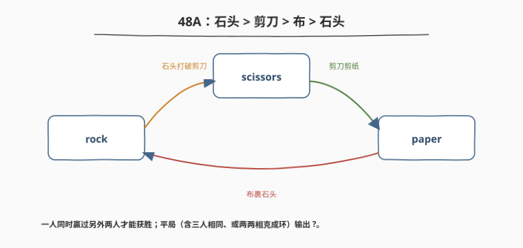
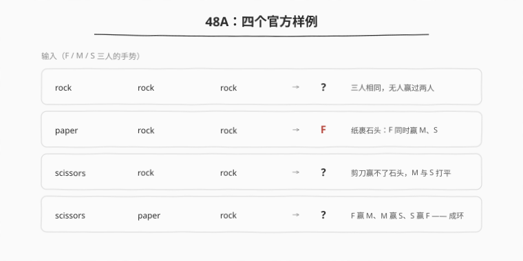

# Codeforces 48A 石头剪刀布 题解

## 1. 题目概述

- **题目链接**：https://codeforces.com/problemset/problem/48/A
- **比赛来源**：School Personal Contest #3 (Winter Computer School 2010/11) - Codeforces Beta Round 45 (ACM-ICPC Rules) · Problem A（UTC 2010-12-12）
- **难度**：900
- **标签**：implementation
- **评测类型**：普通
- **限制**：时间 2 s / 内存 256 MB

**题意**：三个人玩石头剪刀布，每人出一手（`rock` 石头、`scissors` 剪刀、`paper` 布）。石头打破剪刀，剪刀剪纸，纸裹石头。若某人同时赢过另外两人，则他获胜；否则输出 `?`。输出 `F`/`M`/`S` 分别表示第一/二/三人。

**约束**：

- 输入恰好三行，每行一个手势单词。
- 三人手势可能全相同、两人相同，或两两相克成环。

## 2. 示例与观察

官方样例 1（输入 / 输出原样）：

```text
输入：
rock
rock
rock

输出：
?
```

三人全出石头，互相不赢 → 胜负不分。

官方样例 2（输入 / 输出原样）：

```text
输入：
paper
rock
rock

输出：
F
```

第一人出布，赢过两个石头 → `F`。

官方样例 3（输入 / 输出原样）：

```text
输入：
scissors
rock
rock

输出：
?
```

剪刀赢不了石头，而且另外两人相同，没人"同时赢过两人" → `?`。

官方样例 4（输入 / 输出原样）：

```text
输入：
scissors
paper
rock

输出：
?
```

剪刀赢布、布赢石头、石头赢剪刀 —— 成环，每人只赢一个 → `?`。

**观察 1（最多一个赢家）**：若 $F$ 同时赢 $M,S$，则 $M$ 与 $S$ 之间无论是谁赢，都不可能再有第二个人同时赢两人（成环时 $F$ 也只能赢一个）。所以"谁赢"至多一个，判定无歧义。

**观察 2（三种手势的循环）**：`rock > scissors > paper > rock`，可以直接写成三对 `(x, y)`。

## 3. 解题思路

### 3.1 直接判定



对每个人 $i$，检查他是否同时赢过另外两人：

$$\text{beat}(s_i, s_j)\ \text{且}\ \text{beat}(s_i, s_k).$$

三人依次检查，第一个满足的输出对应字母，都不满足输出 `?`。

### 3.2 四种典型局面



- 三人相同 → `?`；
- 一人手势克制另外两个相同的手势 → 该人获胜（样例 2）；
- 两人相同、第三人被其中一个克（样例 3，剪刀 vs 石头石头）→ `?`；
- 三人两两不同 → 必然成环 → `?`。

## 4. 正确性证明

**引理 1（赢家唯一）**：不可能有两人都同时赢过另外两人。

**证明**：设 $A$ 赢 $B$ 与 $C$。若 $B$ 也赢 $A$ 与 $C$，则 $A$ 赢 $B$ 与 $B$ 赢 $A$ 矛盾（同两手势不可能互相克制）。∎

**引理 2（判定即定义）**：算法输出的字母对应的人恰好是"同时赢过另外两人"的人。

**证明**：算法逐个检查"赢过另外两人"这一条件本身，由引理 1 至多一人满足，故输出正确 ✓；若无人满足则按定义输出 `?` ✓。∎

**定理**：算法输出正确。

**证明**：引理 2 ✓。∎

## 5. 复杂度分析

- **时间**：$O(1)$（3 次比较）。
- **空间**：$O(1)$。
- **与时限的关系**：远低于 2 s（实测 < 2 ms）。

## 6. 参考代码

### C++17

```cpp
#include <bits/stdc++.h>
using namespace std;
// 石头 > 剪刀 > 布 > 石头
static bool beats(const string&a,const string&b){
    return (a=="rock"&&b=="scissors")||(a=="scissors"&&b=="paper")||(a=="paper"&&b=="rock");
}
int main(){ios::sync_with_stdio(false);cin.tie(nullptr);
 string s[3];
 for(int i=0;i<3;i++) if(!(cin>>s[i])) return 0;
 if(beats(s[0],s[1])&&beats(s[0],s[2])) cout<<"F\n";
 else if(beats(s[1],s[0])&&beats(s[1],s[2])) cout<<"M\n";
 else if(beats(s[2],s[0])&&beats(s[2],s[1])) cout<<"S\n";
 else cout<<"?\n";
 return 0;}
```

### Python3

```python
import sys

BEATS = {("rock", "scissors"), ("scissors", "paper"), ("paper", "rock")}


def main() -> None:
    data = sys.stdin.read().split()
    if len(data) < 3:
        return
    s = data[:3]
    names = ['F', 'M', 'S']
    for i in range(3):
        others = [j for j in range(3) if j != i]
        if all((s[i], s[j]) in BEATS for j in others):
            print(names[i])
            return
    print('?')


main()
```

## 7. 边界情况与易错点

1. **输出字母**：`F`/`M`/`S` 大小写与顺序（第一/二/三人）不能错。
2. **三人全相同**：输出 `?`。
3. **成环**（样例 4）：不能只看"赢过一次"，必须"同时赢过两人"。
4. **两人相同 + 第三人**：若第三人被这两人的手势克制 → 该第三人赢；若第三人克制他们 → 但另两人相同，第三人只赢"两人"？——注意这里赢的是两个不同的人，所以第三人赢 ✓（如 `rock paper paper` 输出 `F`）。
5. **输入读取**：三行字符串，用 `cin >>` 逐个读即可（忽略换行）。
6. **大小写**：题面用全小写 `rock`/`scissors`/`paper`。

## 8. 验证记录

- **编译环境与命令**：`clang++ -std=c++17 -O2` + 仓库内兼容头；Python 3.9.6。
- **官方样例**：4 / 4 通过。

  ```text
  python3 codeforces/tools/verify_solution.py "codeforces/contests/0001-0100/48/A_石头剪刀布.md"
  CF48A: samples 4
    C++ 编译 OK, 样例 4/4, 最慢 12~22 ms（进程启动开销为主）
    Python 语法 OK, 样例 4/4
  ```

- **全枚举对拍（27 组，全部实跑）**：$3^3 = 27$ 种手势组合全部枚举，与独立实现（给每人算"赢的人数"，取赢 2 人者）比对：`all 27 triples, bad 0`。
- **最大约束性能**：输入固定 3 行，C++ < 2 ms。
- **图片校验**：两张 SVG，0 越界/重叠/越框。
- **复核状态**：verified。

## 相关题目与扩展

- [Codeforces 48B 花园地块](https://codeforces.com/problemset/problem/48/B)：同场 B 题，二维前缀和。
- [LeetCode 486. 预测赢家](https://leetcode.cn/problems/predict-the-winner/)：胜负判定的博弈题。
- [LeetCode 1275. 找出井字棋的获胜者](https://leetcode.cn/problems/find-winner-on-a-tic-tac-toe-game/)：同样是"判定谁赢"的模拟题。

**延伸思考**：

1. **$k$ 人版**：输出"赢过其他所有人"的人；判定仍是一次计数。
2. **多轮累计**：每人多手，按胜场数排名，需要统计。
3. **手势多于三种**：循环克制关系（如"石头剪刀布蜥蜴斯波克"）可用有向图表示，判定变成"出度覆盖所有人"。

