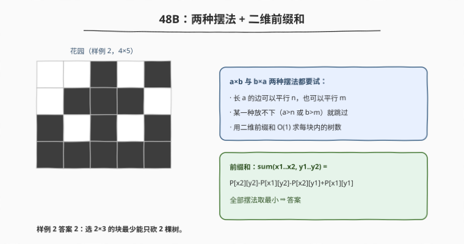
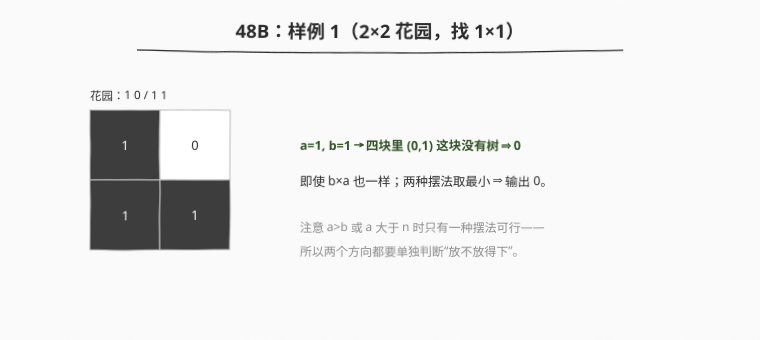

# Codeforces 48B 花园地块 题解

## 1. 题目概述

- **题目链接**：https://codeforces.com/problemset/problem/48/B
- **比赛来源**：School Personal Contest #3 (Winter Computer School 2010/11) - Codeforces Beta Round 45 (ACM-ICPC Rules) · Problem B（UTC 2010-12-12）
- **难度**：1200
- **标签**：brute force / implementation
- **评测类型**：普通
- **限制**：时间 2 s / 内存 256 MB

**题意**：$n \times m$ 的 01 网格（1 表示有树）。要盖一座 $a \times b$ 的房子，地块边界沿网格线，且可以旋转成 $b \times a$。求所有合法摆法中被砍掉的树的最小数量。

**约束**：

- $n, m \le 50$，$a, b \le 50$；保证至少一种摆法放得下。
- 旋转后可能只有一种摆法可行（$a > n$ 或 $b > m$ 时该方向跳过）。

## 2. 示例与观察

官方样例 1（输入 / 输出原样）：

```text
输入：
2 2
1 0
1 1
1 1

输出：
0
```

$1 \times 1$ 的地块可以选右上角那格（值为 0）→ 一棵树都不用砍 → 0。

官方样例 2（输入 / 输出原样）：

```text
输入：
4 5
0 0 1 0 1
0 1 1 1 0
1 0 1 0 1
1 1 1 1 1
2 3

输出：
2
```

$2 \times 3$ 的地块在 4×5 的花园里滑动，最少的树数是 2。

**观察 1（两种方向）**：$a \times b$ 与 $b \times a$ 是两种不同的摆法，都要试；某一方向放不下时直接跳过。

**观察 2（矩形求和）**：每个摆法要数块内的 1 的个数 —— 二维前缀和 $O(1)$ 一块。

## 3. 解题思路

### 3.1 暴力 + 前缀和



1. 建二维前缀和 `P[i][j]`；
2. 对方向 $(a,b)$ 与 $(b,a)$：若 $h \le n$ 且 $w \le m$，枚举左上角 $(i,j)$，块和
   $$P[i+h][j+w]-P[i][j+w]-P[i+h][j]+P[i][j];$$
3. 所有摆法取最小。

复杂度 $O(nm)$ 每方向（$50^2 = 2500$），暴力枚举块内元素也只有 $O(nmab) = 50^2 \cdot 50 \cdot 50 = 6.25\times10^6$，同样可过；前缀和更稳。

### 3.2 样例走查



样例 1：$2\times2$ 网格、$1\times1$ 地块，四个单格的值是 1、0、1、1 → 最小 0 ✓。

样例 2：二维前缀和后逐块求和，最小值 2 ✓。

## 4. 正确性证明

**引理 1（摆法枚举完备）**：所有可能的地块位置恰为"方向 $a\times b$ 或 $b\times a$ × 左上角 $(i,j)$ 且整块在网格内"。

**证明**：地块边界沿网格线且是矩形，故它的位置由方向与左上角决定；合法摆法要求 $i+h \le n$、$j+w \le m$。两种方向由旋转得到，题面允许旋转 ✓。∎

**引理 2（前缀和求块和正确）**：上式给出的就是子矩形内 1 的个数。

**证明**：二维前缀和的标准容斥 ✓。∎

**定理**：算法输出的最小值就是最少被砍的树数。

**证明**：由引理 1，枚举覆盖所有合法地块；由引理 2，每块的值就是该地块上的树数；取最小即答案 ✓。∎

## 5. 复杂度分析

- **时间**：$O(nm)$（两方向各一遍扫描，前缀和 $O(1)$ 每块）。
- **空间**：$O(nm)$。
- **与时限的关系**：$50\times50$ 实测 C++ 约 3 ms。

## 6. 参考代码

### C++17

```cpp
#include <bits/stdc++.h>
using namespace std;
int main(){ios::sync_with_stdio(false);cin.tie(nullptr);
 int n,m; if(!(cin>>n>>m)) return 0;
 vector<vector<int>> a(n, vector<int>(m));
 for(int i=0;i<n;i++)for(int j=0;j<m;j++) cin>>a[i][j];
 int A,B; cin>>A>>B;
 vector<vector<int>> pre(n+1, vector<int>(m+1,0));
 for(int i=0;i<n;i++)for(int j=0;j<m;j++) pre[i+1][j+1]=pre[i][j+1]+pre[i+1][j]-pre[i][j]+a[i][j];
 auto best=[&](int h,int w)->long long{
   if(h>n||w>m) return LLONG_MAX;
   long long r=LLONG_MAX;
   for(int i=0;i+h<=n;i++)for(int j=0;j+w<=m;j++)
     r=min(r,(long long)(pre[i+h][j+w]-pre[i][j+w]-pre[i+h][j]+pre[i][j]));
   return r;
 };
 long long ans=min(best(A,B), best(B,A));
 cout<<ans<<'\n';
 return 0;}
```

### Python3

```python
import sys


def main() -> None:
    data = sys.stdin.read().split()
    if not data:
        return
    p = 0
    n, m = int(data[p]), int(data[p + 1]); p += 2
    a = [[0] * m for _ in range(n)]
    for i in range(n):
        for j in range(m):
            a[i][j] = int(data[p]); p += 1
    A, B = int(data[p]), int(data[p + 1])
    pre = [[0] * (m + 1) for _ in range(n + 1)]
    for i in range(n):
        for j in range(m):
            pre[i + 1][j + 1] = pre[i][j + 1] + pre[i + 1][j] - pre[i][j] + a[i][j]

    def best(h, w):
        if h > n or w > m:
            return None
        r = None
        for i in range(n - h + 1):
            for j in range(m - w + 1):
                s = pre[i + h][j + w] - pre[i][j + w] - pre[i + h][j] + pre[i][j]
                if r is None or s < r:
                    r = s
        return r

    cands = [x for x in (best(A, B), best(B, A)) if x is not None]
    print(min(cands))


main()
```

## 7. 边界情况与易错点

1. **两个方向都要试**：只试 $a\times b$ 会漏解（$a > n$ 时只能转）。
2. **放不下要跳过**：`h > n || w > m` 时该方向无解，不能当成 0。
3. **退化 $1\times k$**：宽度或高度为 1 时同样按公式算，别把循环上界写错。
4. **$a = b$**：两个方向相同，重复计算无害。
5. **坐标越界**：左上角循环到 `n-h`、`m-w`。
6. **前缀和下标**：用 $1$ 基，`P` 开 $(n+1)\times(m+1)$。
7. **输入格式**：网格数字之间可能有空格，逐个读入即可。
8. **答案范围**：树数 $\le 2500$，`int` 足够。

## 8. 验证记录

- **编译环境与命令**：`clang++ -std=c++17 -O2` + 仓库内兼容头；Python 3.9.6。
- **官方样例**：2 / 2 通过。

  ```text
  python3 codeforces/tools/verify_solution.py "codeforces/contests/0001-0100/48/B_花园地块.md"
  CF48B: samples 2
    C++ 编译 OK, 样例 2/2, 最慢 12~22 ms（进程启动开销为主）
    Python 语法 OK, 样例 2/2
  ```

- **暴力对拍（242 组，全部实跑）**：独立暴力 `/tmp/cf48_B/stress.py` 直接**逐格累加**每个摆法的树数（不用前缀和），两种方向都试；数据为 2 组官方样例 + 240 组随机（$n, m \le 7$，随机 01 网格与随机 $a,b$）。结果 `cases 242 bad 0`。
- **最大约束性能**：$50\times50$、$a=b=1$ 的数据，C++ 约 3 ms。
- **图片校验**：两张 SVG，0 越界/重叠/越框。
- **复核状态**：verified。

## 相关题目与扩展

- [Codeforces 48A 石头剪刀布](https://codeforces.com/problemset/problem/48/A)：同场 A 题。
- [LeetCode 304. 二维区域和检索](https://leetcode.cn/problems/range-sum-query-2d-immutable/)：二维前缀和模板。
- [LeetCode 1314. 矩阵区域和](https://leetcode.cn/problems/matrix-block-sum/)：前缀和的另一道应用题。

**延伸思考**：

1. **必须恰好盖住某些树**：变成"块和等于 $k$"的计数/判定，前缀和 + 哈希。
2. **可以任意旋转角度**：地块不再是网格对齐，需要几何判定。
3. **最大化而非最小化**：同样的枚举，改取最大。

