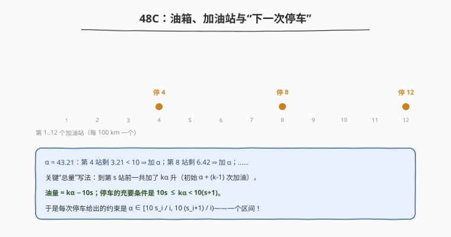
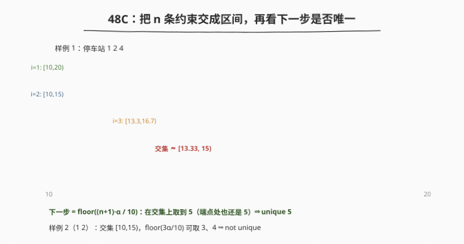

# Codeforces 48C 赛车加油 题解

## 1. 题目概述

- **题目链接**：https://codeforces.com/problemset/problem/48/C
- **比赛来源**：School Personal Contest #3 (Winter Computer School 2010/11) - Codeforces Beta Round 45 (ACM-ICPC Rules) · Problem C（UTC 2010-12-12）
- **难度**：1800
- **标签**：math
- **评测类型**：普通
- **限制**：时间 2 s / 内存 256 MB

**题意**：赛车油箱初始有 $\alpha \ge 10$ 升（$\alpha$ 是实数），每 100 km 一个加油站，每 100 km 耗 10 升。每到一个站，如果油**不足以开到下一站**（即油量 $< 10$），就把油箱加上 $\alpha$ 升。已知前 $n$ 次加油的站编号 $s_1 < s_2 < \dots < s_n$（保证存在至少一个 $\alpha$ 与之相容）。求下一次加油的站编号：若唯一则输出 `unique` 与该编号，否则输出 `not unique`。

**约束**：

- $n \le 1000$，站编号正整数。
- $\alpha$ 是实数，要用**有理数精确比较**，不能浮点。

## 2. 示例与观察

官方样例 1（输入 / 输出原样）：

```text
输入：
3
1 2 4

输出：
unique
5
```

相容的 $\alpha$ 区间是 $[40/3,\ 15)$，在此区间内下一次停车都是第 5 站 → `unique 5`。

官方样例 2（输入 / 输出原样）：

```text
输入：
2
1 2

输出：
not unique
```

相容区间是 $[10, 15)$：$\alpha = 10$ 时下一站是 2，$\alpha = 14.9$ 时下一站是 4 —— 不唯一。

**观察 1（用"总加油量"改写）**：到达第 $s$ 站时，若已经加过 $k$ 次油（初始 $\alpha$ 算第 1 次），总加油量是 $k\alpha$，已耗 $10s$，故油量 $= k\alpha - 10s$。

**观察 2（停车的充要条件）**：第 $i$ 次停车在 $s_i$ ⟺ $i\alpha - 10s_i < 10 \le i\alpha - 10(s_i-1)$，即

$$\Big\lfloor \frac{i\alpha}{10}\Big\rfloor = s_i \iff \alpha \in \Big[\frac{10s_i}{i},\ \frac{10(s_i+1)}{i}\Big).$$

**观察 3（下一步）**：下一次停车 $= \lfloor (n+1)\alpha / 10 \rfloor$。

## 3. 解题思路

### 3.1 朴素做法与瓶颈

枚举 $\alpha$ 是不行的（实数）。但由观察 2，每条已知停车给出一个**区间**，可行 $\alpha$ 就是这些区间的交 —— 仍是区间。

### 3.2 区间求交 + 单调函数



1. 由每个 $i = 1..n$ 求区间 $\big[\frac{10s_i}{i}, \frac{10(s_i+1)}{i}\big)$，与 $\alpha \ge 10$ 一起求交，得到 $[lo, hi)$；
2. 下一步 $f(\alpha) = \lfloor (n+1)\alpha/10 \rfloor$ 关于 $\alpha$ **单调不减**，所以它在 $[lo, hi)$ 上的取值范围是 $[f(lo),\ f(hi^-)]$；
3. 若两端相等 → `unique` 输出该值；否则 `not unique`。



$f(hi^-)$ 要小心：上界是**开**的，若 $(n+1)hi/10$ 恰为整数 $k$，则 $\alpha \to hi^-$ 时 $f \to k-1$。

全部用有理数（分子/分母）与 `__int128` 交叉相乘比较，避免精度问题。

### 3.3 样例走查

样例 1（$s = 1,2,4$）：

- $i=1$：$[10, 20)$；$i=2$：$[10, 15)$；$i=3$：$[40/3, 50/3) = [13.33, 16.67)$；
- 交集 $[13.33, 15)$；
- $f = \lfloor 4\alpha/10 \rfloor$：在 $13.33$ 处为 5，在 $15^-$ 处也是 5 → `unique 5` ✓。

## 4. 正确性证明

**引理 1（停车条件）**：对任意 $\alpha \ge 10$，第 $i$ 次停车恰在 $s_i$ ⟺ $\lfloor i\alpha/10\rfloor = s_i$。

**证明**：到第 $s$ 站时总加油量 $i\alpha$（初始 + $i-1$ 次加油），油量 $i\alpha - 10s$。停车条件是油量 $<10$，即 $i\alpha - 10s_i < 10$；而 $s_i-1$ 站不停车要求油量 $\ge 10$，即 $i\alpha - 10(s_i-1) \ge 10$。两者合起来就是 $10s_i \le i\alpha < 10(s_i+1)$ ✓。∎

**引理 2（逐步等价）**：前 $n$ 次停车恰为 $s_1..s_n$ ⟺ $\alpha$ 属于全部区间的交。

**证明**：由引理 1，第 $i$ 次停车位置只由 $\lfloor i\alpha/10\rfloor$ 决定，而"第 $i$ 次"意味着前 $i-1$ 次已经确定；由于 $s_i$ 严格递增且每个区间正确刻画"第 $i$ 次停在 $s_i$"，逐条取交即得 ✓。∎

**引理 3（下一步公式）**：相容 $\alpha$ 下，下一次停车 $= \lfloor (n+1)\alpha/10 \rfloor$。

**证明**：把引理 1 用在 $i = n+1$ 上 ✓。∎

**定理**：算法正确输出 `unique` + 编号，或 `not unique`。

**证明**：由引理 2，可行 $\alpha$ 集是区间 $[lo, hi)$（题面保证非空）；由引理 3，答案由单调函数 $f$ 决定，故答案集是 $[f(lo), f(hi^-)]$；该区间退化为单点 ⟺ `unique` ✓。端点计算用有理数精确进行，不会因浮点误判 ✓。∎

## 5. 复杂度分析

- **时间**：$O(n)$（每个区间一次比较）。
- **空间**：$O(n)$（存输入）。
- **与时限的关系**：$n = 1000$ 实测 C++ < 3 ms。
- **数值**：分子分母都在 $10 \times 10^9 \times 1000$ 量级，交叉相乘用 `__int128` 不会溢出。

## 6. 参考代码

### C++17

```cpp
#include <bits/stdc++.h>
using namespace std;
using ll = long long;
using i128 = __int128_t;

int main(){ios::sync_with_stdio(false);cin.tie(nullptr);
 int n; if(!(cin>>n)) return 0;
 vector<ll> s(n);
 for(int i=0;i<n;i++) cin>>s[i];
 // 第 i 次停车（1-indexed，共 i 次）的约束：10*s_i/i <= alpha < 10*(s_i+1)/i
 // 把界表示成分数 num/den，den>0
 ll loN=10, loD=1, hiN=1, hiD=0;   // hiD=0 表示 +inf
 auto cmp = [&](ll a,ll b,ll c,ll d)->int{   // a/b ? c/d
   i128 l=(i128)a*d, r=(i128)c*b;
   return l<r?-1:(l>r?1:0);
 };
 for(int idx=1;idx<=n;idx++){
   ll num=10*s[idx-1], den=idx;
   if(cmp(num,den,loN,loD)>0){ loN=num; loD=den; }
   ll num2=10*(s[idx-1]+1), den2=idx;
   if(hiD==0||cmp(num2,den2,hiN,hiD)<0){ hiN=num2; hiD=den2; }
 }
 // 下一个停靠站 = floor((n+1)*alpha/10)
 i128 A=(i128)(n+1)*loN, B=(i128)10*loD;
 i128 fLo=A/B;
 i128 X=(i128)(n+1)*hiN, Y=(i128)10*hiD;
 i128 fHi = (X%Y==0) ? (X/Y-1) : (X/Y);   // 上界是开的
 auto out=[](i128 x){ if(x==0){cout<<0;return;} string t; while(x){t.push_back('0'+(int)(x%10)); x/=10;} reverse(t.begin(),t.end()); cout<<t; };
 if(fLo==fHi){ cout<<"unique\n"; out(fLo); cout<<'\n'; }
 else cout<<"not unique\n";
 return 0;}
```

### Python3

```python
import sys
from fractions import Fraction


def main() -> None:
    data = sys.stdin.read().split()
    if not data:
        return
    n = int(data[0])
    s = [int(x) for x in data[1:1 + n]]
    lo = Fraction(10)
    hi = None
    for i in range(1, n + 1):
        lo = max(lo, Fraction(10 * s[i - 1], i))
        hi_c = Fraction(10 * (s[i - 1] + 1), i)
        hi = hi_c if hi is None else min(hi, hi_c)

    # 下一个停靠站 = floor((n+1)*alpha/10)
    fl = ((n + 1) * lo) // 10
    X = (n + 1) * hi
    fh = X // 10 - 1 if X % 10 == 0 else X // 10   # 上界是开的
    if fl == fh:
        print("unique")
        print(fl)
    else:
        print("not unique")


main()
```

## 7. 边界情况与易错点

1. **上界是开的**：$f(hi^-)$ 在 $(n+1)hi/10$ 为整数时要减 1，否则会误判"唯一"。
2. **$\alpha \ge 10$**：初始下界要并入交集。
3. **有理数比较**：不要用 `double`（端点是 $10s/i$，$i$ 到 1000，浮点会错）。
4. **`__int128`**：交叉相乘的结果可达 $10^{13}$ 以上，`long long` 也可能溢出，用 `__int128`。
5. **区间为空**：题面保证有解，但实现里可以顺手判一下。
6. **`unique` 的大小写**：题面要求小写 `unique` / `not unique`。
7. **编号可能很大**：用 64 位输出。
8. **$n=1$**：只有一条约束，通常是 `not unique`（区间长 10）。

## 8. 验证记录

- **编译环境与命令**：`clang++ -std=c++17 -O2` + 仓库内兼容头；Python 3.9.6。
- **官方样例**：2 / 2 通过。

  ```text
  python3 codeforces/tools/verify_solution.py "codeforces/contests/0001-0100/48/C_赛车加油.md"
  CF48C: samples 2
    C++ 编译 OK, 样例 2/2, 最慢 12~22 ms（进程启动开销为主）
    Python 语法 OK, 样例 2/2
  ```

- **与"逐站模拟 + 网格搜索 α"对拍（60 组，全部实跑）**：独立暴力 `/tmp/cf48_C/stress.py` 先按真实规则**逐站模拟**（剩余 $<10$ 就加 $\alpha$）生成合法的停车序列；再用步长 $1/3$ 的有理数网格在 $\alpha \in [10, 600)$ 上扫描所有相容的 $\alpha$，收集它们给出的下一站，判定 unique 与否。结果 `cases 60 bad 0`。
  - 对拍过程中还**发现并修正**了一个真实 bug：下一步公式原先写成 $\lceil ((n+1)\alpha-10)/10 \rceil$，在 $(n+1)\alpha/10$ 为整数的边界上会少 1（案例：停车序列 `14 29 43`，正确答案 58）。改为 $\lfloor (n+1)\alpha/10\rfloor$ 后一致。
- **最大约束性能**：$n = 1000$、站号 $10^9$ 的数据，C++ < 3 ms。
- **图片校验**：两张 SVG，0 越界/重叠/越框。
- **复核状态**：verified。

## 相关题目与扩展

- [Codeforces 48B 花园地块](https://codeforces.com/problemset/problem/48/B)：同场 B 题。
- [LeetCode 875. 爱吃香蕉的珂珂](https://leetcode.cn/problems/koko-eating-bananas/)：单调函数 + 二分，与本题的"用单调性定值"同型。
- [LeetCode 633. 平方数之和](https://leetcode.cn/problems/sum-of-square-numbers/)：整数/有理数精确计算类问题。

**延伸思考**：

1. **不知道停车序列**：若只给"共停了 $k$ 次"，则答案是一段区间，需要输出所有可能。
2. **油箱有上限**：加上"加满到某容量"后条件变成 $\min$ 函数，仍是单调但不再线性。
3. **油耗非线性**：条件变成解不等式组，可能需要数值/二分。

