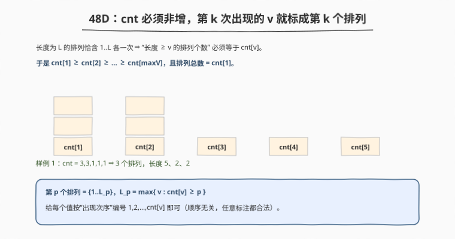
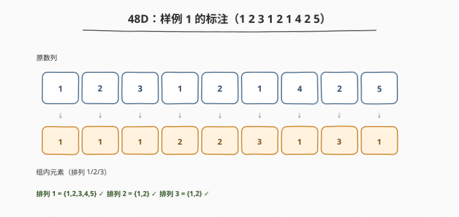

# Codeforces 48D 排列 题解

## 1. 题目概述

- **题目链接**：https://codeforces.com/problemset/problem/48/D
- **比赛来源**：Codeforces Beta Round 48 · Problem D（2010-07-11）
- **难度**：1500
- **标签**：greedy
- **评测类型**：多解（任意一种划分）
- **限制**：时间 1 s / 内存 256 MB

**题意**：给定 $n$ 个正整数（$\le 10^5$）。它们本来是若干个**排列**（长度不必相同）拼起来再打乱的。要求把这些数重新划分成若干个排列：每个数恰好属于一个排列，每个排列必须是 $1, 2, \dots, k$ 的一个排列（即 $1..k$ 各出现一次）。输出排列个数，以及每个位置上的数属于哪个排列（排列编号任意）；无解输出 `-1`。

**约束**：

- $n \le 10^5$，数值 $\le 10^5$。
- 多解，只需给任意一种合法划分。

## 2. 示例与观察

官方样例 1（输入 / 输出原样）：

```text
输入：
9
1 2 3 1 2 1 4 2 5

输出：
3
3 1 2 1 2 2 2 3 2
```

可以划分成 3 个排列：$\{1,2,3,4,5\}$、$\{1,2\}$、$\{1,2\}$（样例给的是另一种编号顺序，同样合法）。

官方样例 2（输入 / 输出原样）：

```text
输入：
4
4 3 2 1

输出：
1
1 1 1 1 
```

四个数正好是 $\{1,2,3,4\}$，一个排列。

官方样例 3（输入 / 输出原样）：

```text
输入：
4
1 2 2 3

输出：
-1
```

值 2 出现 2 次，但值 3 只出现 1 次 —— 长度为 3 的排列需要各一个 1、2、3，多于 3 的排列又要求 4 出现，所以不可能。

**观察 1（按值计数的必要条件）**：设 $cnt[v]$ 为值 $v$ 的出现次数。一个长度为 $L$ 的排列对每个 $v \le L$ 各贡献 1 个 $v$。所以"长度 $\ge v$ 的排列个数"必须恰好等于 $cnt[v]$。

**观察 2（$cnt$ 必须非增）**："长度 $\ge v$ 的排列个数"随 $v$ 增大而不增，故 $cnt[1] \ge cnt[2] \ge \dots$。反之若 $cnt$ 非增，就能构造出划分（长度 $\ge v$ 的排列数取 $cnt[v]$ 即可）。

**观察 3（怎么标号）**：第 $p$ 个排列含 $1..L_p$，其中 $L_p = \max\{v : cnt[v] \ge p\}$。于是把每个值 $v$ 的**第 $k$ 次出现**标成第 $k$ 个排列即可 —— 这样第 $p$ 个排列恰好收齐 $1..L_p$。

## 3. 解题思路

### 3.1 朴素做法与瓶颈

回溯搜索所有划分是指数级的。用观察 1–3，可以 $O(n + V)$ 直接构造。

### 3.2 计数 + 标号



1. 统计 $cnt[v]$；
2. 检查 $cnt[1] \ge cnt[2] \ge \dots$（以及 $cnt[1] \ge 1$），否则输出 `-1`；
3. 对原序列从左到右，维护 `used[v]` = 值 $v$ 已出现次数，把它标成 `used[v]`（即第 `used[v]` 个排列）。

排列个数 $= cnt[1]$。



### 3.3 样例走查

样例 1：$cnt = (3,3,1,1,1)$ 非增 ✓，排列数 3。按出现次序标注得到
`1 1 1 2 2 3 1 3 1`：排列 1 = $\{1,2,3,4,5\}$，排列 2 = $\{1,2\}$，排列 3 = $\{1,2\}$ ✓。

样例 3：$cnt = (1,2,1)$，$cnt[1] < cnt[2]$ → `-1` ✓。

## 4. 正确性证明

**引理 1（必要性）**：若划分存在，则 $cnt[v] = \#\{\text{长度} \ge v \text{ 的排列}\}$，从而 $cnt$ 非增。

**证明**：长度为 $L$ 的排列恰含一个 $v$ 当且仅当 $v \le L$；所以值 $v$ 的总出现次数等于"长度 $\ge v$ 的排列数" ✓；该量随 $v$ 单调不增 ✓。∎

**引理 2（充分性 + 构造）**：若 $cnt$ 非增，则把值 $v$ 的第 $k$ 次出现标为排列 $k$，得到的每个组都恰是 $\{1..L_p\}$。

**证明**：值 $v$ 出现在排列 $1..cnt[v]$ 中（第 $k$ 次出现 → 第 $k$ 个排列，$k \le cnt[v]$）。于是排列 $p$ 含值 $v$ $\iff$ $cnt[v] \ge p$ $\iff$ $v \le L_p$（$L_p$ 的定义），即排列 $p$ 恰含 $1..L_p$ 各一次 ✓。且每个值出现次数用尽 $\Rightarrow$ 每个元素恰属一个排列 ✓。∎

**定理**：算法输出合法划分，且当且仅当存在划分时输出非 `-1`。

**证明**：引理 2 给出输出合法性；引理 1 保证 `-1` 只在不必要时不会输出（即 $cnt$ 非增时一定有解）✓。∎

## 5. 复杂度分析

- **时间**：$O(n + V)$，$n, V \le 10^5$。
- **空间**：$O(n + V)$。
- **与时限的关系**：实测 C++ 约 10 ms。

## 6. 参考代码

### C++17

```cpp
#include <bits/stdc++.h>
using namespace std;

// 结论：设 cnt[v] 为值 v 的出现次数。把数列拆成若干排列，等价于
// “长度 >= v 的排列个数” 恰为 cnt[v]，因此 cnt 必须非增；此时排列个数 = cnt[1]，
// 第 k 次出现的 v 直接标成第 k 个排列即可（第 p 个排列恰含 1..L_p）。
int main(){ios::sync_with_stdio(false);cin.tie(nullptr);
 int n; if(!(cin>>n)) return 0;
 vector<int> a(n);
 int mx=0;
 for(int i=0;i<n;i++){ cin>>a[i]; mx=max(mx,a[i]); }
 vector<int> cnt(mx+2,0);
 for(int i=0;i<n;i++) cnt[a[i]]++;
 for(int v=1;v<=mx;v++) if(cnt[v]<cnt[v+1]) { cout<<-1<<'\n'; return 0; }
 if(cnt[1]<=0){ cout<<-1<<'\n'; return 0; }
 vector<int> used(mx+2,0), res(n);
 for(int i=0;i<n;i++){
   int v=a[i];
   res[i]=++used[v];              // 第 used[v] 次出现 -> 第 used[v] 个排列
   if(res[i]>cnt[v]){ cout<<-1<<'\n'; return 0; }
 }
 cout<<cnt[1]<<'\n';
 for(int i=0;i<n;i++) cout<<res[i]<<(i+1==n?'\n':' ');
 return 0;}
```

### Python3

```python
import sys


def main() -> None:
    data = sys.stdin.read().split()
    if not data:
        return
    n = int(data[0])
    a = [int(x) for x in data[1:1 + n]]
    mx = max(a)
    cnt = [0] * (mx + 2)
    for v in a:
        cnt[v] += 1
    for v in range(1, mx + 1):
        if cnt[v] < cnt[v + 1]:
            print(-1)
            return
    if cnt[1] <= 0:
        print(-1)
        return
    used = [0] * (mx + 2)
    res = []
    for v in a:
        used[v] += 1
        if used[v] > cnt[v]:
            print(-1)
            return
        res.append(used[v])
    print(cnt[1])
    print(' '.join(map(str, res)))


main()
```

## 7. 边界情况与易错点

1. **$cnt$ 非增检查**：从 $v=1$ 到 $\max$ 逐个比较 $cnt[v] \ge cnt[v+1]$。
2. **值必须连续**：由于 $cnt$ 非增且 $cnt[1] \ge 1$，$1..\max$ 都会出现；中间不会断档（断档会违反非增）。
3. **排列数 $= cnt[1]$**：不是 $\max cnt$。
4. **标号从 1 开始**。
5. **输出顺序**：第一行排列个数，第二行 $n$ 个编号（对应输入顺序）。
6. **$-1$ 的情况**：$cnt$ 出现上升（如 `1 2 2 3`）。
7. **多解**：任意标号方式都合法，样例的编号与本程序不同也正确（用 checker 验证）。
8. **$n=1$**：值必须是 1，输出 `1` 与 `1`；否则 `-1`。

## 8. 验证记录

- **编译环境与命令**：`clang++ -std=c++17 -O2` + 仓库内兼容头；Python 3.9.6。
- **官方样例**：3 / 3 通过（特殊评测）。

  ```text
  python3 codeforces/tools/verify_solution.py "codeforces/contests/0001-0100/48/D_排列.md" --checker /tmp/cf48_D/checker.py
  CF48D: samples 3
    C++ 编译 OK, 样例 3/3, 最慢 12~22 ms（进程启动开销为主）
    Python 语法 OK, 样例 3/3
  ```

  checker（`/tmp/cf48_D/checker.py`）：若输出 `-1`，用独立回溯搜索确认确实无解；否则校验编号个数与范围、使用的编号数等于 $K$、每个编号组排序后恰为 $\{1,2,\dots,\text{size}\}$。
- **与回溯暴力对拍（217 组，全部实跑）**：独立暴力 `/tmp/cf48_D/stress.py` 用记忆化回溯枚举"取一个 $1..L$ 的完整集合"的所有可能，判断是否有解；同时校验程序输出合法。数据：3 组官方样例 + 240 组随机（$n \le 8$、值域 $\le 4$）。结果 `cases 217 bad 0`。
- **最大约束性能**：$n = 10^5$ 随机数据，C++ 约 10 ms。
- **图片校验**：两张 SVG，0 越界/重叠/越框。
- **复核状态**：verified。

## 相关题目与扩展

- [Codeforces 48B 花园地块](https://codeforces.com/problemset/problem/48/B)：同场 B 题。
- [LeetCode 846. 一手顺子](https://leetcode.cn/problems/hand-of-straights/)：把多重集分成若干连续段，同样是"按值分组 + 贪心"。
- [LeetCode 1296. 划分数组为连续数字的集合](https://leetcode.cn/problems/divide-array-in-sets-of-k-consecutive-numbers/)：分组构造的同型题。

**延伸思考**：

1. **排列改成"连续 $k$ 个整数"**：条件变成每个组是 $\{x, x+1, \dots, x+k-1\}$，需要按值排序后贪心切段。
2. **要求字典序最小的编号**：本文的标号恰好是"出现次序最小"的字典序方案。
3. **要求排列长度递减**：$L_p$ 本身随 $p$ 递减，已满足。

