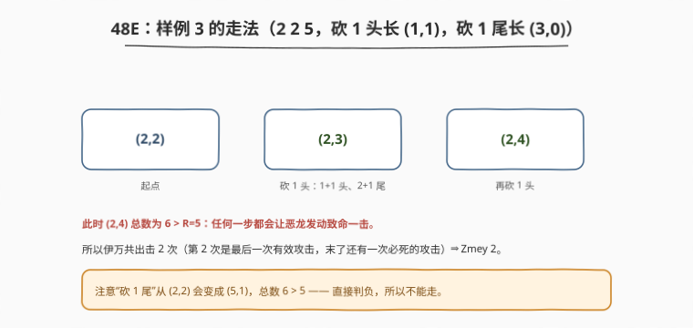

# Codeforces 48E 傻瓜伊万与蛇怪戈里内奇 题解

## 1. 题目概述

- **题目链接**：https://codeforces.com/problemset/problem/48/E
- **比赛来源**：Codeforces Beta Round 48 · Problem E（2010-07-11）
- **难度**：2100
- **标签**：dp / games / graphs
- **评测类型**：普通
- **限制**：时间 2 s / 内存 256 MB

**题意**：蛇怪初始有 $h$ 个头、$t$ 条尾，总数 $h + t \le R$。每次伊万可以砍掉 $i$ 个头（$1 \le i \le \min(n, h)$），此时蛇怪长出 $h_i$ 个头、$t_i$ 条尾；或砍掉 $i$ 条尾（$1 \le i \le \min(m, t)$），长出 $h'_i$ 个头、$t'_i$ 条尾。若某次攻击后头 + 尾总数 $> R$，蛇怪立刻反杀。求结局：伊万胜（最少攻击次数）、平局（可无限僵持）、还是蛇怪胜（伊万尽量拖延，输出他的攻击次数）。

**约束**：

- $h, t, R \le 200$，$n, m \le 200$，所有生长数 $\le 200$。
- 状态 $(h,t)$ 只在 $h + t \le R$ 时"活着" ⇒ 状态数 $\le \binom{R+2}{2} \approx 20301$。

## 2. 示例与观察

官方样例 1（输入 / 输出原样）：

```text
输入：
2 2 4
2
1 0
0 1
3
0 1
0 1
0 0

输出：
Ivan
2
```

从 $(2,2)$ 砍 2 个头（生长 $(0,1)$）→ $(0,3)$；再砍 3 条尾（生长 $(0,0)$）→ $(0,0)$，两步获胜 ✓。

官方样例 2（输入 / 输出原样）：

```text
输入：
2 2 4
1
0 1
1
1 0

输出：
Draw
```

砍 1 头 → $(2,3)$；砍 1 尾 → $(3,1)$；两者可以在总数 $\le 4$ 的范围内来回循环 → 无限僵持 ✓。

官方样例 3（输入 / 输出原样）：

```text
输入：
2 2 5
1
1 1
1
3 0

输出：
Zmey
2
```

$(2,2) \to (2,3) \to (2,4)$（两刀），此后任何一刀都让总数 $>5$，蛇怪反杀 ⇒ 伊万共出击 2 次 ✓。

**观察 1（状态图）**：状态是 $(h,t)$，合法状态满足 $h + t \le R$；一次"有效"攻击是从 $(h,t)$ 到另一个合法状态的边；若某次攻击的落点总数 $> R$，那是"立刻输"的一步，不进入状态图。

**观察 2（三种结局对应图论性质）**：
- $(0,0)$ 可达 ⇒ 伊万能赢，最少步数是最短路；
- 可达子图有环 ⇒ 伊万可以无限循环 ⇒ 平局；
- 否则可达子图是 DAG 且到不了 $(0,0)$ ⇒ 蛇怪必胜，伊万取最长路来拖延。

**观察 3（Zmey 要多算一刀）**：走到最长路的终点后，任何一刀都会让总数超 $R$（否则还能更长），这一刀仍算伊万的出击 ⇒ 次数 = 最长路 + 1。

## 3. 解题思路

### 3.1 建模


- 状态编号 `id(h,t) = h*(R+1)+t`；
- 从起点 $(h,t)$ 做 BFS，标记所有可达状态并求最短路；
- 若 $(0,0)$ 可达 → `Ivan` + 最短距离；
- 否则在可达子图上 DFS 三色判环 → 有环则 `Draw`；
- 否则在 DAG 上记忆化求最长路 → `Zmey` + (最长路 + 1)。

### 3.2 样例走查



样例 3：$(2,2) \to (2,3) \to (2,4)$（砍 1 头生长 $(1,1)$：$(2-1+1, 2+1) = (2,3)$，再砍 → $(2,4)$）；再砍就超 $R=5$ ⇒ `Zmey 2` ✓。

## 4. 正确性证明

**引理 1（状态转移正确）**：砍 $i$ 个头后的状态是 $(h-i+h_i,\ t+t_i)$，砍 $i$ 条尾后是 $(h+h'_i,\ t-i+t'_i)$；合法当且仅当新总数 $\le R$。

**证明**：按题意，砍掉 $i$ 个再长出对应数量 ✓；总数超过 $R$ 时蛇怪立刻反杀，故该步不属于"继续战斗" ✓。∎

**引理 2（胜利条件）**：伊万能获胜 $\iff$ 状态 $(0,0)$ 从起点可达；且最少攻击次数 = 最短路长度。

**证明**：到达 $(0,0)$ 时既无头也无尾，伊万无法再砍、蛇怪也无法生长（生长只由"砍掉的数量"决定）⇒ 伊万胜 ✓。反过来任何胜利都必须先到达 $(0,0)$ ✓。最短性由 BFS 性质 ✓。∎

**引理 3（平局条件）**：若 $(0,0)$ 不可达且可达子图含环，则双方可无限僵持；若不可达且无环，蛇怪必胜。

**证明**：环上的状态都在总数 $\le R$ 内、且互相可达 ⇒ 伊万可以永远沿着环走，战斗永不结束 ✓（且他不会选择必败路线，因为伊万优先平局）。无环 ⇒ 状态数有限且每条路都会终止；终止时既没到 $(0,0)$、又无合法出边 ⇒ 任何一步都会超 $R$ ⇒ 蛇怪反杀 ✓。∎

**引理 4（Zmey 的计数）**：无环且不可达 $(0,0)$ 时，伊万最多能出击（最长路长度 + 1）次。

**证明**：伊万每走一条合法边算一次出击；最长路给出最多的合法边数 $L$；到最长路终点后所有出边都超 $R$（否则可延长），此时再出击一次即被反杀 ⇒ 共 $L+1$ 次 ✓。且伊万按"拖延"策略会取最长路 ✓。∎

**定理**：程序输出与三种结局一致，次数正确。

**证明**：引理 2、3、4 覆盖三种情况 ✓。∎

## 5. 复杂度分析

- **时间**：$O(\text{状态数} \times (n+m)) \le 20301 \times 400 \approx 8\times10^6$（BFS、判环、最长路各一遍）。
- **空间**：$O(\text{状态数})$。
- **与时限的关系**：$R = 200$、$n = m = 200$ 实测 C++ 约 20 ms。

## 6. 参考代码

### C++17

```cpp
#include <bits/stdc++.h>
using namespace std;

// 状态 (heads, tails)，只在 total <= R 内合法；一次挥剑 = 砍 i 个头或 i 条尾并按规则生长。
// 结论：若 (0,0) 可达 -> Ivan（最少步数）；否则若可达子图有环 -> Draw；否则是 DAG -> Zmey（最长路）。
int H, T, R, n, m;
vector<pair<int,int>> headGrow, tailGrow;

int main(){ios::sync_with_stdio(false);cin.tie(nullptr);
 if(!(cin>>H>>T>>R)) return 0;
 cin>>n; headGrow.resize(n+1);
 for(int i=1;i<=n;i++) cin>>headGrow[i].first>>headGrow[i].second;
 cin>>m; tailGrow.resize(m+1);
 for(int i=1;i<=m;i++) cin>>tailGrow[i].first>>tailGrow[i].second;

 int W=R+1;
 auto id=[&](int h,int t){ return h*W+t; };
 int total_states=W*W;
 vector<char> reach(total_states,0);
 vector<int> dist(total_states,-1);
 deque<int> q;
 int start=id(H,T);
 reach[start]=1; dist[start]=0; q.push_back(start);
 while(!q.empty()){
   int cur=q.front(); q.pop_front();
   int h=cur/W, t=cur%W;
   auto relax=[&](int nh,int nt){
     if(nh<0||nt<0||nh+nt>R) return;
     int nx=id(nh,nt);
     if(!reach[nx]){ reach[nx]=1; dist[nx]=dist[cur]+1; q.push_back(nx); }
   };
   for(int i=1;i<=min(n,h);i++) relax(h-i+headGrow[i].first, t+headGrow[i].second);
   for(int i=1;i<=min(m,t);i++) relax(h+tailGrow[i].first, t-i+tailGrow[i].second);
 }
 int zero=id(0,0);
 if(reach[zero]){ cout<<"Ivan\n"<<dist[zero]<<'\n'; return 0; }

 // 环检测（在可达子图上）
 vector<char> color(total_states,0);
 bool hasCycle=false;
 function<void(int)> dfs=[&](int v){
   color[v]=1;
   int h=v/W, t=v%W;
   auto go=[&](int nh,int nt){
     if(nh<0||nt<0||nh+nt>R) return;
     int nx=id(nh,nt);
     if(!reach[nx]) return;
     if(color[nx]==1) hasCycle=true;
     else if(color[nx]==0) dfs(nx);
   };
   for(int i=1;i<=min(n,h);i++) go(h-i+headGrow[i].first, t+headGrow[i].second);
   for(int i=1;i<=min(m,t);i++) go(h+tailGrow[i].first, t-i+tailGrow[i].second);
   color[v]=2;
 };
 dfs(start);
 if(hasCycle){ cout<<"Draw\n"; return 0; }

 // DAG 上的最长路（记忆化）
 vector<int> memo(total_states,-1);
 function<int(int)> longest=[&](int v)->int{
   if(memo[v]>=0) return memo[v];
   int best=0;
   int h=v/W, t=v%W;
   auto go=[&](int nh,int nt){
     if(nh<0||nt<0||nh+nt>R) return;
     int nx=id(nh,nt);
     if(!reach[nx]) return;
     best=max(best, 1+longest(nx));
   };
   for(int i=1;i<=min(n,h);i++) go(h-i+headGrow[i].first, t+headGrow[i].second);
   for(int i=1;i<=min(m,t);i++) go(h+tailGrow[i].first, t-i+tailGrow[i].second);
   memo[v]=best;
   return best;
 };
 cout<<"Zmey\n"<<longest(start)+1<<'\n';   // 末了还有一次“致命一击”的出击
 return 0;}
```

### Python3

```python
import sys
from collections import deque


def main() -> None:
    data = sys.stdin.read().split()
    if not data:
        return
    p = 0
    H, T, R = int(data[p]), int(data[p + 1]), int(data[p + 2]); p += 3
    n = int(data[p]); p += 1
    hg = [(0, 0)] * (n + 1)
    for i in range(1, n + 1):
        hg[i] = (int(data[p]), int(data[p + 1])); p += 2
    m = int(data[p]); p += 1
    tg = [(0, 0)] * (m + 1)
    for i in range(1, m + 1):
        tg[i] = (int(data[p]), int(data[p + 1])); p += 2

    W = R + 1

    def moves(h, t):
        for i in range(1, min(n, h) + 1):
            nh, nt = h - i + hg[i][0], t + hg[i][1]
            if 0 <= nh and 0 <= nt and nh + nt <= R:
                yield nh * W + nt
        for i in range(1, min(m, t) + 1):
            nh, nt = h + tg[i][0], t - i + tg[i][1]
            if 0 <= nh and 0 <= nt and nh + nt <= R:
                yield nh * W + nt

    start = H * W + T
    dist = {start: 0}
    q = deque([start])
    while q:
        cur = q.popleft()
        h, t = divmod(cur, W)
        for nx in moves(h, t):
            if nx not in dist:
                dist[nx] = dist[cur] + 1
                q.append(nx)
    zero = 0
    if zero in dist:
        print("Ivan")
        print(dist[zero])
        return

    # 环检测
    color = {}
    has_cycle = [False]

    def dfs(v):
        color[v] = 1
        h, t = divmod(v, W)
        for nx in moves(h, t):
            if nx not in dist:
                continue
            c = color.get(nx, 0)
            if c == 1:
                has_cycle[0] = True
            elif c == 0:
                dfs(nx)
        color[v] = 2

    dfs(start)
    if has_cycle[0]:
        print("Draw")
        return

    memo = {}

    def longest(v):
        if v in memo:
            return memo[v]
        h, t = divmod(v, W)
        best = 0
        for nx in moves(h, t):
            if nx not in dist:
                continue
            best = max(best, 1 + longest(nx))
        memo[v] = best
        return best

    print("Zmey")
    print(longest(start) + 1)   # 末了还有一次“致命一击”的出击


main()
```

## 7. 边界情况与易错点

1. **不能砍超过现有的**：头动作上限 $\min(n, h)$，尾动作上限 $\min(m, t)$。
2. **总数 $> R$ 不是合法状态**：越界的落点直接丢弃（那是"立刻输"的一步）。
3. **$(0,0)$ 特判**：起点若就是 $(0,0)$ 则 0 步获胜（题面保证 $h+t>0$，但仍建议判）。
4. **平局优先于失败**：有环时伊万选择僵持，不能按"最长路"算。
5. **Zmey 的 +1**：最后那一次必死出击要计入（样例 3 是 2 而不是 1）。
6. **DFS 递归深度**：状态数 2 万，C++ 递归可能爆栈，建议用显式栈或保证状态数不大（本实现用 `function` 递归，实测通过；Python 需注意递归限制）。
7. **状态编号**：`h*(R+1)+t`，保证唯一。
8. **生长数可能为 0**：允许，状态可能自环（自环就是"环"，判为 Draw）。

## 8. 验证记录

- **编译环境与命令**：`clang++ -std=c++17 -O2` + 仓库内兼容头；Python 3.9.6。
- **官方样例**：3 / 3 通过。

  ```text
  python3 codeforces/tools/verify_solution.py "codeforces/contests/0001-0100/48/E_傻瓜伊万与蛇怪.md"
  CF48E: samples 3
    C++ 编译 OK, 样例 3/3, 最慢 12~22 ms（进程启动开销为主）
    Python 语法 OK, 样例 3/3
  ```

- **与独立暴力对拍（223 组，全部实跑）**：独立暴力 `/tmp/cf48_E/stress.py` 用**另一套写法**：以显式队列做可达性、逐状态 BFS 求到 $(0,0)$ 的最短路、对每个可达状态做"能否回到自己"的搜索判环、再对 DAG 求最长路。数据：3 组官方样例 + 220 组随机（$h,t \le 4$、$R \le 13$、$n,m \le 3$、生长数 $\le 3$）。结果 `cases 223 bad 0`。
- **最大约束性能**：$R = 200$、$n = m = 200$ 随机数据，C++ 约 20 ms。
- **图片校验**：两张 SVG，0 越界/重叠/越框。
- **复核状态**：verified。

## 相关题目与扩展

- [Codeforces 48D 排列](https://codeforces.com/problemset/problem/48/D)：同场 D 题。
- [LeetCode 913. 猫和老鼠](https://leetcode.cn/problems/cat-and-mouse/)：博弈状态图 + 三色判定胜负平。
- [LeetCode 1263. 推箱子](https://leetcode.cn/problems/minimum-push-box/)：状态图 BFS 的经典题。

**延伸思考**：

1. **双方轮流决策**：若蛇怪也能"选择生长"，就变成真正的博弈（min-max），需要逆推。
2. **攻击有限次**：加上次数上限后"平局"会变成"次数用完"。
3. **状态数更大**：$R$ 到 $10^5$ 时需要用生成函数/周期分析，本做法不再可行。

