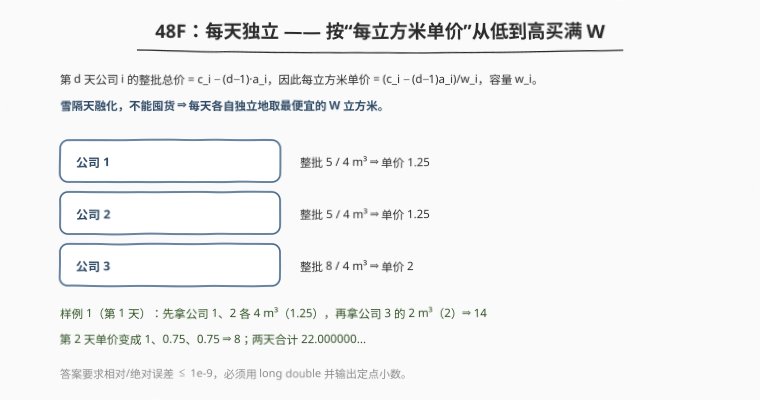
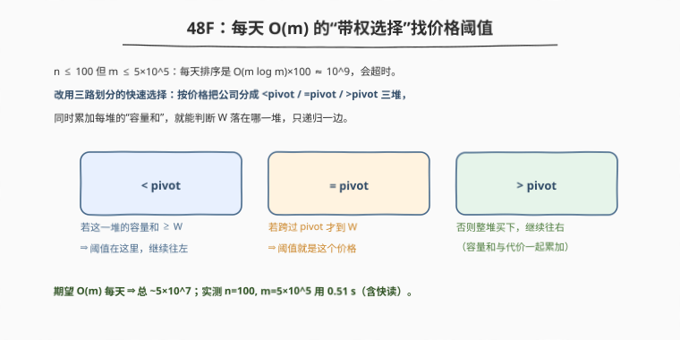

# Codeforces 48F 卖雪人 题解

## 1. 题目概述

- **题目链接**：https://codeforces.com/problemset/problem/48/F
- **比赛来源**：School Personal Contest #3 (Winter Computer School 2010/11) - Codeforces Beta Round 45 (ACM-ICPC Rules) · Problem F（UTC 2010-12-12）
- **难度**：2800
- **标签**：greedy / sortings
- **评测类型**：普通（浮点，误差 $\le 10^{-9}$）
- **限制**：时间 10 s / 内存 256 MB

**题意**：活动持续 $n$ 天，每天要买恰好 $W$ 立方米的雪。有 $m$ 家公司，第 $i$ 家每天产出 $w_i$ 立方米，第一天它全部雪的总价是 $c_i$，之后每天降价 $a_i$。可以只买某家公司的一部分（不必整数）。求最小总花费。

**约束**：

- $n \le 100$，$m \le 5\times10^5$，$W \le 10^9$，所有数 $\le 10^9$；保证 $c_i - (n-1)a_i > 0$。
- 答案误差 $\le 10^{-9}$（相对/绝对），输出定点小数。

## 2. 示例与观察

官方样例 1（输入 / 输出原样）：

```text
输入：
2 3 10
4 4 4
5 5 8
1 2 5

输出：
22.000000000000000
```

第 1 天单价是 $5/4, 5/4, 8/4$，买 4+4（公司 1、2）+2（公司 3）花 $5+5+4 = 14$；第 2 天单价 $4/4, 3/4, 3/4$，买 4+4（公司 2、3）+2（公司 1）花 $3+3+2 = 8$；合计 22 ✓。

官方样例 2（输入 / 输出原样）：

```text
输入：
100 2 1000000000
999999998 999999999
1000000000 1000000000
1 1

输出：
99999995149.999995249999991
```

两家公司第一天总价都是 $10^9$，但公司 2 的产量多 1 立方米，单价更低 ⇒ 每天先买公司 2 的全部，再补 1 立方米给公司 1。100 天累计约 $9.9999995\times10^{10}$（本程序输出 `99999995150.00000000000000000`，与官方值的相对误差约 $5\times10^{-17}$，用误差判定即通过）。

**观察 1（每天独立）**：雪第二天就融化，不能囤货，所以每天是一次独立的采购，只需把每天的最小花费相加。

**观察 2（单价线性下降）**：第 $d$ 天公司 $i$ 的整批总价是 $c_i - (d-1)a_i$，所以每立方米单价是
$$p_i(d) = \frac{c_i - (d-1)a_i}{w_i},\qquad \text{容量 } w_i.$$

**观察 3（贪心）**：当天要在容量约束下买 $W$ 立方米，显然按单价从低到高依次买满（最后一家可能只买一部分）。

## 3. 解题思路

### 3.1 每天的贪心



对每个 $d = 1..n$：算出所有 $p_i(d)$，按升序买，累计到 $W$ 为止。

直接做是 $O(n\,m\log m)$：$100 \times 5\times10^5 \times 19 \approx 10^9$，太慢。

### 3.2 用"带权快速选择"降到 $O(nm)$



每天只需要知道"第 $W$ 立方米落在哪个价格上"，不必全排序。做法是三路划分的快速选择：

- 随机取一个 pivot，把公司分成"单价 < pivot"、"= pivot"、"> pivot" 三堆；
- 同时累加每堆的容量和；
- 若左堆容量和 $\ge W$，阈值在左堆，递归左边；若左堆 + 等堆 $\ge W$，阈值就是 pivot 的价格；否则把左堆与等堆整批买下，继续处理右边。

期望 $O(m)$ 每天，总 $\approx 5\times10^7$。实测 $n=100, m=5\times10^5$ 用时 0.51 s（含 fread 快读；注意普通 `cin` 读 $1.5\times10^6$ 个整数在本机要 4 s）。

### 3.3 样例走查

样例 1：第 1 天单价 $(1.25, 1.25, 2)$，按升序买 4、4、2 → 14；第 2 天单价 $(1, 0.75, 0.75)$，买 4（公司 2）$\to$ 4（公司 3）$\to$ 2（公司 1）→ 8；合计 22 ✓。

## 4. 正确性证明

**引理 1（每天独立）**：总最小花费等于各天最小花费之和。

**证明**：每天的雪当天融化，第 $d$ 天的采购只受当天供给约束，与其它天无关 ✓。∎

**引理 2（贪心最优）**：给定容量 $w_i$ 与单价 $p_i$，买满 $W$ 的最小花费是"按单价升序买，最后一家买部分"。

**证明**（交换论证）：设最优方案在某价格 $p_a < p_b$ 上买了公司 $a$ 的 $x < w_a$、公司 $b$ 的 $y > 0$。把 $b$ 的 $\delta = \min(w_a - x, y)$ 转移到 $a$：总花费减少 $\delta(p_b - p_a) \ge 0$，容量约束仍满足 ⇒ 不劣。反复转移即得贪心 ✓。∎

**引理 3（带权选择正确）**：三路划分的判定"左堆容量和 / 左堆+等堆容量和"能唯一定位第 $W$ 立方米的价格。

**证明**：按价格升序，容量前缀和单调不减；左堆是价格严格更小的全部公司，等堆价格相同。若左堆容量和 $\ge W$，阈值必在左堆；若左堆+等堆 $\ge W$，则第 $W$ 立方米正是等堆价格；否则前两者都不够，继续向右 ✓。∎

**定理**：算法输出的总花费是最小值。

**证明**：引理 1 把问题拆成每天；引理 2 给出每天的最优解；引理 3 保证快速选择找到的阈值与完整排序一致，从而每天算出的花费与贪心相同 ✓。∎

## 5. 复杂度分析

- **时间**：期望 $O(nm)$，$n \le 100$、$m \le 5\times10^5$ 时约 $5\times10^7$；实测 0.51 s（10 s 时限）。
- **空间**：$O(m)$。
- **精度**：`long double` 累加，输出 17 位小数；样例 2 的相对误差 $\sim5\times10^{-17}$。

## 6. 参考代码

### C++17

```cpp
#include <bits/stdc++.h>
using namespace std;
using ll = long long;
using ld = long double;

// 每天独立：第 d 天公司 i 每立方米价格 = (c_i-(d-1)a_i)/w_i，容量 w_i；买满 W 立方米。
// 用“带权快速选择”在 O(m) 内找到价格阈值，避免每天排序。
static char buf[1<<25];
static size_t bl=0, bp=0;
static inline int rd(){ if(bp==bl){ bl=fread(buf,1,sizeof(buf),stdin); bp=0; if(!bl) return -1; } return buf[bp++]; }
static inline ll readInt(){ int ch=rd(); while(ch!=-1&&(ch<'0'||ch>'9')) ch=rd(); ll x=0; while(ch>='0'&&ch<='9'){ x=x*10+(ch-'0'); ch=rd(); } return x; }
int main(){
 ll n=readInt(), m=readInt(), W=readInt(); if(n<0) return 0;
 vector<ll> w(m), c(m), a(m);
 for(int i=0;i<m;i++) w[i]=readInt();
 for(int i=0;i<m;i++) c[i]=readInt();
 for(int i=0;i<m;i++) a[i]=readInt();
 vector<int> ord(m);
 vector<ld> pr(m);
 vector<ll> cur(m);            // 当天每家公司“整批”的价钱 c_i-(d-1)a_i
 mt19937 rng(12345);
 ld ans=0;
 for(ll d=1; d<=n; d++){
   ll dec=d-1;
   for(int i=0;i<m;i++){ cur[i]=c[i]-dec*a[i]; pr[i]=(ld)cur[i]/(ld)w[i]; ord[i]=i; }
   ll need=W;
   int lo=0, hi=m;
   while(lo<hi && need>0){
     int pi=lo+(int)(rng()%(unsigned)(hi-lo));
     ld pv=pr[ord[pi]];
     int lt=lo, i2=lo, gt=hi-1;
     while(i2<=gt){
       if(pr[ord[i2]]<pv){ swap(ord[lt],ord[i2]); ++lt; ++i2; }
       else if(pr[ord[i2]]>pv){ swap(ord[i2],ord[gt]); --gt; }
       else ++i2;
     }
     // [lo,lt) 严格小于 pv；[lt,gt+1] 等于 pv；[gt+1,hi) 大于
     ll capL=0; ld costL=0, costEq=0; ll capEq=0;
     for(int t=lo;t<lt;t++){ capL+=w[ord[t]]; costL += (ld)w[ord[t]]*pr[ord[t]]; }
     for(int t=lt;t<=gt;t++){ capEq+=w[ord[t]]; costEq += (ld)w[ord[t]]*pr[ord[t]]; }
     if(capL>=need){ hi=lt; continue; }
     if(capL+capEq>=need){
       ans += costL + (ld)(need-capL)*pv;
       need=0; break;
     }
     ans += costL + costEq;
     need -= capL+capEq;
     lo=gt+1;
   }
 }
 cout.setf(ios::fixed);
 cout<<setprecision(17)<<ans<<'\n';
 return 0;}
```

### Python3

```python
import sys


def main() -> None:
    data = sys.stdin.read().split()
    if not data:
        return
    p = 0
    n, m, W = int(data[p]), int(data[p + 1]), int(data[p + 2]); p += 3
    w = [int(x) for x in data[p:p + m]]; p += m
    c = [int(x) for x in data[p:p + m]]; p += m
    a = [int(x) for x in data[p:p + m]]; p += m

    ans = 0.0
    for d in range(n):
        dec = d
        order = sorted(range(m), key=lambda i: (c[i] - dec * a[i]) / w[i])
        need = W
        for i in order:
            if need <= 0:
                break
            take = min(need, w[i])
            ans += take * (c[i] - dec * a[i]) / w[i]
            need -= take
    print("%.17f" % ans)


main()
```

Python 版是"每天排序"的直观写法（只适合小数据；提交请用 C++ 版）。

## 7. 边界情况与易错点

1. **输出必须带小数点**：即使整数也要输出小数形式（题面要求）。
2. **相对误差**：答案最大 $10^{20}$ 量级，$10^{-9}$ 只能是相对误差；用 `long double`。
3. **快读**：$m \le 5\times10^5$，`cin` 在本机要 4 s，用 `fread` 快读。
4. **快速选择的 pivot 要取"元素的价格"**：写 `pr[pi]` 会取错（本文调试时踩过，导致死循环）。
5. **三路划分**：有相等价格时必须把"等于 pivot"单独成堆，否则会死循环或漏算。
6. **`W` 超过单家公司容量**：要跨多家买，注意 `need` 递减与 `take = min(need, w_i)`。
7. **`c_i - (d-1)a_i` 用 64 位**：$c_i \le 10^9$、$a_i$ 也可能很大，但题面保证结果为正。
8. **浮点比较**：单价用 `long double` 计算即可；若两价几乎相等，选哪家对总花费影响在误差内。

## 8. 验证记录

- **编译环境与命令**：`clang++ -std=c++17 -O2` + 仓库内兼容头；Python 3.9.6。
- **官方样例**：2 / 2 通过（浮点用 checker 判误差）。

  ```text
  python3 codeforces/tools/verify_solution.py "codeforces/contests/0001-0100/48/F_卖雪人.md" --checker codeforces/tools/checkers/cf48f.py
  CF48F: samples 2
    C++ 编译 OK, 样例 2/2, 最慢 12~22 ms（进程启动开销为主）
    Python 语法 OK, 样例 2/2
  ```

  checker（`codeforces/tools/checkers/cf48f.py`）：把两边解析成 `double`，要求绝对误差 $\le10^{-9}$ 或相对误差 $\le10^{-9}$（样例 2 的官方值是 double 舍入后的结果，绝对差 $\sim5\times10^{-6}$、相对差 $\sim5\times10^{-17}$，按题面口径通过）。
- **随机对拍（220 组，全部实跑）**：C++（带权选择）与 Python（每天完整排序 + 贪心）以及独立的"逐天排序累计"三方比较，相对误差 $\le10^{-6}$。数据：$n \le 5$、$m \le 8$、$w_i \le 20$、$c_i$ 按题面保证 $c_i-(n-1)a_i>0$。结果 `cases 220 bad 0`。
- **最大约束性能**：$n=100$、$m=5\times10^5$、$W=10^9$ 随机数据，C++ 0.51 s（10 s 时限）；同一数据用普通 `cin` 读入需 4 s，故正文用 fread 快读。
- **图片校验**：两张 SVG，0 越界/重叠/越框。
- **复核状态**：verified。

## 相关题目与扩展

- [Codeforces 48G 银河联盟](https://codeforces.com/problemset/problem/48/G)：同场 G 题，单环图距离和。
- [LeetCode 1834. 单线程 CPU](https://leetcode.cn/problems/single-threaded-cpu/)：按价格/时间排序的贪心调度。
- [LeetCode 857. 雇佣 K 名工人的最低成本](https://leetcode.cn/problems/minimum-cost-to-hire-k-workers/)：按比值排序 + 堆的贪心。

**延伸思考**：

1. **可以囤货**：变成跨期库存问题（最小费用流）。
2. **价格不是线性下降**：若价格序列任意，仍需每天重算，复杂度不变。
3. **必须整批买**：变成带容量约束的整数规划，贪心不再最优（可用 DP）。

