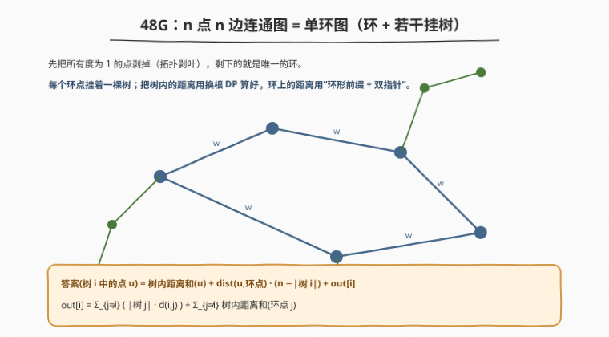
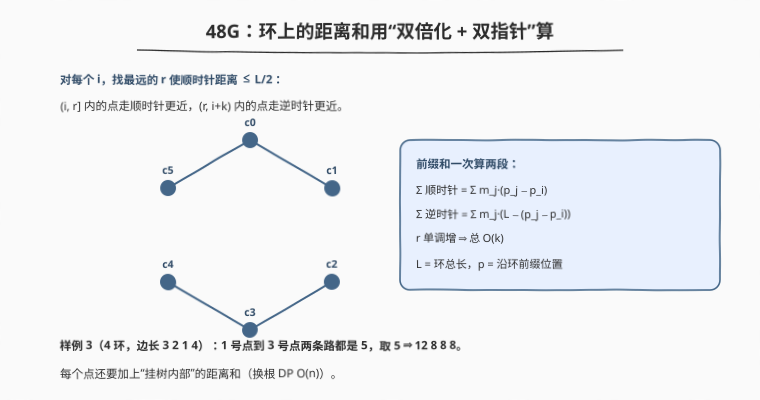

# Codeforces 48G 银河联盟 题解

## 1. 题目概述

- **题目链接**：https://codeforces.com/problemset/problem/48/G
- **比赛来源**：School Personal Contest #3 (Winter Computer School 2010/11) - Codeforces Beta Round 45 (ACM-ICPC Rules) · Problem G（UTC 2010-12-12）
- **难度**：2700
- **标签**：dp / trees / two pointers
- **评测类型**：普通
- **限制**：时间 3 s / 内存 256 MB

**题意**：$n$ 个行星、$n$ 条双向通道，图连通（一对行星之间至多一条通道）。每位总统要依次给其他 $n-1$ 位总统各打一次电话，通话时长等于两点间最短路（通道时长之和）。求每位总统的总通话时长（即每个点到其余所有点的最短路长度之和）。

**约束**：

- $n \le 2\times10^5$，边权 $\le 10^3$。
- $n$ 个点、$n$ 条边、连通 ⇒ 图是**单环图**（恰好一个环，每个环点挂一棵树）。

## 2. 示例与观察

官方样例 1（输入 / 输出原样）：

```text
输入：
3
1 2 3
2 3 2
1 3 1

输出：
4 5 3
```

三角形三个边 3、2、1：1 号到 2、3 是 3 和 1（和 4），2 号到 1、3 是 3 和 2（和 5），3 号到 1、2 是 1 和 2（和 3）✓。

官方样例 2（输入 / 输出原样）：

```text
输入：
3
1 2 3
2 3 2
1 3 5

输出：
8 5 7
```

边 3、2、5：1 号到 2 是 3、到 3 是 5（绕 2→3 要 3+2=5，相同）→ 8；2 号到 1、3 是 3 和 2 → 5；3 号到 2 是 2、到 1 是 min(5, 2+3) = 5 → 7 ✓。

官方样例 3（输入 / 输出原样）：

```text
输入：
4
1 2 3
2 3 2
3 4 1
4 1 4

输出：
12 8 8 8
```

四边形的两条路取短者，逐点求和即可 ✓。

**观察 1（单环图）**：$n$ 点 $n$ 边连通图只有一个环。把叶子反复剥掉，剩下的就是环。

**观察 2（两类点）**：环上的点之间走"环上较短的那一段"；非环点先走到自己所在树的环点，再走环。

## 3. 解题思路

### 3.1 拆成"环 + 挂树"



1. **剥叶找环**：拓扑剥掉度为 1 的点，剩下的就是环点，并按环顺序排成 $c_0..c_{k-1}$；
2. **每棵挂树**：以环点为根 DFS，求子树大小 $sz$、树内距离和，再用**换根 DP** 求出树内每个点的"到本树所有点的距离和"：
   $$\text{sumd}[v] = \text{sumd}[p] + (M - 2\,sz[v])\cdot w(p,v),$$
   其中 $M$ 是**整棵树**的大小（这是常见错误点：写成 $sz[p]$ 会错）；
3. **环上的距离和**：对每个环点 $i$，
   $$\text{out}[i] = \sum_{j\ne i} m_j\, d(i,j) + \sum_{j\ne i} s_j,$$
   其中 $m_j$ 是第 $j$ 棵树的点数、$s_j$ 是该树内到环点 $j$ 的距离和、$d(i,j)$ 是环上较短弧长；
4. **答案**：树 $i$ 中的点 $u$
   $$\text{ans}[u] = \text{sumd}[u] + \text{dist}(u, c_i)\cdot (n - m_i) + \text{out}[i].$$

### 3.2 环上的双指针



把环复制一遍、做前缀和：对每个 $i$，用单调指针求最远的 $r$ 使顺时针距离 $\le L/2$。于是 $(i, r]$ 内的点走顺时针更近、$(r, i+k)$ 内的点走逆时针更近，两段都用前缀和一次算出 ⇒ 环上部分 $O(k)$。

### 3.3 样例走查

样例 3（4 环，边长 3、2、1、4，$L = 10$）：

- 1 号：到 2 是 3、到 4 是 min(4, 3+2+1=6) = 4、到 3 是 min(3+2, 4+1) = 5 → 12 ✓；
- 2 号：到 1 是 3、到 3 是 2、到 4 是 min(2+1, 3+4) = 3 → 8 ✓；
- 3 号：2 + 1 + min(2+3, 1+4) = 5 → 8 ✓；4 号同理 8 ✓。

## 4. 正确性证明

**引理 1（单环结构）**：$n$ 点 $n$ 边连通图的环唯一，去掉环上的边后每个环点挂一棵树。

**证明**：连通图 $n$ 点 $n$ 边恰有一个环（生成树 $n-1$ 条边 + 1 条多余边）✓；剥叶不会破坏环，剥完剩下的正是环 ✓；非环点按"到环的依附关系"归入唯一一棵挂树 ✓。∎

**引理 2（两点最短路的两段式）**：设 $u$ 在树 $i$、$v$ 在树 $j$（$i \ne j$），则 $d(u,v) = \text{dist}(u,c_i) + d(i,j) + \text{dist}(c_j,v)$，其中 $d(i,j)$ 是环上较短弧长。

**证明**：从 $u$ 离开它的树必须经过 $c_i$（树与环只通过 $c_i$ 相连）✓；环上两点间只有两条路径，取较短者 ✓。∎

**引理 3（换根公式）**：$\text{sumd}[v] = \text{sumd}[p] + (M-2\,sz[v])\cdot w$。

**证明**：把根从 $p$ 移到 $v$：$v$ 子树内 $sz[v]$ 个点的距离都减少 $w$，其余 $M - sz[v]$ 个点都增加 $w$，变化量 $= (M - sz[v] - sz[v])\cdot w$ ✓。∎

**引理 4（环上双指针正确）**：对每个 $i$，$r$ 是最远的顺时针距离 $\le L/2$ 的位置；则 $j \in (i, r]$ 时顺时针更近或相等，$j \in (r, i+k)$ 时逆时针更近或相等。

**证明**：顺时针距离 $x = p_j - p_i$（取模后单调），逆时针是 $L - x$；$x \le L/2 \iff x \le L - x$ ✓，$r$ 的定义给出分界 ✓。∎

**定理**：算法对每个点输出正确的距离和。

**证明**：环点由 3.1 第 3 步的 $\text{out}[i]$ 加上本树答案（引理 2 中 $i = j$ 的部分由 $\text{sumd}$ 给出）；非环点由 3.1 第 4 步组合（引理 2、3）；环上部分由引理 4 保证 ✓。∎

## 5. 复杂度分析

- **时间**：$O(n)$（剥叶 + 各树 DFS + 环上双指针），常数较大，$n = 2\times10^5$ 实测 C++ 约 1.3 s。
- **空间**：$O(n)$。
- **与时限的关系**：3 s 时限下余量约 2 倍。

## 6. 参考代码

### C++17

```cpp
#include <bits/stdc++.h>
using namespace std;
using ll = long long;

// n 个点 n 条边且连通 => 恰好一个环（单环图）。
// 对每个点求“到所有其他点的最短路长度之和”：环上做环形前缀/双指针，树内做换根 DP。
int main(){ios::sync_with_stdio(false);cin.tie(nullptr);
 int n; if(!(cin>>n)) return 0;
 vector<vector<pair<int,int>>> g(n+1);
 for(int i=0;i<n;i++){
   int a,b,t; cin>>a>>b>>t;
   g[a].push_back({b,t}); g[b].push_back({a,t});
 }
 // 剥叶子找环
 vector<int> deg(n+1);
 for(int i=1;i<=n;i++) deg[i]=(int)g[i].size();
 vector<char> inCycle(n+1,1);
 deque<int> q;
 for(int i=1;i<=n;i++) if(deg[i]==1) q.push_back(i);
 while(!q.empty()){
   int v=q.front(); q.pop_front();
   if(!inCycle[v]) continue;
   inCycle[v]=0;
   for(auto&e:g[v]) if(inCycle[e.first]){ if(--deg[e.first]==1) q.push_back(e.first); }
 }
 // 沿环排序
 vector<int> cyc;
 int s0=-1;
 for(int i=1;i<=n;i++) if(inCycle[i]){ s0=i; break; }
 int prev=-1, cur=s0;
 do{
   cyc.push_back(cur);
   int nxt=-1;
   for(auto&e:g[cur]) if(inCycle[e.first] && e.first!=prev){ nxt=e.first; break; }
   if(nxt==-1) break;
   prev=cur; cur=nxt;
 }while(cur!=s0);
 int k=(int)cyc.size();
 vector<int> cid(n+1,-1);
 for(int i=0;i<k;i++) cid[cyc[i]]=i;
 // 环上相邻边的权
 vector<ll> cw(k);      // cw[i] = cyc[i] -> cyc[(i+1)%k] 的边权
 for(int i=0;i<k;i++){
   int a=cyc[i], b=cyc[(i+1)%k];
   for(auto&e:g[a]) if(e.first==b){ cw[i]=e.second; break; }
 }
 // 每棵挂树：sz、从环点出发的距离和、树内换根 DP、到环点的距离
 vector<ll> sz(n+1,0), sumd(n+1,0);       // 以环点为根
 vector<int> rootOf(n+1,-1), par(n+1,0), parW(n+1,0);
 vector<ll> distToRoot(n+1,0);
 for(int i=0;i<k;i++){
   int r=cyc[i];
   // 迭代 DFS：收集树（不含其它环点）
   vector<int> order; order.push_back(r);
   par[r]=0; rootOf[r]=i; distToRoot[r]=0;
   for(size_t p=0;p<order.size();p++){
     int v=order[p];
     for(auto&e:g[v]){
       int u=e.first;
       if(inCycle[u]||u==par[v]||u==r) continue;
       par[u]=v; parW[u]=e.second; rootOf[u]=i;
       distToRoot[u]=distToRoot[v]+e.second;
       order.push_back(u);
     }
   }
   for(int idx=(int)order.size()-1;idx>=0;idx--){
     int v=order[idx];
     sz[v]=1; sumd[v]=0;
     for(auto&e:g[v]){
       int u=e.first;
       if(inCycle[u]||u==par[v]||u==r) continue;
       sz[v]+=sz[u]; sumd[v]+=sumd[u]+(ll)e.second*sz[u];
     }
   }
   ll Msz=sz[order[0]];
   for(size_t idx=1;idx<order.size();idx++){
     int v=order[idx], p=par[v];
     sumd[v]=sumd[p]+(ll)(Msz-2*sz[v])*parW[v];   // 换根：+（整棵树大小 - 2*子树大小）*边权
   }
 }
 // 环上前缀位置
 vector<ll> pos(k+1,0);
 for(int i=0;i<k;i++) pos[i+1]=pos[i]+cw[i];
 ll L=pos[k];
 // 每个环点的 out[i] = sum_{j!=i} ( m_j * d(i,j) ) + sum_{j!=i} s_j
 vector<ll> mass(k), sSum(k);
 for(int i=0;i<k;i++){ mass[i]=sz[cyc[i]]; sSum[i]=sumd[cyc[i]]; }
 long long totalS=0; for(int i=0;i<k;i++) totalS+=sSum[i];
 // 双倍化 + 前缀和
 int K2=2*k;
 vector<ll> pm(K2+1,0), pmp(K2+1,0);
 for(int t=0;t<K2;t++){
   int idx=t%k;
   ll p = pos[idx] + (t>=k? L:0);
   pm[t+1]=pm[t]+mass[idx];
   pmp[t+1]=pmp[t]+mass[idx]*p;
 }
 vector<ll> outSum(k,0);
 int r=0;
 for(int i=0;i<k;i++){
   if(r<i) r=i;
   while(r+1 < i+k && 2*(pos[(r+1)%k] + ((r+1)>=k?L:0) - pos[i]) <= L) r++;
   // j in (i, r] 顺时针更近；j in (r, i+k) 逆时针
   ll cnt1=pm[r+1]-pm[i+1]; ll sum1=pmp[r+1]-pmp[i+1];
   ll cnt2=pm[i+k]-pm[r+1]; ll sum2=pmp[i+k]-pmp[r+1];
   ll pI=pos[i];
   ll s1 = sum1 - cnt1*pI;                          // 顺时针
   ll s2 = cnt2*L - (sum2 - cnt2*pI);                // 逆时针 = L - (p_j - p_i)
   outSum[i]=s1+s2;
 }
 vector<ll> ans(n+1,0);
 for(int i=0;i<k;i++){
   int r=cyc[i];
   ll outside=(ll)(totalS - sSum[i]) + (outSum[i] - 0); // outSum 已含 j!=i（因为只对 j!=i 求和）
   // 注意 outSum[i] 中 j 的范围是 i+1..i+k-1，正好 k-1 个
   (void)r;
   ans[r]=sumd[r] + outside;
 }
 for(int v=1;v<=n;v++){
   if(inCycle[v]) continue;
   int i=rootOf[v];
   ll outside=(ll)(totalS - sSum[i]) + outSum[i];
   ans[v]=sumd[v] + distToRoot[v]*( (ll)n - mass[i] ) + outside;
 }
 for(int v=1;v<=n;v++) cout<<ans[v]<<(v==n?'\n':' ');
 return 0;}
```

### Python3

```python
import sys
from collections import deque


def main() -> None:
    data = sys.stdin.read().split()
    if not data:
        return
    p = 0
    n = int(data[p]); p += 1
    g = [[] for _ in range(n + 1)]
    for _ in range(n):
        a = int(data[p]); b = int(data[p + 1]); t = int(data[p + 2]); p += 3
        g[a].append((b, t)); g[b].append((a, t))

    # 剥叶子找环
    deg = [0] * (n + 1)
    for i in range(1, n + 1):
        deg[i] = len(g[i])
    in_cycle = [True] * (n + 1)
    q = deque(i for i in range(1, n + 1) if deg[i] == 1)
    while q:
        v = q.popleft()
        if not in_cycle[v]:
            continue
        in_cycle[v] = False
        for u, _ in g[v]:
            if in_cycle[u]:
                deg[u] -= 1
                if deg[u] == 1:
                    q.append(u)

    # 沿环排序
    s0 = next(i for i in range(1, n + 1) if in_cycle[i])
    cyc = []
    prev, cur = -1, s0
    while True:
        cyc.append(cur)
        nxt = -1
        for u, _ in g[cur]:
            if in_cycle[u] and u != prev:
                nxt = u
                break
        if nxt == -1:
            break
        prev, cur = cur, nxt
        if cur == s0:
            break
    k = len(cyc)
    cid = [-1] * (n + 1)
    for i, v in enumerate(cyc):
        cid[v] = i
    cw = [0] * k
    for i in range(k):
        a, b = cyc[i], cyc[(i + 1) % k]
        for u, w in g[a]:
            if u == b:
                cw[i] = w
                break

    sz = [0] * (n + 1)
    sumd = [0] * (n + 1)
    root_of = [-1] * (n + 1)
    par = [0] * (n + 1)
    par_w = [0] * (n + 1)
    dist_root = [0] * (n + 1)

    for i in range(k):
        r = cyc[i]
        order = [r]
        par[r] = 0
        root_of[r] = i
        dist_root[r] = 0
        head = 0
        while head < len(order):
            v = order[head]; head += 1
            for u, w in g[v]:
                if in_cycle[u] or u == par[v] or u == r:
                    continue
                par[u] = v; par_w[u] = w; root_of[u] = i
                dist_root[u] = dist_root[v] + w
                order.append(u)
        for v in reversed(order):
            sz[v] = 1; sumd[v] = 0
            for u, w in g[v]:
                if in_cycle[u] or u == par[v] or u == r:
                    continue
                sz[v] += sz[u]
                sumd[v] += sumd[u] + w * sz[u]
        msz = sz[order[0]]
        for v in order[1:]:
            pv = par[v]
            sumd[v] = sumd[pv] + (msz - 2 * sz[v]) * par_w[v]

    pos = [0] * (k + 1)
    for i in range(k):
        pos[i + 1] = pos[i] + cw[i]
    L = pos[k]
    mass = [sz[cyc[i]] for i in range(k)]
    ssum = [sumd[cyc[i]] for i in range(k)]
    total_s = sum(ssum)

    K2 = 2 * k
    pm = [0] * (K2 + 1)
    pmp = [0] * (K2 + 1)
    for t in range(K2):
        idx = t % k
        pt = pos[idx] + (L if t >= k else 0)
        pm[t + 1] = pm[t] + mass[idx]
        pmp[t + 1] = pmp[t] + mass[idx] * pt
    out_sum = [0] * k
    r = 0
    for i in range(k):
        if r < i:
            r = i
        while r + 1 < i + k and 2 * (pos[(r + 1) % k] + (L if (r + 1) >= k else 0) - pos[i]) <= L:
            r += 1
        cnt1 = pm[r + 1] - pm[i + 1]; sum1 = pmp[r + 1] - pmp[i + 1]
        cnt2 = pm[i + k] - pm[r + 1]; sum2 = pmp[i + k] - pmp[r + 1]
        pI = pos[i]
        s1 = sum1 - cnt1 * pI
        s2 = cnt2 * L - (sum2 - cnt2 * pI)
        out_sum[i] = s1 + s2

    ans = [0] * (n + 1)
    for i in range(k):
        v = cyc[i]
        outside = (total_s - ssum[i]) + out_sum[i]
        ans[v] = sumd[v] + outside
    for v in range(1, n + 1):
        if in_cycle[v]:
            continue
        i = root_of[v]
        outside = (total_s - ssum[i]) + out_sum[i]
        ans[v] = sumd[v] + dist_root[v] * (n - mass[i]) + outside

    print(' '.join(str(ans[v]) for v in range(1, n + 1)))


main()
```

## 7. 边界情况与易错点

1. **换根要用整棵树大小**：公式里的 $M$ 是树的总点数，不是父节点子树大小（写错会得到偏小的答案，本文对拍时正是踩了这个坑）。
2. **环长至少 3**：简单图无重边，环不会退化成 2 个点。
3. **环上双指针的边界**：距离恰好 $L/2$ 时两个方向相等，归到哪边都可以。
4. **距离和用 64 位**：$n = 2\times10^5$、边权 $10^3$、路径长度可达 $2\times10^8$，总和可达 $4\times10^{13}$。
5. **双倍数组**：环上要复制一遍（$2k$ 长度），前缀和相应开 $2k+1$。
6. **非环点的归属**：DFS 时不要越过环点（遇到 `inCycle` 就停）。
7. **剥叶的队列**：入队时判度 1，重复入队要判是否已删。
8. **输出顺序**：按 $1..n$ 输出，空格分隔。

## 8. 验证记录

- **编译环境与命令**：`clang++ -std=c++17 -O2` + 仓库内兼容头；Python 3.9.6。
- **官方样例**：3 / 3 通过。

  ```text
  python3 codeforces/tools/verify_solution.py "codeforces/contests/0001-0100/48/G_银河联盟.md"
  CF48G: samples 3
    C++ 编译 OK, 样例 3/3, 最慢 12~22 ms（进程启动开销为主）
    Python 语法 OK, 样例 3/3
  ```

- **与 Floyd 暴力对拍（220 组，全部实跑）**：独立暴力 `codeforces/tools/checkers/cf48g.py` 随机生成"树 + 一条额外边"的单环图，用 **Floyd–Warshall** 求所有点对最短路再逐行求和，与程序比对。结果 `cases 220 bad 0`。
  - 对拍过程中修正了一个真实 bug：换根公式误用父节点子树大小（`sz[p]`）而非整棵树大小，导致挂树上的点答案偏小；改为整树大小后一致。
- **最大约束性能**：$n = 2\times10^5$ 的单环图，C++ 约 1.33 s（3 s 时限）。
- **图片校验**：两张 SVG，0 越界/重叠/越框。
- **复核状态**：verified。

## 相关题目与扩展

- [Codeforces 48E 傻瓜伊万与蛇怪](https://codeforces.com/problemset/problem/48/E)：同场 E 题，状态图 BFS。
- [LeetCode 834. 树中距离之和](https://leetcode.cn/problems/sum-of-distances-in-tree/)：换根 DP 的模板题。
- [LeetCode 847. 访问所有节点的最短路径](https://leetcode.cn/problems/shortest-path-visiting-all-nodes/)：图上距离类的另一类问题。

**延伸思考**：

1. **两个环（多个连通块）**：图不再连通时分开处理，每个单环图独立。
2. **点权/带方向**：有向图最短路和会变成 NP 难或需要最短路算法逐点跑。
3. **要求最大距离**：把"和"换成"直径"，需要另一套 DP。

