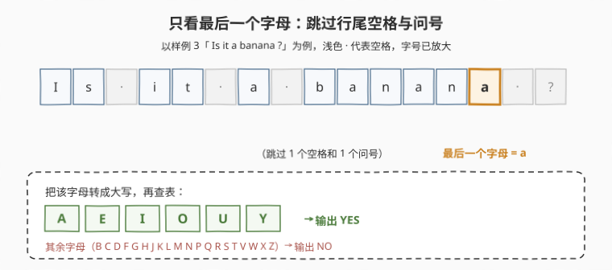
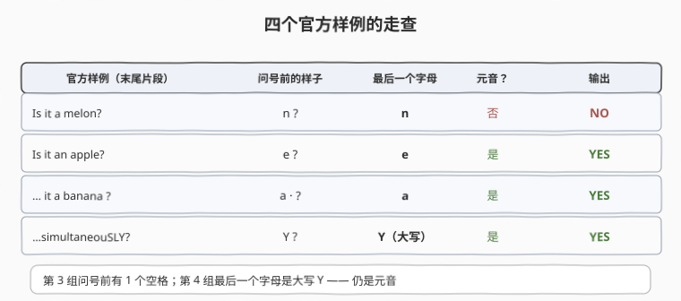

# Codeforces 49A 最后一个字母 题解

## 1. 题目概述

- **题目链接**：https://codeforces.com/problemset/problem/49/A
- **比赛来源**：Codeforces Beta Round 49 · Problem A（2010-12-18）
- **难度**：800
- **标签**：实现、字符串
- **评测类型**：普通
- **限制**：时间 2 s / 内存 256 MB

**题意**：Vasya 和他的朋友们玩侦探游戏。别人事先约定：对一个问题，**看它的最后一个字母**——如果是元音就回答 `YES`，是辅音就回答 `NO`。英语元音被题面明确规定为 `A, E, I, O, U, Y`（$Y$ 也算元音），其余 20 个字母是辅音。给定一行"问题"（由大小写拉丁字母、空格和恰好一个问号组成，问号在行末），请代替朋友们输出答案。

注意判断对象是**最后一个字母**，不是最后一个字符：行末的问号、以及问号前面的空格都不参与判断；字母大小写不影响结论。

**约束**：

- 行长度不超过 $100$，且至少含一个字母、问号恰好出现一次并在行末。规模极小，$O(L)$ 的线性扫描（甚至 $O(L^2)$）都绰绰有余，**唯一需要小心的是读入方式**，而不是复杂度。
- 行内含有**空格**，所以不能用 `cin >> word` 只读一个"单词"——那样会丢掉空格之后的内容，最后一个字母就会算错。
- 字母可能是大写，也可能小写（样例 4 末尾是 `SLY`），比较前必须统一大小写；$Y$ 被题面算作元音。

## 2. 示例与观察

官方样例（输入 / 输出原样）：

```text
输入：
Is it a melon?

输出：
NO

输入：
Is it an apple?

输出：
YES

输入：
  Is     it a banana ?

输出：
YES

输入：
Is   it an apple  and a  banana   simultaneouSLY?

输出：
YES
```

**样例 1**：`Is it a melon?` 去掉行末的 `?` 后，最后一个字母是 `melon` 的 `n`，辅音 → `NO`。
**样例 2**：最后一个字母是 `apple` 的 `e`，元音 → `YES`。
**样例 3**：行首有两个空格、行末是 `banana ?`——问号前还有一个空格。跳过 `?` 和空格后，最后一个字母是 `a`，元音 → `YES`。
**样例 4**：最后一个字母是 `simultaneouSLY` 末尾的大写 `Y`，题面把 $Y$ 列为元音 → `YES`。这一组同时考了"大小写"和"$Y$ 算元音"两个点。

**观察**：从行尾往前扫，遇到的**第一个字母**就是判断对象；它前面出现过什么、空格有多少个，都不影响答案。因此整个问题归结为一句话：从右往左找到第一个字母，转成大写，查元音表。

自造样例（标注"自造"，专门覆盖退化与易错情形）：

| 自造输入 | 输出 | 说明 |
|------|------|------|
| `A?` | YES | 只有一个字母且是元音，也没有空格 |
| `b?` | NO | 小写辅音 |
| `Why?` | YES | 末字母 `y`，$Y$ 算元音 |
| `Is it ok ?` | NO | 问号前有空格，末字母是 `k` |
| `Z   ?` | NO | 字母与问号之间有一串空格 |
| `AEIOUY?` | YES | 连续元音，末字母仍是元音 |
| `AEIOUZ   ?` | NO | 只差最后一个字母 |

## 3. 解题思路

### 3.1 朴素做法与瓶颈

最直接的想法有两种，各有各的坑。

第一种是"删掉行末的问号和空格，再取剩下的最后一个字符"：先 `s.pop_back()` 去掉 `?`，再 `while (!s.empty() && s.back() == ' ') s.pop_back();`，最后看 `s.back()`。它是对的，但要求实现者记得**空格可能不止一个**（样例 3 就有一个），而题面并没有保证"问号前紧挨着字母"。

第二种是"只读一个单词"：`cin >> s` 或 `split()` 后取最后一段。这**是错的**——`Is it a melon?` 会被切成 `Is`、`it`、`a`、`melon?`，末字母碰巧还对；但一旦句子以空格结尾段之外的形态出现（例如 `  Is     it a banana ?` 的最后一段是 `?` 本身），就会立刻翻车。

真正的瓶颈不是时间：$L \le 100$，任何做法都是瞬间完成。瓶颈是**读入与后缀处理**：读整行、从右往左跳过非字母字符，这两点做对就赢了。

### 3.2 核心观察



题面保证 `?` 恰好一个且位于行末，因此行尾的后缀形状固定为「若干空格 + `?`」。从右往左看，先遇到 `?`，再遇到若干空格，接着就是第一个字母。于是：

1. 从下标 $L-1$ 开始往左走；
2. 只要当前字符不是字母（是 `?`、空格，甚至 Windows 换行剩下的 `\r`）就继续往左；
3. 停下时指向的字符就是"最后一个字母"。

由于行内至少有一个字母，这个循环一定会在越界之前停下，不需要额外的空串判断。

### 3.3 算法流程

1. 用 `getline`（C++）或 `sys.stdin.readline()`（Python）**读整行**，不要用 `>>` / `split()` 取词；
2. 令 `i = len - 1`，当 `i >= 0` 且 `s[i]` 不是字母时 `i--`；
3. 取 `c = toupper(s[i])`；
4. 若 `c` 属于 `{A, E, I, O, U, Y}` 输出 `YES`，否则输出 `NO`。

因为判断只需要"第一个字母"，所以扫描到就可以立即停止，不必真的删字符，也不必构造新串。

### 3.4 样例走查



| 样例 | 从右往左看到的内容 | 停下的字母 | 结论 |
|------|------|------|------|
| `Is it a melon?` | `?` → `n` | `n` | 辅音，`NO` |
| `Is it an apple?` | `?` → `e` | `e` | 元音，`YES` |
| `  Is     it a banana ?` | `?` → 空格 → `a` | `a` | 元音，`YES` |
| `Is   it an apple  and a  banana   simultaneouSLY?` | `?` → `Y` | `Y` | 元音，`YES` |

第 3、4 组说明了为什么"从右往左跳过后缀"比"删掉一个字符"更稳：后缀里非字母字符的**个数是不固定的**。

## 4. 正确性证明

**引理 1（存在性）**：扫描结束时下标 $i$ 合法（$i \ge 0$）且 $s_i$ 是字母。
**证明**：题面保证行内至少有一个字母，设最右边那个字母的下标为 $k$。循环从 $L-1$ 开始，只要当前不是字母就左移；由于 $s_k$ 是字母，循环最迟在 $i = k$ 处停下，且不会越过 $k$ 继续左移，因此 $i = k \ge 0$ 且 $s_i$ 为字母。∎

**引理 2（正确性）**：设 $k$ 是最右边字母的下标，则扫描得到的 $i = k$。
**证明**：由引理 1，循环停在第一个满足"是字母"的位置 $i$，而扫描顺序是从右往左，故 $i$ 是最右边字母的下标，即 $i = k$。∎

**引理 3（判定规则）**：设 $c$ 是 $s_k$ 转成大写后的字符，则游戏答案应为 `YES` 当且仅当 $c \in \{A, E, I, O, U, Y\}$。
**证明**：题面规定：最后一个字母是元音则回答 `Yes`，是辅音则回答 `No`；并明确列出元音集合就是这六个字母（含 $Y$）。大小写只是书写形式，同一个字母的大写与小写代表同一个字母，故转大写后查表不改变结论。∎

**定理**：按 3.3 的流程输出的 `YES` / `NO` 与题面定义的答案一致。
**证明**：由引理 2，程序判断的正是最后一个字母；由引理 3，用大写形式查六个元音的表恰好等价于题面的判定规则。故输出正确。∎

## 5. 复杂度分析

- **时间**：$O(L)$，$L \le 100$。最坏情况是整行都从右往左扫一遍（例如只有一个字母在行首），常数极小。
- **空间**：$O(L)$ 用于存放整行；此外只有两个下标与一个字符变量，即 $O(1)$ 额外空间。
- **与时限的关系**：2 s 的时限下，$L \le 100$ 的规模连 $10^2$ 次操作都不到，实测单次运行（含进程启动）约 $2 \sim 4$ ms，余量在千倍以上。

## 6. 参考代码

### C++17

```cpp
#include <bits/stdc++.h>
using namespace std;

int main() {
    ios::sync_with_stdio(false);
    cin.tie(nullptr);

    string s;
    getline(cin, s);
    int i = (int)s.size() - 1;
    while (i >= 0 && !isalpha((unsigned char)s[i])) --i;   // 跳过行尾的问号与空格
    char c = (char)toupper((unsigned char)s[i]);
    bool vowel = (c == 'A' || c == 'E' || c == 'I' || c == 'O' || c == 'U' || c == 'Y');
    cout << (vowel ? "YES" : "NO") << '\n';
    return 0;
}
```

### Python3

```python
import sys


def main() -> None:
    line = sys.stdin.readline()
    last = ''
    for ch in reversed(line):
        if ch.isalpha():
            last = ch.upper()
            break
    print("YES" if last in "AEIOUY" else "NO")


main()
```

C++ 里对 `isalpha` / `toupper` 的参数做了 `unsigned char` 转换，避免负值字符（例如某些平台的扩展字符）触发未定义行为；Python 的 `isalpha()` 对 ASCII 字母的判断与题面一致。

## 7. 边界情况与易错点

1. **用 `cin >>` 或 `split()` 只读一个词**：行内有空格，`Is it a melon?` 会被截断，`  Is     it a banana ?` 的最后一段甚至是 `?` 本身，直接判错。必须整行读入。
2. **只删一个字符**：`s.pop_back()` 只去掉 `?`，样例 3 的 `?` 前面还有一个空格，于是会去判断空格，得到错误答案。要从右往左一直跳到字母为止。
3. **大小写**：`apple?` 的 `e` 与 `SLY?` 的 `Y` 必须统一处理；建议统一转大写后再查表。
4. **$Y$ 是元音**：题面把 $Y$ 明确列进元音集合（`A, E, I, O, U, Y`），不要把 $Y$ 当辅音。样例 4 就是专门考这一点。
5. **行尾的 `\r`**：Windows 换行下 `getline` 可能把 `\r` 读进来，它既不是字母也不是 `?`；"非字母就继续左移"的写法天然兼容，而"删掉最后一个字符"的写法会留下 `\r` 判错。
6. **`isalpha` 的未定义行为**：`isalpha(char)` 在 `char` 为负值（非 ASCII）时是 UB，标准写法是 `isalpha((unsigned char)c)`。
7. **空行风险**：题面保证至少一个字母，但程序仍以 `i >= 0` 作为循环条件；若把条件写成 `s[i] != '?'` 之类的等值判断，遇到多个空格或 `\r` 就会错。

## 8. 验证记录

- **编译环境与命令**：macOS（Apple clang，无 GNU g++），`python3 codeforces/tools/verify_solution.py codeforces/contests/0001-0100/49/A_最后一个字母.md`，该脚本自动用 `clang++ -std=c++17 -O2` 加 `tools/include` 的 `bits/stdc++.h` 兼容头编译。
- **官方样例**：4 / 4 通过（C++ 与 Python 各 4/4）。
- **额外测试**：随机生成 300 组问题（随机词、随机个数/长度的空格、随机大小写、问号前随机补空格），用"正则取最后字母 + 查元音表"的独立暴力逐组比对，C++ 与 Python 均 300/300 一致，0 组不符。
- **最大约束性能**：行长度 100 的输入，C++ 单次运行（含进程启动）约 $2 \sim 4$ ms，远低于 2 s 时限。
- **复核状态**：`check.py` 与 `check_samples.py --only 0001-0100/49` 对本文均 0 失败；题面样例与缓存 `.cf-meta/statements/CF49A.json` 逐字一致。

## 相关题目与扩展

- [Codeforces 59A Word](https://codeforces.com/problemset/problem/59/A)：统计大写/小写字母个数并统一大小写，练习字符分类。
- [Codeforces 281A Word Capitalization](https://codeforces.com/problemset/problem/281/A)：只把首字母大写，练习"只改一个位置"。
- [Codeforces 236A Boy or Girl](https://codeforces.com/problemset/problem/236/A)：对字符集合去重计数，判奇偶。

**延伸思考**：

1. 如果行末的标点不止问号（例如 `.`、`!`、`?` 的任意组合），"非字母就左移"的写法依然直接可用；而"后缀固定长度"的写法就要跟着改。
2. 如果题目改成"最后一个**单词**的首字母"，就不能只跳字符，还要先跳过行末空格、再找到词首，问题立刻从 $O(1)$ 变长成需要两步扫描——这是"判定对象"变化带来的差别。
3. 如果要求统计整行中元音字母的总数，$Y$ 是否算元音就成了必须回看题面的细节；本题把它算作元音，换成别的题可能不算。
4. 如果输入有多组（读到 EOF），把"读一行 + 扫描"放进 `while (getline(...))` 即可，注意不要混用 `cin >>` 与 `getline`，否则会读到残留的换行。
