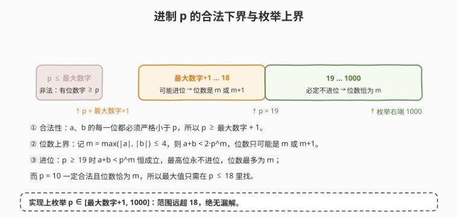
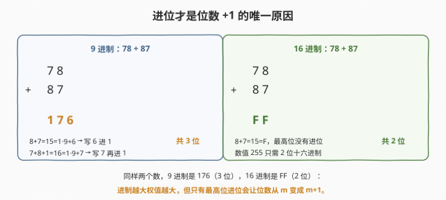
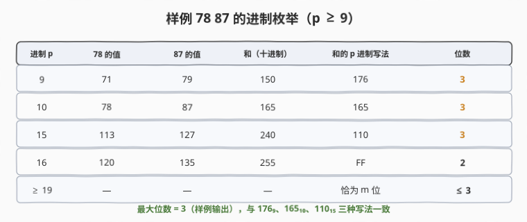

# Codeforces 49B 和的最大位数 题解

## 1. 题目概述

- **题目链接**：https://codeforces.com/problemset/problem/49/B
- **比赛来源**：Codeforces Beta Round 49 · Problem B（2010-12-18）
- **难度**：1500
- **标签**：数学、进制、枚举
- **评测类型**：普通
- **限制**：时间 2 s / 内存 256 MB

**题意**：笔记本上写着 `a+b=?`，但没有写进制。Vasya 可以任选一个进制 $p$，把 $a$ 和 $b$ 都当作 $p$ 进制数来读，只有当 $a$、$b$ 的**每一位数字都严格小于 $p$** 时这个进制才合法。对合法进制把两数相加，结果也写成 $p$ 进制，问结果的**位数（数字字符个数）**最大能是多少。例如 `78+87`：九进制是 $176_9$（3 位），十进制是 $165$（3 位），十五进制是 $110_{15}$（3 位），十六进制是 $FF_{16}$（2 位），八进制及以下非法，所以答案是 3。

**约束**：

- $1 \le a, b \le 1000$，即两个数写成十进制后**最多 4 位**，出现的数字最大是 9。于是 $p \ge 10$ 一定合法，$p$ 的下界是"两数中出现过的最大数字 $+1$"。
- $p$ 没有显式上界，但位数只有 $m$ 或 $m+1$（$m = \max(|a|, |b|)$）：$p$ 再大也不会无限增加位数，所以**有限枚举**是可行的，关键是说清枚举到哪为止。
- 位数只在"最高位进位"时才会 $+1$，因此答案只可能取 $m$ 或 $m+1$ 两个值；真正要判断的是"存不存在一个合法进制能产生进位"。

## 2. 示例与观察

官方样例（输入 / 输出原样）：

```text
输入：
78 87

输出：
3

输入：
1 1

输出：
2
```

**样例 1**：$78+87$ 中出现的最大数字是 8，所以最小合法进制是 9。逐个试：$78_9 + 87_9 = 71 + 79 = 150 = 176_9$（3 位）；$165_{10}$（3 位）；$110_{15}$（3 位）；$FF_{16}$（2 位）。位数最大是 3。

**样例 2**：最大数字是 1，最小合法进制是 **2**。$1_2 + 1_2 = 10_2$，共 2 位。这一组说明下界不是 10 而是"最大数字 +1"——如果只从十进制起试，就会漏掉二进制这个答案。



**观察 1（合法性）**：进制 $p$ 合法 $\iff$ $a,b$ 的每一位都 $< p$ $\iff$ $p \ge D+1$，其中 $D$ 是两数中出现过的最大数字。

**观察 2（位数范围）**：设 $m = \max(|a|,|b|)$。把 $a,b$ 看作 $p$ 进制后，$a < p^m$、$b < p^m$，所以 $a+b < 2p^m$，位数最多 $m+1$；又有 $a \ge p^{|a|-1}$，所以位数至少 $|a|$，同理至少 $|b|$，即位数至少 $m$。于是位数只能取 $m$ 或 $m+1$。

**观察 3（进位）**：位数变成 $m+1$ 的充要条件是"最高位产生了进位"，即 $a+b \ge p^m$。若 $a+b < p^m$，和的最高位不超过第 $m-1$ 位，位数恰为 $m$。



自造样例（标注"自造"）：

| 自造输入 | 输出 | 说明 |
|------|------|------|
| `1000 1000` | 5 | 二进制下 $1000_2 = 8$，和 $16 = 10000_2$，正好 $m+1 = 5$ 位 |
| `9 9` | 2 | 最小合法进制是 10，$9+9=18$ 只有 2 位 |
| `10 10` | 3 | 最小合法进制 2，$2+2=4=100_2$，3 位 |
| `1 1000` | 4 | $m = 4$，最大值就是 4 |
| `999 1` | 4 | 十进制 $999+1=1000$，4 位 |

## 3. 解题思路

### 3.1 朴素做法与瓶颈

最朴素的做法是枚举进制 $p$，把 $a,b$ 按 $p$ 进制转成数值、相加、再转回 $p$ 进制数位数，取最大值。麻烦在于 $p$ 的上界：题面没有给，如果写成 `for (p = D+1; ; ++p)` 就成了死循环。

另一个诱惑是"只试十进制"：对 `1 1` 会输出 2（碰巧对），但对 `10 10` 会输出 2（$10+10=20$ 两位），而正确答案是 3（二进制 $100$）。所以必须真的枚举进制。

### 3.2 核心观察：枚举到 18 就够，实现取 1000


关键是把"$p$ 无上界"变成"$p$ 有上界"。

设 $m = \max(|a|,|b|) \le 4$，两数的每一位都 $\le 9$。对任意合法进制 $p$，

$$a+b \;\le\; 2 \cdot \frac{9(p^m - 1)}{p-1}.$$

当 $p \ge 19$ 时 $p - 1 \ge 18$，于是

$$a+b \;\le\; \frac{18(p^m-1)}{p-1} \;\le\; p^m - 1 \;<\; p^m,$$

即**最高位永远不会进位**，位数只能是 $m$。而 $p = 10$ 一定合法（所有数字 $\le 9 < 10$），且此时位数至少是 $m$。所以：

$$\text{答案} = \max_{D+1 \,\le\, p \,\le\, 18} \text{位数}(a+b \text{ 在 } p \text{ 进制下}).$$

实现上枚举 $p \in [D+1, 1000]$ 即可：$1000 \ge 18$，多出来的部分只是白跑几次循环，绝不会漏解，也不会让数值溢出（$1000^4 = 10^{12}$，`long long` 装得下）。

### 3.3 算法流程

1. 读入两个**字符串** $a,b$（不要读成整数，它们是"数字串"，要在不同进制下重新解释）；
2. 求 $D$ = 两串中出现过的最大数字；
3. 对 $p = D+1, D+2, \dots, 1000$：
   - 用秦九韶法把 $a,b$ 按 $p$ 进制转成整数 $v_a, v_b$；
   - $s = v_a + v_b$，反复整除 $p$ 统计 $s$ 的位数；
   - 用该位数更新最大值；
4. 输出最大值。

### 3.4 样例走查



| $p$ | $78$ 的值 | $87$ 的值 | 和 | 和的 $p$ 进制写法 | 位数 |
|-----|-----------|-----------|-----|-------------------|------|
| 9 | 71 | 79 | 150 | $176$ | 3 |
| 10 | 78 | 87 | 165 | $165$ | 3 |
| 15 | 113 | 127 | 240 | $110$ | 3 |
| 16 | 120 | 135 | 255 | $FF$ | 2 |
| $\ge 19$ | — | — | — | 恰为 $m=2$ 位 | $\le 3$ |

$p < 9$ 非法（数字 8 不小于 $p$）；$p \ge 19$ 不可能进位，位数不会超过 2。所以最大位数 3 一定能在 $p \le 18$ 中被枚举到。

## 4. 正确性证明

**引理 1（合法进制的刻画）**：进制 $p$ 合法当且仅当 $p \ge D+1$，其中 $D$ 是 $a,b$ 数字串中的最大数字。
**证明**：$p$ 进制要求每一位数字都在 $[0, p-1]$ 内，即每个数字 $< p$。所有数字都 $< p$ $\iff$ 最大数字 $D < p$ $\iff$ $p \ge D+1$。∎

**引理 2（位数上界）**：对任意合法 $p$，$a+b$ 在 $p$ 进制下的位数不超过 $m+1$，其中 $m=\max(|a|,|b|)$。
**证明**：$a$ 的 $p$ 进制值 $< p^{|a|} \le p^m$，同理 $b < p^m$，故 $a+b < 2p^m$。对 $p \ge 2$ 有 $2p^m \le p^{m+1}$（因为 $p \ge 2$），所以 $a+b < p^{m+1}$，位数至多 $m+1$。∎

**引理 3（大进制不进位）**：若 $p \ge 19$，则 $a+b < p^m$，位数恰为 $m$ 或更小（实际至少 $m$，故恰为 $m$）。
**证明**：由 $|a|,|b| \le m$ 且每位 $\le 9$，

$$a+b \le 2\sum_{k=0}^{m-1} 9p^k = \frac{18(p^m-1)}{p-1}.$$

当 $p \ge 19$ 时 $p-1 \ge 18$，故 $a+b \le p^m - 1 < p^m$；又 $a+b \ge p^{m-1}$（$m$ 位数的最高位至少是 1，取到 $m$ 位的那一个），所以位数恰为 $m$。∎

**引理 4（枚举区间充分）**：答案一定在 $p \in [D+1, 18]$ 内取到（$D \le 9$，故该区间非空）。
**证明**：取 $p_0 = 10$，由引理 1 它合法，且位数 $\ge m$。由引理 2，任何合法进制的位数都 $\le m+1$。若某个 $p \ge 19$ 取到 $m+1$ 位，与引理 3 矛盾，所以取到最大值的进制一定 $\le 18$；又由引理 1 它 $\ge D+1$。∎

**定理**：程序枚举 $p \in [D+1, 1000]$ 得到的最大位数就是题目所求。
**证明**：$[D+1,1000] \supseteq [D+1,18]$，由引理 4 答案在该区间内取到，故枚举结果 $\ge$ 答案；另一方面程序只统计合法进制的位数（$p \ge D+1$），而 $1000$ 以内每个数都是真实可取的进制，故枚举结果 $\le$ 答案。两者相等。∎

## 5. 复杂度分析

- **时间**：$O(1000 \cdot (|a| + |b| + \log_p s)) \approx 4000$ 次基本运算，与 $p$ 的取值无关的常数级开销；单组数据不到 $10^4$ 次操作。
- **空间**：$O(1)$，只存两个数字串和几个整数。
- **数值范围**：$p \le 1000$、$|a| \le 4$，所以 $v_a, v_b < 1000^4 = 10^{12}$，和 $< 2 \times 10^{12}$，`long long` 安全；`int` 在这里会溢出（$1000$ 进制的 4 位数远超 $2^{31}$）。
- **与时限的关系**：2 s 时限下即使把枚举上界写成 $10^5$ 也毫无压力；实测单次运行（含进程启动）约 $2 \sim 4$ ms。

## 6. 参考代码

### C++17

```cpp
#include <bits/stdc++.h>
using namespace std;

int main() {
    ios::sync_with_stdio(false);
    cin.tie(nullptr);

    string a, b;
    cin >> a >> b;
    int mind = 0;
    for (char c : a) mind = max(mind, c - '0');
    for (char c : b) mind = max(mind, c - '0');
    int best = 0;
    for (int p = mind + 1; p <= 1000; ++p) {   // p > 18 之后不可能再产生进位，1000 远超需要
        long long va = 0, vb = 0;
        for (char c : a) va = va * p + (c - '0');
        for (char c : b) vb = vb * p + (c - '0');
        long long sum = va + vb;
        int len = 0;
        do { ++len; sum /= p; } while (sum > 0);
        best = max(best, len);
    }
    cout << best << '\n';
    return 0;
}
```

### Python3

```python
import sys


def main() -> None:
    a, b = sys.stdin.read().split()
    mind = max(int(c) for c in a + b)
    best = 0
    for p in range(mind + 1, 1001):
        va = 0
        for c in a:
            va = va * p + int(c)
        vb = 0
        for c in b:
            vb = vb * p + int(c)
        s = va + vb
        length = 0
        while True:
            length += 1
            s //= p
            if s == 0:
                break
        best = max(best, length)
    print(best)


main()
```

两份实现都把 $a,b$ 当字符串读入、按位解释；`do {...} while` 保证 $0$ 也至少算 1 位（虽然本题 $a,b \ge 1$，和恒为正）。

## 7. 边界情况与易错点

1. **把数字串当整数读**：`cin >> int a` 会把 `78` 读成七十八，而在九进制里它是 $7 \times 9 + 8 = 71$。必须读字符串、按位重新解释。
2. **进制下界写成 10**：`1 1` 的答案来自二进制（$1+1=10_2$，2 位），`10 10` 的答案来自二进制（$100_2$，3 位）。下界必须是"最大数字 + 1"，可能是 2。
3. **进制无上界导致死循环**：不能写 `for (p = D+1; ; ++p)`。必须给出上界，本文证明 $p \ge 19$ 不可能进位，实现取 1000 安全。
4. **`int` 溢出**：$p=1000$ 时 4 位数字串的值可达 $10^{12}$，`int` 乘法立刻溢出，`long long` 才够。
5. **位数用数值比较代替**：不能拿"和的大小"当位数；不同进制的和不可比（$150$ 在九进制是 3 位，$255$ 在十六进制是 2 位）。必须真正数位数。
6. **问号/空格读入**：本题只有两个数，用 `cin >> a >> b` 即可；若改用 `getline` 要注意行末多余空格与前导空格。
7. **`a+b` 的进位链**：低位进位可能逐位传上去（如 $999+1$），所以"最高位进位"只能靠真实相加判断，不能只看最高位两个数字之和是否 $\ge p$。

## 8. 验证记录

- **编译环境与命令**：`python3 codeforces/tools/verify_solution.py codeforces/contests/0001-0100/49/B_和的最大位数.md`，脚本用 `clang++ -std=c++17 -O2` + 兼容头编译，Python 用 `python3` 语法检查并运行。
- **官方样例**：2 / 2 通过（C++ 与 Python 各 2/2）。
- **额外测试**：随机 300 组 $a,b \in [1,1000]$，用"独立实现 + 把进制上限开到 $2 \times 10^5$ 的暴力"逐组比对（暴力用 Python 大整数按位求值并统计位数），C++ 与 Python 均 300/300 一致，0 组不符。这同时经验性地验证了"$p \ge 19$ 不会更大"的结论——暴力把上界扩大了两百多倍，答案与程序相同。
- **最大约束性能**：$a=b=1000$ 这类最长输入，单次运行（含进程启动）约 $2 \sim 4$ ms。
- **复核状态**：`check.py` 与 `check_samples.py --only 0001-0100/49` 均 0 失败；样例与 `.cf-meta/statements/CF49B.json` 逐字一致。

## 相关题目与扩展

- [Codeforces 1B Spreadsheet](https://codeforces.com/problemset/problem/1/B)：十进制与"列名 26 进制"互转，同样是进制解释与进位处理。
- [Codeforces 630A Again Twenty Five!](https://codeforces.com/problemset/problem/630/A)：看似大数、实则只与末位有关，练习"抓住不变量"。
- [Codeforces 110A Nearly Lucky Number](https://codeforces.com/problemset/problem/110/A)：按十进制逐位处理。

**延伸思考**：

1. 如果要输出"取到最大位数的**最小**合法进制"，枚举时把 `max` 换成"严格更大才更新"即可得到最小解，正确性证明不需要改。
2. 如果把加法换成乘法 $a \times b$，位数范围会变成大约 $m_1+m_2$ 或再加一，但"$p$ 足够大时不再进位"的论证思路完全一样：用 $a \cdot b < p^{m_1+m_2}$ 定出上界。
3. 如果不限定 $a,b \le 1000$ 而是任意长度（比如 $10^5$ 位数字串），就不能逐位求值了，需要只在字符串上做 $p$ 进制加法并在 $O(|a|)$ 内数位数；此时枚举上界也要重新推导（大致是 $p > 2 \cdot 9$ 一类的常数）。
4. 题目里 $p$ 是整数进制；若推广到"负进制"或"平衡三进制"，数字集合与进位方向都会改变，位数上界的证明要重做。
