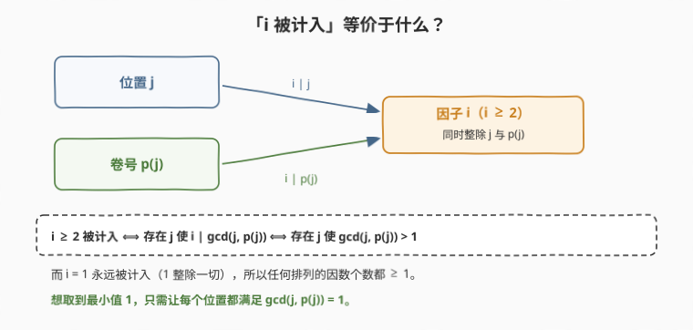
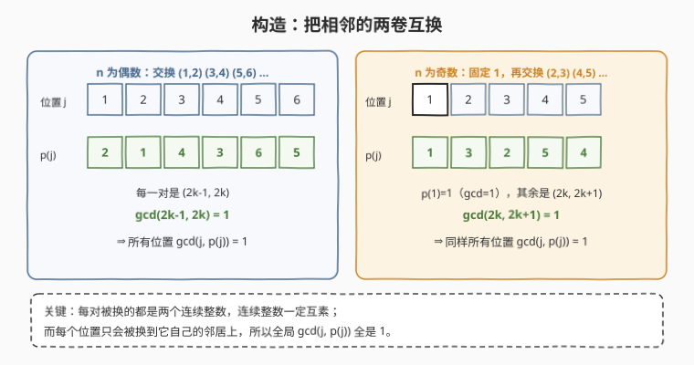
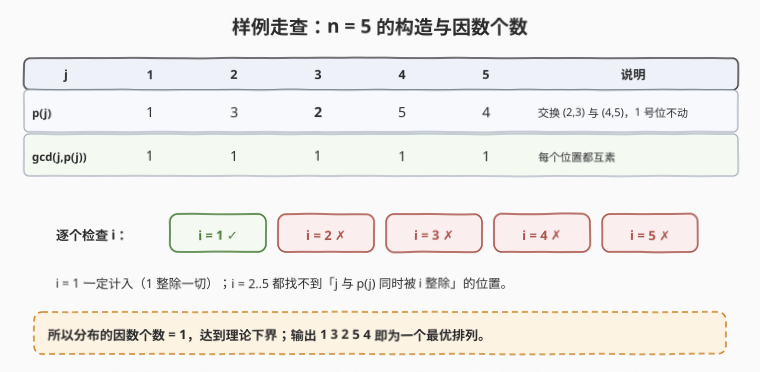

# Codeforces 49C 最小因数排列 题解

## 1. 题目概述

- **题目链接**：https://codeforces.com/problemset/problem/49/C
- **比赛来源**：Codeforces Beta Round 46 (Div. 2) · Problem C（UTC 2010-12-17）
- **难度**：1700
- **标签**：构造、数学
- **评测类型**：特殊评测（任意最优解均可）
- **限制**：时间 2 s / 内存 256 MB

**题意**：有 $n$ 卷编号 $1 \sim n$ 的书要放到 $n$ 个位置 $1 \sim n$ 上，每个位置恰好一本。把位置 $j$ 上的书号记作 $p(j)$，$p$ 是一个排列。定义**分布的因数个数**为满足下面条件的正整数 $i$ 的个数：

$$\exists\, j \in [1,n]:\quad i \mid j \ \text{ 且 } \ i \mid p(j).$$

要求输出一个排列 $p$，使这个个数**尽可能小**（只需输出排列本身，多个最优解输出任意一个）。注意 $i$ 不必 $\le n$，但 $i > n$ 时因 $1 \le j \le n$ 不可能有 $i \mid j$，所以真正可能被计入的只有 $i \le n$。

**约束**：

- $n \le 10^5$，需要 $O(n)$ 或 $O(n \log n)$ 的构造；任何 $O(n!)$ 的枚举、或对每个排列 $O(n \log n)$ 的检查都不可行。
- 输出是 $n$ 个整数，答案不唯一，**必须用 checker 校验**而不是文本比对。
- 计数上界：$i=1$ 一定被计入，所以任何排列的因数个数至少是 1。

## 2. 示例与观察

官方样例（输入 / 输出原样）：

```text
输入：
2

输出：
2 1 

输入：
3

输出：
1 3 2 
```

**样例 1**：$n=2$，排列 $(2,1)$。$i=1$ 被计入；$i=2$：位置 2 上放的是 1，$2 \nmid 1$，不计入。因数个数为 1。
**样例 2**：$n=3$，排列 $(1,3,2)$。$i=1$ 计入；$i=2$：位置 2 上是 3，$2 \nmid 3$；$i=3$：位置 3 上是 2，$3 \nmid 2$。因数个数为 1。



**观察 1**：把"$i \mid j$ 且 $i \mid p(j)$"改写成关于 $\gcd$ 的语句。若存在 $i \ge 2$ 同时整除 $j$ 与 $p(j)$，则 $\gcd(j, p(j)) \ge i \ge 2$；反过来若 $\gcd(j,p(j)) = g \ge 2$，取 $i = g$ 就能同时整除两者。于是

$$i \ge 2 \text{ 被计入} \iff \exists j:\ \gcd(j, p(j)) > 1 .$$

**观察 2**：$i = 1$ 永远被计入（$1$ 整除一切，取 $j=1$ 即可）。所以因数个数的最小可能值就是 $1$，而且**能取到 1** 等价于构造出一个满足

$$\gcd\bigl(j, p(j)\bigr) = 1 \quad \text{对一切 } j = 1,\dots,n$$

的排列。

**观察 3**：连续两个整数一定互素，即 $\gcd(k, k+1) = 1$。于是"交换相邻的两卷"是最自然的候选：每个位置只会被换到它旁边的位置上。

自造样例（标注"自造"）：

| $n$ | 一组最优排列 | 因数个数 | 说明 |
|-----|--------------|----------|------|
| 1 | `1` | 1 | 没有相邻位置可换，只有 $i=1$ |
| 4 | `2 1 4 3` | 1 | 交换 (1,2) 与 (3,4) |
| 5 | `1 3 2 5 4` | 1 | 固定 1，交换 (2,3)、(4,5) |
| 6 | `2 1 4 3 6 5` | 1 | 三对相邻交换 |

## 3. 解题思路

### 3.1 朴素做法与瓶颈

想直接"搜索最小因数个数"是不可行的：排列有 $n!$ 个，$n = 10^5$ 时天文数字。即便只对每个排列花 $O(n \log n)$ 去数因数，也完全不可能。

即便退一步"随便构造一个排列再看因数个数"，也需要一个**结构性的**保证，否则无法知道自己的构造是不是最优。所以真正的任务是两件事：证明下界 1 可达，并给出一个 $O(n)$ 的构造。

### 3.2 核心观察：把条件化成 gcd


由第 2 节的观察 1、2，问题等价于：

$$\text{求排列 } p,\ \text{使 } \gcd(j, p(j)) = 1 \ \text{对一切 } j .$$

这个转化把"对每个 $i$ 检查所有倍数"的二维条件压成了每个位置一条独立的整除条件。下界也就立刻清楚了：$i=1$ 无法避免，故最小值 $\ge 1$。

接下来只需要构造。注意 $\gcd(j,j)=j$，所以"不动点"是不好的（除非 $j=1$）；而"$j$ 与相邻位置交换"总是好的，因为相邻整数互素。

### 3.3 构造



分两种情形（都从 1 开始编号）：

- **$n$ 为偶数**：交换 $(1,2), (3,4), \dots, (n-1,n)$，即

$$p(2k-1) = 2k,\qquad p(2k) = 2k-1 \quad (1 \le k \le n/2).$$

- **$n$ 为奇数**：先固定 $p(1) = 1$，再交换 $(2,3), (4,5), \dots, (n-1,n)$，即

$$p(1) = 1,\qquad p(2k) = 2k+1,\qquad p(2k+1) = 2k \quad (1 \le k \le (n-1)/2).$$

两种情形都是"若干个不相交的对换"，所以显然是一个排列（每个位置恰好被处理一次、每个数恰好出现一次）。并且每个位置要么不动、要么与它相邻的位置互换：

- 不动的只有 $n$ 为奇数时的位置 1，$\gcd(1,1) = 1$；
- 其余的 $j$ 都被换到 $j \pm 1$ 上，而 $\gcd(j, j\pm1) = 1$。

所以 $\gcd(j, p(j)) = 1$ 对全部 $j$ 成立，因数个数恰为 1，达到下界。

### 3.4 样例走查



以 $n = 5$ 为例（$n$ 为奇数）：

| $j$ | 1 | 2 | 3 | 4 | 5 |
|-----|---|---|---|---|---|
| $p(j)$ | 1 | 3 | 2 | 5 | 4 |
| $\gcd(j,p(j))$ | 1 | 1 | 1 | 1 | 1 |

逐个检查 $i$：$i=1$ 一定计入；$i=2$ 只可能看位置 2、4，而 $p(2)=3$、$p(4)=5$ 都不被 2 整除；$i=3$ 只看位置 3，$p(3)=2$ 不被 3 整除；$i=4$、$i=5$ 分别只看位置 4、5，对应 $p$ 值是 5 与 4，也不被整除。所以因数个数 $=1$，与样例 2 的答案（$n=3$ 时输出 `1 3 2`）思路一致。

## 4. 正确性证明

**引理 1（下界）**：任意排列的因数个数至少是 1。
**证明**：取 $i = 1$、$j = 1$，有 $1 \mid 1$ 且 $1 \mid p(1)$，故 $i=1$ 总被计入。∎

**引理 2（等价刻画）**：对任意排列与任意 $i \ge 2$，$i$ 被计入当且仅当存在 $j$ 使 $\gcd(j, p(j)) \ge i$；从而"存在 $i\ge2$ 被计入"当且仅当"存在 $j$ 使 $\gcd(j,p(j)) > 1$"。
**证明**：若 $i \ge 2$ 被计入，则存在 $j$ 同时被 $i$ 整除，故 $\gcd(j,p(j)) \ge i \ge 2$。反之若 $\gcd(j,p(j)) = g \ge 2$，则 $g \mid j$、$g \mid p(j)$，取 $i = g \ge 2$ 即知 $i$ 被计入。∎

**引理 3（构造是排列）**：3.3 给出的 $p$ 是 $1..n$ 的一个排列。
**证明**：构造由若干互不相交的对换 $(2k-1,2k)$（$n$ 偶）或 $(2k,2k+1)$（$n$ 奇，再加不动点 1）组成；它们把 $\{1,\dots,n\}$ 划分成互不相交的二元组（奇数情形外加单点 $\{1\}$），每个组内互换，故每个数恰好出现一次。∎

**引理 4（构造满足 gcd 条件）**：对 3.3 的 $p$，$\gcd(j,p(j)) = 1$ 对一切 $j$ 成立。
**证明**：若 $j$ 不动，则只可能是奇数情形下的 $j=1$，$\gcd(1,1)=1$。否则 $p(j) = j+1$ 或 $p(j) = j-1$，而相邻整数互素：若 $d \mid j$ 且 $d \mid j+1$，则 $d \mid 1$，故 $d=1$；对 $j-1$ 同理。∎

**定理**：3.3 的构造达到最小可能的因数个数 1，即它是最优解。
**证明**：由引理 3 它是合法排列；由引理 4 与引理 2，没有任何 $i \ge 2$ 被计入，结合引理 1 知因数个数恰为 1。由引理 1 这是下界，故最优。∎

## 5. 复杂度分析

- **时间**：$O(n)$，只需一次循环填 $p$，再一次循环输出。
- **空间**：$O(n)$ 存放排列（也可以不存、边算边输出，做到 $O(1)$ 额外空间）。
- **与时限的关系**：$n \le 10^5$，$O(n)$ 的构造在 2 s 内余量极大；实测 $n=10^5$ 时（含输出 10 万个数字，约 60 万字节）C++ 运行约 $15 \sim 20$ ms，其中绝大部分是格式化输出的开销。
- **输出量**：约 $6 \times 10^5$ 字节，属于本题的主要开销，仍在毫秒级。

## 6. 参考代码

### C++17

```cpp
#include <bits/stdc++.h>
using namespace std;

int main() {
    ios::sync_with_stdio(false);
    cin.tie(nullptr);

    int n;
    if (!(cin >> n)) return 0;
    vector<int> p(n + 1);
    if (n % 2 == 0) {
        for (int i = 1; i <= n; i += 2) { p[i] = i + 1; p[i + 1] = i; }
    } else {
        p[1] = 1;                                  // 奇数长度：先把 1 号位固定
        for (int i = 2; i <= n; i += 2) { p[i] = i + 1; p[i + 1] = i; }
    }
    for (int j = 1; j <= n; ++j) cout << p[j] << (j == n ? '\n' : ' ');
    return 0;
}
```

### Python3

```python
import sys


def main() -> None:
    data = sys.stdin.read().split()
    if not data:
        return
    n = int(data[0])
    p = list(range(n + 1))
    if n % 2 == 0:
        for i in range(1, n, 2):
            p[i], p[i + 1] = i + 1, i
    else:
        for i in range(2, n, 2):
            p[i], p[i + 1] = i + 1, i
    sys.stdout.write(" ".join(map(str, p[1:])) + "\n")


main()
```

输出格式只要求 $n$ 个数，用空格或换行分隔都行；两份代码都用空格，行末有无空格不影响 checker。

## 7. 边界情况与易错点

1. **$n=1$**：只有排列 $(1)$，$i=1$ 被计入，答案是 1 个因数。构造必须输出 `1`，不能输出空行。
2. **奇数 $n$ 的尾巴**：$n$ 为奇数时如果从 1 开始两两交换，最后一个位置会落单并保持 $p(n)=n$，此时 $\gcd(n,n)=n>1$（$n \ge 2$），会多算一个因数。必须改成"固定 1、从 2 开始配对"。
3. **$n=2$ 的特殊性**：$\gcd(1,1)=1$ 没问题，但若不动的位置是 2，则 $\gcd(2,2)=2$。$n=2$ 只能输出 `2 1`（或其等价最优解），不能输出 `1 2`。
4. **下标从 0 还是 1 开始**：本题位置与书号都是 $1$ 起，写代码时 `vector` 多开一位最省事；若用 0 起下标，交换条件与 $\gcd$ 的自变量都会整体错位。
5. **$i > n$ 的处理**：不必也不能枚举 $i > n$；由 $1 \le j \le n$ 可知 $i \mid j$ 迫使 $i \le n$，程序里循环到 $n$ 就是全部。
6. **输出格式**：特殊评测，通常按 token 比较，行末空格与换行数量不敏感；但仍建议严格按"$n$ 个数、以空格分隔、末尾换行"输出。
7. **大数据输出**：$n=10^5$ 时一次性 `cout` 每个数会偏慢，`'\n'` 而非 `endl`、或像参考代码那样用 `? :` 控制分隔符，可以避免多余的 flush。

## 8. 验证记录

- **编译环境与命令**：`python3 codeforces/tools/verify_solution.py codeforces/contests/0001-0100/49/C_最小因数排列.md --checker codeforces/tools/checkers/cf49c.py`。checker 约定为 `python3 checker.py <input> <output> <answer>`，本 checker 校验：① 恰好输出 $n$ 个整数；② 是 $1..n$ 的排列；③ 按题面定义统计因数个数，必须等于 1（理论最小值）。
- **官方样例**：2 / 2 通过（checker 判合法，C++ 与 Python 各 2/2）。
- **额外测试**：① 对 $n = 1,2,\dots,300$ 逐个运行 checker，全部合法（因数个数均为 1）；② 对 $n \le 8$ 用 `itertools.permutations` **全枚举** $n!$ 个排列求最小因数个数，全部等于 1，与"最小值 $=1$"的证明一致；③ $n = 100000$ 的最大数据也能通过 checker。
- **最大约束性能**：$n = 10^5$，C++ 单次运行（含输出 10 万个数字）约 $15 \sim 20$ ms，远低于 2 s。
- **复核状态**：`check.py` 与 `check_samples.py --only 0001-0100/49` 均 0 失败；样例与 `.cf-meta/statements/CF49C.json` 逐字一致（含样例输出行末的空格）。

## 相关题目与扩展

- [Codeforces 136A Presents](https://codeforces.com/problemset/problem/136/A)：排列的逆，练习 1 起下标与排列表示。
- [Codeforces 233A Perfect Permutation](https://codeforces.com/problemset/problem/233/A)：构造满足 $p_{p_i} = i$、$p_i \ne i$ 的排列，同样是"对换拼排列"。
- [Codeforces 49A 最后一个字母](https://codeforces.com/problemset/problem/49/A)：同场热身题。

**延伸思考**：

1. 如果改问**最大**的因数个数，答案显然是 $n$（恒等排列让每个 $i$ 都被自己那个位置计入），问题就退化；可见本题的趣味全在"下界 1 是否可达"。
2. 如果把条件换成"$i \mid j$ **或** $i \mid p(j)$"，下界立刻变成 $\Omega(n \log n)$ 级别（接近"所有 $i$ 都计入"），构造思路完全不同。
3. 如果要求排列恰好有 $k$ 个不动点，其余位置仍需 $\gcd(j,p(j))=1$，可以把 $1..n$ 划分成若干长度 $\ge 2$ 的连续段，段内做"循环移位"，从而在保持 $\gcd$ 条件的同时调整不动点个数。
4. 本题构造的两个要点——"连续整数互素"与"对换不产生交叉"——可以推广：任意把 $[1,n]$ 分成连续区间、在每个区间内部任意置换，都仍满足 $\gcd(j,p(j))=1$；这也是为什么最优解非常多。
