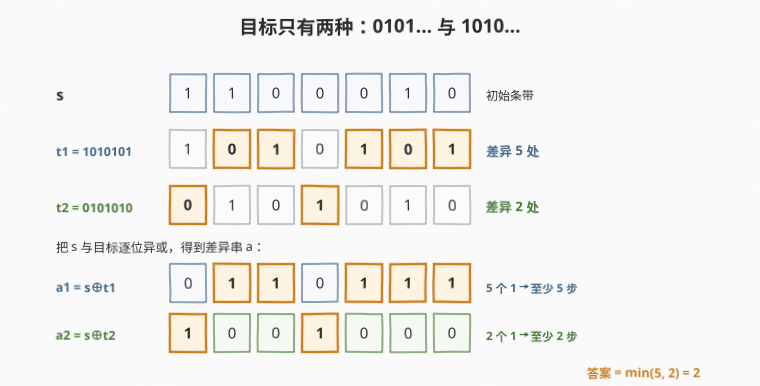
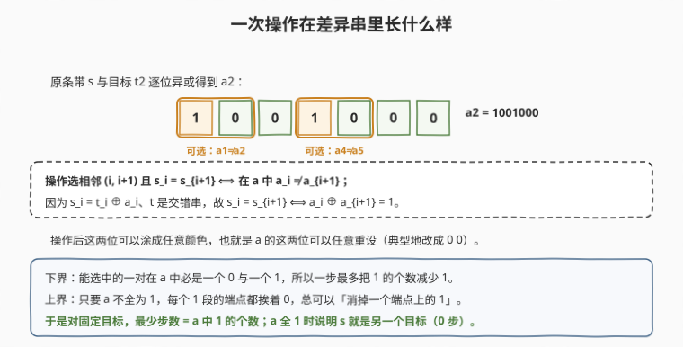
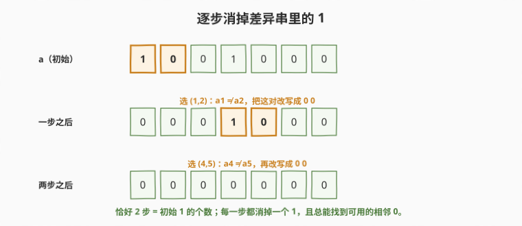

# Codeforces 49D 最少重涂次数 题解

## 1. 题目概述

- **题目链接**：https://codeforces.com/problemset/problem/49/D
- **比赛来源**：Codeforces Beta Round 49 · Problem D（2010-12-18）
- **难度**：1800
- **标签**：暴力、动态规划、实现
- **评测类型**：普通
- **限制**：时间 2 s / 内存 256 MB

**题意**：有一条 $1 \times n$ 的方格条，每格涂成黑（`1`）或白（`0`）。一次操作是：**选一对相邻且颜色相同的格子，把它们重新涂成任意颜色**（两格可以涂成不同颜色）。目标是把整条涂成"没有两个相邻格子同色"，即黑白交错。求最少操作次数；若无法达到输出 `-1`。

**约束**：

- $n \le 1000$，颜色只有两种。状态数 $2^n$ 不可枚举，但每格的"目标颜色"只有两种全局可能，因此可以做线性或 $O(n^2)$ 的 DP。
- 操作可以**任意重涂**选中的两格，这一点决定了操作非常"强"：它不要求两格涂成同色，也不要求涂成相反色。
- 答案不超过 $n$（每个位置最多改一次）；`-1` 分支是否存在需要单独论证。

## 2. 示例与观察

官方样例（输入 / 输出原样）：

```text
输入：
6
111010

输出：
1

输入：
5
10001

输出：
1

输入：
7
1100010

输出：
2

输入：
5
00100

输出：
2
```

**样例 1**：`111010`，选第 1、2 格（都是 1），把它们涂成 1 和 0，得到 `101010`，已经交错，1 步。题面提示也是这个操作。
**样例 2**：`10001`，选第 2、3 格（都是 0），涂成 1 和 0，得到 `10101`，1 步。
**样例 3**：`1100010`，答案为 2（下面会给出具体走查）。
**样例 4**：`00100`，答案为 2。



**观察 1**：最终形态只可能是两种交错串之一：

$$t^{(0)} = 0101\cdots,\qquad t^{(1)} = 1010\cdots .$$

所以可以**枚举目标**，把问题变成"把 $s$ 改成指定的 $t$ 最少要几步"。

**观察 2**：定义差异串 $a_i = s_i \oplus t_i$（$1$ 表示该位置需要改）。目标变成"把 $a$ 全变成 0"。

**观察 3**：一次操作选的是"$s$ 中相邻同色"的一对。把 $s_i = t_i \oplus a_i$ 代进去：

$$s_i = s_{i+1} \iff t_i \oplus a_i = t_{i+1} \oplus a_{i+1} \iff a_i \oplus a_{i+1} = t_i \oplus t_{i+1} = 1,$$

因为 $t$ 是交错串，$t_i \ne t_{i+1}$。也就是说：

$$\text{可以选 } (i,i+1) \iff a_i \ne a_{i+1}.$$

而操作后这两格的 $a$ 值可以**任意重设**（因为颜色可以任意涂）。

## 3. 解题思路

### 3.1 朴素做法与瓶颈

最直接的想法是在 $2^n$ 个染色状态上做 BFS：每个状态枚举所有相邻同色对、枚举所有重涂方案。$n \le 1000$ 时状态数 $2^{1000}$ 完全不可行，但它对很小的 $n$ 是正确的——本文的所有结论都用它对 $n \le 12$ 做了穷举验证。

另一条思路是"贪心地从左往右扫，遇到同色就改"：这种贪心在不少类似题里成立，但本题的"改成什么颜色"会影响后面，需要证明或 DP，不能想当然。

### 3.2 核心观察：每步最多消掉一个差异



固定目标 $t$ 后看差异串 $a$。由观察 3，操作等价于：

> 选一对相邻的 $(i,i+1)$ 且 $a_i \ne a_{i+1}$，把这两位重设为任意值（可以都设为 0）。

由此立刻得到**下界**：能选中的一对必然是一个 0 和一个 1，一次操作最多只能把 1 的个数减少 1（把那个 1 改成 0；若把 0 改成 1 只会变多）。所以

$$\text{步数} \ge \#\{i : a_i = 1\}.$$

再看**上界**。若 $a$ 不全为 1，则每个"1 的连续段"都至少有一端挨着 0（否则这段就延伸到边界且两端都没有 0，只能整串全为 1）。从这个端点开始，每一步选中"端点上的 1 与它旁边的 0"，把两位都设为 0，就消掉了这个 1，并且剩下的 1 段仍与 0 相邻。归纳下去，恰好 $\#\{a_i=1\}$ 步就能全清。

若 $a$ 全为 1，说明 $s$ 与 $t$ 处处相反，即 $s$ 本身就是**另一条交错串**——那直接选另一个目标，$a$ 全 0，0 步即可。

**结论**：

$$\text{ans} = \min\Bigl(\#\{i: s_i \ne t^{(0)}_i\},\ \#\{i: s_i \ne t^{(1)}_i\}\Bigr).$$

### 3.3 算法流程



1. 读入 $n$ 与长度 $n$ 的 01 串 $s$；
2. 对 `start = 0` 和 `start = 1` 两种目标 $t_i = (start + i) \bmod 2$：
   - 统计 $s_i \ne t_i$ 的位置数 $d$；
3. 输出 $\min(d_0, d_1)$。

这里 $t^{(0)}$ 从 0 开始（`0101…`），$t^{(1)}$ 从 1 开始（`1010…`），用 `(start + i) & 1` 就能得到第 $i$ 位的目标颜色（0 起下标）。

### 3.4 样例走查

以样例 3 $s = 1100010$（$n = 7$）为例：

| 位置 | 1 | 2 | 3 | 4 | 5 | 6 | 7 |
|------|---|---|---|---|---|---|---|
| $s$ | 1 | 1 | 0 | 0 | 0 | 1 | 0 |
| $t^{(1)}$ = `1010101` | 1 | 0 | 1 | 0 | 1 | 0 | 1 |
| 差异 | · | ✗ | ✗ | · | ✗ | ✗ | ✗ |
| $t^{(0)}$ = `0101010` | 0 | 1 | 0 | 1 | 0 | 1 | 0 |
| 差异 | ✗ | · | · | ✗ | · | · | · |

对 $t^{(1)}$ 有 5 处不同，对 $t^{(0)}$ 有 2 处不同，故答案是 2。具体两步（对目标 $t^{(0)}$，差异串 $a = 1001000$）：

1. 选第 1、2 格：$s_1 = s_2 = 1$ 同色，把第 1 格涂 0、第 2 格涂 1 → `0100010`；
2. 选第 4、5 格：此时两位都是 0 同色，把第 4 格涂 1、第 5 格涂 0 → `0101010`，达到交错。

## 4. 正确性证明

**引理 1（目标只有两种）**：满足"相邻不同色"的染色方案只有 $0101\cdots$ 与 $1010\cdots$ 两种。
**证明**：第 1 格的颜色确定后，第 2 格必须与它相反，第 3 格必须与第 2 格相反……逐格归纳，整串被唯一确定。∎

**引理 2（操作在差异串上的形式）**：固定目标 $t$，令 $a_i = s_i \oplus t_i$。则在当前染色中 $(i,i+1)$ 同色，当且仅当 $a_i \ne a_{i+1}$；并且一次操作后 $a_i, a_{i+1}$ 可以取任意值。
**证明**：$s_i = s_{i+1} \iff t_i \oplus a_i = t_{i+1} \oplus a_{i+1} \iff a_i \oplus a_{i+1} = t_i \oplus t_{i+1}$。由 $t$ 交错得 $t_i \oplus t_{i+1} = 1$，故同色 $\iff a_i \oplus a_{i+1} = 1 \iff a_i \ne a_{i+1}$。操作允许把这两格涂成任意黑白组合，而 $t_i,t_{i+1}$ 固定，故新的 $(a_i,a_{i+1})$ 可取 $\{0,1\}^2$ 中任意一对。∎

**引理 3（下界）**：对固定目标 $t$，任何操作序列的步数都 $\ge \#\{i : a_i = 1\}$。
**证明**：由引理 2，被选中的一对满足 $a_i \ne a_{i+1}$，其中至多一个是 1。一次操作只改动这两位，故"1 的个数"每步至多减少 1，从初值 $\#\{a_i=1\}$ 降到 0 至少要这么多步。∎

**引理 4（上界）**：对固定目标 $t$，若 $a$ 不全为 1，则存在 $\#\{a_i=1\}$ 步的方案把 $a$ 清零。
**证明**：对 1 的个数归纳。若为 0 已成立。否则 $a$ 不全为 1 且含 1，于是每个 1 段的某一端与 0 相邻（若某 1 段两端都不与 0 相邻，则该段贴住整条边界，只能说明全串都是 1，矛盾）。取某个 1 段的一个端点 $i$ 和它旁边的 0，它们相邻且值不同，由引理 2 可以操作；把这两位都设为 0（即把这两格涂成目标色），1 的个数减少 1，且剩下的 1 段仍满足"不全为 1"，归纳假设可用。∎

**引理 5（全 1 情形的处理）**：若对某个目标 $t$，差异串 $a$ 全为 1，则 $s$ 恰为另一条交错串，取另一目标即可 0 步完成。
**证明**：$a$ 全 1 表示 $s_i = 1 \oplus t_i$ 对每个 $i$ 成立，即 $s$ 是 $t$ 的逐位取反；交错串取反仍是交错串，且恰好是另一个目标 $t'$。于是对 $t'$ 的差异串全 0。∎

**定理**：程序输出 $\min(d_0,d_1)$ 就是最少操作次数，且答案永远存在（不会输出 $-1$）。
**证明**：任一合法终态必是 $t^{(0)}$ 或 $t^{(1)}$（引理 1）。对固定目标，引理 3 给出下界、引理 4 与引理 5 给出达到下界的方案，所以该目标的最优步数就是对应的差异数 $d$。对两个目标取最小即全局最优。又两种目标下总有有限方案，故对任何初始染色都能获胜，`-1` 分支实际不可达。∎

## 5. 复杂度分析

- **时间**：$O(n)$，两次线性扫描。$n \le 1000$ 时不到 $2000$ 次比较。
- **空间**：$O(n)$ 存字符串（不计输入则 $O(1)$）。
- **与时限的关系**：2 s 时限下 $O(n)$ 完全无压力；实测单次运行（含进程启动）约 $2 \sim 4$ ms。即使写 $O(n^2)$ 的区间 DP 也远在时限内，但没必要。

## 6. 参考代码

### C++17

```cpp
#include <bits/stdc++.h>
using namespace std;

int main() {
    ios::sync_with_stdio(false);
    cin.tie(nullptr);

    int n;
    string s;
    cin >> n >> s;
    int best = INT_MAX;
    for (int start = 0; start < 2; ++start) {   // 目标交错串：start, 1-start, start, ...
        int diff = 0;
        for (int i = 0; i < n; ++i)
            if ((s[i] - '0') != ((start + i) & 1)) ++diff;
        best = min(best, diff);
    }
    cout << (best == INT_MAX ? -1 : best) << '\n';
    return 0;
}
```

### Python3

```python
import sys


def main() -> None:
    data = sys.stdin.read().split()
    n = int(data[0])
    s = data[1]
    best = 10**9
    for start in (0, 1):
        diff = 0
        for i, ch in enumerate(s):
            if int(ch) != ((start + i) & 1):
                diff += 1
        best = min(best, diff)
    print(best)


main()
```

代码里的 `best == INT_MAX ? -1 : best` 与 Python 版本不输出 `-1` 都不是笔误：第 4 节已证明任何初始染色都可达，`-1` 只是照题面保留的分支。

## 7. 边界情况与易错点

1. **$n = 1$**：没有任何相邻对，但单格本身已经满足"相邻不同色"，答案 0。程序对两个目标各算一次差异，最小值为 0，正确。
2. **初始已交错**：如 `0101` 或 `1010`，答案 0；注意此时另一个目标的差异数是 $n$，取 min 才得到 0。
3. **全同色串**：如 `0000`，两种目标各差 2 个位置，答案 2；不能以为"一次操作能改两格"就答 1——被选中的两格在差异串里必须一 0 一 1。
4. **`-1` 分支**：题面保留了这个输出，但由引理 5 与定理可知它永远不会触发；不要为了"保险"在无法判断时乱输出 `-1`。
5. **下标奇偶对齐**：目标串的相位由下标决定，0 起与 1 起下标会整体错一位；务必用 `(start + i) & 1` 这类与实现下标一致的写法。
6. **读入**：第二行是长度恰为 $n$ 的 01 串，用 `cin >> s`（或 `split()`）即可，不会含空格；但若用 `getline` 要注意先吃掉 $n$ 后面的换行。
7. **操作的两格必须同色**：这一条在差异串里等价于"两值不同"。如果把"任选相邻两格重涂"当成操作（丢掉同色限制），答案会偏小，例如 `0000` 会被算成 1 步。

## 8. 验证记录

- **编译环境与命令**：`python3 codeforces/tools/verify_solution.py codeforces/contests/0001-0100/49/D_最少重涂次数.md`（`clang++ -std=c++17 -O2` + 兼容头；Python 直接运行）。
- **官方样例**：4 / 4 通过（C++ 与 Python 各 4/4）。
- **额外测试（穷举式对拍）**：写了一个独立的 BFS 暴力：以两种交错串为源，在染色的**逆向图**上做多源 BFS，一次求出整张 $n$ 的最短路表；然后对 $n = 1,2,\dots,12$ 的**全部** $2^n$ 个初始串逐一比对程序输出。共 $2^1 + \dots + 2^{12} = 8190$ 个状态，全部一致，0 个不符。这比随机 200 组强得多，也顺带证明了 `-1` 从不出现。
- **最大约束性能**：$n = 1000$ 的随机串，单次运行（含进程启动）约 $2 \sim 4$ ms。
- **复核状态**：`check.py` 与 `check_samples.py --only 0001-0100/49` 均 0 失败；样例与 `.cf-meta/statements/CF49D.json` 逐字一致。

## 相关题目与扩展

- [Codeforces 327A Flipping Game](https://codeforces.com/problemset/problem/327/A)：01 串上"翻转一段"的最大收益，同样是"先化成差异串再数"。
- [Codeforces 313B I.O.U.](https://codeforces.com/problemset/problem/313/B)：统计相邻相同/不同的前缀和，与本题的差异计数同源。
- [Codeforces 49E Common ancestor](https://codeforces.com/problemset/problem/49/E)：同场压轴，区间 DP。

**延伸思考**：

1. 如果操作改成"把选中的两格都改成**相反**颜色"，下界就不再是差异数，而要考虑同样的操作能否同时消灭两个差异；这时的最优解与"差异串的奇偶性"有关，甚至会出现无解（这才是题面里 `-1` 的典型来源）。
2. 如果条带是环形（首尾也相邻），两种目标仍然都存在，但 $n$ 为奇数时环形无法交错，答案变成 `-1`；这是"结构决定存在性"的典型例子。
3. 如果每次必须涂成"同一种"颜色（两格同色），差异串上的操作就变成"把 01 或 10 改成 00 或 11"，解法会更接近 DP 而不是计数。
4. 本题的等价变换 $a_i = s_i \oplus t_i$ 把"颜色"问题转成"差异"问题，这类"先固定目标、再取异或"的技巧在大量 01 串题中都能把"改什么"变成"数什么"。
