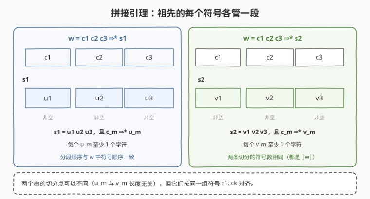
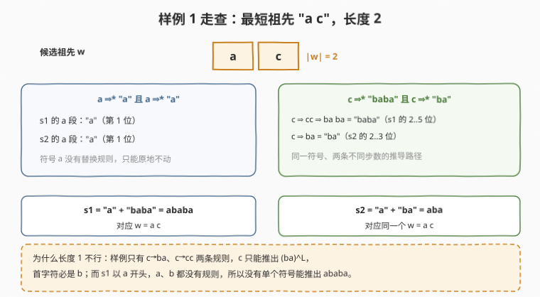

# Codeforces 49E 最短公共祖先 题解

## 1. 题目概述

- **题目链接**：https://codeforces.com/problemset/problem/49/E
- **比赛来源**：Codeforces Beta Round 46 (Div. 2) · Problem E（UTC 2010-12-17）
- **难度**：2300
- **标签**：动态规划、区间 DP、字符串
- **评测类型**：普通
- **限制**：时间 5 s / 内存 256 MB

**题意**：DNA 序列是小写字母串。演化的一步是**把恰好一个字符替换成恰好两个字符**，共有 $n$ 条允许的替换规则 $a_i \to b_i c_i$，每条规则可以使用任意多次。若存在一个非空串 $s_3$，使得 $s_3$ 经过若干步（两个方向步数可以不同）能演化出 $s_1$，也能演化出 $s_2$，则称 $s_1,s_2$ 有公共祖先。给定 $s_1, s_2$ 与全部规则，求最短公共祖先的**长度**；不存在则输出 `-1`。

**约束**：

- $|s_1|, |s_2| \le 50$，$n \le 50$，字母表 26 个小写字母。
- 每一步长度 $+1$，所以祖先长度不超过 $\min(|s_1|, |s_2|)$，且**任何**祖先都能在长度 $\le 50$ 内被考虑；这排除了"无限深搜索"。
- 规则可能重复、左部字符可能从不出现在 $s_1,s_2$ 中；$s_1$ 与 $s_2$ 可能相同（此时答案 1）。
- 区间数只有 $50 \times 51 / 2 = 1275$，两串的区间对约 $1.6 \times 10^6$，但下面的状态只有 $51 \times 51$ 个，转移是 $O(|s_1||s_2|)$，完全可以接受。

## 2. 示例与观察

官方样例（输入 / 输出原样）：

```text
输入：
ababa
aba
2
c->ba
c->cc

输出：
2

输入：
ababa
aba
7
c->ba
c->cc
e->ab
z->ea
b->ba
d->dd
d->ab

输出：
1

输入：
ababa
aba
1
c->ba

输出：
-1
```

**样例 1**：规则只有 `c->ba`、`c->cc`。$s_1 = \text{ababa}$ 以 `a` 开头，而 `c` 只能推出 $(\text{ba})^L$、以 `b` 开头，所以任何祖先的第一个符号都必须是 `a` 本身（`a` 没有规则，只能原地不动）。于是祖先形如 `a` + （产生 `baba` 与 `ba` 的部分）。取 `c`：$c \Rightarrow cc \Rightarrow ba\,ba = \text{baba}$ 且 $c \Rightarrow ba = \text{ba}$，所以 $s_3 = \text{ac}$，长度 2。长度 1 不可能（没有哪个字符能同时推出两个串），故答案是 2。

**样例 2**：答案 1。$d$ 可以：$d \Rightarrow dd \Rightarrow ab\,ab = \text{abab}$，再把最后一个 `b` 用 `b->ba` 展开成 `ba`，得 $\text{aba}\,\text{ba} = \text{ababa}$；而 $d \Rightarrow ab$，再把 `b` 展开得 $\text{aba}$。所以 $s_3 = d$ 就是公共祖先，长度 1 是最小可能值。

**样例 3**：只有 `c->ba`。$s_1$ 以 `a` 开头，故首符号必须是 `a`；剩下的 `baba` 与 `ba` 若都由 `c` 生成，`baba` 需要至少两个 `c`（$c \Rightarrow cc$），而 `ba` 只需一个，两边的切分无法对齐，故不存在公共祖先，输出 `-1`。



**观察 1（拼接引理）**：若 $w = c_1 c_2 \cdots c_k \Rightarrow^{*} s$，则 $s$ 可以切成 $k$ 个**非空**连续段 $s = u_1 u_2 \cdots u_k$，且 $c_m \Rightarrow^{*} u_m$。原因是每次替换只作用于一个符号，把它换成两个符号，各符号产生的字符在最终串里始终连成一段、互不交错。
**观察 2**：同一次演化中，$w$ 的每个符号既要负责 $s_1$ 的一段，也要负责 $s_2$ 的一段；两边的切分点可以不同，但**符号顺序一致**。所以可以按"祖先符号"逐个推进：状态只需记"$s_1$ 用到哪、$s_2$ 用到哪"。

## 3. 解题思路

### 3.1 朴素做法与瓶颈

可以想到 BFS：从 $s_1,s_2$ 出发做"逆向替换"（把相邻的 $b_ic_i$ 缩成 $a_i$），两边能到达的公共串里取最短。这个做法对样例完全正确，但状态是指数级的字符串集合，$|s_i| = 50$ 时爆炸，只能用于小数据（本文用它做对拍）。

也可以想到"对每个区间判断能否由某个字符推出"的区间 DP，但两个串如何**对齐**是难点：祖先长度不同、两边的切分点也不同，单串的区间 DP 无法表达。

### 3.2 核心观察：按祖先符号推进的双指针 DP

![状态 dp[i][j] 与转移](../../../images/cf49e_dp.svg)

由拼接引理，设最短公共祖先是 $w = c_1 c_2 \cdots c_k$。它把 $s_1$ 切成 $k$ 段、把 $s_2$ 切成 $k$ 段，且第 $m$ 个符号 $c_m$ 同时生成两边的第 $m$ 段。于是可以定义：

$$dp[i][j] = \text{用若干符号同时生成 } s_1[i..]\ \text{与}\ s_2[j..]\ \text{所需的最少符号数},$$

其中下标 0 起、区间是左闭右开（$s_1[i..]$ 表示 $s_1[i], \dots, s_1[|s_1|-1]$）。转移时枚举"第一个符号 $c$ 负责的两段"：

$$dp[i][j] = 1 + \min_{\substack{i \le i' < |s_1|,\ j \le j' < |s_2|\\ \exists c:\ c \Rightarrow^{*} s_1[i..i'],\ c \Rightarrow^{*} s_2[j..j']}} dp[i'+1][j'+1].$$

边界：$dp[|s_1|][|s_2|] = 0$；只要有一边用完而另一边没用完，就无解（每个符号必须同时为两边各贡献至少一个字符），记为 $+\infty$。

答案就是 $dp[0][0]$，若为 $+\infty$ 输出 `-1`。

### 3.3 预处理与实现细节

转移里要用到"字符 $c$ 能否推出区间 $s[i..j]$"。对每个串单独做一次区间 DP：

$$can[c][i][j] = \begin{cases} [\,s_i = c\,], & i = j,\\ \bigvee\limits_{(c \to xy)} \bigvee\limits_{k=i}^{j-1} \bigl(can[x][i][k] \wedge can[y][k+1][j]\bigr), & i < j. \end{cases}$$

按区间长度从小到大计算即可。把每个区间的 $can[\cdot][i][j]$ 压成 26 位整数掩码 $mask[i][j]$，转移时只需判断

$$mask_1[i][i'] \ \&\ mask_2[j][j'] \ne 0,$$

一次按位与即可。$dp$ 按 $i,j$ 从大到小枚举（转移只走向下标更大的状态，天然拓扑有序），每个状态枚举 $(i',j')$ 共 $O(|s_1||s_2|)$。

### 3.4 样例走查：样例 1



对样例 1（规则 `c->ba`、`c->cc`）：

- 区间掩码：$mask_1[0][0] = \{a\}$（单字符 `a`），$mask_1[1][4] = \{c\}$（`baba`：$c \Rightarrow cc \Rightarrow ba\,ba$），$mask_2[0][0] = \{a\}$，$mask_2[1][2] = \{c\}$（`ba`）。
- 从 $dp[0][0]$ 出发，唯一可行的第一步是取 $c = a$、$i' = j' = 0$（两边都是单字符 `a`），进入 $dp[1][1]$。
- 在 $dp[1][1]$：取 $c = c$、$i' = 4$、$j' = 2$，两边区间分别是 `baba` 与 `ba`，都可由 `c` 推出，进入 $dp[5][3] = 0$。
- 所以 $dp[0][0] = 2$，对应 $w = \text{a}\,\text{c}$。

而长度 1 的方案要求某个字符同时推出 `ababa` 与 `aba`：`c` 只能推出 $(\text{ba})^L$（以 `b` 开头），`a`、`b` 没有规则只能原地不动，故无解——这正是 $dp$ 里"单符号"路径不存在的体现。

## 4. 正确性证明

**引理 1（拼接引理）**：若 $w = c_1\cdots c_k \Rightarrow^{*} s$（$k \ge 1$），则存在切分 $s = u_1 \cdots u_k$，每个 $u_m$ 非空，且 $c_m \Rightarrow^{*} u_m$。
**证明**：对推导步数归纳，同时维护更强的命题："当前串的每个符号各自产生最终串的一个连续非空段，且各段按符号顺序拼接成最终串"。初始时每个符号产生自己那一段。每一步把某个符号 $c$ 换成 $xy$，该符号原本对应的段被 $x$ 与 $y$ 两段替换（$x$ 的段在前，$y$ 的段在后），其余符号的段不变，命题保持。归纳结束即得结论。∎

**引理 2（转移的必要性）**：设 $dp[i][j]$ 有有限最优值，对应某个最优祖先 $w = c_1\cdots c_k$（$k \ge 1$）。则存在 $i' \ge i$、$j' \ge j$ 与字符 $c_1$，使 $c_1 \Rightarrow^{*} s_1[i..i']$、$c_1 \Rightarrow^{*} s_2[j..j']$，且 $dp[i'+1][j'+1] \le k-1$。
**证明**：由引理 1 分别对 $s_1[i..]$ 与 $s_2[j..]$ 切分，第一段非空；把 $c_2\cdots c_k$ 作为剩余两段的一个公共祖先，即得长度为 $k-1$ 的方案。∎

**引理 3（转移的充分性）**：若存在 $i',j',c$ 使 $c \Rightarrow^{*} s_1[i..i']$、$c \Rightarrow^{*} s_2[j..j']$，且 $dp[i'+1][j'+1] = t$，则 $dp[i][j] \le t+1$。
**证明**：把 $c$ 与 $dp[i'+1][j'+1]$ 对应的最优祖先（设为 $w'$）拼接成 $c\,w'$，它先推出两段、再由 $w'$ 推出剩余部分；因为各符号的推导互不影响（引理 1 的"独立性"），故 $c\,w'$ 同时推出 $s_1[i..]$ 与 $s_2[j..]$，长度 $t+1$。∎

**引理 4（边界正确）**：$dp[|s_1|][|s_2|] = 0$；若 $i = |s_1|$ 而 $j < |s_2|$（或反之），则 $dp[i][j] = +\infty$。
**证明**：两边都空时用 0 个符号即可。若一边已空、另一边非空，任何符号都必须同时给两边贡献非空段（引理 1 中每段非空），矛盾。∎

**定理**：$dp[0][0]$（$+\infty$ 时输出 `-1`）等于最短公共祖先的长度。
**证明**：对 $dp$ 的定义区间长度和（$|s_1|-i)+(|s_2|-j)$ 做归纳。由引理 2，任何公共祖先都给出一个合法转移，故 $dp[0][0] \ge$ 最优长度；由引理 3 与引理 4，任何转移链都对应一个合法公共祖先，故 $dp[0][0] \le$ 最优长度。两者相等；$+\infty$ 表示不存在公共祖先。∎

## 5. 复杂度分析

- **时间**：预处理每个串 $O\bigl((26 + R)\cdot L^3\bigr)$，其中 $L \le 50$、$R \le 50$ 为规则数；DP 部分 $O(|s_1|^2|s_2|^2) \le 50^4 = 6.25 \times 10^6$ 次按位与。总计约 $10^7$ 次基本操作。
- **空间**：$can$ 为 $26 \times L^2$ 个 `int`（约 $130$ KB），掩码 $L^2$，$dp$ 为 $51 \times 51$；总计不到 $1$ MB。
- **与时限的关系**：5 s 时限非常宽松。实测最大数据（$|s_1|=|s_2|=50$、$n=50$）C++ 约 $3 \sim 5$ ms（偶发 $10$ ms 左右，取决于机器负载），余量在千倍量级。Python 版本在最大数据上约 $0.1 \sim 0.45$ s，也能过，但建议提交 C++ 或 PyPy3。

## 6. 参考代码

### C++17

```cpp
#include <bits/stdc++.h>
using namespace std;

const int INF = 1e9;

int main() {
    ios::sync_with_stdio(false);
    cin.tie(nullptr);

    string s1, s2;
    if (!(cin >> s1)) return 0;
    cin >> s2;
    int n;
    cin >> n;
    vector<vector<char>> rule(26);           // rule[c]：每条规则压成两个 0..25 的字符
    for (int i = 0; i < n; ++i) {
        string r;                             // 形如 "a->bc"
        cin >> r;
        rule[r[0] - 'a'].push_back((char)(r[3] - 'a'));
        rule[r[0] - 'a'].push_back((char)(r[4] - 'a'));
    }

    // mask1[i][j]：能一步（若干步）生成 s1[i..j] 的那些"根符号"的位掩码
    auto build = [&](const string &s) {
        int L = (int)s.size();
        vector<vector<int>> can(26, vector<int>(L * L, 0));   // can[c][i*L+j]
        auto at = [&](int c, int i, int j) -> int & { return can[c][i * L + j]; };
        for (int i = 0; i < L; ++i) at(s[i] - 'a', i, i) = 1;
        for (int len = 2; len <= L; ++len)
            for (int i = 0; i + len - 1 < L; ++i) {
                int j = i + len - 1;
                for (int c = 0; c < 26; ++c) {
                    if (rule[c].empty()) continue;
                    bool ok = false;
                    for (size_t r = 0; r < rule[c].size() && !ok; r += 2) {
                        int x = rule[c][r], y = rule[c][r + 1];
                        for (int k = i; k < j; ++k)
                            if (at(x, i, k) && at(y, k + 1, j)) { ok = true; break; }
                    }
                    if (ok) at(c, i, j) = 1;
                }
            }
        vector<vector<int>> mask(L, vector<int>(L, 0));
        for (int i = 0; i < L; ++i)
            for (int j = i; j < L; ++j) {
                int m = 0;
                for (int c = 0; c < 26; ++c)
                    if (at(c, i, j)) m |= 1 << c;
                mask[i][j] = m;
            }
        return mask;
    };

    auto m1 = build(s1), m2 = build(s2);
    int L1 = (int)s1.size(), L2 = (int)s2.size();
    // dp[i][j]：把 s1[i..] 与 s2[j..] 同时生成所需的最少祖先符号数
    vector<vector<int>> dp(L1 + 1, vector<int>(L2 + 1, INF));
    dp[L1][L2] = 0;
    for (int i = L1 - 1; i >= 0; --i)
        for (int j = L2 - 1; j >= 0; --j) {
            int best = INF;
            for (int i2 = i; i2 < L1; ++i2) {
                int b1 = m1[i][i2];
                if (!b1) continue;
                for (int j2 = j; j2 < L2; ++j2) {
                    if ((b1 & m2[j][j2]) && dp[i2 + 1][j2 + 1] + 1 < best)
                        best = dp[i2 + 1][j2 + 1] + 1;
                }
            }
            dp[i][j] = best;
        }
    cout << (dp[0][0] >= INF ? -1 : dp[0][0]) << '\n';
    return 0;
}
```

### Python3

```python
import sys


def main() -> None:
    data = sys.stdin.read().split()
    if not data:
        return
    s1, s2 = data[0], data[1]
    n = int(data[2])
    rules = [[] for _ in range(26)]
    for t in range(n):
        r = data[3 + t]                      # 形如 "a->bc"
        rules[ord(r[0]) - 97].append((ord(r[3]) - 97, ord(r[4]) - 97))

    def build(s):
        L = len(s)
        can = [[[0] * L for _ in range(L)] for _ in range(26)]
        for i in range(L):
            can[ord(s[i]) - 97][i][i] = 1
        for length in range(2, L + 1):
            for i in range(0, L - length + 1):
                j = i + length - 1
                for c in range(26):
                    if not rules[c]:
                        continue
                    ok = False
                    for (x, y) in rules[c]:
                        for k in range(i, j):
                            if can[x][i][k] and can[y][k + 1][j]:
                                ok = True
                                break
                        if ok:
                            break
                    if ok:
                        can[c][i][j] = 1
        mask = [[0] * L for _ in range(L)]
        for i in range(L):
            for j in range(i, L):
                m = 0
                for c in range(26):
                    if can[c][i][j]:
                        m |= 1 << c
                mask[i][j] = m
        return mask

    m1, m2 = build(s1), build(s2)
    L1, L2 = len(s1), len(s2)
    INF = 10 ** 9
    dp = [[INF] * (L2 + 1) for _ in range(L1 + 1)]
    dp[L1][L2] = 0
    for i in range(L1 - 1, -1, -1):
        for j in range(L2 - 1, -1, -1):
            best = INF
            for i2 in range(i, L1):
                b1 = m1[i][i2]
                if not b1:
                    continue
                for j2 in range(j, L2):
                    if (b1 & m2[j][j2]) and dp[i2 + 1][j2 + 1] + 1 < best:
                        best = dp[i2 + 1][j2 + 1] + 1
            dp[i][j] = best
    print(-1 if dp[0][0] >= INF else dp[0][0])


main()
```

两份代码都把规则读成"一个 token 形如 `a->bc`"，因此按白空格切分后每条规则只占一个 token，不能用 `cin >> a >> b` 分两次读。

## 7. 边界情况与易错点

1. **规则行是整 token**：输入写成 `a->bc`（没有空格），按空白切分后是**一个** token；若按"左部、右部"两次读取，会把下一条规则读进右部，直接判错。
2. **$n = 0$**：没有任何规则，只有 $s_1 = s_2$ 时答案为 1，否则 `-1`。程序靠"单字符区间掩码"自然处理。
3. **$s_1 = s_2$**：答案 1（取其本身作为祖先，长度不可能更小，因为祖先非空）。
4. **长度为 1 的串**：单字符区间只可能由它自己推出（推导只会让长度增加），所以 $s_1 = \text{"a"}, s_2 = \text{"b"}$ 时即使有 `c->ab` 也是 `-1`——$c$ 推不出单个 `a`。
5. **切分点必须两边同时前进**：每个祖先符号要为两个串各贡献**至少一个**字符，所以 $dp[|s_1|][j]$（$j<|s_2|$）必须是 $+\infty$；若写成"某一边可以先结束"，会把无解情形算成有解。
6. **重复规则**：题面允许重复的规则，逐条存储即可，重复不影响正确性，只是多花一点时间。
7. **递归深度**：区间 DP 用迭代（按长度递增）实现，不要写成记忆化递归，$|s_i|=50$ 虽然不深，但规则划分的递归树会重复计算大量子区间。
8. **答案上界**：公共祖先长度不可能超过 $\min(|s_1|,|s_2|)$（每个符号至少贡献 1 个字符），可用来做断言或剪枝；若 $dp[0][0]$ 超过该值，说明实现有误。

## 8. 验证记录

- **编译环境与命令**：`python3 codeforces/tools/verify_solution.py codeforces/contests/0001-0100/49/E_最短公共祖先.md`（`clang++ -std=c++17 -O2` + 兼容头；Python 直接运行）。
- **官方样例**：3 / 3 通过（C++ 与 Python 各 3/3），其中第 3 组输出 `-1`。
- **额外测试（独立暴力对拍）**：写了完全不同的暴力——从 $s_1$、$s_2$ 分别做**逆向替换**（把相邻的 `bc` 缩成 `a`）得到两个可达串集合，取交集里最短的长度，与 DP 比较。共 700 组随机小数据（长度 $\le 6 \sim 7$、规则 $\le 8$ 条）：
  - 400 组随机规则 + 随机串（大量 `-1` 与少量有解混合）；
  - 300 组"先用随机规则从一个随机根串正向展开出 $s_1,s_2$"，保证有公共祖先，用来覆盖有解路径与最短长度判定。
  700 组全部一致，0 组不符。
- **最大约束性能**：$|s_1| = |s_2| = 50$、$n = 50$ 的多组最大数据，C++ 单次运行约 $3 \sim 11$ ms（多次测量最小值 $3 \sim 5$ ms，含进程启动；5 s 时限的千分之一量级）；Python 版本约 $0.1 \sim 0.45$ s。
- **复核状态**：`check.py` 与 `check_samples.py --only 0001-0100/49` 均 0 失败；样例与 `.cf-meta/statements/CF49E.json` 逐字一致。

## 相关题目与扩展

- [Codeforces 607B Zuma](https://codeforces.com/problemset/problem/607/B)：经典区间 DP，与本题"区间能否由某符号推出"的预处理同型。
- [Codeforces 1132F Clear the String](https://codeforces.com/problemset/problem/1132/F)：区间 DP 的另一种转移（按首字符消除整段）。
- [Codeforces 49D 最少重涂次数](https://codeforces.com/problemset/problem/49/D)：同场题，展示"先固定目标再取异或"的转化技巧。

**延伸思考**：

1. 如果规则右边可以是最多 3 个字符（$a \to bcd$），拼接引理仍然成立，但区间 DP 的转移要从"二分"变成"三分"，复杂度升一个量级。
2. 如果要求输出**具体的**最短祖先串而不只是长度，可以在 $dp$ 之外记录每个状态的最优后继 $(c,i',j')$，再从 $(0,0)$ 沿后继链把字符拼出来；答案长度不超过 50，回溯很轻。
3. 如果两个串的长度上限变成 $500$，$O(|s_1|^2|s_2|^2)$ 升到 $6 \times 10^{10}$ 就不可接受了，需要利用"每个符号产生的段"的结构做 knapsack 式的 $O(n^3)$ 合并（把"能生成某区间"的符号集合作为状态在两端之间做卷积）。
4. 本题的本质是"两个串在同一个上下文无关文法下的最小公共推导"，这也是**文法压缩/最短公共超串**类问题的入口：把"祖先"换成"两个串的最短公共超串"时，问题会变成另一类（更难）的 DP。
