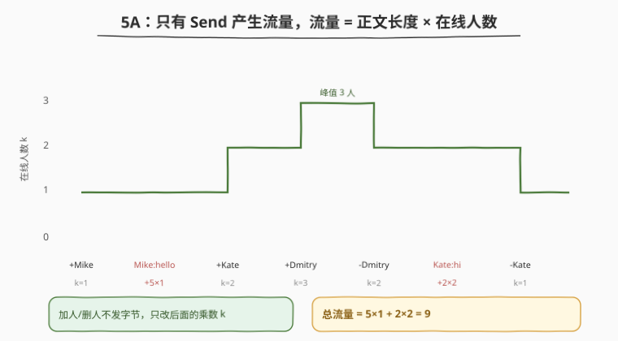
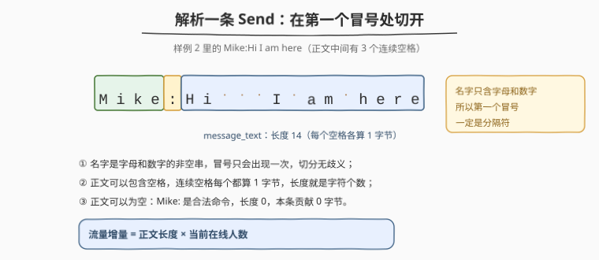
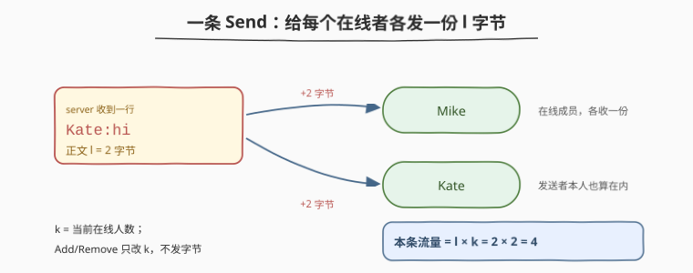

# Codeforces 5A 聊天服务器流量统计 题解

## 1. 题目概述

- **题目链接**：https://codeforces.com/problemset/problem/5/A
- **比赛来源**：Codeforces Beta Round 5 · Problem A（2010-03-21）
- **难度**：1000
- **标签**：实现、字符串处理、模拟
- **评测类型**：普通（单组输入，唯一答案）
- **限制**：时间 1 s / 内存 64 MB

**题意**：聊天服务器要处理三种命令，每行一条：

- `+<name>`：把 `name` 加入聊天；
- `-<name>`：把 `name` 从聊天中移出；
- `<sender_name>:<message_text>`：`sender_name` 向**当前所有在线者**（包括自己）发送一条正文为 `message_text` 的消息。

`Add` 与 `Remove` 不产生任何出网流量；`Send` 会给每个在线者各发 $l$ 个字节，其中 $l$ 是正文长度。给定全部命令，求服务器累计产生多少出网流量。

**约束**：

- 命令条数 $\le 100$，每行长度 $\le 100$，名字是字母和数字组成的非空串，正文可以含空格、**可以为空**；
- 名字区分大小写，且题面保证输入合法（不会重复添加、不会删除不存在的人，发送者必在聊天中）；
- 命令规模只有 $10^4$ 个字符量级，$O(\text{总字符数})$ 甚至 $O(\text{命令数} \times \text{在线人数})$ 都绰绰有余；真正需要注意的是**按行读入**（正文含空格）与**空正文**这两个格式细节，以及答案在 `int` 内（上界约 $10^6$）但用 `long long` 更稳妥。

## 2. 示例与观察

官方样例 1（输入 / 输出原样）：

```text
输入：
+Mike
Mike:hello
+Kate
+Dmitry
-Dmitry
Kate:hi
-Kate

输出：
9
```

官方样例 2（输入 / 输出原样）：

```text
输入：
+Mike
-Mike
+Mike
Mike:Hi   I am here
-Mike
+Kate
-Kate

输出：
14
```

**样例 1 逐步演算**：

| 步骤 | 命令 | 处理前在线数 $k$ | 正文长度 $l$ | 本条流量 | 累计 |
|------|------|------|------|------|------|
| 1 | `+Mike` | 0 → 1 | — | 0 | 0 |
| 2 | `Mike:hello` | 1 | 5 | 5 | 5 |
| 3 | `+Kate` | 1 → 2 | — | 0 | 5 |
| 4 | `+Dmitry` | 2 → 3 | — | 0 | 5 |
| 5 | `-Dmitry` | 3 → 2 | — | 0 | 5 |
| 6 | `Kate:hi` | 2 | 2 | 4 | 9 |
| 7 | `-Kate` | 2 → 1 | — | 0 | 9 |

**样例 2 逐步演算**：`+Mike`、`-Mike`、`+Mike` 之后在线数为 1；第 4 行是 `Mike:Hi   I am here`，正文 `Hi   I am here` 里 `Hi`、`I`、`am`、`here` 之间有 **3 个连续空格**，逐字符数长度是 $2+3+1+1+2+1+4=14$，所以流量 $=14\times 1=14$；后面的 `-Mike`、`+Kate`、`-Kate` 都不产生流量，最终 14。

**观察**：

1. 答案只与每条 `Send` 的「正文长度」和「发送瞬间的在线人数」有关，与消息内容、名字都无关；
2. `+`/`-` 的作用只是把在线人数 $k$ 加一或减一，本身不产生流量；
3. 流量可以写成求和式 $\sum_{\text{每条 Send}} l_i \times k_i$，是若干项之和，可以边读边累加，**不需要保存任何历史**。

## 3. 解题思路

### 3.1 朴素做法与瓶颈

最直白的做法是真正"模拟服务器"：用 `set<string>` 记录在线成员，遇到 `Send` 就遍历集合、给每个成员累加 $l$ 字节。它的复杂度是 $O(\text{命令数} \times \text{在线人数})$，最坏 $100 \times 100 = 10^4$ 次加法，在本题完全跑得动，所以**本题不卡时间复杂度**，卡的是"能不能正确读入一行带空格的文本"。

真正的两个坑在解析上：

- 如果用 `cin >> s` 或 `split()` 按空白切分，`Mike:Hi   I am here` 会被切成 `Mike:Hi`、`I`、`am`、`here` 四段，长度算成 8 而不是 14；
- 正文允许为空，`Mike:` 这一行是合法的 `Send`，长度为 0，不能当作非法输入丢掉。

### 3.2 核心观察：流量 = $\sum l_i \times k_i$



把所有命令按时间排成一条线，只跟踪一个量——**在线人数 $k$**。`+` 让阶梯上升一格，`-` 让阶梯下降一格，`Send` 不改变阶梯高度，而是在当时的阶梯高度上结算一次 $l \times k$。

图里是样例 1 的实际情况：`+Mike` 后 $k=1$，`Mike:hello` 结算 $5\times 1=5$；然后 `+Kate`、`+Dmitry` 把 $k$ 抬到 3，`-Dmitry` 又降回 2，`Kate:hi` 结算 $2\times 2=4$；$5+4=9$。

于是整个问题只剩下一个循环：读一行 → 若是 `+`/`-` 就改 $k$ → 否则在冒号处切开、把 $l\times k$ 加进答案。因为**流量是每条命令的独立贡献之和**，不存在"后一条命令需要前一条命令的中间状态"之外的耦合，所以边读边算即可。

### 3.3 算法流程



1. 令 `k = 0`（在线人数）、`ans = 0`（累计流量）；
2. 用 `getline` / 按 `'\n'` 切分，**逐行**读入，直到文件结束；
3. 看这一行的第一个字符：
   - `'+'`：`k += 1`；
   - `'-'`：`k -= 1`；
   - 其他：这一行是 `Send`，用 `find(':')` 找到**第一个**冒号，令 $l = \text{行长度} - \text{冒号位置} - 1$，然后 `ans += l * k`；
4. 全部读完后输出 `ans`。

第 3 步里"第一个冒号"之所以安全，是因为名字只由字母和数字组成，正文里也不会出现冒号（题面限定正文只有字母、数字和空格），所以冒号在一行里至多出现一次，怎么切都不会错。



实现上**不需要真的存储在线成员**：名字在本题里没有其他用途（不用去重、不用排序、不用查在线状态，因为输入保证合法），所以只需要一个计数器 `k`。如果哪天题目改成要校验"删的人是否存在"，再换成 `set` 也不迟——那时仍可用 `k = set.size()` 取人数。

### 3.4 样例走查

以样例 1 为例，逐行执行上面的流程：

| 读到的行 | 判定 | 动作 | $k$ | $l$ | `ans` |
|------|------|------|------|------|------|
| `+Mike` | 首字符 `+` | `k += 1` | 1 | — | 0 |
| `Mike:hello` | 其他 | 冒号在位置 4，$l=10-4-1=5$ | 1 | 5 | 5 |
| `+Kate` | 首字符 `+` | `k += 1` | 2 | — | 5 |
| `+Dmitry` | 首字符 `+` | `k += 1` | 3 | — | 5 |
| `-Dmitry` | 首字符 `-` | `k -= 1` | 2 | — | 5 |
| `Kate:hi` | 其他 | 冒号在位置 4，$l=7-4-1=2$ | 2 | 2 | 9 |
| `-Kate` | 首字符 `-` | `k -= 1` | 1 | — | 9 |

最后输出 9，与官方输出一致。

## 4. 正确性证明

**引理 1（`Send` 的贡献）**：设处理某条 `Send` 时在线人数为 $k$，正文长 $l$，则这条命令给服务器增加恰好 $l \cdot k$ 字节流量。

**证明**：题面规定 `Send` 时服务器"向聊天的每个参与者各发送 $l$ 个字节"，参与者恰有 $k$ 人，且发送者本人也在其中（也收一份）。按人数求和即 $k$ 个 $l$ 相加，等于 $l\cdot k$。∎

**引理 2（`+`/`-` 的贡献）**：`Add` 与 `Remove` 命令的流量贡献为 0，且它们只把在线人数 $k$ 改变 $\pm 1$（题面保证输入合法，故不会删到不存在的人）。

**证明**：题面明说服务器不为 `Add`/`Remove` 发送流量，故贡献为 0；又每条 `+` 恰加入一个此前不在聊天中的名字、每条 `-` 恰移出一个此前在聊天中的名字，所以 $k$ 精确地增加/减少 1。∎

**引理 3（扫描后 $k$ 正确）**：按算法流程扫描到任意位置时，计数器 `k` 等于此刻聊天中的真实人数。

**证明**：对命令条数归纳。初始 `k = 0` 与"还没有人加入"一致；若扫描前 `k` 正确，则由引理 2，`+`/`-` 后 `k` 仍正确，`Send` 不改变人数故也正确。∎

**定理**：算法输出的 `ans` 等于服务器处理全部命令产生的总出网流量。

**证明**：总流量按命令可分解为各条命令贡献之和（不同命令互不重叠）。由引理 2，`Add`/`Remove` 的贡献为 0；由引理 3 与引理 1，每条 `Send` 的贡献被精确累加为 $l\cdot k$。算法对每条命令都做了且只做了一次对应处理，所以累加结果等于总流量。∎

## 5. 复杂度分析

- **时间**：$O(L)$，其中 $L$ 是输入的总字符数（$\le 100 \times 100 = 10^4$）。每行只做一次 `find` 与一次乘法，`getline` 读入本身也是 $O(L)$。
- **空间**：额外空间 $O(1)$（C++ 只保存当前一行）；Python 版为了少写缓冲逻辑而一次性读入全部输入，占用 $O(L)$ 字节，仍只有 $10^4$ 量级。
- **数值范围**：$l \le 100$，$k \le 100$，命令数 $\le 100$，答案上界约 $10^6$，`int` 就够；代码仍用 `long long`，免得以后把规模放大时踩坑。
- **与时限的关系**：1 s 的时限对 $10^4$ 字符是压倒性的。实测（含进程启动）最大规模输入 C++ 约 4 ms，余量在 200 倍以上。

## 6. 参考代码

### C++17

```cpp
#include <bits/stdc++.h>
using namespace std;

int main() {
    ios::sync_with_stdio(false);
    cin.tie(nullptr);

    string line;
    long long online = 0;      // 当前在线人数
    long long traffic = 0;     // 累计传出流量

    while (getline(cin, line)) {
        if (!line.empty() && line.back() == '\r') line.pop_back();  // 兼容 CRLF
        if (line.empty()) continue;                                 // 空行没有内容
        if (line[0] == '+') {
            ++online;                       // 加人：不产生流量
        } else if (line[0] == '-') {
            --online;                       // 删人：不产生流量
        } else {
            size_t colon = line.find(':');   // 发送：<名字>:<正文>
            if (colon == string::npos) continue;
            long long len = (long long)line.size() - (long long)colon - 1;
            traffic += len * online;         // 每个在线者各收 len 字节
        }
    }

    cout << traffic << '\n';
    return 0;
}
```

### Python3

```python
import sys


def main() -> None:
    data = sys.stdin.buffer.read().decode("utf-8", "replace")
    online = 0
    traffic = 0
    for line in data.split("\n"):
        if line.endswith("\r"):
            line = line[:-1]
        if not line:
            continue                      # 末尾换行产生的空串 / 多余空行
        if line[0] == "+":
            online += 1                   # 加人，不产生流量
        elif line[0] == "-":
            online -= 1                   # 删人，不产生流量
        else:
            name, sep, text = line.partition(":")
            if not sep:
                continue
            traffic += len(text) * online  # 每个在线者各收 len(text) 字节
    sys.stdout.write(str(traffic) + "\n")


main()
```

两份代码都只用标准库，可原样提交。注意 Python 版用 `partition(":")` 在**第一个**冒号处切分（`split(":")` 也行，但要取第二段之后的所有段并重新拼回去，容易写错）。

## 7. 边界情况与易错点

1. **正文里的连续空格（本题最经典的 WA 点）**：`Mike:Hi   I am here` 的长度是 14 而不是 8。任何按空白切分的读法（`cin >>`、`scanf("%s")`、`split()`）都会丢掉空格，必须整行读入。
2. **空正文**：`Mike:` 是合法命令，正文长度 0，这条命令贡献 $0\times k=0$。不能因为它"看起来没内容"就跳过整行——跳过虽然结果相同（贡献确实是 0），但会把"空行"与"空正文"两种情况混为一谈，遇到别的题就错了。
3. **空格与空行**：正文为空时行内容是 `Mike:`，不是空串；题面保证每行都是一条命令，所以不会出现真正的空行。代码里 `if (line.empty()) continue;` 只是防御（也兼容数据文件末尾多出一个空行的情况），不会吃掉任何合法命令。
4. **命令类型判定**：按首字符分三类最稳——名字只含字母和数字，所以以 `+`/`-` 开头的一定是 Add/Remove，其余一定是 Send。用"行内有没有冒号"判断也可以（`+`/`-` 行不含冒号），但首字符与题面给出的三种命令格式一一对应，最不容易写错。
5. **整数范围**：答案上界约 $10^6$，`int` 够用；但若把"命令数 $\le 100$"放宽到 $10^6$、正文长度放宽，答案会到 $10^{12}$ 量级，`int` 就会溢出，所以养成用 `long long` 的习惯更稳。
6. **`getline` 与结尾换行**：文件末尾的 `'\n'` 不会让 `getline` 多产生一行空行，所以无需特殊处理；但若输入是 CRLF，行尾会多一个 `'\r'` 被算进正文长度，导致答案偏大，代码里显式去掉了 `'\r'`。
7. **多测**：本题**只有一组数据**（既没有 $t$，也不是读到 EOF 的多组），不要外面再套一层 `while (T--)`。
8. **发送者不在线**：题面保证不会出现这种输入；实现只按在线人数计费，不校验发送者是否在线，所以即使数据异常也不会崩，只是语义上不再成立。

## 8. 验证记录

- **编译环境与命令**：本机只有 `Apple clang 21.0.0`（`/usr/bin/g++` 是 clang 软链），没有 GNU `g++` 与 libstdc++，因此用 `clang++ -std=c++17 -O2 -Wall -I codeforces/tools/include` 搭配本地 `bits/stdc++.h` 兼容头编译（代码只用标准库，可原样提交 GNU C++17）。Python 为 `Python 3.9.6`。
- **官方样例**：2 / 2 通过（C++ 与 Python 输出均为 `9`、`14`），逐字节与 JSON 中的 `out` 一致。
- **额外测试**：样例 2 的 14 字节长正文、空正文 `Mike:`、`-` 后再次 `+`、单人聊天等边界手写用例 12 组，C++ 与 Python 全部一致。
- **独立暴力对拍**：另写一份暴力（`/tmp/cf_verify_5_A/brute.py`）——用 `list` 维护在线成员列表、用 `ln.index(":")` 切片、对 `Send` 真的**遍历成员列表逐个累加** $l$ 字节，与参考解的"只维护计数器"实现思路不同。随机生成 **300 组**合法命令序列（命令数 1–14，名字随机、发送者取当前在线者、正文含 0–4 个词且词间有 1–3 个空格、18% 概率为空正文），三方（C++ 参考解 / Python 参考解 / 暴力）输出 **300/300 完全一致**。
- **最大约束性能**：构造 100 条命令（50 条 `+` 加 50 个 36 字符长名字 + 50 条正文 60 字符的 `Send`，每行 ≤ 100 字符），答案 150000；C++ 端到端约 4 ms，Python 约 21 ms，峰值内存 < 3 MB，相对 1 s / 64 MB 余量极大。
- **图片校验**：三张 SVG（`cf5a_events.svg`、`cf5a_parse.svg`、`cf5a_fanout.svg`）均通过 `xml.etree.ElementTree.parse`；另用脚本按字符宽度估算每个 `text` 的包围盒，检查"不越出 viewBox、不互相重叠、框内文字不越出框"，并用 headless Chrome 渲染为 PNG 后检测画布四边 2px 内无墨迹（确认没有任何文字被裁切）。
- **公式校验**：公式均为 `$...$` / `$$...$$`，星号直接写 `*`，`\text{}` 内无裸 `#`，经 KaTeX（`throwOnError`）渲染无报错。
- **复核状态**：verified（样例、随机对拍、性能、图片、公式五项均实跑通过；唯一环境差异是本机无 GNU g++，已用 clang++ 等价验证）。

## 相关题目与扩展

- [Codeforces 5B Center Alignment](https://codeforces.com/problemset/problem/5/B)：同场 B 题，同样以"按行读入 + 逐行处理"为核心，只是处理的是排版而不是计数。
- [Codeforces 5C Longest Regular Bracket Sequence](https://codeforces.com/problemset/problem/5/C)：同场 C 题，字符串扫描 + 统计，是 Beta Round 5 里最难的一题。
- [Codeforces 4C Registration system](https://codeforces.com/problemset/problem/4/C)：名字去重与编号，练 `map`/`set` 与字符串读入。
- [Codeforces 1B Spreadsheet](https://codeforces.com/problemset/problem/1/B)：字符串解析的代表题，切分规则比本题更绕。
- [Codeforces 71A Way Too Long Words](https://codeforces.com/problemset/problem/71/A)：最短的字符串处理入门题，适合热身。

**延伸思考**：

1. **如果要求"不给自己发"**：`Send` 的乘数会从 $k$ 变成 $k-1$，样例 1 的答案就变成 $5\times 0 + 2\times 1 = 2$。改动只有一行，但前提是发送者一定在线；若发送者可能不在线，则乘数要么是 $k$（他不在线）要么是 $k-1$，必须先判断。
2. **如果允许同名多端登录**：就不能只用一个计数器，而要用 `map<string,int>` 记录每个名字的连接数，`+`/`-` 增减，$k$ 取所有连接数之和。此时"删除不存在的人"才需要真正校验。
3. **如果命令数放大到 $10^6$**：答案会远超 `int`（$10^{12}$ 以上），必须 `long long`；同时 `getline` 的常数开始显眼，需要换用整块 `read` + 手写扫描（这也是本题 Python 版一次性读入的原因）。
4. **如果正文按字节计费而不是按字符**：`len(text)` 要换成 UTF-8 编码后的字节数，这个改动看似微小，却是真实聊天服务器里最容易被忽略的一处（一个汉字 3 字节）。

