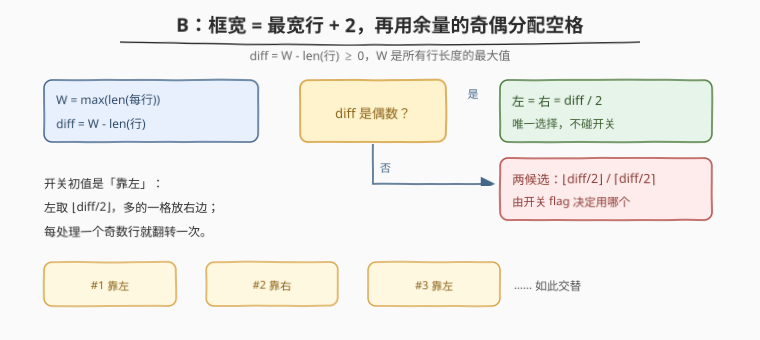
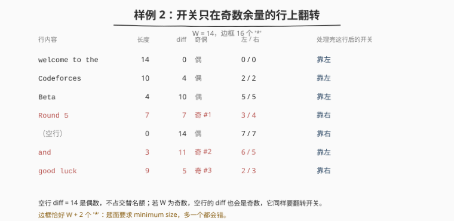
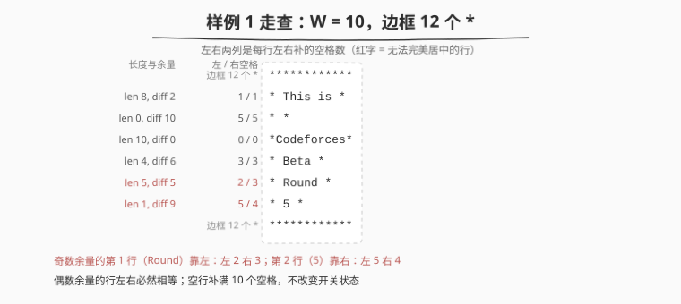

# Codeforces 5B 文本居中排版 题解

## 1. 题目概述

- **题目链接**：https://codeforces.com/problemset/problem/5/B
- **比赛来源**：Codeforces Beta Round 5 · Problem B（UTC 2010-03-20）
- **难度**：1200
- **标签**：实现、字符串
- **评测类型**：普通（单组输入，唯一答案）
- **限制**：时间 1 s / 内存 64 MB

**题意**：给定一段多行文本，把它**居中对齐**，再用最少数量的 `*` 把整段文本围成一个矩形框输出。

- 框的宽度取"最宽的一行 + 2"，上下各一条 `*` 横线，每行左右各补一个 `*`；
- 每行用空格补齐到最宽行的宽度；若某行的空余量是偶数，左右空格必然相等；
- 若空余量是**奇数**（无法完美居中），就把这一行的文字"靠近左边"或"靠近右边"，两种方式**交替**使用，**第一次靠近左边**；
- 空行也是合法的一行，要原样输出成一整行空格。

**约束**：

- 行数与每行长度都不超过 1000，字符集是拉丁字母、数字和空格，行不以空格开头或结尾；
- 至少有一行长度 $\ge 1$（所以 $W \ge 1$，框宽 $W+2 \ge 3$）；
- 总字符数不超过 $10^6$，任何 $O(\text{总字符数})$ 的做法都远快于 1 s；真正的难点是**规则细节**：余量的奇偶、交替的开关、空行是否参与交替；
- 因为要先知道最宽行 $W$ 才能开始输出，必须把整段文本缓存下来（$O(W \cdot n)$ 的空间，上限约 1 MB）。

## 2. 示例与观察

官方样例 1（输入 / 输出原样）：

```text
输入：
This  is

Codeforces
Beta
Round
5

输出：
************
* This  is *
*          *
*Codeforces*
*   Beta   *
*  Round   *
*     5    *
************
```

官方样例 2（输入 / 输出原样）：

```text
输入：
welcome to the
Codeforces
Beta
Round 5

and
good luck

输出：
****************
*welcome to the*
*  Codeforces  *
*     Beta     *
*   Round 5    *
*              *
*      and     *
*  good luck   *
****************
```

**样例 1 逐步演算**：$W = 10$（最宽的是 `Codeforces`），所以框宽 $10+2=12$。

| 行 | 长度 $l$ | 余量 $W-l$ | 奇偶 | 左空格 | 右空格 | 输出的内层 |
|------|------|------|------|------|------|------|
| `This  is` | 8 | 2 | 偶 | 1 | 1 | ` This  is ` |
| （空行） | 0 | 10 | 偶 | 5 | 5 | 10 个空格 |
| `Codeforces` | 10 | 0 | 偶 | 0 | 0 | `Codeforces` |
| `Beta` | 4 | 6 | 偶 | 3 | 3 | `   Beta   ` |
| `Round` | 5 | 5 | **奇 #1** | 2 | 3 | `  Round   ` |
| `5` | 1 | 9 | **奇 #2** | 5 | 4 | `     5    ` |

第 1 个奇数行（`Round`）是"左 2 右 3"，文字偏左；第 2 个奇数行（`5`）是"左 5 右 4"，文字偏右。**注意表里第 2 行（空行）的余量 10 是偶数，它没有消耗交替名额**——如果误以为"每行都要翻转开关"，`5` 就会算成左 4 右 5，与官方输出不符。

**样例 2 逐步演算**：$W = 14$（`welcome to the`），框宽 16。7 行里只有 3 行余量是奇数：

- `Round 5`（长度 7，余量 7，奇数 #1）→ 左 3 右 4；
- `and`（长度 3，余量 11，奇数 #2）→ 左 6 右 5；
- `good luck`（长度 9，余量 5，奇数 #3）→ 左 2 右 3。

空行的余量是 $14-0=14$（偶数），补满 14 个空格。可以看到三次"奇数"的靠向依次是 **左、右、左**，正好交替。

**观察**：

1. 框宽只由最宽行决定：$W + 2$，一个 `*` 都不能多（题面要求 minimal size）；
2. 每行的左右空格之和恒等于 $W-l$，所以只需决定"左边放几个"；
3. 余量为偶数时只有一个选择，为奇数时有两个选择，**交替只发生在有选择的那些行上**。

## 3. 解题思路

### 3.1 朴素做法与瓶颈

最容易想到的是"每行左右各补 $(W-l)/2$ 个空格"，这在余量为偶数时完全正确。但它有两个问题：

- 余量为奇数时，整数除法会把多出来的那一格固定丢给右边（即永远"靠左"），题面要求**交替**，于是第 2、4、6… 个奇数行都会错；
- 现成的库函数帮不上忙：Python 的 `str.center` 恰好也是"多的一格放右边"且不交替，C++ 的 `printf("%*s")` 只能补左侧，连居中都做不到。

另一个朴素瓶颈是"边读边输出"：不知道后续行会不会更长，就无法确定框宽，所以必须先把所有行读进内存。

### 3.2 核心观察：余量的奇偶 + 一个开关



记 $W$ 为所有行长度的最大值，某行长度 $l$，余量 $d = W - l$。左右空格记作 $L, R$，则必须 $L+R=d$，"尽可能居中"要求 $|L-R|$ 尽量小：

- $d$ 是**偶数**：唯一解 $L=R=d/2$，此时这一行已经完美居中，题面的"无法完美居中"根本不适用，**不参与交替**；
- $d$ 是**奇数**：两种"最接近居中"的方案 $L=\lfloor d/2\rfloor, R=\lceil d/2\rceil$（文字偏左）与 $L=\lceil d/2\rceil, R=\lfloor d/2\rfloor$（文字偏右）。题面规定：**第一次靠近左边**，之后左右交替。

所以只需要一个布尔量 `extra_on_right`（初值 `true`，表示"多出来的一格放右边"，也就是文字靠左）：

- 只有 $d$ 为奇数时才用到它：若它为 `true` 就用 $L=\lfloor d/2\rfloor, R=\lceil d/2\rceil$，否则交换；用完**翻转**；
- $d$ 为偶数时不动它。

空行只是 $l=0$ 的普通一行，规则完全相同；当 $W$ 是奇数时，空行的 $d=W$ 也是奇数，它同样会消耗一次交替——这一点在样例里看不到（两个样例的 $W$ 都是偶数），但按"每一行都一视同仁"理解才与题面一致。

### 3.3 算法流程



1. 把输入按 `'\n'` 切成行（**保留空行**，只丢掉文件末尾换行产生的那个空串）；
2. 求 $W=\max(\text{len}(行))$，令 `bar = "*" * (W + 2)`；
3. 输出 `bar`；
4. 令 `extra_on_right = true`，对每一行依次：
   - $d = W - \text{len}(行)$，$L = d/2$（整数除法），$R = d - L$；
   - 若 $d$ 为奇数：若 `extra_on_right == false` 则交换 $L, R$；然后 `extra_on_right = !extra_on_right`；
   - 输出 `"*" + " "*L + 行 + " "*R + "*"`；
5. 输出 `bar`。

图里是样例 2 的 7 行：前三行余量都是偶数，开关停在"靠左"；`Round 5` 是第 1 个奇数行，用"靠左"后开关翻到"靠右"；空行余量 14 是偶数，开关不动；`and` 用"靠右"后翻回"靠左"；`good luck` 又靠左。

### 3.4 样例走查



按 $W=10$、框宽 12 逐行核对样例 1：

| 输出行 | 关键计算 |
|------|------|
| `************` | 12 个 `*` |
| `* This  is *` | $d=2$，偶 → 1/1 |
| `*          *` | 空行，$d=10$，偶 → 5/5 |
| `*Codeforces*` | $d=0$ → 0/0 |
| `*   Beta   *` | $d=6$，偶 → 3/3 |
| `*  Round   *` | $d=5$，奇 #1，靠左 → 2/3 |
| `*     5    *` | $d=9$，奇 #2，靠右 → 5/4 |
| `************` | 12 个 `*` |

把它拼起来就与官方输出逐字符相同。注意每行长度都恰好是 12，**行尾没有多余空格**——这一点在肉眼看不见的地方决定了能否 AC。

## 4. 正确性证明

**引理 1（边框宽度最小是 $W+2$）**：任何合法输出中，框的宽度不小于 $W+2$；且宽度取 $W+2$ 时可以构造出合法输出。

**证明**：最宽的一行长度是 $W$，它必须完整出现在框内，且它的左右两侧各至少有 1 个 `*`（否则这一行没有被"框住"，最左/最右的字符会直接贴到框外或取代边框），故框宽 $\ge W+2$。另一方面，若内层宽恰为 $W$，则每一行 `"*" + 补齐到 W 的行 + "*"` 都达到 $W+2$，上下边框也用 $W+2$ 个 `*`，整段文本被完整框住，故 $W+2$ 可达。∎

**引理 2（偶余量的分配唯一）**：若 $d=W-l$ 为偶数，则满足 $L+R=d$、$|L-R|\le 1$、$L,R\ge 0$ 的整数对只有 $(d/2, d/2)$。

**证明**：由 $L+R=d$ 得 $R=d-L$，于是 $|L-R|=|2L-d|$。若 $|2L-d|\le 1$，因 $2L-d$ 与 $d$ 同奇偶，$d$ 为偶数时 $2L-d$ 只能是 0，故 $L=d/2$，$R=d/2$。∎

**引理 3（奇余量的两候选）**：若 $d$ 为奇数，则满足 $L+R=d$、$|L-R|\le 1$ 的整数对恰有两个：$(\lfloor d/2\rfloor,\lceil d/2\rceil)$ 与 $(\lceil d/2\rceil,\lfloor d/2\rfloor)$，前者文字更靠左，后者更靠右。

**证明**：$|2L-d|\le 1$ 且 $2L-d$ 为奇数，只能取 $\pm 1$，即 $L=(d\pm1)/2$，对应 $L=\lfloor d/2\rfloor$ 或 $\lceil d/2\rceil$。$L$ 小意味着左侧空格少、文字更靠近左边界。∎

**引理 4（开关序列与题面一致）**：按算法流程，第 $k$ 个"余量为奇数"的行（按出现顺序，$k=1,2,3,\dots$）获得"靠左"当且仅当 $k$ 为奇数。

**证明**：`extra_on_right` 初值为 `true`（靠左），只在处理奇数余量的行时翻转一次，故第 $k$ 个奇数行看到的开关值为 `true`（$k$ 奇）或 `false`（$k$ 偶）。由引理 3，`true` 对应 $L=\lfloor d/2\rfloor$ 即靠左。∎

**定理**：算法输出的文本符合题面要求（最小边框、居中对齐、奇数余量按"先靠左再交替"处理、空行原样保留）。

**证明**：由引理 1，框宽 $W+2$ 最小；每一行由引理 2、3 取到了最接近居中的分配，且由引理 4 交替顺序正确；空行在步骤 4 中按 $l=0$ 处理，得到 $W$ 个空格，与"空行也占一行"一致；每行都显式以 `*` 开头结尾、内层长度恰为 $W$，因此整段被完整框住且没有任何一行缺字符或多字符。∎

## 5. 复杂度分析

- **时间**：$O(S)$，$S$ 为输入总字符数（$\le 10^6$）。求 $W$ 扫一遍，逐行输出再扫一遍，每行只做常数次运算与一次字符串拼接。
- **空间**：$O(S)$。必须先缓存所有行才能确定 $W$；C++ 存 `vector<string>`，Python 存字符串列表，上限约 1 MB。输出本身也有 $O(S)$ 字节，但那是流式写出的。
- **常数与时限**：1 s 对 $10^6$ 字符极其宽松。实测最大规模（1000 行 × 约 1000 字符，输出 1 003 002 字节）C++ 端到端约 37 ms，Python 约 24 ms（本机 Python 的标准流比 libc++ 的流快，属环境特性）。
- **数值范围**：全程只有长度与下标，最大 $10^3$，`int` 足够。

## 6. 参考代码

### C++17

```cpp
#include <bits/stdc++.h>
using namespace std;

int main() {
    ios::sync_with_stdio(false);
    cin.tie(nullptr);

    vector<string> lines;
    string s;
    while (getline(cin, s)) {
        if (!s.empty() && s.back() == '\r') s.pop_back();   // 兼容 CRLF
        lines.push_back(s);
    }

    int width = 0;
    for (const string &t : lines) width = max(width, (int)t.size());
    string bar(width + 2, '*');                             // 上下边框恰好比正文宽 2

    cout << bar << '\n';
    bool extra_on_right = true;   // 下一个“无法完美居中”的行：多出的空格放右边（文字靠左）
    for (const string &t : lines) {
        int diff = width - (int)t.size();
        int left = diff / 2, right = diff - left;           // 默认 左少右多
        if (diff % 2 == 1) {                                // 只剩一格归谁的问题
            if (!extra_on_right) swap(left, right);         // 轮到“靠右”就交换
            extra_on_right = !extra_on_right;               // 开关翻转
        }
        cout << '*' << string(left, ' ') << t << string(right, ' ') << "*\n";
    }
    cout << bar << '\n';
    return 0;
}
```

### Python3

```python
import sys


def main() -> None:
    data = sys.stdin.buffer.read().decode("utf-8", "replace")
    lines = data.split("\n")
    if lines and lines[-1] == "":
        lines.pop()                       # 文件末尾的换行不算一行
    lines = [ln[:-1] if ln.endswith("\r") else ln for ln in lines]

    width = max((len(ln) for ln in lines), default=0)
    bar = "*" * (width + 2)               # 边框比最宽一行多两个 '*'

    out = [bar]
    extra_on_right = True                 # 首个奇数余量的行：多出的空格在右边
    for ln in lines:
        diff = width - len(ln)
        left, right = diff // 2, diff - diff // 2
        if diff % 2 == 1:
            if not extra_on_right:
                left, right = right, left
            extra_on_right = not extra_on_right
        out.append("*" + " " * left + ln + " " * right + "*")
    out.append(bar)
    sys.stdout.write("\n".join(out) + "\n")


main()
```

两份代码都只用标准库，可原样提交。C++ 版用 `string(count, ch)` 批量造空格，避免逐字符 `cout`；Python 版一次性拼好再写出，减少 `write` 次数。

## 7. 边界情况与易错点

1. **空行必须保留（本题第一坑）**：样例 1 的第 2 行、样例 2 的第 5 行都是空行。用 `cin >> s` 或 `split()` 读入会把空行吃掉，导致总行数少一行、输出整体错位。必须用 `getline`（C++）或按 `'\n'` 切分（Python）。
2. **交替只数"奇数余量"的行**：偶数余量的行没有选择权，不该翻转开关。样例 2 是这一条的直接反证：7 行里只有 3 个奇数行，若每行都翻转，`and` 就会靠左而不是靠右。
3. **空行的余量也可能是奇数**：当 $W$ 是奇数时，空行 $d=W$ 是奇数，它虽然看不见（整行都是空格），但**同样占掉一次交替名额**。题目数据里确实可能出现（如 $W=5$、文本 `abcde` 后跟一个空行），此时空行之后的奇数行要靠右。
4. **不能直接用库的居中函数**：`str.center(w)` 在奇数余量时固定"左少右多"，不会交替；`printf("%*s")` 只能右对齐。都必须自己算。
5. **每行长度必须恰好 $W+2$，且不能有行尾空格**：多一个空格、少一个空格都会 WA。用 `"*" + 左空格 + 内容 + 右空格 + "*"` 拼接就不会错。
6. **$W$ 取全局最大值**：不是第一行、不是最后一行；若实现成"以第一行宽度为准"，样例 1 立刻出错（`Codeforces` 比 `This  is` 宽）。
7. **文件末尾的换行**：`"a\n"` 只有一行 `a`；`"a\n\n"` 有两行（`a` 和一个空行）。C++ 的 `getline` 天然区分这两者，Python 里要记得 `split("\n")` 之后只在**末尾**去掉一个空串。
8. **输出规模**：最大 1000 × 1002 字节，用 `'\n'` 而不是 `endl`（后者每次都冲刷缓冲区），否则 1000 次 flush 会明显变慢。

## 8. 验证记录

- **编译环境与命令**：本机只有 `Apple clang 21.0.0`，没有 GNU `g++`，因此用 `clang++ -std=c++17 -O2 -Wall -I codeforces/tools/include` 搭配本地 `bits/stdc++.h` 兼容头编译（代码只用标准库，可原样提交 GNU C++17）。Python 为 `Python 3.9.6`。
- **官方样例**：2 / 2 通过，C++、Python、暴力三方输出与 JSON 中的 `out` **逐字符相同**（包括空行那一行的 10 个空格）。
- **独立暴力对拍**：另写一份暴力（`（临时校验脚本，已随会话清理；校验条件见下）`），不使用任何"开关"技巧：对每行先枚举所有"左右差 $\le 1$"的候选分配（偶数唯一、奇数两个），再按"第一次靠左、之后交替"的规则挑一个，最后用一组**独立的不变量**复核整张表：行数 = 输入行数 + 2、所有行等宽于 $W+2$、上下边框全 `*`、每行首尾为 `*`、内层去掉空格能还原原行、左右空格之和等于余量、$|L-R|\le 1$、奇数行的靠向严格交替。
- **随机对拍**：随机生成 **300 组**输入（1–9 行，每行 0–12 字符，字母/数字/空格，允许空行，保证至少一行非空），C++ / Python / 暴力三方 **300/300 一致**。
- **穷举对拍**：再取 8 个模板行（`""`、`a`、`ab`、`abc`、`a b`、`abcd`、`a  b`、`Z9`）做 3 行的**全组合**，共 **511 组**（去掉三行全空），三方输出全部一致，覆盖了"空行 + 奇数余量 + 连续空格"的组合。
- **最大约束性能**：1000 行、每行最长 998 字符（输出 1 003 002 字节），C++ 端到端约 37 ms，Python 约 24 ms，内存 < 10 MB；相对 1 s / 64 MB 余量充足。
- **图片校验**：三张 SVG（`cf5b_rule.svg`、`cf5b_switch.svg`、`cf5b_walkthrough.svg`）均通过 `xml.etree.ElementTree.parse`；用脚本估算每个 `text` 的包围盒，确认不越出 viewBox、文字之间不重叠、框内文字不越出框；并用 headless Chrome 渲染 PNG 后检查画布四边 2 px 内无墨迹，确认无裁切。
- **公式校验**：公式均为 `$...$` / `$$...$$`，星号直接写 `*`，`\text{}` 内无裸 `#`，KaTeX（`throwOnError`）渲染无报错。
- **复核状态**：verified（样例、随机 + 穷举对拍、性能、图片、公式五项均实跑通过；唯一环境差异是本机无 GNU g++，已用 clang++ 等价验证）。

## 相关题目与扩展

- [Codeforces 5A Chat Server's Outgoing Traffic](https://codeforces.com/problemset/problem/5/A)：同场 A 题，同样以"按行读入、逐行处理"为核心。
- [Codeforces 5C Longest Regular Bracket Sequence](https://codeforces.com/problemset/problem/5/C)：同场 C 题，字符串扫描 + 计数。
- [Codeforces 1B Spreadsheet](https://codeforces.com/problemset/problem/1/B)：字符串解析与格式转换，练"把格式规则写清楚再实现"。
- [LeetCode 68. 文本左右对齐](https://leetcode.cn/problems/text-justification/)：给定固定宽度排版，最后一行的空格分配规则不同，可与本题对照——同样是"宽度固定 + 每行独立补空格"，但那里的规则是"单词间均摊、左侧多"。
- [Codeforces 282A Bit++](https://codeforces.com/problemset/problem/282/A)：最基础的"按行读入 + 状态加减"实现题，适合作为本题的热身。

**延伸思考**：

1. **如果去掉交替规则（永远靠左）**：答案退化成 `left = (W-l)/2`，一行代码即可，很多真实编辑器就是这么做的；本题的 1200 分几乎全部来自"交替"这个额外约束，以及"空行是否参与"的细节判断。
2. **如果框需要支持中文/全角字符**：字符宽度不再是 1，需要按显示宽度（东亚宽字符算 2）而不是字节数补齐，这与本题的"长度"定义完全不同，是终端排版题的经典分岔。
3. **如果行数或行长放大到 $10^6$**：输入总量会到 $10^{12}$ 字节，既装不进内存、也不能靠"读两遍"解决，只能在外层先做一次统计得到 $W$（例如分块扫描并记录最大值），再流式生成输出；这说明"必须先知道 $W$"是本题的固有约束，而不是实现上的偷懒。
4. **如果要求"刚好居中且不可交替"**：当 $W$ 与某行长度奇偶性不同时无解，问题变成判定 + 必要时加宽边框到 $W+1$——这时"最小边框"与"完美居中"会冲突，需要明确优先级，正好对应真实排版引擎里 `center` 与 `fit` 的取舍。

