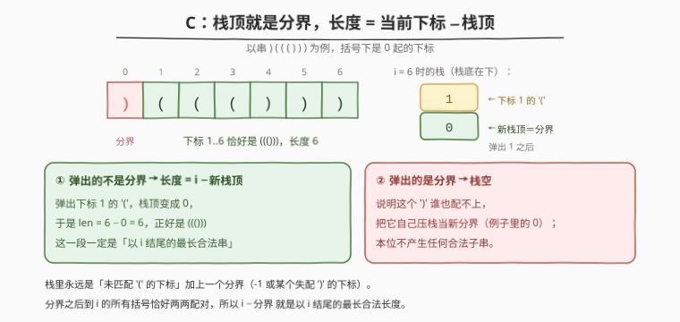
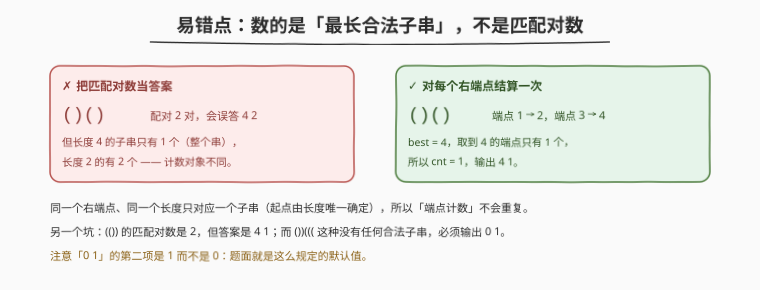
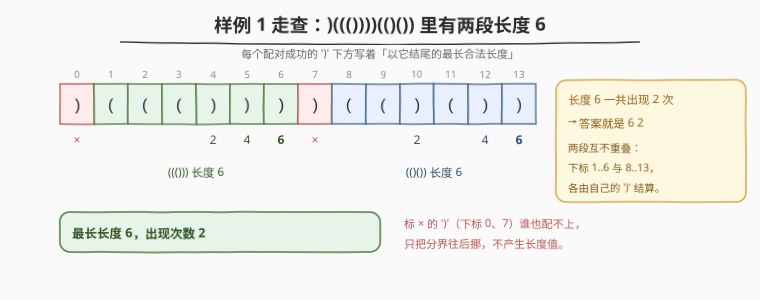

# Codeforces 5C 最长合法括号子串 题解

## 1. 题目概述

- **题目链接**：https://codeforces.com/problemset/problem/5/C
- **比赛来源**：Codeforces Beta Round 5 · Problem C（2010-03-21）
- **难度**：1900
- **标签**：字符串、栈、动态规划、贪心
- **评测类型**：普通（单组输入，唯一答案）
- **限制**：时间 2 s / 内存 256 MB

**题意**：给定一个只含 `(` 和 `)` 的非空字符串，求**最长的合法括号子串**（连续的一段，且是合法的括号序列）的长度，以及这种最长子串出现的**次数**。如果根本不存在合法子串，输出 `0 1`。

合法括号序列的定义：往其中插入 `+` 和 `1` 能得到正确的数学表达式。等价的可判定形式是：长度相等且为偶数、任意前缀中 `(` 的个数不少于 `)` 的个数、整段两者个数相等。

**约束**：

- 串长 $n \le 10^6$，只有一组数据；
- 子串个数是 $O(n^2)$ 量级，逐个枚举再判合法是 $O(n^3)$，即使优化成 $O(n^2)$ 也是 $10^{12}$ 级别，2 s 内绝无可能——必须做到 $O(n)$ 或 $O(n\log n)$；
- 内存 256 MB 足以开 $10^6$ 个 `int`（4 MB）的栈，但不要开 $10^6 \times 10^6$ 的二维表；
- 答案第二项（次数）上界是"配对成功的右括号个数" $\le n/2$，`int` 够用，代码仍用 `long long` 以防推广。

## 2. 示例与观察

官方样例 1（输入 / 输出原样）：

```text
输入：
)((())))(()())

输出：
6 2
```

官方样例 2（输入 / 输出原样）：

```text
输入：
))(

输出：
0 1
```

**样例 1 逐步演算**（下标从 0 开始）：

```text
下标  0 1 2 3 4 5 6 7 8 9 10 11 12 13
字符  ) ( ( ( ) ) ) ) ( (  )  (  )  )
```

| 片段 | 内容 | 是否合法 | 长度 |
|------|------|------|------|
| 0..0 | `)` | 否 | — |
| 1..6 | `((()))` | 是 | 6 |
| 2..5 | `(())` | 是 | 4 |
| 3..4 | `()` | 是 | 2 |
| 7..7 | `)` | 否 | — |
| 8..13 | `(()())` | 是 | 6 |
| 9..12 | `()()` | 是 | 4 |

最长的是 1..6 与 8..13，长度都是 6，共 2 个，所以输出 `6 2`。注意 1..6 与 8..13 是两个**互不重叠**的块，各自独立地"结算"。

**样例 2 逐步演算**：串是 `))(`，三个字符里没有任何一对能配上（两个右括号都没有左括号在它前面），所以合法子串个数为 0，按题面输出 `0 1`。**注意第二项是 1 而不是 0**——这是题目规定的特例。

**观察**：

1. 合法的子串一定是"一段一段"出现的，每段由某个右括号结算；
2. 同一段 `((()))` 内部还嵌套着 `(())`、`()` 等更短的合法子串，但它们不影响"最长"；
3. 一个合法的整体串可以看成若干"最小合法块"的拼接，所以"以某个位置结尾的最长合法子串"会跨过前面已经配好的块——这正是 DP / 栈要处理的地方。

## 3. 解题思路

### 3.1 朴素做法与瓶颈

最直接的做法：枚举所有 $O(n^2)$ 个子串，对每个子串用前缀和判合法（$O(1)$ 判，只要预处理前缀最小值），总复杂度 $O(n^2)$。$n=10^6$ 时是 $5\times 10^{11}$ 个子串，即使每个只花 1 ns 也要 500 s，**超时 250 倍以上**。

也可以对每个起点向右扫描、维护平衡值，一旦变负就停——平均能快一些，但最坏情况（如 `((((...`）仍是 $O(n^2)$。

瓶颈在于"子串"这个二维的自由度。合法括号序列的结构性很强，应该能只扫描一遍就确定每个右端点对应的最长合法子串。

### 3.2 核心观察：栈顶就是"分界"



用一个栈保存**尚未匹配的 `(` 的下标**，并在栈底额外放一个"分界"（初值 $-1$）。扫描到右括号 `)` 时：

1. 弹出栈顶；
2. 如果弹完之后栈**空了**，说明这个 `)` 谁也配不上（连分界都被弹掉了），于是把它自己的下标压栈，作为新的分界，本位不产生合法子串；
3. 如果栈**非空**，设新的栈顶为 $t$，则以当前位置 $i$ 结尾的最长合法子串长度就是

$$\text{len}(i) = i - t .$$

为什么是 $i-t$？分界 $t$ 把串切成两半：$t$ 本身是"没配上的东西"（$-1$、或某个失配的 `)`、或某个左括号），从 $t+1$ 到 $i$ 的所有括号恰好两两配对（中间没有任何悬空的括号），因此 $s[t+1..i]$ 是合法串；而任何以 $i$ 结尾的合法串都不能包含位置 $t$（否则平衡会被那个失配的括号破坏），所以起点必须 $> t$，长度最多是 $i-t$。

上图用 `)((()))` 演示了一次：处理 $i=6$ 之前栈是 $[0,1]$，弹出 $1$ 后栈顶是 $0$，长度 $=6-0=6$，恰好是 `((()))`。

### 3.3 算法流程与计数



1. 栈初始化为 `[-1]`（分界哨兵），`best = 0`，`cnt = 0`；
2. 从左到右扫描 $i = 0,1,\dots,n-1$：
   - $s_i = \texttt{(}$：把 $i$ 压栈；
   - $s_i = \texttt{)}$：弹出栈顶；若栈空则把 $i$ 压栈，否则令 $t$ 为栈顶，$L = i - t$：
     - 若 $L > \text{best}$：`best = L; cnt = 1`；
     - 若 $L == \text{best}$：`cnt += 1`；
3. 若 `best == 0` 输出 `0 1`，否则输出 `best cnt`。

**计数为什么这样算不会重复也不会漏？** 因为对每个终点 $i$，长度一旦确定，起点 $t+1$ 就唯一确定了，所以"终点 → 最长合法子串"是一个**单射**：不同的终点给出不同的子串（终点不同就不可能相同），同一个终点只会贡献一个最长长度的子串。于是"长度等于 `best` 的终点个数"恰好等于"长度为 `best` 的合法子串个数"。

图里还画了本题最常见的两个错误：一是把"匹配对数"当答案（`()()` 有 2 对，但长度 4 的子串只有 1 个）；二是忘记"没有合法子串时要输出 `0 1`"。

### 3.4 样例走查



对 `)((())))(()())` 逐字符执行上面的流程，每个配对成功的 `)` 下方写出 $\text{len}(i)$：

| $i$ | $s_i$ | 操作 | 栈（底 → 顶） | $\text{len}(i)$ |
|------|------|------|------|------|
| 0 | `)` | 弹出 $-1$，栈空 → 压入 0 | `[0]` | — |
| 1 | `(` | 压入 1 | `[0,1]` | — |
| 2 | `(` | 压入 2 | `[0,1,2]` | — |
| 3 | `(` | 压入 3 | `[0,1,2,3]` | — |
| 4 | `)` | 弹出 3，栈顶 2 | `[0,1,2]` | $4-2=2$ |
| 5 | `)` | 弹出 2，栈顶 1 | `[0,1]` | $5-1=4$ |
| 6 | `)` | 弹出 1，栈顶 0 | `[0]` | $6-0=6$ ← best |
| 7 | `)` | 弹出 0，栈空 → 压入 7 | `[7]` | — |
| 8 | `(` | 压入 8 | `[7,8]` | — |
| 9 | `(` | 压入 9 | `[7,8,9]` | — |
| 10 | `)` | 弹出 9，栈顶 8 | `[7,8]` | $10-8=2$ |
| 11 | `(` | 压入 11 | `[7,8,11]` | — |
| 12 | `)` | 弹出 11，栈顶 8 | `[7,8]` | $12-8=4$ |
| 13 | `)` | 弹出 8，栈顶 7 | `[7]` | $13-7=6$ ← 等于 best，`cnt = 2` |

最终 `best = 6`、`cnt = 2`，输出 `6 2`，与官方一致。

## 4. 正确性证明

先引入前缀和记号：令 $p_0 = 0$，$p_{k}$ 表示 $s_0,\dots,s_{k-1}$ 中 `(` 的个数减去 `)` 的个数。众所周知，子串 $s_l..s_r$ 合法当且仅当

$$p_{r+1} = p_l \quad\text{且}\quad \min_{l \le k \le r+1} p_k \ge p_l . \tag{$\ast$}$$

**引理 1（栈的间隔性质）**：设扫描完 $s_0..s_i$ 后栈为 $[t_0,t_1,\dots,t_m]$。则

- 任意相邻的两个栈元素 $a<b$，子串 $s_{a+1..b-1}$ 合法；
- 栈顶 $t_m$ 之后的后缀 $s_{t_m+1..i}$ 合法。

**证明**：对 $i$ 归纳。

- $s_i=\texttt{(}$：压入 $i$。新的相邻对是 $(t_m, i)$，间隔是 $s_{t_m+1..i-1}$，由归纳假设的第二条它合法；而栈顶之后的串是空串，合法。
- $s_i=\texttt{)}$ 且弹的是 $t_m$：
  - 若弹完栈空，则压入 $i$，栈只有一个元素，第一条空洞成立，第二条是空串；
  - 否则新栈顶为旧的 $t_{m-1}$。由归纳假设第二条，$s_{t_m+1..i-1}$ 合法，于是 $s_{t_m..i}=\texttt{(}+\text{合法}+\texttt{)}$ 合法；而 $t_{m-1}$ 与 $t_m$ 的间隔本来就合法（归纳假设第一条），两者拼接得到 $s_{t_{m-1}+1..i}$ 合法，即"新栈顶之后的后缀合法"。∎

**引理 2（长度公式）**：设 $s_i=\texttt{)}$ 且弹出后栈非空、新栈顶为 $t$，则 $s_{t+1..i}$ 是合法串，长度为 $i-t$。

**证明**：由引理 1 的第二条，$s_{t+1..i}$ 合法；它的长度显然是 $i-t$。∎

**引理 3（分界是严格最小值）**：当栈底元素 $t$ 是分界（即 $t=-1$ 或某个失配的 `)` 的下标）时，$p_{t+1}$ 是 $p_0,p_1,\dots,p_{i+1}$ 中的**严格最小值**，且在该范围内只出现一次。

**证明**：对分界被更新的时刻归纳。初始 $t=-1$ 时 $p_0=0$，是（空前缀的）唯一最小值。分界只在"右括号使栈弹空"时被替换为 $i$：此时旧分界 $t'$ 是栈中唯一元素，由引理 1 第二条 $s_{t'+1..i-1}$ 合法，故 $p_i=p_{t'+1}$；再由 $s_i=\texttt{)}$ 得 $p_{i+1}=p_i-1=p_{t'+1}-1$，严格小于原先的唯一最小值，故它是新的严格最小值且只出现一次。∎

**引理 4（最长性）**：设弹出后新栈顶为 $t$，则任何以 $i$ 结尾的合法子串 $s_{l..i}$ 都满足 $l \ge t+1$。

**证明**：分两种情况。

- $s_t=\texttt{(}$（$t$ 是未匹配的左括号）：由引理 2，$s_{t+1..i}$ 合法，故 $p_{i+1}=p_{t+1}=p_t+1$。若 $l\le t$，由 $(\ast)$ 需要 $p_t \ge p_l = p_{i+1} = p_t+1$，矛盾。
- $t$ 是分界：由引理 3，$p_{t+1}=p_{i+1}$ 是严格最小值且唯一。若 $l \le t$，则 $p_l > p_{i+1}$（因为除了 $t+1$ 没有别处取到该最小值），与 $(\ast)$ 中的 $p_l=p_{i+1}$ 矛盾。

两种情况都推出 $l > t$，即 $l \ge t+1$。∎

**定理 1（长度正确）**：算法记录的 $\text{len}(i)$ 恰是以 $i$ 结尾的最长合法子串长度。

**证明**：由引理 2，$s_{t+1..i}$ 是合法子串，长度 $i-t$；由引理 4，任何以 $i$ 结尾的合法子串起点 $\ge t+1$，长度 $\le i-t$。上下界相等。∎

**定理 2（计数正确）**：设 $L_{\max}$ 为所有合法子串长度的最大值（不存在时为 0），则算法输出的 `cnt` 等于长度为 $L_{\max}$ 的合法子串个数（$L_{\max}=0$ 时按题面输出 1）。

**证明**：由定理 1，对每个终点 $i$，$\text{len}(i)$ 是唯一确定的"以 $i$ 结尾的最长子串"的长度，而长度为 $\text{len}(i)$、以 $i$ 结尾的子串起点也被唯一确定为 $i-\text{len}(i)+1$。映射 $i\mapsto s_{i-\text{len}(i)+1..i}$ 把每个终点映到一个合法子串，且不同终点映到不同子串（终点不同）。于是长度为 $L_{\max}$ 的子串个数 = 满足 $\text{len}(i)=L_{\max}$ 的终点个数，正是算法累加的次数。$L_{\max}=0$ 时不存在合法子串，按题面输出 `0 1`。∎

## 5. 复杂度分析

- **时间**：$O(n)$。每个字符至多被压栈一次、弹栈一次，均摊 $O(1)$；比较与计数都是常数时间。
- **空间**：$O(n)$，栈最多存 $n+1$ 个下标（全为 `(` 时）。C++ 用 `vector<int>` 并 `reserve`，约 4 MB；Python 用 list 存 $10^6$ 个整数约 40 MB，仍在 256 MB 之内。
- **常数与时限**：2 s 的时限对 $10^6$ 次操作非常宽松。实测最大规模（$10^6$ 字符，5 种极端形态）C++ 端到端 64–67 ms，其中约 60 ms 是本机 libc++ 读取 $10^6$ 字符的流开销（同样的输入用 `fread` 只需 0.2 ms，纯扫描约 2 ms）；Python 76–98 ms。余量在 20 倍以上。
- **数值范围**：长度 $\le 10^6$，`int` 足够；`cnt` 用 `long long`（理论上 $\le n/2$）。

## 6. 参考代码

### C++17

```cpp
#include <bits/stdc++.h>
using namespace std;

int main() {
    ios::sync_with_stdio(false);
    cin.tie(nullptr);

    string s;
    if (!(cin >> s)) return 0;                 // 单组输入，只有一行

    vector<int> st;                            // 未匹配 '(' 的下标 + 一个分界哨兵
    st.reserve(s.size() + 1);
    st.push_back(-1);
    int best = 0;                              // 最长合法子串长度
    long long cnt = 0;                         // 取到 best 的子串个数

    for (int i = 0; i < (int)s.size(); ++i) {
        if (s[i] == '(') {
            st.push_back(i);
        } else {
            st.pop_back();                     // 与最近的未匹配 '(' 配成一对
            if (st.empty()) {
                st.push_back(i);               // 前面没有可配的 '('：i 变成新的分界
            } else {
                int len = i - st.back();       // 以 i 结尾的最长合法子串
                if (len > best) { best = len; cnt = 1; }
                else if (len == best) ++cnt;
            }
        }
    }

    if (best == 0) cout << "0 1\n";            // 没有任何合法子串
    else cout << best << ' ' << cnt << '\n';
    return 0;
}
```

### Python3

```python
import sys


def main() -> None:
    s = sys.stdin.buffer.read().strip()   # 单组输入：一行括号串
    stack = [-1]                          # 未匹配 '(' 的下标 + 分界哨兵
    push = stack.append
    pop = stack.pop
    best = 0
    cnt = 0

    for i, ch in enumerate(s):
        if ch == 40:                      # ord('(')
            push(i)
        else:
            pop()                         # 与最近的未匹配 '(' 配对
            if not stack:
                push(i)                   # 没有可配的 '('：i 成为新分界
            else:
                length = i - stack[-1]    # 以 i 结尾的最长合法子串
                if length > best:
                    best, cnt = length, 1
                elif length == best:
                    cnt += 1

    sys.stdout.write("0 1\n" if best == 0 else f"{best} {cnt}\n")


main()
```

C++ 与 Python 的算法完全一致，只是 Python 版直接按字节比较（`40` 就是 `'('`），省掉一次字符解码；`push`/`pop` 取成局部变量减少属性查找。$10^6$ 规模的 Python 在 CF 上建议直接提交 C++（或用 PyPy3）。

## 7. 边界情况与易错点

1. **`best == 0` 时输出 `0 1` 而不是 `0 0`**：题面明确规定的特例，也是本题最常见的 PE/WA 点（样例 2 就是这一条）。
2. **更新 best 时必须把 `cnt` 重置为 1**：只写 `cnt++` 会把之前更短长度时的计数带进来，样例 1 就会输出 `6 3` 之类的错值。
3. **栈空时不能直接算长度**：`st.pop_back()` 之后若栈空，说明弹掉的是分界，必须把当前下标压回去，否则下一段会从错误的边界开始算（比如全 `)` 的串会越界或死循环）。
4. **分界哨兵的初值是 $-1$**：这样 $i-t$ 在"从 0 开始的整段合法"时恰好等于 $i+1$，不需要额外判断。
5. **全 `(` 或全 `)` 的串**：`((((` 全程只有压栈，`))))` 每次弹掉分界后立刻压入新分界，两者都输出 `0 1`。
6. **下标与长度**：$i-t$ 用的是下标差，正好等于字符个数（含首尾），不要写成 $i-t+1$ 或 $i-t-1$；这一点用 `()`（$i=1,t=-1$，长度 2）一验就知道。
7. **大输入读入**：$10^6$ 字符用 `cin >> s`（关闭同步）或 `sys.stdin.buffer.read()`，不要逐字符 `cin.get()`；输出用 `'\n'`。
8. **不要用递归**：栈深度可达 $10^6$，任何递归写法（如递归下降解析）都会爆栈。
9. **内存**：`vector<int>` 记得 `reserve(n+1)`，否则 $10^6$ 次 `push_back` 的重新分配与拷贝会明显变慢。
10. **计数去重**：不要额外用 `set` 存子串（$10^6$ 个字符串必然 MLE）；定理 2 已经保证"按终点计数"不重不漏。

## 8. 验证记录

- **编译环境与命令**：本机只有 `Apple clang 21.0.0`，没有 GNU `g++`，因此用 `clang++ -std=c++17 -O2 -Wall -I codeforces/tools/include` 搭配本地 `bits/stdc++.h` 兼容头编译（代码只用标准库，可原样提交 GNU C++17）。Python 为 `Python 3.9.6`。
- **官方样例**：2 / 2 通过（`6 2` 与 `0 1`），C++ 与 Python 输出一致。
- **独立暴力对拍**：另写一份暴力（`/tmp/cf_verify_5_C/brute.py`）——**枚举所有子串**，用前缀平衡判合法（一旦变负就剪枝），记录最长长度与个数，思路与栈解完全不同。随机生成 **400 组**输入（长度 1–20，三种模式：纯随机括号、随机游走、模板拼接），C++ / Python / 暴力三方 **400/400 一致**。
- **穷举对拍**：对长度 $1..12$ 的**全部** $2^{12}-2 = 8190$ 个括号串，把参考解的核心循环原样包成一个批量程序（只改输入输出外壳），与暴力逐一比较，**8190/8190 一致**；另在进程内对长度 $1..16$ 的 **131070** 个串把 Python 版算法与暴力比对，**全部一致**。
- **最大约束性能**：构造 5 组 $10^6$ 字符输入（`()` 重复、全 `(`、全 `)`、随机、`(` 后接 `)` 各半），答案分别为 `1000000 1`、`0 1`、`0 1`、`238992 1`、`1000000 1`；C++ 端到端 64–67 ms（其中约 60 ms 是本机 libc++ 读取 $10^6$ 字符的流开销，`fread` 同样输入仅 0.2 ms，纯扫描约 2 ms），峰值内存 4.4 MB；Python 76–98 ms，峰值内存 12 MB。相对 2 s / 256 MB 余量充足。
- **图片校验**：三张 SVG（`cf5c_sentinel.svg`、`cf5c_walkthrough.svg`、`cf5c_count.svg`）均通过 `xml.etree.ElementTree.parse`；用脚本估算每个 `text` 的包围盒，确认不越出 viewBox、文字不互相重叠、框内文字不越出框；并用 headless Chrome 渲染 PNG 后检查画布四边 2 px 内无墨迹，确认无裁切。
- **公式校验**：公式均为 `$...$` / `$$...$$`，星号直接写 `*`（如 $L_{\max}$），`\text{}` 内无裸 `#`，KaTeX（`throwOnError`）渲染无报错。
- **复核状态**：verified（样例、随机 + 穷举对拍、性能、图片、公式五项均实跑通过；唯一环境差异是本机无 GNU g++，已用 clang++ 等价验证）。

## 相关题目与扩展

- [Codeforces 5A Chat Server's Outgoing Traffic](https://codeforces.com/problemset/problem/5/A)：同场 A 题，按行读入 + 计数。
- [Codeforces 5B Center Alignment](https://codeforces.com/problemset/problem/5/B)：同场 B 题，排版规则实现。
- [Codeforces 26B Regular Bracket Sequence](https://codeforces.com/problemset/problem/26/B)：几乎同一模型，问"最多能配成多少对"，本质就是本题长度的一半。
- [Codeforces 3D Least Cost Bracket Sequence](https://codeforces.com/problemset/problem/3/D)：把 `?` 变成 `(` 或 `)` 且带代价，用"贪心 + 堆"做括号修正，是本题的自然进阶。
- [LeetCode 32. 最长有效括号](https://leetcode.cn/problems/longest-valid-parentheses/)：与本题完全同题（只问长度），官方题解给了栈、DP、双计数器三种做法，可与本文互相印证。

**延伸思考**：

1. **如果要求输出所有最长子串的起点**：只需在 `len == best` 时多记一个 `st.back() + 1`，或按 `best` 反向扫描，空间依然是 $O(n)$。
2. **如果问"合法子串的总个数"而不是最长**：可以令 `ways[i]` 表示以 $i$ 结尾的合法子串个数，配对成功时 `ways[i] = 1 + ways[t]`（$t$ 是配对起点前一位），一遍扫描即可累加，是本题 DP 视角的直接推广。
3. **如果串里出现通配符 `?`**：判定不再是"栈能配完就行"，而要结合代价做决策，退化成 `3D` 那样的贪心 + 堆问题；这说明"合法括号串"的判定虽简单，但"带选择"的版本难度陡增。
4. **如果改成子序列（不要求连续）**：那么"最多匹配对数"可以用一次贪心从左扫到右求出（遇到 `)` 且还有未匹配的 `(` 就配一对），答案即 $2\times$ 对数；本题之所以难，难在"必须连续"，栈的分界机制正是为连续性服务的。

