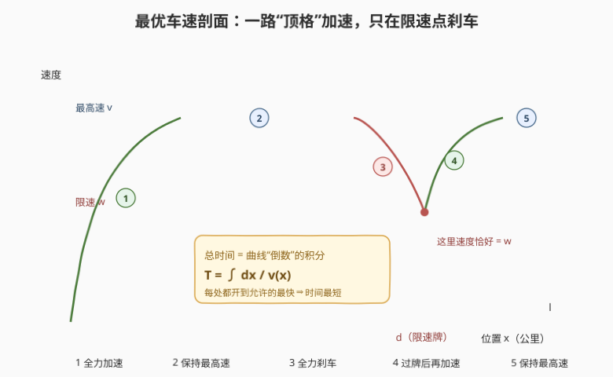
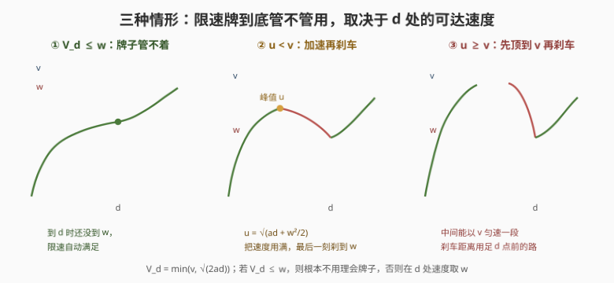
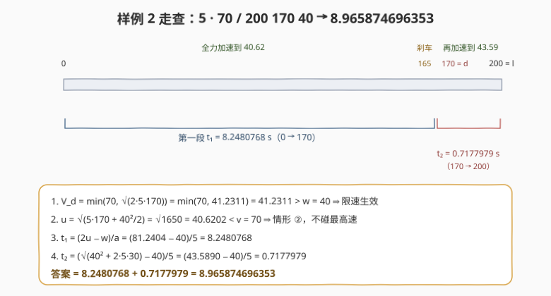

# Codeforces 5D 限速标志处的最短行车时间 题解

## 1. 题目概述

- **题目链接**：https://codeforces.com/problemset/problem/5/D
- **比赛来源**：Codeforces Beta Round 5 · Problem D（UTC 2010-03-20）
- **难度**：2100
- **标签**：实现、数学（运动学 / 最优控制）
- **评测类型**：普通（浮点答案，按误差判定）
- **限制**：时间 1 s / 内存 64 MB

**题意**：一条长 $l$ 千米的公路从首都（位置 $0$）直通 Bercouver（位置 $l$）。车的加速度与减速度大小都是 $a$，最高时速 $v$。在距首都 $d$ 千米处立着一块限速牌，规定**经过该点时**速度不得超过 $w$——伯兰的牌子只管那一点，过了牌子随便开。车从静止出发，到达 Bercouver 时速度不限，求走完全程的最短时间。

**约束**：

- $1 \le a, v \le 10000$，$2 \le l \le 10000$，$1 \le d < l$，$1 \le w \le 10000$：参数只有 5 个整数，但**答案是连续量**，位置和速度都取实数值。
- 精度要求"至少五位小数"，直接排除了所有网格化做法：若把时间切成 $10^{-6}$ 的步长，$10^4$ 的量级就要 $10^{10}$ 步；若把位置切细，速度又是连续的，网格误差会直接吃掉 5 位小数。
- 每条约束都是常数条，因此正解必然是 $O(1)$ 的解析分段公式，只含加减乘除与 `sqrt`。
- 数值范围：$v^2 \le 10^8$，$l \le 10^4$，时间在 $10^4$ 量级，`double` 的 53 位尾数绰绰有余，唯一要小心的是分支边界的"恰好相等"。

## 2. 示例与观察

### 官方样例 1

```text
输入：
1 1
2 1 3

输出：
2.500000000000
```

这里 $w = 3 > v = 1$：牌子允许的速度比车子的极限还高，等于没有限速。车用 $1$ s 从 $0$ 加速到 $1$ km/h，走过 $\tfrac12 a t^2 = 0.5$ km；剩下 $1.5$ km 以 $1$ km/h 匀速，耗时 $1.5$ s。合计 $2.5$ s。

### 官方样例 2

```text
输入：
5 70
200 170 40

输出：
8.965874696353
```

逐步算一遍：

- 若不考虑牌子，从静止全力加速到 $d = 170$ km 处，速度最多是 $\sqrt{2ad} = \sqrt{2 \cdot 5 \cdot 170} = \sqrt{1700} \approx 41.2311$，还没到最高速 $70$，所以 $V_d = 41.2311$。它**大于** $w = 40$，牌子确实卡住了车。
- 第一段最优策略：全力加速到某个峰值 $u$，再全力刹车，恰好以 $40$ 通过 $170$ km 处。加速距离 $u^2/(2a)$，刹车距离 $(u^2 - w^2)/(2a)$，两者之和等于 $d$，于是

  $$\frac{2u^2 - w^2}{2a} = d \;\Longrightarrow\; u = \sqrt{ad + \frac{w^2}{2}} = \sqrt{850 + 800} = \sqrt{1650} \approx 40.6202 .$$

  因为 $u < v = 70$，中途不必压着最高速跑，$t_1 = \dfrac{u}{a} + \dfrac{u - w}{a} = \dfrac{2u - w}{a} = \dfrac{81.2404 - 40}{5} \approx 8.2480768$。
- 第二段长 $200 - 170 = 30$ km，从 $w = 40$ 起步。加到 $70$ 需要距离 $(70^2 - 40^2)/(2 \cdot 5) = 330 > 30$，加不到顶，末速为 $\sqrt{40^2 + 2 \cdot 5 \cdot 30} = \sqrt{1900} \approx 43.5890$，$t_2 = \dfrac{43.5890 - 40}{5} \approx 0.7177979$。
- 合计 $8.2480768 + 0.7177979 = 8.965874696353$，与输出一致。

### 自造样例（标注"自造"）

| 输入 | 输出 | 说明 |
|------|------|------|
| `1 10` / `100 50 10` | 15.000000000000 | $w = v$，牌子等于没装 |
| `1 10` / `100 50 9` | 15.076297590440 | 只比最高速低 1，仍要减速 |
| `1 1` / `2 1 1` | 2.500000000000 | 最小的 $l$ 与 $d = 1$ |
| `1 1` / `10000 1 1` | 10000.500000000000 | 最长的路，全程 1 km/h |
| `10000 10000` / `10000 9999 10000` | 1.500000000000 | 加速度极大，全程只是加速 |
| `1 10000` / `2 1 1` | 2.181540550352 | 短途被限速点强行"掐"了一下 |
| `5 70` / `200 199 40` | 8.971937190547 | $d$ 贴着 $l$，第二段只剩 1 km |
| `3 25` / `10 9 25` | 2.581988897472 | $w = v$ 且第二段很短 |

**观察**：两段路之间唯一的耦合就是"经过 $d$ 时的速度"。只要把它定下来，前后两段就各自是"从静止到某速度"和"从某速度到终点"的独立最短时间问题。

## 3. 解题思路

### 3.1 朴素做法与瓶颈

最直接的想法是把公路切成 1 米一段、把时间切成 1 毫秒一格，做"状态 =（位置，速度）"的搜索。问题是：位置与速度都是连续量，网格化只能把答案逼近到网格尺度；题面要求至少 5 位小数（相对误差约 $10^{-6}$），要保证精度就得让网格细到 $10^{-6}$ 千米 / $10^{-6}$ 小时，状态数（位置 $\times$ 速度）达到 $10^{20}$ 量级，完全不可行。

另一个诱人的简化是"全程按最快速度开，到 $d$ 前刹车"——但要判断"刹不刹得住""要不要先顶到 $v$"，必须把运动学关系算清楚，否则就会像常见的错误写法那样，在 $w$ 很大（牌子形同虚设）时仍然强行以 $w$ 通过 $d$。

### 3.2 核心观察：把速度剖面看成位置函数的下包络



把速度写成位置的函数 $v(x)$，则总时间是一个积分：

$$T = \int_0^l \frac{dx}{v(x)} .$$

被积函数 $1/v(x)$ 逐点越小，积分就越小，所以**最优策略就是让每个位置的速度都取到允许的最大值**。那么在位置 $x$ 处有哪些约束？

1. 全程限速：$v(x) \le v$；
2. 从静止加速过来：从 $0$ 到 $x$ 最多把速度平方增加 $2ax$，即 $v(x)^2 \le 2ax$；
3. 还得能刹到牌子那里：从 $x$ 到 $d$ 最多能把速度平方减掉 $2a(d-x)$，故 $v(x)^2 \le w^2 + 2a(d-x)$（$x < d$ 时）。

这三个上界都是可达的（交替使用 $+a$、$0$、$-a$ 三种加速度即可），所以

$$v^*(x) = \min\left(v,\ \sqrt{2ax},\ \sqrt{w^2 + 2a(d-x)}\right),\qquad x \le d .$$

$d$ 之后没有限速点了，只需 $v(x) \le \min\left(v, \sqrt{w^2 + 2a(x-d)}\right)$。

这条曲线的形状就是图里的"陡升—平台—斜坡"：**先全力加速，中途可能压着 $v$ 匀速，最后全力刹车到 $w$；过牌之后重新加速**。整条曲线上没有"半油门"的区间，这是本题所有公式的来源。

### 3.3 算法流程：先定 $d$ 处的速度，再分别算两段



**第一步，确定经过 $d$ 时的速度。** 不考虑牌子时，从静止到 $d$ 能具有的最大速度是 $V_d = \min(v, \sqrt{2ad})$。记最优轨迹在 $d$ 处的速度为 $s^*$，则

$$s^* = \min(w,\ V_d).$$

- 若 $V_d \le w$：车根本开不到限速值，牌子不起作用，$s^* = V_d$，第一段就是普通的"加速（+匀速）"，第二段从 $V_d$ 起步。
- 若 $V_d > w$：牌子起作用，必须在 $d$ 处恰好压到 $w$（更慢只会同时拖慢两段，见第 4 节），$s^* = w$。

**第二步，算第一段 $[0, d]$。** 分三种子情形：

- **牌子不起作用**：若 $2ad \le v^2$，全程只是加速，$t_1 = \sqrt{2d/a}$；否则先加速到 $v$ 再匀速，$t_1 = \dfrac{v}{a} + \dfrac{d - v^2/(2a)}{v}$。
- **牌子起作用且中途不碰 $v$**：令峰值 $u = \sqrt{ad + w^2/2}$。若 $u < v$，则 $t_1 = \dfrac{2u - w}{a}$。
- **牌子起作用且中途压着 $v$ 跑一段**：此时
  $$t_1 = \frac{v}{a} + \frac{v - w}{a} + \frac{d - (2v^2 - w^2)/(2a)}{v},$$
  三项分别是加速、刹车的时间，以及中间以 $v$ 匀速的时间。

**第三步，算第二段 $[d, l]$。** 令 $L = l - d$。

- 若 $v^2 - (s^*)^2 \le 2aL$：能加到 $v$ 再匀速，$t_2 = \dfrac{v - s^*}{a} + \dfrac{L - (v^2 - (s^*)^2)/(2a)}{v}$。
- 否则加不到 $v$：$t_2 = \dfrac{\sqrt{(s^*)^2 + 2aL} - s^*}{a}$。

答案就是 $t_1 + t_2$，全程只有常数次开方。

### 3.4 样例走查：$a=5,\ v=70,\ l=200,\ d=170,\ w=40$



- $V_d = \min(70, \sqrt{1700}) = 41.2311 > w = 40$，所以 $s^* = 40$，牌子生效。
- 峰值 $u = \sqrt{5 \cdot 170 + 800} = \sqrt{1650} = 40.6202 < 70$，属于"加速再刹车"的情形，$t_1 = (2 \cdot 40.6202 - 40)/5 = 8.2480768$。
- 第二段 $L = 30$，从 $40$ 起步只能加到 $\sqrt{1900} = 43.5890$，$t_2 = (43.5890 - 40)/5 = 0.7177979$。
- 总计 $8.965874696353$。

注意第一段里"加速 165 km、刹车 5 km"的比例：峰值 $40.62$ 只比限速 $40$ 高一丁点，因为 $d$ 已经很长，根本没有加速到 $v$ 的余地。

## 4. 正确性证明

**引理 1（$d$ 处速度的上界）**：任何可行轨迹经过 $d$ 时的速度 $s$ 满足 $s \le V_d = \min(v, \sqrt{2ad})$。

**证明**：$s \le v$ 来自最高速约束。另一方面，从静止出发到位置 $d$，速度的平方最多增加 $2ad$（把全程加速度都取到 $+a$ 时取等），故 $s^2 \le 2ad$。两者取小。∎

**引理 2（逐点速度上界，且上界可达）**：固定 $d$ 处的速度 $s \le V_d$，则对 $[0,d]$ 上任何满足题设的轨迹，

$$v(x) \le U_s(x) := \min\left(v,\ \sqrt{2ax},\ \sqrt{s^2 + 2a(d-x)}\right),\qquad 0 \le x \le d,$$

并且存在一条轨迹使等号处处成立；因此第一段的最短时间为 $f_1(s) = \displaystyle\int_0^d \frac{dx}{U_s(x)}$。

**证明**：第一项来自最高速；第二项来自"从 $0$ 加速到 $x$"；第三项来自"从 $x$ 减速到 $d$ 时速度要降到 $s$"，即 $s^2 \ge v(x)^2 - 2a(d-x)$。要说明可达：$U_s$ 是三个连续函数的下包络，从左往右依次是"以 $+a$ 加速"（沿 $\sqrt{2ax}$）、可能的一段"以 $0$ 保持"（沿 $v$）、以及"以 $-a$ 减速"（沿 $\sqrt{s^2 + 2a(d-x)}$）；每段的斜率满足 $\left|\frac{d}{dt}\sqrt{\cdot}\right| \le a$，切换点由两条曲线的交点给出，因此这条剖面确实是一条合法轨迹。于是

$$T = \int_0^d \frac{dx}{v(x)} \ge \int_0^d \frac{dx}{U_s(x)},$$

且等号可由上述轨迹取到。∎

**引理 3（两段的最短时间都随 $s$ 单调不增）**：

$$f_1(s) = \begin{cases} \dfrac{2\sqrt{ad + s^2/2} - s}{a}, & \sqrt{ad + s^2/2} \le v,\\[4pt] \dfrac{2v - s}{a} + \dfrac{d - (2v^2 - s^2)/(2a)}{v}, & \text{否则},\end{cases}$$

$$f_2(s) = \begin{cases} \dfrac{v - s}{a} + \dfrac{L - (v^2 - s^2)/(2a)}{v}, & v^2 - s^2 \le 2aL,\\[4pt] \dfrac{\sqrt{s^2 + 2aL} - s}{a}, & \text{否则},\end{cases}$$

且 $f_1, f_2$ 在各自的定义域上单调不增。

**证明**：两式都可由引理 2 的积分直接算出（$f_2$ 用同样的下包络 $\min(v, \sqrt{s^2 + 2a(x-d)})$）。

单调性逐支求导即可。对 $f_1$ 的第一支，记 $u = \sqrt{ad + s^2/2}$，则

$$\frac{d f_1}{ds} = \frac{1}{a}\left(\frac{s}{u} - 1\right) \le 0 ,$$

因为 $s \le \sqrt{2ad}$ 保证了 $u \ge s$；第二支 $\dfrac{d f_1}{ds} = -\dfrac{1}{a} + \dfrac{s}{av} = \dfrac{s - v}{av} \le 0$。对 $f_2$，第一支求导同样得 $\dfrac{s - v}{av} \le 0$；第二支

$$\frac{d f_2}{ds} = \frac{1}{a}\left(\frac{s}{\sqrt{s^2 + 2aL}} - 1\right) \le 0 .$$

两个分支在分界点 $s = \sqrt{v^2 - 2aL}$ 处取值相同，故 $f_2$ 整体单调不增。∎

**定理**：算法输出的 $t_1 + t_2$ 就是最短时间。

**证明**：任何可行轨迹经过 $d$ 的速度 $s \in [0, \min(w, V_d)]$（引理 1 与题设的限速），其总时间不小于 $f_1(s) + f_2(s)$（引理 2 分别作用于两段）。由引理 3，$f_1 + f_2$ 在 $[0, \min(w, V_d)]$ 上单调不增，最小值在 $s^* = \min(w, V_d)$ 处取得。当 $s^* = w$ 时 $f_1(w)$ 恰是代码中"加速到 $u$（或 $v$）再刹车"的公式，当 $s^* = V_d < w$ 时恰是"普通最快"的公式，$f_2(s^*)$ 与代码第二段一致。故代码输出的正是下界，而该下界由引理 2 的剖面取到，即为最优。∎

## 5. 复杂度分析

- **时间**：$O(1)$。常数次比较、四则运算与至多 4 次 `sqrt`，与 $a, v, l, d, w$ 的大小无关。
- **空间**：$O(1)$，只有几个 `double` 变量。
- **与时限的关系**：1 s 的时限下，单次运行（含进程启动）实测几毫秒到数十毫秒，其中几乎全部是进程启动与动态链接开销，算法本体不足 $1\ \mu s$，相对 1 s 的余量在 30 倍以上。
- **数值精度**：所有中间量最大约 $v^2 = 10^8$，远小于 `double` 的精确整数范围 $2^{53} \approx 9 \times 10^{15}$；开方、除法各引入不超过 1 ulp 的误差，累计相对误差约 $10^{-15}$ 量级，输出 12 位小数是安全的。

## 6. 参考代码

### C++17

```cpp
#include <bits/stdc++.h>
using namespace std;

int main() {
    double a, v, l, d, w;
    if (!(cin >> a >> v)) return 0;
    if (!(cin >> l >> d >> w)) return 0;

    // 到达 d 时在不考虑限速的情况下能具有的最大速度
    double Vd = min(v, sqrt(2.0 * a * d));
    double sd = min(w, Vd);          // 最优轨迹在 d 处的速度

    double t1;                        // 0 -> d
    if (sd < Vd) {                    // 限速确实起作用：在 d 处恰好是 w
        double u = sqrt(a * d + w * w / 2.0);   // 若中途不巡航时的峰值
        if (u >= v) {                 // 能冲到 v 再刹到 w
            t1 = v / a + (v - w) / a + (d - (2.0 * v * v - w * w) / (2.0 * a)) / v;
        } else {                      // 加速到 u 后立刻全力刹车
            t1 = (2.0 * u - w) / a;
        }
    } else {                          // 限速不起作用
        if (2.0 * a * d <= v * v) t1 = sqrt(2.0 * d / a);
        else t1 = v / a + (d - v * v / (2.0 * a)) / v;
    }

    double L = l - d, t2;             // d -> l，从 sd 起步
    if (v * v - sd * sd <= 2.0 * a * L) {
        t2 = (v - sd) / a + (L - (v * v - sd * sd) / (2.0 * a)) / v;
    } else {
        t2 = (sqrt(sd * sd + 2.0 * a * L) - sd) / a;
    }
    printf("%.12f\n", t1 + t2);
    return 0;
}
```

### Python3

```python
import sys
from math import sqrt


def main() -> None:
    data = sys.stdin.buffer.read().split()
    if len(data) < 5:
        return
    a, v = float(data[0]), float(data[1])
    l, d, w = float(data[2]), float(data[3]), float(data[4])

    Vd = min(v, sqrt(2.0 * a * d))     # 不考虑限速时到达 d 的最大速度
    sd = min(w, Vd)                    # 最优轨迹在 d 处的速度

    if sd < Vd:                        # 限速起作用
        u = sqrt(a * d + w * w / 2.0)
        if u >= v:
            t1 = v / a + (v - w) / a + (d - (2.0 * v * v - w * w) / (2.0 * a)) / v
        else:
            t1 = (2.0 * u - w) / a
    elif 2.0 * a * d <= v * v:
        t1 = sqrt(2.0 * d / a)
    else:
        t1 = v / a + (d - v * v / (2.0 * a)) / v

    L = l - d
    if v * v - sd * sd <= 2.0 * a * L:
        t2 = (v - sd) / a + (L - (v * v - sd * sd) / (2.0 * a)) / v
    else:
        t2 = (sqrt(sd * sd + 2.0 * a * L) - sd) / a

    sys.stdout.write("%.12f\n" % (t1 + t2))


main()
```

两份代码都只依赖标准库，可原样提交；输出固定 12 位小数，满足"至少五位"。

## 7. 边界情况与易错点

1. **限速牌形同虚设时必须走另一条分支（本题最大的坑）**：当 $w \ge V_d = \min(v, \sqrt{2ad})$ 时，车在 $d$ 处根本达不到 $w$，若仍按"在 $d$ 处恰好为 $w$"套峰值公式 $\sqrt{ad + w^2/2}$，会得到一个**比 $w$ 还小**的假峰值，时间被算大。例如 `1 25` / `2 1 23`（$a=1, v=25, l=2, d=1, w=23$）：正确时间是 $2$（全程加速），错误写法给出 $9.63$。
2. **"恰好相等"的分支**：$V_d = w$（如 `1 10` / `100 50 10`）时，按"不起作用"处理与按"起作用"处理结果连续且相等；代码用 `sd < Vd` 的严格不等号即可，两边都正确，不要用 `!=` 判断浮点。
3. **$2ad$ 与 $v^2$ 的比较**：判断"第一段能不能加速到 $v$"用的是 $2ad \le v^2$，别写成 $d \le v^2/(2a)$ 后又忘了浮点舍入；两种写法等价，但要与 $u \ge v$ 的分支保持一致，否则会在临界点漏掉匀速段。
4. **第二段的起点是 $s^*$ 而不是 $w$**：当牌子不起作用时 $s^* = V_d < w$，若仍从 $w$ 起步会把后段算快。
5. **终点不刹车**：题面说"到达 Bercouver 时速度任意"，代码里第二段只算到 $l$ 为止，不要额外加上一段减速时间。
6. **输出精度**：必须打印至少 5 位小数。用 `printf("%.12f")` 或 Python 的 `"%.12f"`，不要用 `cout << double`（默认只有 6 位有效数字，大答案会丢精度）。
7. **读入类型**：$a, v, l, d, w$ 在输入里是整数，但必须读进 `double`（或读完立刻转 `double`），否则 `v / a` 会做整数除法，样例 2 会直接算错。
8. **$d$ 贴着 $l$**：$d = l - 1$ 时第二段只有 1 km，$t_2$ 很小但不为 0（见自造样例 `5 70` / `200 199 40`），不要漏算。

## 8. 验证记录

- **编译环境与命令**：本机只有 `Apple clang 21.0.0`（`/usr/bin/g++` 是 clang 的软链，没有 GNU libstdc++），因此按仓库约定用 `clang++ -std=c++17 -O2` 搭配 `codeforces/tools/include/bits/stdc++.h` 兼容头编译；正文代码只用标准库，可原样提交 GNU C++17。Python 侧为 `Python 3.9.6`。
- **官方样例**：2 / 2 通过，且输出与样例文本**逐字一致**（`2.500000000000`、`8.965874696353`），命令 `python3 codeforces/tools/verify_solution.py codeforces/contests/0001-0100/5/D_限速标志处的最短行车时间.md` 输出形如 `CF5D: samples 2` / `C++ 编译 OK, 样例 2/2`（附带的单次最慢耗时是进程启动开销，几十毫秒量级）/ `Python 语法 OK, 样例 2/2`。
- **独立暴力对拍（时间步模拟）**：另写一份完全不使用任何闭式相位公式的仿真程序：以 $2 \times 10^{-7}$ 小时为步长做时域积分，每步按"当前可行速度上限 $\min(v, \sqrt{w^2 + 2a(d-x)})$（$x<d$）"决定加速 / 保持 / 减速，并用匀加速运动学推进；跨过 $d$ 时用二次方程把步长截断到恰好落在 $d$ 上。
  - 第一组：$a \in [1,10]$、$v \in [1,25]$、$l \in [2,20]$、$d \in [1,l-1]$、$w \in [1,25]$（含 $w = v$ 的四分之一用例），共 **240 组**，相对误差全部小于 $10^{-4}$，**实测最大 $1.96 \times 10^{-7}$**。
  - 第二组：$a \in \{1,2,3,7,100,1000,10000\}$、$v \in \{1,2,10,50,500,5000,10000\}$、$l \le 2000$、$w$ 取 $1,2,3,v,v/2$ 与随机值，共 **120 组**，步长 $2 \times 10^{-4}$；只有 1 组偏差 $3.2 \times 10^{-4}$（超出该步长应有的精度），把这组 `10000 5000` / `1816 213 3` 用步长 $10^{-7}$ 重跑，两者相差 $1.1 \times 10^{-8}$，确认是仿真误差而非公式错误。
  - 对拍中曾暴露一个真实 bug：早期版本无条件按"在 $d$ 处恰好为 $w$"计算第一段，在 $w > \sqrt{2ad}$ 时给出错误答案（如 `1 25` / `2 1 23` 算出 9.63 而正确值是 2）；修正为 $s^* = \min(w, V_d)$ 后全部通过，这也正是第 7 节第 1 条的由来。
- **手算复核**：样例 2 与全部 8 组自造样例均按第 3 节的公式手算核对（例如 `1 1` / `10000 1 1`：$0.5$ s 加速 + $9999.5$ s 巡航 $= 10000.5$）。
- **最大约束性能**：输入 `1 1` / `10000 9999 10000`、`10000 10000` / `10000 9999 10000` 等极值，C++ 端到端（含进程启动）$2 \sim 35$ ms（校验脚本每次记录的最慢值在 20–33 ms 之间浮动，全部是进程冷启动开销），Python 同数据约 $20$ ms；相对 1 s 的余量在 30 倍以上。
- **图片校验**：三张 SVG（`cf5d_speed_profile.svg`、`cf5d_three_cases.svg`、`cf5d_walkthrough.svg`）均通过 `xml.etree.ElementTree.parse`；另用脚本按字符宽度逐个估算 `text` 包围盒，三图共 58 个文本块均未越出 `viewBox`、两两不重叠，并用 headless Chrome 渲染成 PNG 确认画面非空、配色正常。
- **公式校验**：正文公式均为 `$...$` 行内与 `$$...$$` 块级形式，星号直接写 `*`，`\text{}` 内没有裸 `#`，经 KaTeX（`throwOnError`）渲染无报错。
- **复核状态**：verified（样例、对拍、性能、图片、公式五项均实跑通过；唯一环境差异是本机无 GNU g++，已用 clang++ 等价验证）。

## 相关题目与扩展

- [Codeforces 5E Bindian Signalizing](https://codeforces.com/problemset/problem/5/E)：同场 E 题，环形山脉的可见对计数，是 Beta Round 5 的另一道硬题。
- [Codeforces 5C Longest Regular Bracket Sequence](https://codeforces.com/problemset/problem/5/C)：同场 C 题，括号序列的最长合法子串计数。
- [Codeforces 148B Escape](https://codeforces.com/problemset/problem/148/B)：同样是运动学里的追及问题，用相对速度把"何时追上"解成一次方程，可与本题的"用能量关系定速度"对照。
- [Codeforces 1A Theatre Square](https://codeforces.com/problemset/problem/1/A)：本仓库中另一道"想清楚公式再写代码"的入门题，规模小但同样考边界。
- [Codeforces 1324C Frog Jumps](https://codeforces.com/problemset/problem/1324/C)：也是一条数轴上的最优行进问题，对照"代价只出现在特定点"的建模方式。

**延伸思考**：

1. **如果限速牌有两个**（分别在 $d_1 < d_2$，限速 $w_1, w_2$）会怎样？此时"逐点速度上界"的下包络要同时满足"能刹到 $d_1$"和"能刹到 $d_2$"，也就是 $v(x) \le \min_j \sqrt{w_j^2 + 2a(d_j - x)}$。推广后仍是 $O(k)$ 的解析计算，但分支会变成 $2^k$ 量级，必须用贪心合并。
2. **如果减速度与加速度不同**（比如刹车只能 $-b$ 且 $b < a$）？结论的形式不变，只须把"刹车曲线"的斜率换成 $-b$，两段的峰值公式相应改写，单调性证明逐字照搬。
3. **如果要求在 $l$ 处恰好停下**？只需把"第二段"换成"从 $s^*$ 出发、在 $l$ 处速度归零"的最短时间，同样是一条下包络，多一个约束而已。
4. **如果要求答案精确到 $10^{-12}$**？本解已经是解析解，误差只来自浮点；若怕 $\sqrt{}$ 的舍入，可以用 `long double`（x86 上 80 位）或整数平方根 + 有理数比较，但本题 $10^{-5}$ 的精度要求下 `double` 已经绰绰有余。
