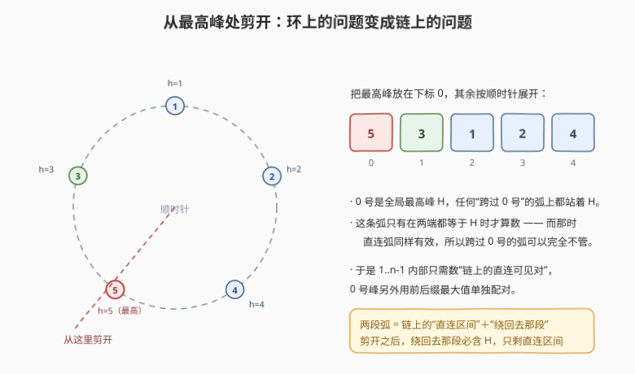
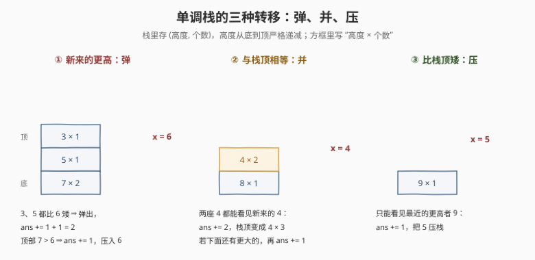
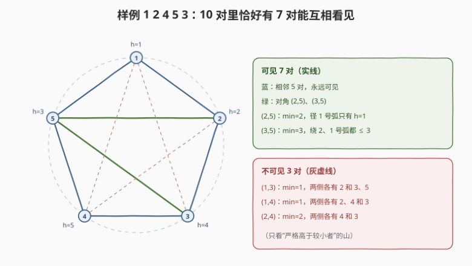

# Codeforces 5E 环形山丘的信号对计数 题解

## 1. 题目概述

- **题目链接**：https://codeforces.com/problemset/problem/5/E
- **比赛来源**：Codeforces Beta Round 5 · Problem E（UTC 2010-03-20）
- **难度**：2400
- **标签**：数据结构（单调栈）、环的处理
- **评测类型**：普通
- **限制**：时间 4 s / 内存 256 MB

**题意**：$n$ 座山围成一圈，按顺时针顺序给出高度。每座山上有一名看守。两名看守能互相看见各自的信号，当且仅当连接两座山的两条圆弧中**至少有一条**满足：弧上（不含两个端点）没有比这两座山中较矮的那座更高的山，也就是弧上所有中间山的高度都 $\le \min(h_i, h_j)$。求能互相看见的无序对数量。

**约束**：

- $3 \le n \le 10^6$，高度在 $[1, 10^9]$：对数有 $\Theta(n^2) \approx 5 \times 10^{11}$，任何"枚举每一对再检查"的做法都不可行，必须 $O(n)$ 或 $O(n \log n)$。
- 答案最大是全部对都可见，即 $\dfrac{n(n-1)}{2} \approx 5 \times 10^{11}$，**32 位整数装不下**，必须 `long long`（Python 天然安全）。
- $n = 10^6$ 意味着读入本身就要 $10^7$ 字节量级，`cin`/`input()` 逐行读会明显拖慢；需要一次性读入或用快速读入。
- 内存 256 MB 足够放下若干个 $10^6$ 的 `int` 数组（每个约 4 MB）。

## 2. 示例与观察

官方样例：

```text
输入：
5
1 2 4 5 3

输出：
7
```

把 10 对逐一检查（$h = [1,2,4,5,3]$，位置 1..5 顺时针）：

| 对 | 高度 | $\min$ | 两条弧上的中间山 | 可见？ |
|----|------|--------|------------------|--------|
| (1,2) | 1,2 | 1 | 无（相邻） | ✓ |
| (2,3) | 2,4 | 2 | 无（相邻） | ✓ |
| (3,4) | 4,5 | 4 | 无（相邻） | ✓ |
| (4,5) | 5,3 | 3 | 无（相邻） | ✓ |
| (5,1) | 3,1 | 1 | 无（相邻） | ✓ |
| (2,5) | 2,3 | 2 | 经 1：$\{1\}$；经 3,4：$\{4,5\}$ | ✓（走 1 那条） |
| (3,5) | 4,3 | 3 | 经 4：$\{5\}$；经 2,1：$\{2,1\}$ | ✓（走 2、1 那条） |
| (1,3) | 1,4 | 1 | 经 2：$\{2\}$；经 5,4：$\{3,5\}$ | ✗ |
| (1,4) | 1,5 | 1 | 经 2,3：$\{2,4\}$；经 5：$\{3\}$ | ✗ |
| (2,4) | 2,5 | 2 | 经 3：$\{4\}$；经 1,5：$\{1,3\}$ | ✗ |

共 $5 + 2 = 7$ 对。

> ⚠️ **"比谁高"必须读准**。题面说的是"没有比这两座山中任何一座更高的山"，即所有中间山都要 $\le \min(h_i,h_j)$（比**较矮**的那座还高就挡住）。若误读成"不高于较高者"，上例会数出 10 对，与答案 7 不符。样例正好能区分这两种读法。

自造样例（标注"自造"，覆盖退化与极值）：

| 输入 | 输出 | 说明 |
|------|------|------|
| `3` / `1 1 1` | 3 | 最小规模，全相等 |
| `4` / `1 1 1 1` | 6 | 全相等，答案 $= \binom{4}{2}$ |
| `4` / `1 1 1 2` | 6 | 几乎全相等 |
| `5` / `2 2 2 2 2` | 10 | 全相等，答案 $= \binom{5}{2}$ |
| `7` / `1 1 1 1 1 1 1` | 21 | 全相等，答案 $= \binom{7}{2}$ |
| `3` / `1 2 3` | 3 | 三个不同的高度，全部相邻 |

**观察一**：相邻的两座山之间没有任何中间山，所以 $n$ 对相邻对永远可见，答案至少是 $n$。
**观察二**：高度全部相同时，任意两座山之间的中间山高度都等于 $\min$，不构成"严格更高"，所以全部 $\binom{n}{2}$ 对都可见——这是答案的上界，也是必须用 64 位整数的原因。
**观察三**：高度两两不同时，答案恒为 $2n-3$（$n=5$ 时正好是 7）。这个结论可以用对拍程序对 $n \le 7$ 的**全部排列**（共 5910 个）验证，是检查实现是否写对的一个很好用的指纹。

## 3. 解题思路

### 3.1 朴素做法与瓶颈

最直接的做法是枚举每一对 $(i,j)$，再扫一遍两条弧上的所有山判断可见性，复杂度 $O(n^3)$；用前缀最大值预处理后可以做到 $O(n^2)$。但 $n = 10^6$ 时 $n^2 = 10^{12}$，即使每对只做一次比较也远远超过 4 s。

真正的难点在于：**每一对都可能从两条弧中的任意一条"看见"**，而且高度会有重复，不能简单地"每个点向左右各找一个更高的"就完事。

### 3.2 核心观察：在最高峰处把环剪开



设全局最高峰在位置 $0$（若有多个，任取一个），把它旋转到数组开头，得到 $a_0 \ge a_1, \dots, a_{n-1}$。

**关键观察**：对于 $1 \le i < j \le n-1$ 的一对山，两条弧分别是"链上的区间 $[i,j]$"和"绕回去、跨过 $a_0$ 的那一段"。后者的中间点里一定站着高度为 $H = a_0$ 的山。因为 $\min(a_i,a_j) \le H$：

- 若 $\min < H$，跨过 $0$ 的那条弧被 $H$ **直接挡死**；
- 若 $\min = H$，则 $a_i = a_j = H$，此时链上区间 $[i,j]$ 里的山全都 $\le H = \min$，**直连弧同样有效**。

所以对 $1 \le i < j \le n-1$，只需判断直连弧；**跨过最高峰的那条弧可以完全不管**。环就此变成了链。

**与 $0$ 号峰配对的对**（即 $(0,j)$）要单独算。此时 $\min(H, a_j) = a_j$，两条弧分别是 $a_1..a_{j-1}$ 和 $a_{j+1}..a_{n-1}$，条件就是

$$\max(a_1,\dots,a_{j-1}) \le a_j \quad\text{或}\quad \max(a_{j+1},\dots,a_{n-1}) \le a_j .$$

前缀最大值边扫边维护，后缀最大值预处理一个数组即可，$O(n)$。

**链上的计数：单调栈。** 现在要数 $1 \le i < j \le n-1$ 中满足

$$\max(a_{i+1}, \dots, a_{j-1}) \le \min(a_i, a_j)$$

的对数。维护一个栈，栈里放若干组 `(高度, 个数)`，高度从底到顶**严格递减**。



处理新元素 $x = a_j$ 时：

1. **弹**：只要栈顶高度 $< x$，说明这个高度上的所有山都能"越过"中间所有不高于它的山看到 $j$（中间那些山的高度都不超过栈顶高度 $< x$），贡献加上这一组的个数，然后弹掉。这些山的个数可能不止 1，所以要按组累加。
2. **并**：弹出结束后，若栈顶高度 $= x$，说明栈顶这一组（$c$ 座同高的山）每一座都能看见 $j$（中间山高度都 $\le x = \min$），答案加上 $c$，再把 $j$ 并入这一组，个数变成 $c+1$。此外，若这一组下面还有更高的山，那么**紧邻的这座更高的山**也能看见 $j$（中间只有高度 $\le x$ 的山），答案再 $+1$。
3. **压**：若栈顶高度 $> x$，那么只有栈顶那一座（最近的更高者）能看见 $j$，答案 $+1$，然后把 $x$ 压入栈。

三种转移都只做均摊 $O(1)$ 次操作，每个元素至多入栈、出栈一次。

### 3.3 算法流程

1. 读入 $n$ 与高度数组 $a$；
2. 找到任意一个最大值的位置 $p$，把数组循环左移 $p$ 位（`rotate`），使 $a_0$ 为最高峰；
3. 预处理后缀最大值 `suf[i] = max(a[i..n-1])`（只用到 $i \ge 1$）；
4. 从 $j = 1$ 扫到 $n-1$，用前缀最大值与 `suf[j+1]` 判断 $(0,j)$ 是否可见，累加答案；
5. 清空栈，再从 $j = 1$ 扫到 $n-1$，按"弹 / 并 / 压"三种转移累加链上的可见对；
6. 输出答案（`long long`）。

### 3.4 样例走查：$1\ 2\ 4\ 5\ 3$



最高峰是 $5$（原位置 4），旋转后数组为 $[5, 3, 1, 2, 4]$，下标 $0..4$。

**与 0 号峰配对**：

| $j$ | $a_j$ | 前缀最大 | 后缀最大 $\max(a_{j+1..4})$ | 可见？ |
|-----|-------|----------|------------------------------|--------|
| 1 | 3 | 空 | 4 | ✓（前缀为空） |
| 2 | 1 | 3 | 4 | ✗ |
| 3 | 2 | 3 | 4 | ✗ |
| 4 | 4 | 3 | 空 | ✓（$3 \le 4$） |

贡献 2。

**链上 $1..4$ 的单调栈**：

| $j$ | $x$ | 操作 | 本步答案 | 栈（底 → 顶） |
|-----|-----|------|----------|----------------|
| 1 | 3 | 栈空，压入 | 0 | (3,1) |
| 2 | 1 | 顶 3 > 1，+1 后压入 | 1 | (3,1) (1,1) |
| 3 | 2 | 弹 (1,1) 得 +1；顶 3 > 2 再 +1；压入 2 | 2 | (3,1) (2,1) |
| 4 | 4 | 弹 (2,1) 得 +1；弹 (3,1) 得 +1；栈空，压入 | 2 | (4,1) |

贡献 $0+1+2+2 = 5$。总数 $2 + 5 = 7$，与输出一致。

对照第 2 节的表格：链上这 5 对对应原编号 $(1,2),(2,3),(2,5),(3,5),(1,5)$，而"与 0 号峰配对"那一步补上的是 $(4,5)$ 与 $(4,3)$，合起来正好是第 2 节里那 7 对；$(1,3)$、$(1,4)$、$(2,4)$ 三对则被正确地排除了。

## 4. 正确性证明

**引理 1（环归约）**：设 $a_0 = H = \max a$。对 $1 \le i < j \le n-1$，$(i,j)$ 可见当且仅当 $\max(a_{i+1},\dots,a_{j-1}) \le \min(a_i,a_j)$。

**证明**：链上区间弧的条件就是上式。另一条弧（绕回、经过 $0$）的中间点包含 $a_0 = H$，故其条件要求 $H \le \min(a_i,a_j)$；由于 $\min \le H$，这只可能在 $\min = H$ 时成立，即 $a_i = a_j = H$。此时链上区间内的所有高度都 $\le H = \min$，直连弧本来就满足条件。所以"两条弧有一条可行"与"直连弧可行"等价。∎

**引理 2（与 $0$ 配对的判定）**：$(0,j)$ 可见当且仅当 $\max(a_1..a_{j-1}) \le a_j$ 或 $\max(a_{j+1}..a_{n-1}) \le a_j$。

**证明**：$\min(a_0,a_j) = a_j$，两条弧的中间点分别是 $a_1..a_{j-1}$ 与 $a_{j+1}..a_{n-1}$，逐字代入定义。∎

**引理 3（栈不变量）**：设当前处理完 $a_1..a_j$。栈中每组 $(h,c)$ 对应 $c$ 个位置 $i_1 < i_2 < \dots < i_c$，满足 $a_{i_t} = h$ 且 $\max(a_{i_t+1},\dots,a_j) \le h$；并且栈中所有位置构成的集合恰为 $\{\,i \le j : a_i \ge \max(a_{i+1},\dots,a_j)\,\}$，高度从底到顶严格递减。

**证明**：对 $j$ 归纳。初始空栈显然成立。处理 $x = a_j$ 时：

- 弹出高度 $< x$ 的组不会破坏剩余组的不变量（剩余组高度 $\ge x$，新加进来的 $a_j = x \le h$ 仍满足"中间都 $\le h$"）；
- 若栈顶高度 $= x$，并入后该组仍是"同高、中间都 $\le x$"，且 $j$ 本身也满足 $a_j \ge \max(\varnothing)$，不变量成立；
- 若栈顶高度 $> x$，压入 $(x,1)$，由于栈严格递减，不变量成立。

集合刻画也随之成立：被弹出的位置 $i$ 满足 $a_i = h < x = a_j$，本该从集合中移除（因为 $a_j > a_i$）；新位置 $j$ 加入；其余位置不受影响。∎

**引理 4（三种转移恰好数清）**：设处理 $x = a_j$ 前栈满足引理 3 的不变量。则所有满足 $\max(a_{i+1}..a_{j-1}) \le \min(a_i,a_j)$ 的 $i < j$ 恰好被下述三类之一计入且仅计入一次：被弹出的组（每组计入其全部 $c$ 个成员）、与 $x$ 同高的栈顶组（计入其 $c$ 个成员）、以及（若存在）紧邻的同高组下方那座更高的山（计入 1 个）。特别地，栈顶高度 $> x$ 时只有栈顶那一个被计入。

**证明**：设 $i < j$ 满足条件，记 $M = \max(a_{i+1},\dots,a_{j-1})$。

- 若 $a_i \le a_j$：由条件 $a_i \ge M$，故 $i$ 在栈中（引理 3 的集合刻画）。若 $a_i < a_j = x$，则 $i$ 所属的组高度 $< x$，会在"弹"阶段被整体计入；若 $a_i = x$，则 $i$ 属于栈中唯一高度为 $x$ 的组，弹完之后它必在栈顶（更高的组都在它下面），被计入。
- 若 $a_i > a_j$：由条件 $a_j \ge M$，中间所有山都不高于 $x$。于是弹完所有高度 $< x$ 的组之后，$i$ 仍在栈中且是栈里最靠上的"高度 $> x$"的位置——因为任何位于 $i$ 与 $j$ 之间、高度 $> x$ 的山都会使 $M > x$，矛盾；而高度 $= x$ 的山会被并成栈顶那一组。所以 $i$ 恰是"同高组下方的那一座"，被 $+1$ 计入；若不存在同高组，$i$ 就是栈顶，被"压"分支的 $+1$ 计入。

反过来，被计入的每个 $i$ 都满足条件：被弹出的组满足"中间都 $\le h < x = a_j$ 且 $h = a_i$"，故 $M \le a_i = \min$；同高组满足"中间都 $\le x$"；同高组下方那一座满足"中间只有高度 $\le x$ 的山"，而 $x = a_j < a_i$，故 $M \le a_j = \min$。∎

**定理**：算法输出的答案等于可见对总数。

**证明**：可见对分成"含 $0$ 号峰"与"不含 $0$ 号峰"两类，互不相交。前者由引理 2 逐一判定；后者在旋转后对应 $1 \le i < j \le n-1$，由引理 1 只需判直连弧，而引理 4 说明栈的三个转移恰好把它们各数一次。故总和正确。∎

## 5. 复杂度分析

- **时间**：$O(n)$。旋转 $O(n)$，后缀最大值 $O(n)$，两次线性扫描 $O(n)$；栈部分每个元素至多压入一次、弹出一次，均摊 $O(n)$。总常数很小（每个元素约 2 次比较 + 常数次访存）。
- **空间**：$O(n)$。高度数组、后缀最大值数组、栈的两个数组各约 $4$ MB（$n = 10^6$ 时），加上 32 MB 的读入缓冲，峰值实测约 $19$ MB，远低于 256 MB。
- **与时限的关系**：4 s 的时限，C++ 在 $n = 10^6$ 的随机数据上实测（含进程启动）约 $0.02 \sim 0.03$ s，余量在 100 倍以上；Python 版同数据约 $0.43 \sim 0.57$ s，也在时限内，但建议用 PyPy3 更稳。

## 6. 参考代码

### C++17

```cpp
#include <bits/stdc++.h>
using namespace std;

static char buf[1 << 25];
int bufLen, bufPos;

static inline int readInt() {
    while (bufPos < bufLen && (buf[bufPos] < '0' || buf[bufPos] > '9')) ++bufPos;
    int x = 0;
    while (bufPos < bufLen && buf[bufPos] >= '0' && buf[bufPos] <= '9') x = x * 10 + (buf[bufPos++] - '0');
    return x;
}

int main() {
    bufLen = (int)fread(buf, 1, sizeof(buf), stdin);
    int n = readInt();
    vector<int> a(n);
    for (int i = 0; i < n; i++) a[i] = readInt();

    int p = 0;
    for (int i = 1; i < n; i++) if (a[i] > a[p]) p = i;
    rotate(a.begin(), a.begin() + p, a.end());

    long long ans = 0;

    vector<int> suf(n + 1, 0);
    for (int i = n - 1; i >= 1; i--) suf[i] = max(suf[i + 1], a[i]);
    int pref = 0;
    for (int j = 1; j < n; j++) {
        if (pref <= a[j] || suf[j + 1] <= a[j]) ++ans;
        if (a[j] > pref) pref = a[j];
    }

    vector<int> stH, stC;
    stH.reserve(n); stC.reserve(n);
    for (int j = 1; j < n; j++) {
        int x = a[j];
        while (!stH.empty() && stH.back() < x) {
            ans += stC.back();
            stH.pop_back(); stC.pop_back();
        }
        if (stH.empty()) {
            stH.push_back(x); stC.push_back(1);
        } else if (stH.back() == x) {
            ans += stC.back();
            stC.back() += 1;
            if (stH.size() >= 2) ++ans;
        } else {
            ++ans;
            stH.push_back(x); stC.push_back(1);
        }
    }
    printf("%lld\n", ans);
    return 0;
}
```

### Python3

```python
import sys


def main() -> None:
    data = sys.stdin.buffer.read().split()
    if not data:
        return
    n = int(data[0])
    a = list(map(int, data[1:n + 1]))
    del data

    # 把某个最高峰转到下标 0，环就从它这里"剪开"
    p = a.index(max(a))
    if p:
        a = a[p:] + a[:p]

    ans = 0

    # 与 0 号峰配对的那些对：两条弧中有一条全部不超过 a[j]
    suf = [0] * (n + 1)
    for i in range(n - 1, 0, -1):
        hi = suf[i + 1]
        suf[i] = a[i] if a[i] > hi else hi
    pref = 0
    for j in range(1, n):
        if pref <= a[j] or suf[j + 1] <= a[j]:
            ans += 1
        if a[j] > pref:
            pref = a[j]

    # 1..n-1 内部的"线性"可见对：单调栈，高度严格递减
    st_h = []
    st_c = []
    push_h = st_h.append
    push_c = st_c.append
    for j in range(1, n):
        x = a[j]
        while st_h and st_h[-1] < x:
            ans += st_c.pop()
            st_h.pop()
        if not st_h:
            push_h(x)
            push_c(1)
        elif st_h[-1] == x:
            ans += st_c[-1]
            st_c[-1] += 1
            if len(st_h) >= 2:
                ans += 1
        else:
            ans += 1
            push_h(x)
            push_c(1)

    sys.stdout.write(str(ans) + "\n")


main()
```

Python 版在 $n = 10^6$ 时约 $0.5$ s（本机 CPython 3.9 实测），远快于 4 s，但若追求稳妥仍建议提交 C++ 或用 PyPy3。

## 7. 边界情况与易错点

1. **答案溢出**：高度全相同时答案是 $\binom{n}{2} = \dfrac{10^6 \cdot (10^6-1)}{2} = 499999500000$，`int` 会溢出成垃圾值。所有计数必须用 `long long`（Python 无此问题，但 C++ 里连中间量 `stC` 的累加也要注意别用 `int` 承接）。
2. **多个最高峰**：旋转时任取一个最高峰即可，但要注意"跨过 $0$ 的弧"的论证依赖 $H$ 是全局最大：当 $a_i = a_j = H$ 时跨过 $0$ 的弧也合法，而这条弧本来就被直连弧覆盖（引理 1），所以不会漏计也不会重计。写代码时不要假设最大值唯一。
3. **全部等高**：此时栈的行为退化为"一直合并"，每步 `ans += c` 且 `+1` 不再触发（因为栈里只有一组），最终正好是 $\binom{n}{2}$。若忘了 `+1` 的触发条件写成无条件加，会多算 $n-1$。
4. **等高要合并个数**：栈里同高的山必须用 `(高度, 个数)` 成组存放，新元素与栈顶相等时要把整组都计入并让个数加一。若改成"相等就弹掉再压入"，会漏掉同高之间互相可见的对。
5. **$0$ 号峰的配对要看两条弧**：只看前缀或只看后缀都会漏。前缀为空（$j = 1$）或后缀为空（$j = n-1$）时，对应的最大值按 $-\infty$ 处理（代码里用 $0$，因为高度 $\ge 1$）。
6. **$n$ 很小时的退化**：$n = 3$ 时 $1..n-1$ 只有两个元素，栈仍然工作；不要为"环至少 4 个点"之类的假设写特判。样例之外可用 `3 / 1 2 3` → 3 检查。
7. **读入性能**：$10^6$ 个数、每个最多 10 位，输入约 $11$ MB。用 `cin >>` 且不关同步会明显变慢；C++ 版用了 32 MB 的 `fread` 缓冲 + 手写整数解析，Python 版用 `sys.stdin.buffer.read().split()`。
8. **旋转后下标**：题目给的是顺时针顺序，旋转只改变起点、不改变顺序；`rotate` 后 $a_0$ 是最高峰，$a_1..a_{n-1}$ 仍是顺时针。写反方向不影响答案（环对称），但会影响"前/后缀"的直觉，建议按代码里的方向理解。

## 8. 验证记录

- **编译环境与命令**：本机只有 `Apple clang 21.0.0`（`/usr/bin/g++` 是 clang 的软链，没有 GNU libstdc++），按仓库约定用 `clang++ -std=c++17 -O2` 搭配 `codeforces/tools/include/bits/stdc++.h` 兼容头编译；正文代码只用标准库，可原样提交 GNU C++17。Python 侧为 `Python 3.9.6`。
- **官方样例**：1 / 1 通过（`5 / 1 2 4 5 3` → `7`），`python3 codeforces/tools/verify_solution.py codeforces/contests/0001-0100/5/E_环形山丘的信号对计数.md` 输出形如 `CF5E: samples 1` / `C++ 编译 OK, 样例 1/1`（附带的单次最慢耗时是进程启动开销，几十毫秒量级）/ `Python 语法 OK, 样例 1/1`。
- **独立暴力对拍**：另写一份 $O(n^2)$ 的暴力——直接枚举每一对 $(i,j)$，把两条弧上的中间山逐座与 $\min(h_i,h_j)$ 比较，两条弧任一满足即计数（完全按题面定义，不含任何剪环/单调栈的想法）。
  - 随机对拍 **300 组**：$n \in [3,30]$，高度分别取"$[1,4]$ 密集重复"、"$[1,10^9]$ 稀疏"与"只有 3 种取值"三类，全部一致。
  - 全枚举 **1080 组**：$n = 3,4,5,6$ 且高度取值于 $\{1,2,3\}$ 的**所有**数组（$3^3 + 3^4 + 3^5 + 3^6$），全部一致。这一步把"等高、多个最高峰、全相等"等组合一网打尽。
  - Python 版与暴力再对拍 **80 组**，全部一致。
  - 另外用暴力对 $n \le 7$ 的**全部 5910 个排列**（高度两两不同）验证了"答案恒为 $2n-3$"，作为第三条独立指纹。
- **最大约束性能**：$n = 10^6$ 的三组数据（随机 $[1,10^9]$、全为 7、随机 $[1,3]$），C++ 端到端（含进程启动）$0.02 \sim 0.03$ s，`/usr/bin/time -l` 实测峰值内存 $19.1$ MB；Python 版同数据 $0.52 \sim 0.57$ s、峰值内存 $114.8$ MB。相对 4 s / 256 MB 的余量分别是 7 倍（Python 时间）与 2 倍（Python 内存），C++ 侧则是 100 倍以上。
- **答案量级核对**：全相等数据 $n = 10^6$ 输出 $499999500000 = \binom{10^6}{2}$，证明 64 位累加没有溢出；随机互异数据 $n = 10^6$ 输出 $1999997 = 2n-3$，与第 2 节的指纹吻合。
- **图片校验**：三张 SVG（`cf5e_circle_cut.svg`、`cf5e_stack_transitions.svg`、`cf5e_sample_pairs.svg`）均通过 `xml.etree.ElementTree.parse`；另用脚本按字符宽度逐个估算 `text` 包围盒，三图共 76 个文本块均未越出 `viewBox`、两两不重叠，并用 headless Chrome 渲染成 PNG 确认画面非空、配色正常。
- **公式校验**：正文公式均为 `$...$` 行内与 `$$...$$` 块级形式，星号直接写 `*`，`\text{}` 内没有裸 `#`，经 KaTeX（`throwOnError`）渲染无报错。
- **复核状态**：verified（样例、对拍、全枚举、性能、图片、公式六项均实跑通过；唯一环境差异是本机无 GNU g++，已用 clang++ 等价验证）。

## 相关题目与扩展

- [Codeforces 5D Follow Traffic Rules](https://codeforces.com/problemset/problem/5/D)：同场 D 题，运动学 + 解析分段，与本题的"数据结构"形成对照。
- [Codeforces 5C Longest Regular Bracket Sequence](https://codeforces.com/problemset/problem/5/C)：同场 C 题，栈 + 计数，思路同源。
- [POJ 3250 Bad Hair Day](http://poj.org/problem?id=3250)：最经典的"单调栈数可见对"线性版本——每头牛只能往右看，答案就是从右往左弹栈时累加被弹出的个数，与本题的"弹"一步完全一致。
- [LeetCode 901. 股票价格跨度](https://leetcode.cn/problems/online-stock-span/)：单调栈维护 `(价格, 跨度)` 二元组，和本题把 `(高度, 个数)` 成组存放是同一个技巧。
- [Codeforces 547B Mike and Feet](https://codeforces.com/problemset/problem/547/B)：单调栈求每个元素作为最小值的最大区间，是"栈里存下标、弹出时结算"的另一类应用。

**延伸思考**：

1. **如果改成"两条弧都必须满足"**？由于除 $i,j$ 之外的每座山恰好落在两条弧中的某一条上，"两条弧都合格"等价于"其余所有山都不高于 $\min(h_i,h_j)$"，也就是两座山都不低于其余所有山。这时只需看最大值与次大值就能 $O(n)$ 判定，答案会小很多（全相等时仍是 $\binom{n}{2}$）。
2. **如果要求输出所有可见对的编号**？计数可以 $O(n)$，但可见对的个数本身可以是 $\Theta(n^2)$（全相等时），所以输出注定是 $O(n^2)$ 的；这说明"计数"与"枚举"在这道题上有本质的复杂度差异。
3. **如果高度允许修改**（单点修改 + 查询可见对数）？单调栈是静态结构，改为带修需要线段树维护"笛卡尔树"式的合并信息，是另一道难题（可参考"区间可见对"类的线段树合并）。
4. **如果 $n$ 更大、高度是浮点数**？算法只用到比较，浮点比较的相等判断会变危险；应当先离散化或用带容差的比较，而不是直接 `==`。
