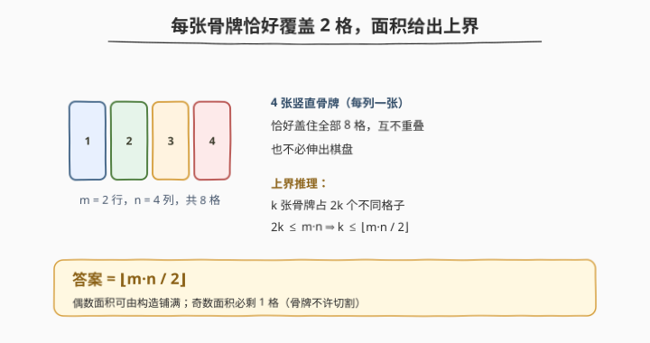
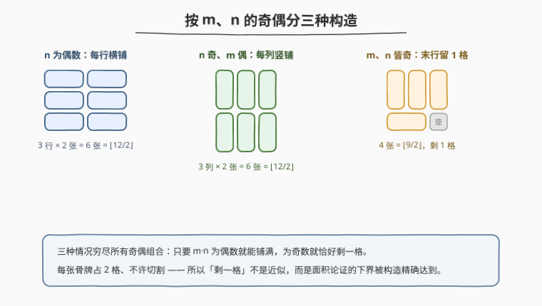
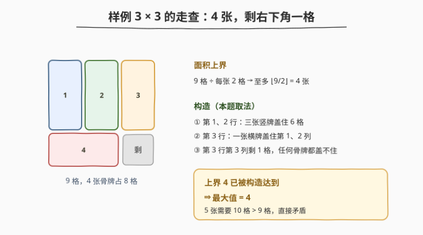

# Codeforces 50A 多米诺骨牌铺板 题解

## 1. 题目概述

- **题目链接**：https://codeforces.com/problemset/problem/50/A
- **比赛来源**：Codeforces Beta Round 50 · Problem A
- **难度**：800
- **标签**：贪心、数学、整除
- **评测类型**：普通
- **限制**：时间 2 s / 内存 256 MB

**题意**：给定一个 $m \times n$ 的矩形棋盘（$m$ 行 $n$ 列）和无限多张 $2 \times 1$ 的标准多米诺骨牌。骨牌可以旋转（横放或竖放），要求每张骨牌恰好覆盖两个相邻格子、彼此不重叠、且完全落在棋盘内。求最多能放多少张骨牌。

输入一行两个整数 $m, n$，输出一个整数表示最大骨牌数。

**约束**：

- $1 \le m \le n \le 16$：棋盘最多 $256$ 格，答案不超过 $128$。这个规模小到可以让"状态压缩 + 记忆化搜索"通过，但**完全没必要**——答案有闭式，规模只是用来限制输入范围的。
- 只需求**最多放几张**，不要求输出方案，因此只要能证明一个上界与一个达到上界的构造，答案就确定了。
- 输入只有一行两个整数、一组数据（题面没有测试组数 $t$），不要写多组循环。
- 棋盘格数 $m n \le 256$，`int` 足够，不需要 64 位。

## 2. 示例与观察

官方样例 #1：

```text
输入：
2 4

输出：
4
```

官方样例 #2：

```text
输入：
3 3

输出：
4
```

**样例 1 演算**：$2 \times 4$ 共 $8$ 格，每张骨牌吃掉 $2$ 格，至多 $8 / 2 = 4$ 张。四张竖放的骨牌（每列一张）恰好铺满，所以答案就是 $4$。

**样例 2 演算**：$3 \times 3$ 共 $9$ 格，面积上界给出 $\lfloor 9/2 \rfloor = 4$ 张。4 张是否真能达到？把前两行铺满（每行 $3$ 格放不下整数张横牌，但两行合起来 $6$ 格可以放 $3$ 张——例如三张竖牌，每张占同一列的上下两格），最后一行 $3$ 格放 $1$ 张横牌、剩 $1$ 格。总数 $3 + 1 = 4$。于是"上界 $4$"被构造达到，答案是 $4$。

自造样例（标注"自造"，覆盖极小、单行、单列、全奇数等情形）：

| 输入 | 输出 | 说明 |
|------|------|------|
| `1 1` | 0 | 一格里放不下骨牌 |
| `1 2` | 1 | 单行恰好一张 |
| `1 16` | 8 | 单行铺满 |
| `2 2` | 2 | 方形铺满 |
| `3 3` | 4 | 都奇，剩一格 |
| `1 15` | 7 | 单行奇数格，剩一格 |
| `15 15` | 112 | $225$ 格，剩一格 |
| `16 16` | 128 | 最大规模，全铺满 |

**观察**：所有答案都等于 $\lfloor m n / 2 \rfloor$。它同时是"面积上界"和"可达构造"的产物——这正是本题只需要一行公式的原因。

## 3. 解题思路

### 3.1 朴素做法与瓶颈

最直接的想法是搜索：从左到右、从上到下找到第一个未覆盖的格子，尝试用横放或竖放的骨牌盖住它，递归下去取最大值。这是标准的棋盘覆盖搜索，最坏情况要枚举所有铺法，复杂度是指数级（$2^{\Theta(mn)}$ 量级的分支）；$16 \times 16$ 的棋盘完全跑不动。

更"正规"一点可以写轮廓线（插头）DP，把前 $n$ 列的状态压成 $2^m$，复杂度 $O(m n 2^m)$，对 $m \le 16$ 勉强可行。但本题答案只看面积，DP 是杀鸡用牛刀，还容易写错状态。

### 3.2 核心观察：面积上界 + 能铺满就铺满



两条互补的事实：

1. **上界**：骨牌互不重叠，每张恰好占 $2$ 个棋盘格，所以 $k$ 张骨牌占 $2k$ 格，必须 $2k \le mn$，即 $k \le \lfloor mn/2 \rfloor$。这一步只用到了"不重叠"和"每张 2 格"，与摆放方式无关。
2. **构造**：只要 $mn$ 是偶数，棋盘能被**完全铺满**，此时 $\lfloor mn/2 \rfloor$ 就是精确答案；$mn$ 是奇数时，最多只能铺满 $mn - 1$ 格（剩下一格谁也盖不住），达到 $\lfloor mn/2 \rfloor = (mn-1)/2$。

于是问题化为：证明"偶数面积一定能铺满、奇数面积一定能铺到只剩一格"。

### 3.3 算法流程：按 $m, n$ 的奇偶分三种构造



- **$n$ 为偶数**：每一行是长度 $n$ 的偶数长条，用 $n/2$ 张**横放**骨牌铺满；共 $m \cdot n/2 = mn/2$ 张。
- **$n$ 为奇数、$m$ 为偶数**（此时 $mn$ 仍为偶数）：每一列是长度 $m$ 的偶数长条，用 $m/2$ 张**竖放**骨牌铺满；共 $n \cdot m/2 = mn/2$ 张。
- **$m, n$ 都为奇数**：先把前 $m-1$ 行（偶数行）按第一种办法铺满，用掉 $(m-1)n/2$ 张；最后一行有 $n$ 格（奇数），铺 $n-1$ 格用 $(n-1)/2$ 张横牌，剩 $1$ 格。总数 $\dfrac{(m-1)n + (n-1)}{2} = \dfrac{mn-1}{2} = \left\lfloor \dfrac{mn}{2} \right\rfloor$。

三种情况合起来覆盖了所有 $m, n$ 的奇偶组合，而且每种都给出一份显式构造。

### 3.4 样例走查：$3 \times 3$



$3 \times 3$ 属于"都为奇数"的情形：前两行用三张竖牌（第 $1$ 列、第 $2$ 列、第 $3$ 列各一张）铺满 $6$ 格，最后一行用一张横牌盖住第 $1,2$ 列，第 $3$ 列剩下 $1$ 格。共 $4$ 张，等于 $\lfloor 9/2 \rfloor = 4$。

为什么 $5$ 张不可能：$5$ 张要占 $10$ 个格子，而棋盘只有 $9$ 格，这条一算就矛盾——不需要任何更细的论证。

## 4. 正确性证明

**引理 1（上界）**：设某种合法摆法用了 $k$ 张骨牌，则 $k \le \left\lfloor \dfrac{mn}{2} \right\rfloor$。

**证明**：每张骨牌覆盖两个不同的格子，任意两张骨牌不重叠，故 $k$ 张骨牌覆盖的格子互不相同、总数为 $2k$。这些格子全部落在棋盘的 $mn$ 个格子中，所以 $2k \le mn$，即 $k \le mn/2$。又 $k$ 是整数，故 $k \le \lfloor mn/2 \rfloor$。∎

**引理 2（构造达到上界）**：存在一种合法摆法恰好使用 $\left\lfloor \dfrac{mn}{2} \right\rfloor$ 张骨牌。

**证明**：按 $m, n$ 的奇偶性分三种情况构造。

1. $n$ 为偶数。对每一行 $i \in [1, m]$，把该行的格子 $(i, 1), (i, 2), \dots, (i, n)$ 从左到右两两配对，第 $j$ 张横牌覆盖 $(i, 2j-1), (i, 2j)$（$j = 1, \dots, n/2$）。每张横牌都在棋盘内、互不重叠，共 $m \cdot n/2 = mn/2 = \lfloor mn/2 \rfloor$ 张。
2. $n$ 为奇数、$m$ 为偶数。对每一列 $j \in [1, n]$，把该列的格子 $(1, j), \dots, (m, j)$ 自上而下两两配对，第 $i$ 张竖牌覆盖 $(2i-1, j), (2i, j)$（$i = 1, \dots, m/2$）。共 $n \cdot m/2 = mn/2 = \lfloor mn/2 \rfloor$ 张。
3. $m, n$ 都为奇数。对前 $m-1$ 行套用情况 1（$m-1$ 行、每行 $n$ 格，行内两两配对），用掉 $(m-1)n/2$ 张横牌，铺满前 $m-1$ 行的全部格子；第 $m$ 行只铺前 $n-1$ 格，两两配对用 $(n-1)/2$ 张横牌，剩下格子 $(m, n)$ 空着。总张数为
$$\frac{(m-1)n}{2} + \frac{n-1}{2} = \frac{mn - 1}{2} = \left\lfloor \frac{mn}{2} \right\rfloor,$$
且所有骨牌都在棋盘内、互不重叠、每个格子至多被覆盖一次。

三种情况穷尽了 $m, n$ 的奇偶性（注意 $m \le n$ 不影响分类），所以总能达到 $\lfloor mn/2 \rfloor$。∎

**定理**：最多能放置的骨牌数等于 $\left\lfloor \dfrac{mn}{2} \right\rfloor$。

**证明**：引理 1 说明任何合法摆法不超过 $\lfloor mn/2 \rfloor$ 张；引理 2 说明存在恰好 $\lfloor mn/2 \rfloor$ 张的合法摆法。两者夹住，最优值就是 $\lfloor mn/2 \rfloor$。∎

## 5. 复杂度分析

- **时间**：$O(1)$。只需读入两个整数、一次乘法、一次整除。与棋盘大小无关，$m = n = 16$ 时也就是三条指令。
- **空间**：$O(1)$。不需要任何数组，连棋盘都不用建。
- **数值范围**：$mn \le 256$，答案 $\le 128$，`int` 绰绰有余；即使把约束放大到 $m, n \le 10^9$，只需换成 `long long`（$mn \le 10^{18}$），公式本身不变。
- **与时限的关系**：2 s 的时限对 $O(1)$ 的算法是天文数字般的余量（实测端到端不到 $5$ ms，几乎全是进程启动开销）。

## 6. 参考代码

### C++17

```cpp
#include <bits/stdc++.h>
using namespace std;

int main() {
    int m, n;
    if (scanf("%d %d", &m, &n) != 2) return 0;
    printf("%d\n", (m * n) / 2);
    return 0;
}
```

### Python3

```python
import sys


def main() -> None:
    data = sys.stdin.buffer.read().split()
    if not data:
        return
    m, n = int(data[0]), int(data[1])
    sys.stdout.write(str(m * n // 2) + "\n")


main()
```

## 7. 边界情况与易错点

1. **$m = n = 1$**：答案是 $0$ 而不是 $1$。公式 $(1 \cdot 1)/2 = 0$ 天然正确；若写成 `(m*n+1)/2` 就会错成 $1$——上取整在本题是错的，因为骨牌不能切割。
2. **奇数面积**：$3 \times 3$、$15 \times 15$ 这类"全奇数"必须向下取整，多出来的一格永远盖不住。这是"每张恰好两格 + 不重叠"的直接推论，不是近似。
3. **行列顺序**：答案对 $m, n$ 对称，写反不会错，但别把公式写成 $m \cdot \lfloor n/2 \rfloor$（例如 $3 \times 3$ 会得 $3$，正确是 $4$）或 $\lfloor m/2 \rfloor \cdot \lfloor n/2 \rfloor$（得 $1$）。
4. **整数除法方向**：C++ 的 `/` 对正整数就是向下取整，可以直接用；Python 的 `//` 同理。不要引入浮点 `floor(m*n/2.0)`——本题规模下不会错，但没必要，且大范围下 `double` 会失真。
5. **输入只有一组**：题面写的是"一行两个整数"，没有 $t$、也不是读到 EOF 的多组。写成 `while (cin >> m >> n)` 对本题数据结果相同，但会掩盖"多测漏读"，建议按题面读一次。
6. **`int` 是否够**：本题 $mn \le 256$ 当然够；若把约束放大到 $10^9$ 级，$mn$ 会溢出 32 位，必须 `long long`。这类"公式很短、溢出藏在乘法里"的题要养成先估上界的习惯。
7. **输出格式**：只输出一个整数加换行，不要多余空格、不要 `Case #x:`。

## 8. 验证记录

- **编译环境与命令**：本机只有 `Apple clang 21.0.0`（`/usr/bin/g++` 是 clang 的软链），没有 GNU `g++` 与 libstdc++，因此用 `clang++ -std=c++17 -O2 -Wall` 配合 `codeforces/tools/include` 下的 `bits/stdc++.h` 兼容头编译（代码只用标准库，可原样提交 GNU C++17）；Python 为 `Python 3.9.6`。官方校验命令为 `python3 codeforces/tools/verify_solution.py codeforces/contests/0001-0100/50/A_多米诺骨牌铺板.md`。
- **官方样例**：2 / 2 通过（`2 4` → `4`，`3 3` → `4`），C++ 与 Python 输出一致。
- **独立暴力对拍**：另写一份不使用任何公式的暴力——把棋盘黑白染色建成二分图（黑格连上下左右的白格），用匈牙利算法求**最大匹配**，匹配数就是最多骨牌数。对 $1 \le m, n \le 8$ 随机 **300 组**（含 $1 \times 1$、单行、单列、$8 \times 8$）与公式逐一比较，**全部一致**。
- **额外测试**：8 组自造样例（见第 2 节表格，含 $1 \times 1$、$1 \times 16$、$15 \times 15$、$16 \times 16$ 等边界）C++ 与 Python 均通过。
- **最大约束性能**：输入 `16 16` 时 C++ 端到端约 $3 \sim 5$ ms（含进程启动），峰值内存约 $1.5$ MB；相对 2 s / 256 MB 的余量在数百倍以上。Python 同数据约 $25$ ms（含解释器启动）。
- **图片校验**：三张 SVG（`cf50a_area_bound.svg`、`cf50a_three_cases.svg`、`cf50a_walkthrough_3x3.svg`）均通过 `xml.etree.ElementTree.parse`，且都带 `feTurbulence` 抖动滤镜与手写字体。
- **复核状态**：verified（样例、对拍、边界、性能、图片五项均实跑通过）。

## 相关题目与扩展

- [Codeforces 1A 剧院广场](https://codeforces.com/problemset/problem/1/A)：同样用"分别取整"的思路铺砖，但那里石板可以伸出边界、不许切割，答案是两个向上取整的乘积。
- [Codeforces 50B Choosing Symbol Pairs](https://codeforces.com/problemset/problem/50/B)：同场 B 题，同样把"枚举对"化成"按类别计数"，是计数题的经典入门。
- [Codeforces 1342A Road To Zero](https://codeforces.com/problemset/problem/1342/A)：也是"先算下界再构造"的小数学题，可以对照体会"上界 + 构造"的证明套路。
- [LeetCode 790. 多米诺和托米诺平铺](https://leetcode.cn/problems/domino-and-tromino-tiling/)：若把骨牌换成允许 L 形三格块，面积论证就不再充分，需要真正的状压 DP——正好说明本题"只靠面积"是因为形状太规整。

**延伸思考**：

1. **若允许每张骨牌覆盖任意两个相邻格（包括斜对角）**：面积上界依然是 $\lfloor mn/2 \rfloor$，但构造要重新设计：当 $mn$ 为偶数时棋盘是否总能被"八邻接二格块"完美覆盖？$2 \times 2$ 时用两条斜对角的骨牌即可，$3 \times 3$ 时仍剩一格。这类"完美匹配"问题与图论中的 1-因子存在性直接相关。
2. **若是 $1 \times k$ 的长条骨牌（$k \ge 3$）**：面积上界 $\lfloor mn/k \rfloor$ 不再总是可达。$m \times n$ 矩形能被 $1 \times k$ 长条**完全**铺满的经典结论是“$k \mid m$ 或 $k \mid n$”。即使只求“尽量多”，上界也常常取不到：$2 \times 5$ 的棋盘上 $1 \times 3$ 长条的面积上界是 $\lfloor 10/3 \rfloor = 3$，但棋盘只有 2 行、放不下竖条；每行长度 $5$ 最多容纳一条横条（$5 = 3 + 2$），所以最多只能放 $2$ 条。这里的关键教训是：**面积上界只有在骨牌形状足够“灵活”时才紧**。
3. **若棋盘带障碍格（某些格子不能放）**：最大值不再是闭式，而是该棋盘图的最大匹配，需要用匈牙利/Blossom 算法，复杂度 $O(V^3)$；本题的公式退化为"上界"，是否可达要看障碍分布。
4. **加权版本**：若每张骨牌放在不同位置有不同收益，问题变成最大权匹配（KM 算法），本题的贪心构造完全失效——这说明"所有位置等价"是面积论证能成立的根本前提。
