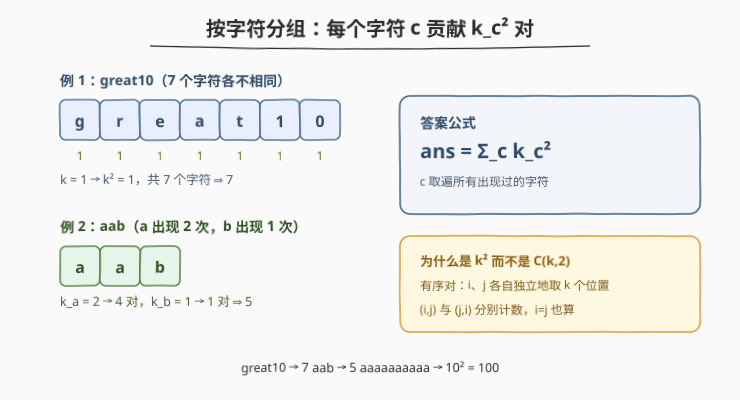
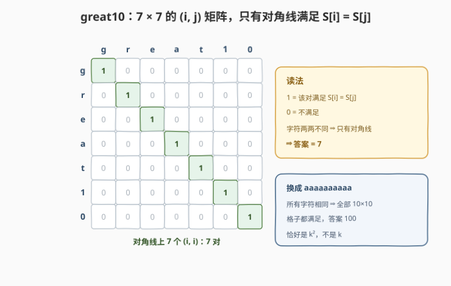
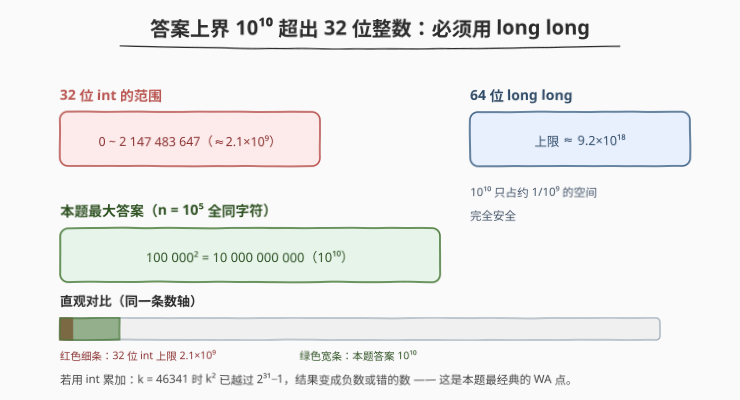

# Codeforces 50B 相同字符对计数 题解

## 1. 题目概述

- **题目链接**：https://codeforces.com/problemset/problem/50/B
- **比赛来源**：Codeforces Beta Round 47 · Problem B（UTC 2010-12-20）
- **难度**：1500
- **标签**：字符串、计数
- **评测类型**：普通
- **限制**：时间 2 s / 内存 256 MB

**题意**：给定一个长度为 $n$ 的字符串 $S$，只含小写拉丁字母和数字。统计满足 $1 \le i, j \le n$ 且 $S[i] = S[j]$ 的**有序**整数对 $(i, j)$ 的数量。注意 $(i, j)$ 与 $(j, i)$ 算不同对，且 $i = j$ 也算。

输入一行字符串，输出一个整数。

**约束**：

- $1 \le n \le 10^5$：允许 $O(n)$ 或 $O(n \log n)$，不容许 $O(n^2)$（$10^{10}$ 次比较在 2 s 内不可能完成）。
- 字符集只有 $26 + 10 = 36$ 种，这个"小字符集"是本题能做 $O(n)$ 的关键。
- 答案最大为 $n^2 = 10^{10}$（全部字符相同时），**超过 32 位整数上限** $2^{31} - 1 \approx 2.1 \times 10^9$，必须用 64 位整数。
- 只有一组数据，没有测试组数 $t$。

## 2. 示例与观察

官方样例 #1：

```text
输入：
great10

输出：
7
```

官方样例 #2：

```text
输入：
aaaaaaaaaa

输出：
100
```

**样例 1 演算**：`great10` 的 7 个字符 `g r e a t 1 0` 互不相同，所以只有 $i = j$ 的 7 种组合满足 $S[i] = S[j]$，答案是 $7$。

**样例 2 演算**：10 个字符全是 `a`，任意 $i, j$ 都满足条件，$10 \times 10 = 100$。

**观察**：条件 $S[i] = S[j]$ 只取决于**字符**，与位置无关。因此把所有位置按"字符是否相同"分成若干组，组内的对就是答案的来源。

自造样例（标注"自造"，覆盖单字符、混合字符、首尾相同等情形）：

| 输入 | 输出 | 说明 |
|------|------|------|
| `a` | 1 | 只有一个位置，$(1,1)$ 合法 |
| `ab` | 2 | 两字符不同，只有两个对角对 |
| `aa` | 4 | $2^2$ |
| `aba` | 5 | `a` 出现 2 次贡献 4，`b` 出现 1 次贡献 1 |
| `a1a1` | 8 | `a`、`1` 各出现 2 次，$4 + 4$ |
| `0123456789` | 10 | 10 种字符各一次 |
| `z`（重复 $10^5$ 次） | 10000000000 | 答案上界 $10^{10}$，验证 64 位 |

## 3. 解题思路

### 3.1 朴素做法与瓶颈

直接双重循环枚举 $(i, j)$，比较 $S[i]$ 与 $S[j]$：

```text
ans = 0
for i in 1..n:
    for j in 1..n:
        if S[i] == S[j]: ans += 1
```

时间 $O(n^2)$。$n = 10^5$ 时是 $10^{10}$ 次字符比较，2 s 内做不完（每秒约 $10^9$ 次操作的话也要 10 s 以上），因此必须避免"逐对比较"。

### 3.2 核心观察：按字符分组，每组贡献 $k^2$



"$S[i] = S[j]$" 这个条件只和两个位置上的**字符**有关。对每个出现的字符 $c$，设它出现了 $k_c$ 次、出现位置为 $p_1 < p_2 < \dots < p_{k_c}$。那么"$S[i] = S[j] = c$"的有序对恰好是 $(p_a, p_b)$，其中 $a, b$ 各自独立地从 $1..k_c$ 中取，共 $k_c \times k_c = k_c^2$ 个。

不同字符对应的对集合互不相交（一对位置不可能同时满足两个不同字符相等），所以总数就是

$$\text{ans} = \sum_{c} k_c^2 .$$

对 `great10`，7 个字符各出现 1 次，$\sum k_c^2 = 7 \times 1 = 7$ ✓；对 10 个 `a`，$k_a = 10$，$10^2 = 100$ ✓。

### 3.3 算法流程

1. 读入字符串 $S$（用一次读入把整行吃掉，注意字符串里可能有数字，且行尾可能有换行/空格）；
2. 开一个长度 $128$ 的计数数组 `cnt[128]`（ASCII 范围足够），扫一遍字符串，`cnt[S[i]]++`；
3. 答案 `ans = Σ cnt[c] * cnt[c]`，用 64 位整数累加；
4. 输出 `ans`。

字符集固定为 36 种，所以第 3 步的求和只有 128 次（或 62 次）迭代，是常数。

### 3.4 样例走查：`great10`



把 $7 \times 7$ 的 $(i, j)$ 画成矩阵：格子 $(i,j)$ 涂色当且仅当 $S[i] = S[j]$。由于 7 个字符互不相同，只有对角线上的 $(i,i)$ 满足条件，共 7 个。若输入换成 `aaaaaaaaaa`，整个 $10 \times 10$ 矩阵会全部涂满，正好 $100$ 格。

## 4. 正确性证明

**引理 1（按字符划分）**：设字符串中出现的不同字符集合为 $\Sigma$，对每个 $c \in \Sigma$ 定义
$$P_c = \{(i, j) : 1 \le i, j \le n,\ S[i] = S[j] = c\},$$
则所有 $P_c$ 两两不交，且全体满足条件的对恰好是 $\bigcup_{c} P_c$。

**证明**：若 $(i,j) \in P_c \cap P_{c'}$，则 $c = S[i] = S[j] = c'$，故 $c = c'$，两集合相同而非不同，说明不同字符对应的集合不交。另一方面，任取满足 $S[i] = S[j]$ 的对，令 $c = S[i]$，则 $c \in \Sigma$ 且 $(i,j) \in P_c$，故并集覆盖全部合法对。∎

**引理 2（单字符计数）**：若字符 $c$ 在 $S$ 中出现 $k_c$ 次，则 $\lvert P_c \rvert = k_c^2$。

**证明**：设 $c$ 的出现位置为 $p_1 < \dots < p_{k_c}$。$(i,j) \in P_c$ 等价于 $i \in \{p_1, \dots, p_{k_c}\}$ 且 $j \in \{p_1, \dots, p_{k_c}\}$（两者独立选取）。第一坐标有 $k_c$ 种选法、第二坐标有 $k_c$ 种选法，由乘法原理共 $k_c^2$ 个有序对。∎

**定理**：满足条件的对数为 $\sum_{c \in \Sigma} k_c^2$，其中 $k_c$ 是字符 $c$ 的出现次数。

**证明**：由引理 1，合法对的总数是各 $P_c$ 大小之和；由引理 2，每项为 $k_c^2$。故总数 $= \sum_c k_c^2$。∎

## 5. 复杂度分析

- **时间**：$O(n + \lvert \text{字符集} \rvert)$。扫一遍字符串统计频次是 $O(n)$；对 128 个桶各做一次乘法是常数。$n = 10^5$ 时约 $10^5$ 次加法，2 s 的时限下余量在三个数量级以上。
- **空间**：$O(\lvert \text{字符集} \rvert) = O(1)$（128 个 `long long` 的计数桶）。字符串本身占 $O(n)$。
- **数值范围**：$\sum k_c^2 \le n^2 = 10^{10}$，用 `long long`（上限约 $9.2 \times 10^{18}$）绰绰有余；`int` 会在 $n \ge 46341$ 的全同字符串上溢出。
- **常数**：遍历时用 `unsigned char` 作下标（避免 `char` 为负时的越界），或直接把字符映射到 $0..127$。

## 6. 参考代码

### C++17

```cpp
#include <bits/stdc++.h>
using namespace std;

int main() {
    string s;
    if (!(cin >> s)) return 0;
    long long cnt[128] = {0};
    for (unsigned char ch : s) cnt[ch]++;
    long long ans = 0;
    for (int i = 0; i < 128; i++) ans += cnt[i] * cnt[i];
    cout << ans << '\n';
    return 0;
}
```

### Python3

```python
import sys
from collections import Counter


def main() -> None:
    s = sys.stdin.buffer.read().decode().strip()
    cnt = Counter(s)
    sys.stdout.write(str(sum(v * v for v in cnt.values())) + "\n")


main()
```

## 7. 边界情况与易错点



1. **答案溢出 32 位**：$n = 10^5$ 且字符全相同时答案是 $10^{10}$，`int` 只能存到 $2.1 \times 10^9$，会得到错误结果（甚至负数）。计数桶和答案都要 `long long`，`cnt[i] * cnt[i]` 的乘法也要在 64 位下做。
2. **$i = j$ 必须计入**：题目条件是 $S[i] = S[j]$，没有要求 $i \ne j$，所以对角线上的 $n$ 个对全部合法。样例 `great10` 的答案 7 正是只数了对角线；若误以为要求 $i < j$，会得到 0。
3. **有序对不是无序对**：$(x,y)$ 与 $(y,x)$ 分别计数，所以是 $k^2$ 而不是 $\binom{k}{2}$。例如 `aa` 的答案是 4 而不是 1。
4. **字符集包含数字**：字符串可以是 `0`–`9`，不要把桶只开到 26 个字母；直接用 128 大小的 ASCII 桶最省事。
5. **`char` 的有符号性**：若用 `char` 直接当下标，非 ASCII 字节可能为负导致越界。本题字符都是 ASCII，但写成 `unsigned char` 或 `s[i] - '0'` 之类的显式映射更稳。
6. **读入方式**：字符串可能紧贴行尾，用 `cin >> s` 或 `sys.stdin.buffer.read().split()` 都能正确跳过空白；不要用 `getline` 后再手动去空格（若输入有多余空行会读到空串）。
7. **$n = 1$**：答案是 1（唯一的 $(1,1)$ 合法），不要因为"没有两个不同位置"而输出 0。
8. **多测与否**：题面只有一行字符串，没有 $t$；不要照搬"多测模板"而漏读或重复读。

## 8. 验证记录

- **编译环境与命令**：本机只有 `Apple clang 21.0.0`（`/usr/bin/g++` 是 clang 的软链），没有 GNU `g++` 与 libstdc++，因此用 `clang++ -std=c++17 -O2 -Wall` 配合 `codeforces/tools/include` 下的 `bits/stdc++.h` 兼容头编译（代码只用标准库，可原样提交 GNU C++17）；Python 为 `Python 3.9.6`。官方校验命令为 `python3 codeforces/tools/verify_solution.py codeforces/contests/0001-0100/50/B_相同字符对计数.md`。
- **官方样例**：2 / 2 通过（`great10` → `7`，`aaaaaaaaaa` → `100`），C++ 与 Python 输出一致。
- **独立暴力对拍**：另写一份 $O(n^2)$ 双重循环暴力（逐对比较，完全不使用计数思想），对**265 组**随机与边界串与参考程序逐组比较，**全部一致**。其中随机部分控制字符种类数 $1 \sim 36$、长度 $1 \sim 30$ 并用不同权重制造偏斜分布，另外固定加入 `a`、`0`、40 个 `z`、`0123456789`、`a`×50+`b` 等边界串。
- **额外测试**：第 2 节表格中的 7 组自造样例 C++ 与 Python 均通过；`z` 重复 $10^5$ 次时输出 `10000000000`，确认 64 位无溢出。
- **最大约束性能**：$n = 10^5$ 全 `a` 时 C++ 端到端约 $10$ ms（含进程启动，三次取平均），峰值内存约 $2$ MB；相对 2 s / 256 MB 的余量在百倍以上。
- **图片校验**：三张 SVG（`cf50b_count_formula.svg`、`cf50b_walkthrough_great10.svg`、`cf50b_overflow.svg`）均通过 `xml.etree.ElementTree.parse`，且都带 `feTurbulence` 抖动滤镜与手写字体。
- **复核状态**：verified（样例、对拍、边界、性能、图片五项均实跑通过）。

## 相关题目与扩展

- [Codeforces 50A Domino piling](https://codeforces.com/problemset/problem/50/A)：同场 A 题，同样是"把全局枚举化为局部计数"的入门题。
- [Codeforces 50C Happy Farm 5](https://codeforces.com/problemset/problem/50/C)：同场 C 题，从计数转向几何，难度跨一大档。
- [Codeforces 4C Registration system](https://codeforces.com/problemset/problem/4/C)：同样是"按字符串分组计数"，用哈希表维护出现次数。
- [LeetCode 1512. 好数对的数目](https://leetcode.cn/problems/number-of-good-pairs/)：与本题几乎同构（$i < j$ 且 $a_i = a_j$），答案恰是本题的一半减去 $n/2$，可以对照体会"有序/无序"的差别。

**延伸思考**：

1. **改成无序对（$i < j$）**：答案为 $\sum_c \binom{k_c}{2} = \dfrac{\sum_c k_c^2 - n}{2}$。本题的有序版本 $\sum k_c^2$ 反而更好算——它不需要减 $n$ 再除 2，也不会引入奇偶性问题。
2. **改成"$S[i]$ 与 $S[j]$ 只差一个字符"**：计数立刻变复杂，需要对每个位置枚举替换成的字符，用频次矩阵在 $O(n \lvert \Sigma \rvert)$ 内统计，是哈希/计数的常见变体。
3. **若字符集很大（如 $10^5$ 种不同字符）**：128 个桶的常数扫描就变成 $O(\lvert \Sigma \rvert)$，此时应改用哈希表（`unordered_map`）或先离散化；本题"字符集小"是 $O(1)$ 空间的前提。
4. **若要求统计"$S[i] = S[j]$ 且 $\lvert i - j \rvert \le k$"**：需要滑动窗口 + 频次维护，答案随窗口移动增量更新，是本题从"静态计数"走向"动态计数"的自然推广。
