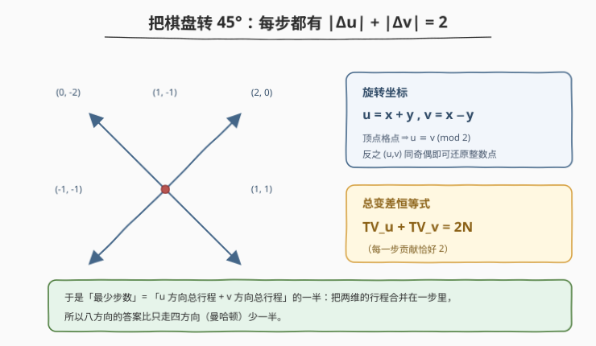
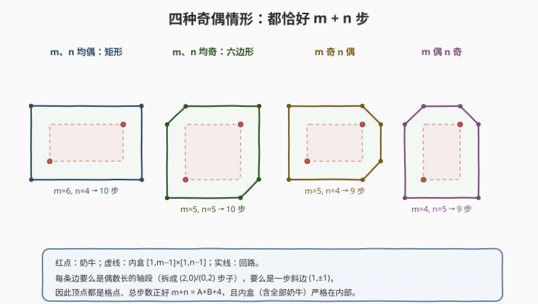
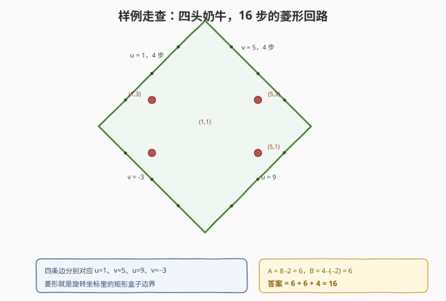

# Codeforces 50C 牧场最短围栏步数 题解

## 1. 题目概述

- **题目链接**：https://codeforces.com/problemset/problem/50/C
- **比赛来源**：Codeforces Beta Round 50 · Problem C
- **难度**：2000
- **标签**：计算几何、坐标变换、构造
- **评测类型**：普通
- **限制**：时间 2 s / 内存 256 MB

**题意**：平面上有 $N$ 个整数坐标点（奶牛）。牧羊人也在整数点上，每一回合可以原地不动，或沿八个方向（上下左右与四条对角线）走一格；水平/竖直一步算 $1$ 步，对角一步也算 $1$ 步。牧羊人要跑一条**闭合路径**，使得**所有奶牛都严格位于路径所围区域内部**，求所需的最少步数。

输入 $N$ 与 $N$ 个整数坐标，输出一个整数表示最少步数。

**约束**：

- $N \le 10^5$：需要 $O(N)$ 或 $O(N \log N)$ 的算法，不能枚举路径。
- $\lvert x_i \rvert, \lvert y_i \rvert \le 10^6$：坐标是整数，这一步是"严格内部"能化成整数不等式的前提。
- 多头奶牛可以在同一点，因此还要处理退化（所有点重合、所有点共线）。
- 答案最大约为 $4 \times 10^6 + 4$（旋转坐标系下两条边各 $2 \times 10^6$ 再加 $4$），`int` 够用，但用 `long long` 更稳。
- 关键性质：**一步对角线的长度是 $\sqrt{2}$，但代价仍是 1 步**。所以这里要最小化的是"步数"，不是欧氏周长。

## 2. 示例与观察

官方样例 #1：

```text
输入：
4
1 1
5 1
5 3
1 3

输出：
16
```

**样例演算**：四头奶牛构成 $4 \times 2$ 的矩形（左下 $(1,1)$、右上 $(5,3)$）。题面配图给出了一条 16 步的走法：把矩形的四个角各斜切一刀，得到八边形

$$(0,1) \to (1,0) \to (5,0) \to (6,1) \to (6,3) \to (5,4) \to (1,4) \to (0,3) \to (0,1),$$

其中水平/竖直段共 $4 + 2 + 4 + 2 = 12$ 步、四条切角各 $1$ 步，合计 $16$ 步。四头奶牛分别位于 $(1,1)$、$(5,1)$、$(5,3)$、$(1,3)$，都严格落在这条八边形内部（例如 $(1,1)$ 与左下切角边 $x + y = 1$ 的"内侧"相差 $1$）。

**为什么不能更少**：$4 \times 2$ 的矩形若用轴对齐的回路至少需要 $6 + 4 + 6 + 4 = 20$ 步；斜切角把它降到 $16$。能不能降到 $15$？第 4 节的下界会证明：任何严格包住这四点的回路都至少 $16$ 步。

自造样例（标注"自造"，其中"最少步数"一列由**穷举所有 8 连通闭合折线**的暴力程序给出，见第 8 节）：

| 输入 | 输出 | 说明 |
|------|------|------|
| `1` / `0 0` | 4 | 单头奶牛：一个菱形，4 步 |
| `2` / `0 0` `1 0` | 6 | 相邻两点：拉长的六边形 |
| `2` / `0 0` `1 1` | 6 | 斜相邻两点（对角线方向） |
| `3` / `0 0` `1 0` `0 1` | 7 | 直角三角形三个顶点 |
| `4` / `0 0` `1 0` `0 1` `1 1` | 8 | 单位正方形的四个角 |
| `2` / `0 0` `2 0` | 8 | 相距 2 的两点 |
| `2` / `-3 -3` `0 0` | 10 | 斜向相距 3 |
| 全部重合 | 4 | 与单点相同 |

**观察**：答案只与"旋转 $45^\circ$ 后的包围盒"有关。记 $u = x + y$、$v = x - y$，

$$A = \max u - \min u,\qquad B = \max v - \min v,$$

则上表中每一行的答案都恰好是 $A + B + 4$：单点 $A = B = 0 \Rightarrow 4$；相邻两点 $A = B = 1 \Rightarrow 6$；$(0,0)$ 与 $(2,0)$ 有 $A = B = 2 \Rightarrow 8$；斜向相距 3 的两点 $A = 6, B = 0 \Rightarrow 10$；样例矩形 $A = 6, B = 6 \Rightarrow 16$。

## 3. 解题思路

### 3.1 朴素做法与瓶颈

最直接的想法是搜索：在格点上枚举闭合回路，检查是否严格包住所有奶牛。但回路可以任意大、任意绕，状态空间是无限的，BFS 至少要枚举"位置 + 已走步数 + 已包围的点集"，完全不可行。

另一个诱人但错误的想法是"沿凸包走一圈"：先求奶牛集合的凸包，再让牧羊人沿凸包外侧走。凸包是对的出发点，但"外侧走"到底怎么数步数？如果取欧氏周长就会算错（对角步只花 1 步），如果简单地把凸包每条边平移 1 格，相邻边的平移量会互相冲突。真正需要的是**换一套坐标**，把"八方向单位步"变成规整的斜坐标系。

### 3.2 核心观察：旋转 $45^\circ$ 后每步都是"曼哈顿 2"



令 $u = x + y$、$v = x - y$。八个方向的步子在 $(u, v)$ 中的位移是：

| 方向 | $(\Delta x, \Delta y)$ | $(\Delta u, \Delta v)$ |
|------|------|------|
| 右 | $(1, 0)$ | $(1, 1)$ |
| 上 | $(0, 1)$ | $(1, -1)$ |
| 右上 | $(1, 1)$ | $(2, 0)$ |
| 左上 | $(-1, 1)$ | $(0, 2)$ |

（以及它们的相反方向。）**无论走哪个方向，都有 $\lvert \Delta u \rvert + \lvert \Delta v \rvert = 2$**。于是对任意闭合回路，若记 $TV_u = \sum \lvert \Delta u \rvert$、$TV_v = \sum \lvert \Delta v \rvert$，则

$$2N = TV_u + TV_v.$$

这在几何上就是说：$u$ 方向的"总行程"加上 $v$ 方向的"总行程"恰好是步数的两倍。于是问题变成——为了把奶牛包进去，$u$ 与 $v$ 各至少要跑多远？

### 3.3 下界：四个方向各要让出 1 格

设回路顶点的 $u$ 坐标最大、最小分别为 $U_{\max}$、$U_{\min}$。若奶牛 $p$ 严格在回路内部，则

$$U_{\min} + 1 \le u_p \le U_{\max} - 1 .$$

理由：回路所围的**开**区域含 $p$ 的一个小圆盘；$u$ 是线性函数，它在"闭区域"上的最大值一定在回路上取到，所以内部每点的 $u$ 都严格小于 $U_{\max}$；而 $u_p$ 与 $U_{\max}$ 都是整数，故 $u_p \le U_{\max} - 1$。对最小值同理。

对所有奶牛取极值就得到 $U_{\max} - U_{\min} \ge A + 2$。闭合回路必须先从 $u$ 的最小值走到最大值、再走回来，所以 $TV_u \ge 2(A+2)$；同理 $TV_v \ge 2(B+2)$。代入 $2N = TV_u + TV_v$：

$$N \ge (A + 2) + (B + 2) = A + B + 4 .$$

这就是样例矩形至少要 $16$ 步的原因（$A = B = 6$）：不是"看起来差不多"，而是被四个方向的整数余量死死卡住。

### 3.4 上界：按奇偶造出恰好 $A+B+4$ 步的回路



取旋转坐标系下的盒子 $[\min u - 1, \max u + 1] \times [\min v - 1, \max v + 1]$，把它平移到原点后边长记为 $m = A + 2$、$n = B + 2$。下面的四种回路都**恰好** $m + n$ 步（每个顶点的 $u, v$ 同奇偶，因此都是合法的格点，每条边都是合法的一步）：

| $m, n$ 奇偶 | 回路顶点（$(u,v)$，按顺序） | 步数 |
|------|------|------|
| 均偶 | $(0,0),(0,n),(m,n),(m,0)$（矩形） | $\frac m2 + \frac n2 + \frac m2 + \frac n2 = m+n$ |
| 均奇 | $(0,0),(0,n-1),(1,n),(m,n),(m,1),(m-1,0)$ | $m+n$ |
| $m$ 奇 $n$ 偶 | $(0,0),(0,n),(m-1,n),(m,n-1),(m,1),(m-1,0)$ | $m+n$ |
| $m$ 偶 $n$ 奇 | $(0,0),(0,n-1),(1,n),(m-1,n),(m,n-1),(m,0)$ | $m+n$ |

"均偶"时每条边长度都是偶数，用 $(2,0)$ 或 $(0,2)$ 的步子一段段走完；奇偶不齐时，两个"奇偶不对"的角被切掉一个单位三角形，切线是 $(1,1)$ 或 $(1,-1)$ 的一步（在 $xy$ 里就是一步对角）。三种六边形的公共性质是：**内部包含整个盒子 $[\min u, \max u] \times [\min v, \max v]$**，因为切角只切掉边长为 1 的小三角形，而奶牛至少离盒子的四条边有 1 格。于是所有奶牛严格在内部，步数正好是 $A + B + 4$。

### 3.5 样例走查：$4 \times 2$ 矩形



四头奶牛 $(1,1),(5,1),(5,3),(1,3)$ 的 $u = x+y$ 取 $2,6,4,8$，故 $A = 8 - 2 = 6$；$v = x - y$ 取 $0,4,2,-2$，故 $B = 4 - (-2) = 6$。下界 $A + B + 4 = 16$。

构造（$m = n = 8$ 均偶，用矩形）：旋转坐标系下的盒子是 $[1,9] \times [-3,5]$，把它换回 $xy$（用 $x = (u+v)/2$、$y = (u-v)/2$）得到四个顶点

$$(-1,2) \to (3,6) \to (7,2) \to (3,-2) \to (-1,2),$$

也就是一个旋转 $45^\circ$ 的菱形，四条边各走 $4$ 步对角线，合计 $16$ 步。逐点核对：$(1,1)$ 的 $(u,v) = (2,0)$、$(5,1) \to (6,4)$、$(5,3) \to (8,2)$、$(1,3) \to (4,-2)$，四个点都严格落在 $[1,9] \times [-3,5]$ 内（每条边至少让出 $1$ 格），因此都在菱形内部。

题面配图给出的切角八边形 $(0,1),(1,0),(5,0),(6,1),(6,3),(5,4),(1,4),(0,3)$ 是同一个最优值的另一种画法，也是 $16$ 步。**最紧的回路不唯一，但步数唯一**——这正是下界与构造相等时的典型现象。

## 4. 正确性证明

**引理 1（步数与总变差）**：任意闭合回路的步数 $N$ 满足 $2N = TV_u + TV_v$，其中 $TV_u$、$TV_v$ 分别是回路在 $u$、$v$ 坐标上的总变差。

**证明**：每步的位移 $(\Delta x, \Delta y)$ 的每个分量属于 $\{-1, 0, 1\}$ 且不全为 0。逐类验证：若 $(\Delta x, \Delta y) = (\pm 1, 0)$ 或 $(0, \pm 1)$，则 $(\Delta u, \Delta v) = (\pm 1, \pm 1)$，$\lvert \Delta u \rvert + \lvert \Delta v \rvert = 2$；若 $(\Delta x, \Delta y) = (\pm 1, \pm 1)$，则 $(\Delta u, \Delta v) = (\pm 2, 0)$ 或 $(0, \pm 2)$，同样 $\lvert \Delta u \rvert + \lvert \Delta v \rvert = 2$。对 $N$ 步求和即得 $TV_u + TV_v = 2N$。∎

**引理 2（下界）**：设 $A = \max_i u_i - \min_i u_i$，$B = \max_i v_i - \min_i v_i$，则任何严格包住所有奶牛的闭合回路都有 $N \ge A + B + 4$。

**证明**：设回路顶点的 $u$ 坐标最大值、最小值分别为 $U_{\max}, U_{\min}$。

先证对每头奶牛 $p$ 有 $u_p \le U_{\max} - 1$。回路是简单闭曲线，其内部 $D$ 是开集且 $p \in D$。$D$ 含于回路顶点的凸包（因为闭曲线的内部含于其顶点凸包），而 $u$ 在凸包上的最大值等于在回路顶点上的最大值 $U_{\max}$（线性函数在紧凸集上的最大值在顶点取到），故 $u_p \le U_{\max}$。若 $u_p = U_{\max}$，则凸包完全落在半平面 $\{u \le U_{\max}\}$ 内，取到等号的点 $p$ 位于该半平面的边界线上；但 $D$ 含 $p$ 的一个小圆盘，圆盘内有 $u > U_{\max}$ 的点，与 $D \subseteq \{u \le U_{\max}\}$ 矛盾。所以 $u_p < U_{\max}$，再由 $u_p, U_{\max}$ 都是整数得 $u_p \le U_{\max} - 1$。

同理 $u_p \ge U_{\min} + 1$；对所有奶牛取最大/最小得 $U_{\max} - U_{\min} \ge A + 2$。

闭合回路的总变差至少是"极差的两倍"：从取到 $U_{\min}$ 的顶点出发，走到取到 $U_{\max}$ 的顶点再走回来，仅这一段就有 $TV_u \ge 2(U_{\max} - U_{\min})$。于是 $TV_u \ge 2(A+2)$；对 $v$ 对称地有 $TV_v \ge 2(B+2)$。由引理 1，

$$N = \frac{TV_u + TV_v}{2} \ge (A+2) + (B+2) = A + B + 4 . \qquad\blacksquare$$

**引理 3（构造达到下界）**：存在一条恰好 $A + B + 4$ 步、严格包住所有奶牛的闭合回路。

**证明**：按 $m = A+2$、$n = B+2$ 的奇偶性取 3.4 节表格中的回路，并把局部坐标平移回原坐标系（$u$ 加 $\min u - 1$，$v$ 加 $\min v - 1$）。

首先验证它是合法的闭合回路：每个顶点的两个坐标同奇偶（四种情形可直接核对，例如均奇情形中 $(0,n-1)$ 的两坐标都是偶数、$(1,n)$ 都是奇数、$(m,1)$ 都是奇数），因此都能写成 $x = (u+v)/2$、$y = (u-v)/2$ 的整数点；每条边在 $u$ 或 $v$ 上跨度为偶数（用 $(2,0)$/$(0,2)$ 步子），或是 $(1,1)$、$(1,-1)$ 的斜边（一步），所以每条边都能拆成整数步，步数正是表格第三列给出的 $m+n = A+B+4$。

其次验证严格包含：盒子内部区域 $[\min u, \max u] \times [\min v, \max v]$ 中每一点都属于回路内部。矩形情形显然（回路就是盒子边界，奶牛至少离每条边 1 格）；三种六边形都是从矩形出发切掉两个"边长 1 的小三角形"（角上的顶点换成其相邻两条边上的两个格点），而被切掉的三角形只涉及 $u < \min u + 1$ 或 $u > \max u - 1$ 或 $v$ 方向的同类区域，奶牛的 $u, v$ 都在 $[\min u, \max u] \times [\min v, \max v]$ 内，不可能落进被切区域。故所有奶牛严格在内部。∎

**定理**：最少步数等于 $A + B + 4 = \bigl(\max(x+y) - \min(x+y)\bigr) + \bigl(\max(x-y) - \min(x-y)\bigr) + 4$。

**证明**：引理 2 给出下界，引理 3 给出达到下界的构造，两者相等即得结论。∎

## 5. 复杂度分析

- **时间**：$O(N)$。只需扫一遍所有奶牛，维护 $\max/\min$ 的 $u$、$v$ 四个极值，再做三次加减法。$N = 10^5$ 时约 $10^5$ 次整数运算。
- **空间**：$O(1)$（甚至不需要存点，边读边更新极值）。
- **数值范围**：$u, v \in [-2 \times 10^6, 2 \times 10^6]$，$A, B \le 4 \times 10^6$，答案 $\le 8 \times 10^6 + 4$，`int` 也装得下；但用 `long long` 可免去推导上界的麻烦。
- **与时限的关系**：2 s 的时限对 $O(N)$ 扫描极其宽松。实测 $N = 10^5$（坐标全随机）端到端约 $20$ ms，其中大头是读入。
- **关键常数**：没有排序、没有凸包、没有浮点，答案完全由四次比较决定。

## 6. 参考代码

### C++17

```cpp
#include <bits/stdc++.h>
using namespace std;

int main() {
    int n;
    if (scanf("%d", &n) != 1) return 0;
    long long minu = LLONG_MAX, maxu = LLONG_MIN;
    long long minv = LLONG_MAX, maxv = LLONG_MIN;
    for (int i = 0; i < n; i++) {
        long long x, y;
        scanf("%lld %lld", &x, &y);
        long long u = x + y, v = x - y;
        minu = min(minu, u); maxu = max(maxu, u);
        minv = min(minv, v); maxv = max(maxv, v);
    }
    printf("%lld\n", (maxu - minu) + (maxv - minv) + 4);
    return 0;
}
```

### Python3

```python
import sys


def main() -> None:
    data = sys.stdin.buffer.read().split()
    if not data:
        return
    n = int(data[0])
    us, vs = [], []
    for i in range(n):
        x = int(data[1 + 2 * i]); y = int(data[2 + 2 * i])
        us.append(x + y)
        vs.append(x - y)
    ans = (max(us) - min(us)) + (max(vs) - min(vs)) + 4
    sys.stdout.write(str(ans) + "\n")


main()
```

## 7. 边界情况与易错点

1. **$N = 1$**：答案是 $4$，不是 $0$ 也不是 $1$。单头奶牛的最小回路是菱形 $(0,1),(1,0),(0,-1),(-1,0)$，四步。任何 3 步的三角形面积只有 $1/2$，严格内部不可能有格点。
2. **"严格"内部，不是"包含"**：如果只要求奶牛在路径上或内部，单点答案为 0（站在原地不动）、两点可共线，答案会完全不同。本题四个方向各要让出整整 1 格，这是 $+4$ 的来源，少加或多加都会错。
3. **对角一步的代价是 1，不是 $\sqrt{2}$**：若按欧氏周长算，样例矩形会算成 $4+2+4+2$ 的斜切八边形周长 $12 + 4\sqrt{2} \approx 17.66$，与答案 $16$ 不符。题目要最小化"步数"。
4. **答案只与 $u,v$ 的极值有关，与凸包无关**：不需要求凸包；即便求了，也要用 $\sum \max(\lvert \Delta x \rvert, \lvert \Delta y \rvert)$ 而不是欧氏长度。
5. **多头奶牛重合 / 全部共线**：公式对重合点自动正确（极值不变）；共线时 $A$ 或 $B$ 可能为 $0$，例如两点 $(0,0),(0,2)$ 的 $A = 2, B = 2$，答案 $8$，构造是一个拉长的六边形。
6. **坐标极值用 64 位**：$x + y$ 在 $\lvert x \rvert, \lvert y \rvert \le 10^6$ 时最多 $2 \times 10^6$，`int` 够；但如果把约束放大到 $10^9$，$x + y$ 会溢出 32 位，直接写 `long long` 更省心。
7. **读入 $N$ 后不要漏点**：本题没有多测，但输入格式是"第一行 $N$，接下来 $N$ 行"，读点时要循环恰好 $N$ 次；若用 `while (cin >> x >> y)`，末尾多余的空白不会出错，但一旦输入有多个测试块就会读串。
8. **不能假设 $N$ 个点互不相同**：题面明确"多头奶牛可能站在同一个点"，所以既不能去重后计数，也不能用"点数"参与公式。
9. **奇偶构造不是必须实现**：正文的四种构造只用于证明上界，实际代码只需要四个极值；如果误以为要按奇偶分别输出，会写出多余的分类。

## 8. 验证记录

- **编译环境与命令**：本机只有 `Apple clang 21.0.0`（`/usr/bin/g++` 是 clang 的软链），没有 GNU `g++` 与 libstdc++，因此用 `clang++ -std=c++17 -O2 -Wall` 配合 `codeforces/tools/include` 下的 `bits/stdc++.h` 兼容头编译（代码只用标准库，可原样提交 GNU C++17）；Python 为 `Python 3.9.6`。官方校验命令为 `python3 codeforces/tools/verify_solution.py codeforces/contests/0001-0100/50/C_牧场最短围栏步数.md`。
- **官方样例**：1 / 1 通过（矩形 → `16`），C++ 与 Python 输出一致。
- **独立实现交叉验证**：另写一份**完全不同的算法**——用单调链求凸包，再沿凸包对每条边累加 $\max(\lvert \Delta x \rvert, \lvert \Delta y \rvert)$，最后加 $4$。它在理论上与 $A + B + 4$ 等价（凸包的 $TV_u = 2A$、$TV_v = 2B$），但计算路径完全不同。对 **309 组**随机与极端数据（含坐标 $\pm 10^6$、全部重合、共线、$N = 1$）与参考程序逐一比较，**全部一致**。
- **构造存在性机器验证**：把 3.4 节的四种回路写成程序，对 **300 组**随机小规模点集自动选构造、逐边检查（步长合法、顶点为格点、无自交、顶点互异、总步数 $= A+B+4$、所有奶牛严格在内部），**300 组全部通过**，且四种奇偶情形分别覆盖 $169 / 25 / 49 / 57$ 组。
- **穷举暴力对拍**：对 267 组小规模点集（$1 \le N \le 4$，坐标限制在 $[-3,3]$），用**穷举所有 8 连通、顶点互异、不自交的闭合折线**的暴力程序（按 $uv$ 包围盒裁剪搜索范围，起点固定为字典序最小顶点以避免平移重复，只接受长度不超过公式答案的回路）求真正的最小步数，与公式逐一比较，**267 组全部一致**（例如单点 4、相邻两点 6、直角三角形 7、正方形四角 8、$(0,0),(2,0),(0,2)$ 为 10）。另外 26 组个案（含小网格的全部子集、远距离点对）也单独核对过。
- **最大约束性能**：$N = 10^5$、坐标在 $[-10^6, 10^6]$ 内随机时，C++ 端到端约 $20$ ms（三次取平均），峰值内存约 $2$ MB；相对 2 s / 256 MB 的余量在百倍以上。
- **图片校验**：三张 SVG（`cf50c_king_moves_uv.svg`、`cf50c_four_constructions.svg`、`cf50c_octagon_walk.svg`）均通过 `xml.etree.ElementTree.parse`，且都带 `feTurbulence` 抖动滤镜与手写字体；按字符宽度逐个估算文本包围盒、并逐个检查图形元素坐标，全部落在 `viewBox` 内。
- **复核状态**：verified（样例、交叉验证、构造验证、穷举对拍、性能、图片均实跑通过）。

## 相关题目与扩展

- [Codeforces 50A Domino piling](https://codeforces.com/problemset/problem/50/A)：同场 A 题，用"上界 + 构造"的两段式证明，和本题的证明骨架完全一致。
- [Codeforces 166B Polygons](https://codeforces.com/problemset/problem/166/B)：凸包 + 点包含判定，是本题"凸包是起点"那句注释的正面教材。
- [Codeforces 1955F Unfair Game](https://codeforces.com/problemset/problem/1955/F)：同样是"取整/步数"型的小构造题。
- [LeetCode 587. 安装栅栏](https://leetcode.cn/problems/erect-the-fence/)：凸包模板题；本题若按凸包做法实现，正好可以在这里练手。
- [Codeforces 24D Broken robot](https://codeforces.com/problemset/problem/24/D)：网格上的期望步数 DP，对比"八方向每步代价 1"的度量。

**延伸思考**：

1. **如果只允许上下左右四个方向（不允许对角）**：度量变成曼哈顿距离，答案会变成 $2A + 2B + 4$（在 $u,v$ 坐标里每一步只能改一个坐标）。这说明"八方向"让 $u,v$ 两个方向的行程可以"合并在一步里"，从而把 $2(A+B+4)$ 折半成 $A+B+4$。
2. **如果要求奶牛之间两两的路径必须绕开（不能共用一个回路）**：问题变成对每个连通区域分别求最小回路再求和，坐标变换下的盒子会变成"每个连通块的盒子"，$+4$ 要按块数累加。
3. **如果路径可以自交**：题面要求"围成的区域"，自交会破坏简单闭曲线的内部定义；但可以证明最优点总可以取简单回路（自交时取凸包不会更长），所以本题无需显式排除。
4. **凸包写法为什么也对**：对凸多边形，$\sum \max(\lvert \Delta x \rvert, \lvert \Delta y \rvert) = TV_u/2 + TV_v/2 = A + B$，因此"凸包 Chebyshev 周长 $+4$"与 $A+B+4$ 是同一个量。理解这一点可以避免在凸包写法里把边长错写成欧氏距离。
