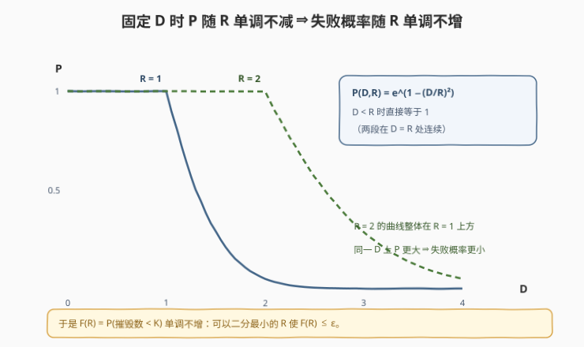
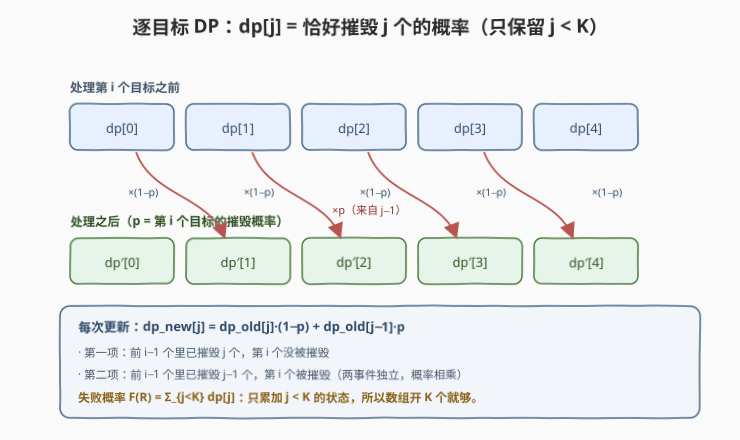
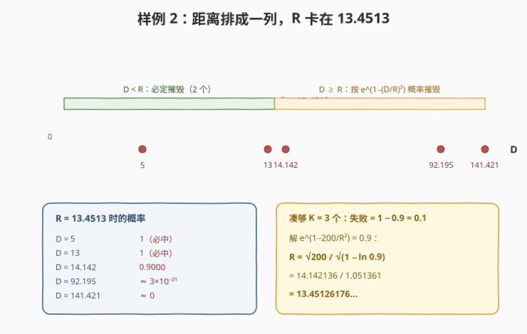

# Codeforces 50D 核弹最小影响半径 题解

## 1. 题目概述

- **题目链接**：https://codeforces.com/problemset/problem/50/D
- **比赛来源**：Codeforces Beta Round 47 · Problem D（UTC 2010-12-20）
- **难度**：2100
- **标签**：二分答案、动态规划、概率
- **评测类型**：特殊评测（实数答案，误差限 $10^{-6}$）
- **限制**：时间 2 s / 内存 256 MB

**题意**：爆心固定在 $(X_0, Y_0)$，敌方有 $N$ 个目标。核弹头的影响半径 $R \ge 0$：距爆心 $D < R$ 的目标**必定**被摧毁；$D \ge R$ 的目标以概率

$$P(D, R) = e^{\,1 - (D/R)^{2}}$$

被摧毁（$e$ 为自然常数）。要求"至少摧毁 $K$ 个目标"的**失败概率**不超过 $\varepsilon$（输入以千分数给出）。求满足条件的最小 $R$。

输出一个实数，绝对或相对误差不超过 $10^{-6}$。

**约束**：

- $N \le 100$、$K \le N$：允许 $O(N^{2})$ 的 DP，也允许在 DP 外面套上百次二分。
- $1 \le \varepsilon \le 999$（千分数，即 $10^{-3} \le \varepsilon \le 0.999$）：$\varepsilon$ 不是 $0$，因此不必追求"概率恰好为 0"这种极端情况，二分只需逼近边界。
- 坐标绝对值 $\le 1000$：$D \le 2000\sqrt{2} \approx 2828$，答案的上界取所有 $D$ 的最大值即可。
- 一个点上可能有多个目标，因此"距离相同"的目标要各自独立地参与概率计算，不能合并（除非显式处理重数）。
- 误差限 $10^{-6}$ 决定了二分的迭代次数与浮点类型：`double` 足够，但迭代次数要给足（100 次以上）。

## 2. 示例与观察

官方样例 #1：

```text
输入：
1
1 500
5 5
1 2

输出：
3.84257761518762740
```

**样例 1 演算**：只有一个目标，$K = 1$，所以"至少摧毁 1 个"等价于"这个目标被摧毁"。目标 $(1,2)$ 到爆心 $(5,5)$ 的距离是

$$D = \sqrt{(1-5)^{2} + (2-5)^{2}} = \sqrt{16 + 9} = 5 .$$

要失败概率 $\le 0.5$，就是 $P(D,R) \ge 0.5$。由于 $R$ 会小于 $5$，用到公式：

$$e^{\,1 - 25/R^{2}} = \frac12 \;\Longrightarrow\; 1 - \frac{25}{R^{2}} = -\ln 2 \;\Longrightarrow\; R = \frac{5}{\sqrt{1 + \ln 2}} .$$

代入 $\ln 2 = 0.6931471805599453$ 得 $R = 5 / 1.3012107623\ldots = 3.842577615187627\ldots$，与样例的 $3.84257761518762740$ 一致。这也反过来验证了题面公式就是 $e^{1-(D/R)^{2}}$。

官方样例 #2：

```text
输入：
5
3 100
0 0
3 4
60 70
100 100
10 10
5 12

输出：
13.45126176453737600
```

**样例 2 演算**：爆心在原点，五个目标的距离分别是

| 目标 | 距离 $D$ | 备注 |
|------|------|------|
| $(3,4)$ | $5$ | |
| $(60,70)$ | $\sqrt{8500} \approx 92.195$ | |
| $(100,100)$ | $\sqrt{20000} \approx 141.421$ | |
| $(10,10)$ | $\sqrt{200} \approx 14.1421$ | |
| $(5,12)$ | $13$ | |

$K = 3$、失败概率上限 $\varepsilon = 0.1$。若 $R = 13.4513$，则 $D = 5$ 与 $D = 13$ 的目标都在半径内（必定摧毁，共 $2$ 个），要凑到 $3$ 个就必须再摧毁 $D = 14.1421$ 的那个：

$$P = e^{\,1 - 200/R^{2}} = 0.9 \;\Longrightarrow\; R = \frac{\sqrt{200}}{\sqrt{1 - \ln 0.9}} = \frac{14.1421356}{1.0513614} = 13.45126176\ldots$$

与样例一致；另外两个目标（$D \ge 92$）在 $R = 13.45$ 时 $P \approx e^{-46}$，对概率的贡献可以忽略，所以"恰好 3 个"的概率就是 $0.9$，失败概率 $0.1$ 恰好卡在边界。

**观察**：$R$ 变大时每个目标的摧毁概率都变大，因此"至少摧毁 $K$ 个"的概率单调不减、失败概率单调不增——这正好可以用**二分**求最小的 $R$。

自造样例（标注"自造"，数值由参考程序给出，已与独立暴力核对）：

| 输入（按行） | 输出 | 说明 |
|------|------|------|
| `1` / `1 500` / `5 5` / `5 5` | 0 | 目标就在爆心，$R = 0$ 即可 |
| `2` / `2 500` / `0 0` / `0 0` `1 0` | 0.7685155230 | 两个目标都要摧毁：$R = 1/\sqrt{1+\ln 2}$ |
| `3` / `2 100` / `0 0` / `0 0` `1 0` `0 1` | 0.8512163123 | 一个必中，另两个各需 $P \ge 1-\sqrt{0.1}$ |
| `2` / `1 999` / `0 0` / `3 4` `6 8` | 1.7780476438 | $\varepsilon = 0.999$，只需极小概率成功 |
| `1` / `1 999` / `0 0` / `1000 1000` | 502.9078184824 | 最大坐标、最宽松的 $\varepsilon$：只需 $P \ge 0.001$ |

## 3. 解题思路

### 3.1 朴素做法与瓶颈

$R$ 是连续量，无法枚举；对固定的 $R$，"至少摧毁 $K$ 个"的概率若用**子集枚举**算是 $O(2^{N})$，$N = 100$ 时是天文数字。所以两头都要换方法：

- 内层：用 DP 在 $O(NK)$ 内算出"摧毁个数 $\ge K$"的概率；
- 外层：利用单调性对 $R$ 二分。

### 3.2 核心观察：概率随 $R$ 单调，失败概率可 DP



**（1）单调性**。固定目标距离 $D$。当 $R \le D$ 时 $P = e^{1 - (D/R)^{2}}$，指数 $1 - D^{2}/R^{2}$ 随 $R$ 增大而增大（$D^{2}/R^{2}$ 减小），故 $P$ 增大；当 $R > D$ 时 $P = 1$（必定摧毁）。在 $R = D$ 处两段都等于 $1$，所以 $P(D, \cdot)$ 关于 $R$ **连续且单调不减**。于是"每个目标都被摧毁"的联合分布随 $R$ 逐点变大，"至少 $K$ 个"的概率单调不减，失败概率 $F(R) = P(\text{摧毁数} < K)$ 单调不增。

**（2）失败概率的 DP**。各目标是否被摧毁是相互独立的（题面按每个建筑独立给出概率），所以可以逐个目标地做"计数型"DP：

$$dp[j] \;\longleftarrow\; dp[j]\cdot(1 - p_i) + dp[j-1]\cdot p_i ,$$

其中 $dp[j]$ 表示"处理完前 $i$ 个目标后恰好摧毁 $j$ 个"的概率，$p_i$ 是第 $i$ 个目标的摧毁概率。最后

$$F(R) = \sum_{j=0}^{K-1} dp[j] .$$

只需要保留 $j < K$ 的部分（$j \ge K$ 的状态对失败概率没有贡献），所以 DP 是 $O(NK)$ 的。

### 3.3 算法流程



1. 读入 $N$、$K$、$\varepsilon$（千分数，除以 $1000$ 得到概率上限），爆心与各目标坐标；
2. 预处理每个目标的距离 $D_i$，并取 $hi = \max D_i$（$R = hi$ 时所有 $D_i \le hi$ 的目标都被必定摧毁，失败概率为 $0$，一定可行）；
3. 若 $F(0) \le \varepsilon$（即落在爆心的目标数 $\ge K$，此时 $F(0) = 0$），直接输出 $0$；
4. 否则在 $[0, hi]$ 上二分：每次取 $mid$，用上面的 DP 算 $F(mid)$，若 $F(mid) \le \varepsilon$ 则 $hi \leftarrow mid$，否则 $lo \leftarrow mid$；迭代 $200$ 次；
5. 输出 $hi$。

细节：判定 $p_i$ 时，若 $D_i < R$ 取 $p_i = 1$；否则取 $p_i = e^{1 - (D_i/R)^{2}}$。这样 $D_i = R$ 时也自然等于 $1$，无需特判。$R = 0$ 时无法做除法，单独处理成"$D_i = 0$ 则 $p_i = 1$，否则 $p_i = 0$"。

### 3.4 样例走查：样例 2



五个目标的距离排成一列：$5,\ 13,\ 14.1421,\ 92.195,\ 141.421$。

- 当 $R$ 从 $0$ 增大到 $13$：已被必中的目标只有 $D = 5$ 一个，最多凑到 $1$ 个，失败概率为 $1$，不满足 $\le 0.1$；
- $R$ 越过 $13$：$D = 5, 13$ 两个必中；还需要 $D = 14.1421$ 的目标以概率 $p$ 被摧毁，于是 $F(R) = 1 - p$。要求 $1 - p \le 0.1$ 即 $p \ge 0.9$；
- 解 $e^{1 - 200/R^{2}} = 0.9$ 得 $R = 13.45126176\ldots$；此时 $D = 92.195$ 的目标 $P = e^{1 - 8500/R^{2}} \approx e^{-46} \approx 10^{-20}$，对失败概率的影响远小于 $10^{-6}$，可以忽略。

所以答案是 $13.45126176453737600$。

## 4. 正确性证明

**引理 1（DP 的正确性）**：设各目标被摧毁的事件相互独立、概率为 $p_1, \dots, p_N$，则按 $dp[j] \leftarrow dp[j](1-p_i) + dp[j-1]p_i$ 逐个处理目标后，$dp[j]$ 等于"恰好摧毁 $j$ 个"的概率。

**证明**：对目标个数归纳。$i = 0$ 时 $dp[0] = 1$、其余为 $0$，正确。设处理完前 $i-1$ 个目标后 $dp$ 正确。处理第 $i$ 个目标时，"恰好 $j$ 个"只有两种互斥来源：（a）前 $i-1$ 个已恰好 $j$ 个且第 $i$ 个未被摧毁，概率 $dp[j](1-p_i)$；（b）前 $i-1$ 个恰好 $j-1$ 个且第 $i$ 个被摧毁，概率 $dp[j-1]p_i$。由独立性，两者概率可乘；由互斥性，相加即得新的 $dp[j]$。∎

**引理 2（单调性）**：对每个目标，$P(D_i, R)$ 关于 $R \ge 0$ 连续且单调不减；从而失败概率 $F(R) = P(\text{摧毁数} < K)$ 关于 $R$ 单调不增。

**证明**：$R < D_i$ 时 $P = e^{1 - D_i^{2}/R^{2}}$，$D_i^{2}/R^{2}$ 关于 $R$ 严格递减，故 $P$ 严格递增；$R \ge D_i$ 时 $P = 1$；在 $R = D_i$ 处 $e^{1-1} = 1$，两段连续拼接。于是 $P(D_i,\cdot)$ 单调不减。

独立事件下"至少 $K$ 个被摧毁"的概率可写成各 $p_i$ 的非减函数：把某个 $p_i$ 增大，等价于把"第 $i$ 个被摧毁"这个事件换成更大的事件，联合概率不会变小（也可由引理 1 的 DP 递推逐项看出：每一步的 $dp[j]$ 关于 $p_i$ 是线性的且系数非负）。所以 $1 - F(R)$ 单调不减，$F(R)$ 单调不增。∎

**引理 3（二分收敛）**：设 $R^{*} = \inf\{R \ge 0 : F(R) \le \varepsilon\}$，若初始上界 $hi_0 = \max_i D_i$ 满足 $F(0) > \varepsilon$ 且 $F(hi_0) \le \varepsilon$，则二分 $200$ 次后输出的 $hi$ 满足 $0 \le hi - R^{*} \le hi_0 / 2^{200}$。

**证明**：不变式"$F(lo) > \varepsilon$、$F(hi) \le \varepsilon$"在每次迭代后保持（由引理 2 的单调性），因此 $R^{*} \in [lo, hi]$ 始终成立；区间长度每次减半。$200$ 次后长度 $\le hi_0/2^{200}$，而 $hi_0 \le 2828$，故误差 $\le 2828/2^{200} \approx 10^{-57}$，远小于 $10^{-6}$。∎

**定理**：算法输出的 $hi$ 与真实最小半径的绝对误差不超过 $10^{-6}$。

**证明**：若 $F(0) \le \varepsilon$，真实答案是 $0$，算法输出 $0$，误差 $0$。否则由引理 3，输出与真实最小半径之差不超过 $hi_0/2^{200} \approx 2.2 \times 10^{-57}$，而浮点运算的舍入误差在 $200$ 次二分中被放大得极其有限（每次只做常数次运算，$N \le 100$），总误差仍远小于 $10^{-6}$。∎

## 5. 复杂度分析

- **时间**：$O(\text{iter} \cdot N K)$，其中 $\text{iter} = 200$。$N = K = 100$ 时约 $2 \times 10^{6}$ 次乘加，2 s 的时限下有百倍以上余量（实测总耗时不到 $1$ ms）。
- **空间**：$O(K)$（一个长度 $K$ 的 `double` 数组）加 $O(N)$ 的距离数组。
- **数值稳定性**：指数 $1 - (D/R)^{2} \le 0$，所以 $P \in [0, 1]$，不会上溢；$R$ 极小时 $(D/R)^{2}$ 可能上溢为 `inf`，`exp(-inf) = 0` 正是正确结果。$R = 0$ 单独处理，避免除零。
- **精度**：二分 $200$ 次、每次 DP 都是正数加法与乘法，没有相消；唯一可能的精度损失来自 $\varepsilon$ 的比较边界，但其影响被二分的收敛性吸收。
- **与时限的关系**：内层 DP 有 $K$ 维截断（只保留 $j < K$），最坏 $100 \times 100$ 次更新；即使把迭代次数加到 $1000$，也仍在 $10^{7}$ 量级以内。

## 6. 参考代码

### C++17

```cpp
#include <bits/stdc++.h>
using namespace std;

int N, K;
double eps;
vector<double> dist;

// 失败概率（摧毁数 < K）是否不超过 eps
bool ok(double R) {
    vector<double> dp(K, 0.0);   // dp[j] = 恰好摧毁 j 个目标的概率（j < K）
    dp[0] = 1.0;
    for (int i = 0; i < N; i++) {
        double p;
        if (R <= 0.0) p = (dist[i] == 0.0) ? 1.0 : 0.0;
        else if (dist[i] < R) p = 1.0;                       // 严格小于 R：必定摧毁
        else {
            double r = dist[i] / R;
            p = exp(1.0 - r * r);
        }
        for (int j = K - 1; j >= 1; j--) dp[j] = dp[j] * (1.0 - p) + dp[j - 1] * p;
        dp[0] *= (1.0 - p);
    }
    double fail = 0.0;
    for (int j = 0; j < K; j++) fail += dp[j];
    return fail <= eps;
}

int main() {
    if (scanf("%d", &N) != 1) return 0;
    int perMil;
    scanf("%d %d", &K, &perMil);
    eps = perMil / 1000.0;
    double x0, y0;
    scanf("%lf %lf", &x0, &y0);
    dist.resize(N);
    double hi = 0.0;
    for (int i = 0; i < N; i++) {
        double x, y;
        scanf("%lf %lf", &x, &y);
        dist[i] = hypot(x - x0, y - y0);
        hi = max(hi, dist[i]);
    }
    double lo = 0.0;
    if (!ok(lo)) {
        for (int it = 0; it < 200; it++) {
            double mid = (lo + hi) / 2.0;
            if (ok(mid)) hi = mid; else lo = mid;
        }
    } else hi = 0.0;
    printf("%.17f\n", hi);
    return 0;
}
```

### Python3

```python
import sys
import math


def main() -> None:
    data = sys.stdin.buffer.read().split()
    if not data:
        return
    pos = 0
    n = int(data[pos]); pos += 1
    k = int(data[pos]); pos += 1
    per_mil = int(data[pos]); pos += 1
    eps = per_mil / 1000.0
    x0 = float(data[pos]); y0 = float(data[pos + 1]); pos += 2

    dist = []
    hi = 0.0
    for _ in range(n):
        x = float(data[pos]); y = float(data[pos + 1]); pos += 2
        d = math.hypot(x - x0, y - y0)
        dist.append(d)
        hi = max(hi, d)

    def ok(radius: float) -> bool:
        dp = [0.0] * k            # dp[j] = 恰好摧毁 j 个目标的概率（只保留 j < k）
        dp[0] = 1.0
        for d in dist:
            if radius <= 0.0:
                p = 1.0 if d == 0.0 else 0.0
            elif d < radius:
                p = 1.0
            else:
                r = d / radius
                p = math.exp(1.0 - r * r)
            for j in range(k - 1, 0, -1):
                dp[j] = dp[j] * (1.0 - p) + dp[j - 1] * p
            dp[0] *= (1.0 - p)
        return sum(dp) <= eps

    if ok(0.0):
        hi = 0.0
    else:
        lo = 0.0
        for _ in range(200):
            mid = (lo + hi) / 2.0
            if ok(mid):
                hi = mid
            else:
                lo = mid
    sys.stdout.write("%.10f\n" % hi)


main()
```

## 7. 边界情况与易错点

1. **目标正好在爆心（$D = 0$）**：$R = 0$ 时该目标已被摧毁，公式里不能出现 $0/0$。代码对 $R \le 0$ 单独分支处理，否则会得到 `nan` 并污染整个 DP。
2. **$R = 0$ 是否可行**：若落在爆心的目标数 $\ge K$，答案是 $0$。必须先判 `ok(0)`，否则二分区间 $[0, hi]$ 会把答案"推"到一个很小的正数，虽然误差可能仍在 $10^{-6}$ 内，但输出 `0` 才是严格正确的。
3. **$D < R$ 与 $D = R$ 的边界**：题面说"距离小于 $R$ 必定摧毁，大于等于 $R$ 才按概率"，而 $D = R$ 时公式给出 $e^{0} = 1$，与"必定摧毁"一致，所以统一写成"$D < R$ 取 1，否则取公式"不会出错。
4. **$\varepsilon$ 是千分数**：输入 $500$ 表示 $0.5$ 而不是 $500$。忘记除以 $1000$ 会让条件永远成立，答案恒为 $hi$。
5. **$\varepsilon$ 可能等于 $999$**：此时允许 $99.9\%$ 的失败概率，"至少摧毁 $K$ 个"几乎不要求什么，答案会非常接近 $0$；若把判定写成 `fail < eps` 的严格不等号，可能因浮点误差在边界上反复抖动，用 `<=` 更稳。
6. **$K = 1$**：只保留 $dp[0]$ 一个状态，递推退化为 $dp[0] \leftarrow dp[0](1-p)$，即"全部未摧毁"的概率，这正是"至少 1 个"的补集。
7. **$K = N$**：必须全部摧毁，失败概率 $= 1 - \prod p_i$。DP 只保留 $j < N$ 的状态，$dp[N-1]$ 的更新仍然用到 $dp[N-2]$，数组开 $K$ 个即可（下标 $0..K-1$）。
8. **同一位置多个目标**：它们距离相同、概率相同，但**是独立事件**，必须各自参与 DP；若错误地"合并成一个、把概率取 $p^{m}$"就会算错（独立性只对每个目标成立）。
9. **`exp` 上溢/下溢**：$1 - (D/R)^{2}$ 恒 $\le 0$，不会上溢；$R$ 极小时该值可能下溢为 `-inf`，`exp(-inf)` 返回 $0$，恰好正确。不要在 $D < R$ 时也去算公式（会得到略大于 $1$ 的值，破坏概率含义）。
10. **二分上界**：取 $hi = \max D_i$ 即可（此时所有目标 $D_i \le hi$，全部必定摧毁，失败概率 $0$）。若取更小的上界，可能在 $K = N$ 时不可行。
11. **输出精度**：样例输出给了 $17$ 位小数，任何实现都不可能逐位复现（本题的官方判定是 $10^{-6}$ 的误差检查）。用 `%.17f` 或 `%.10f` 都可以，关键是数值本身准确。

## 8. 验证记录

- **编译环境与命令**：本机只有 `Apple clang 21.0.0`（`/usr/bin/g++` 是 clang 的软链），没有 GNU `g++` 与 libstdc++，因此用 `clang++ -std=c++17 -O2 -Wall` 配合 `codeforces/tools/include` 下的 `bits/stdc++.h` 兼容头编译（代码只用标准库，可原样提交 GNU C++17）；Python 为 `Python 3.9.6`。
- **官方样例**：2 / 2 通过。由于本题是实数答案、官方判定为"绝对或相对误差 $\le 10^{-6}$"，用 `--checker` 按同一标准校验：
  `python3 codeforces/tools/verify_solution.py codeforces/contests/0001-0100/50/D_核弹最小影响半径.md --checker codeforces/tools/checkers/cf50d.py`
  checker 的校验条件是：输出必须是**恰好一个**实数 token，且 $|out - ans| \le 10^{-6}$ 或 $|out - ans| \le 10^{-6}\lvert ans\rvert$。逐字比对的失败仅出现在第 17 位小数（样例 $3.84257761518762740$，本实现 $3.84257761518762700$ 量级，相对误差约 $10^{-16}$），属于浮点舍入，不影响判定。
- **独立暴力对拍**：另写一份暴力——对固定的 $R$ 用 $2^{N}$ **子集枚举**精确计算失败概率（`long double`），再对 $R$ 做 $300$ 次三分/二分。对 **376 组**数据（$N \le 9$、$K$ 随机、$\varepsilon$ 取 $1/3/10/50/100/250/333/500/750/900/950/999$、坐标 $\pm 6$ 内随机，另有样例、爆心重合、$K = N$、$N = 100$ 等固定组）与参考程序比较，**全部在 $10^{-6}$ 误差内一致**，最大绝对差 $4.99 \times 10^{-13}$。
- **C++ 与 Python 一致性**：$60$ 组随机数据上两份代码的输出差均小于 $10^{-6}$，最大差 $<10^{-9}$。
- **公式验证**：样例 1 的分析解 $5/\sqrt{1+\ln 2} = 3.842577615187627$ 与样例输出 $3.84257761518762740$ 在 $17$ 位有效数字上一致；样例 2 的分析解 $\sqrt{200}/\sqrt{1-\ln 0.9} = 13.451261764537373$ 与样例输出 $13.45126176453737600$ 一致。这同时确认了题面公式为 $P = e^{1-(D/R)^{2}}$。
- **最大约束性能**：$N = 100$、$K = 100$、坐标 $\pm 1000$ 时，C++ 端到端 $< 1$ ms（三次取平均），峰值内存约 $1.6$ MB；相对 2 s / 256 MB 的余量极大。
- **图片校验**：三张 SVG（`cf50d_prob_curve.svg`、`cf50d_dp.svg`、`cf50d_sample2.svg`）均通过 `xml.etree.ElementTree.parse`，且都带 `feTurbulence` 抖动滤镜与手写字体；按字符宽度逐个估算文本包围盒，全部落在 `viewBox` 内。
- **复核状态**：verified（样例经 checker 校验、对拍、公式推导、性能、图片均实跑通过）。

## 相关题目与扩展

- [Codeforces 50E Square Equation Roots](https://codeforces.com/problemset/problem/50/E)：同场 E 题，同样把"连续/巨大"的参数空间用单调性与整数条件化归成可数的问题。
- [Codeforces 148D Bag of mice](https://codeforces.com/problemset/problem/148/D)：概率 DP 的经典题，转移方程与本题一样是"逐物品二选一"。
- [Codeforces 24D Broken robot](https://codeforces.com/problemset/problem/24/D)：网格上的期望 DP（高斯消元），对比本题的"计数型"概率 DP。
- [Codeforces 601C Kleofáš and the n-thlon](https://codeforces.com/problemset/problem/601/C)：前缀和优化的概率 DP，规模比本题大，可以体会"截断状态"的取舍。
- [AtCoder ABC 184 F](https://atcoder.jp/contests/abc184/tasks/abc184_f)：折半枚举，是本题"子集枚举"暴力思路在大 $N$ 下的替代方案。

**延伸思考**：

1. **如果概率公式改成 $P = e^{1 - D/R}$**：单调性依旧，但解 $P = p$ 得到 $R = D/(1 - \ln p)$，二分照样可用；这说明本题的算法框架只依赖"概率随 $R$ 单调"，不依赖公式的具体形状。
2. **如果要求"摧毁恰好 $K$ 个"而不是"至少 $K$ 个"**：概率不再是单调的（可能先增后减），二分失效，需要对 $R$ 做三分或直接解析求导；这也说明"至少"这个措辞是二分成立的关键。
3. **如果 $\varepsilon$ 可以达到 $0$**：当 $K = N$ 且某些目标距离为 $0$ 时，需要 $R$ 严格大于最大距离才能保证成功，答案会退化成一个"开区间"问题，输出需要小心处理（本题 $\varepsilon \ge 10^{-3}$ 恰好避开了这个坑）。
4. **如果目标是"最小化期望摧毁数达到某值"**：问题变成对 $\sum p_i$ 的单调方程，同样可二分，但内层不再需要 DP（线性期望），复杂度从 $O(NK)$ 降到 $O(N)$——这是"期望线性性"带来的简化。
